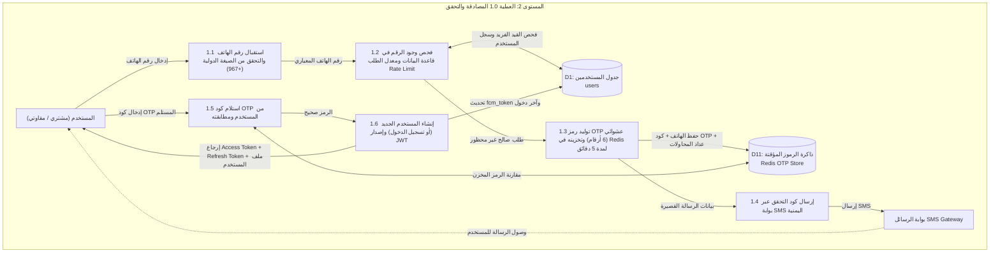
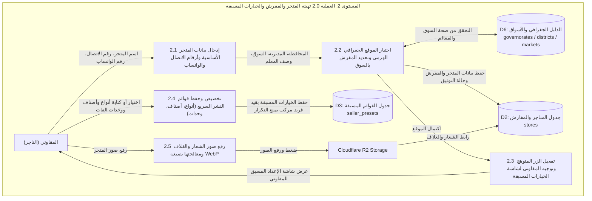
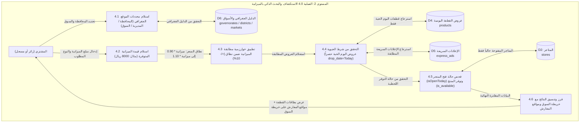
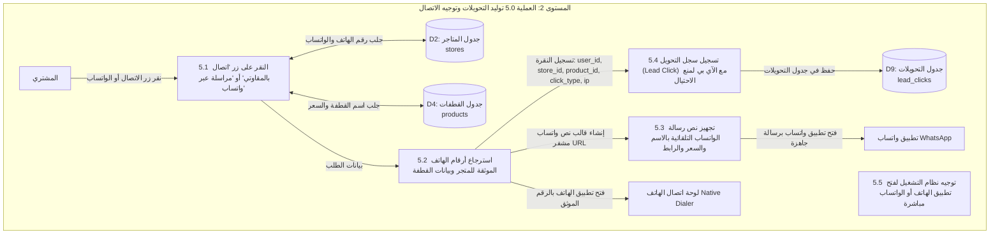

# مخططات تدفق البيانات للعمليات (Data Flow Diagrams - DFD) | منصة قطفة

---

## 1. مقدمة ومنهجية النمذجة (Introduction & Methodology)

تُعد وثيقة **مخططات تدفق البيانات (Data Flow Diagrams - DFD)** المرجع الهندسي الرئيسي لفهم حركة البيانات، وتحولاتها، ومساراتها بين المستخدمين، والأنظمة الخارجية، وقواعد البيانات داخل منصة **قطفة (Qatfa)**.

تعتمد النمذجة على منهجية **Gane & Sarson / Yourdon** المتوافقة مع معايير هندسة البرمجيات، وتتدرج عبر ثلاثة مستويات:
1. **المستوى 0 (Context Diagram):** يحدد حدود النظام (System Boundary) وعلاقته بالكيانات الخارجية (External Entities).
2. **المستوى 1 (Platform Overview DFD):** يفكك النظام إلى 8 عمليات رئيسية تمثل الوحدات الوظيفية الكبرى للمنصة مع مستودعات البيانات (Data Stores).
3. **المستوى 2 (Detailed Process Decomposition):** يحلل العمليات الحيوية المعقدة (المصادقة، النشر الخاطف، البحث بالميزانية، تتبع التحويلات، والرقابة ومنع الاحتيال) إلى خطواتها الفرعية الدقيقة وقواعد العمل (Business Rules) المنظمة لها.

---

## 2. عناصر ومصطلحات المخططات (Notation & Legend)

- **الكيانات الخارجية (External Entities) `[Square]`:** أطراف فاعلة خارج نطاق خادم النظام (المشتري، المقاوتي، المشرف، بوابات الاتصال، التخزين السحابي).
- **العمليات الإجرائية (Processes) `((Circle / Rounded))`:** وحدات منطقية لمعالجة وتدقيق وتحويل البيانات.
- **مستودعات البيانات (Data Stores) `[(Cylinder)]`:** جداول قاعدة بيانات PostgreSQL وذاكرة Redis المؤقتة التي تستقر فيها البيانات.
- **تدفقات البيانات (Data Flows) `-->|Label|`:** أسهم موجهة توضح البيانات المنقولة واتجاه حركتها.

---

## 3. مخطط تدفق البيانات - المستوى 0: مخطط السياق العام (DFD Level 0 - Context Diagram)

يوضح هذا المخطط منصة "قطفة" ككيان معالج مركزي يرتبط بكافة الأطراف الفاعلة والخدمات الخارجية الداعمة دون الدخول في التفاصيل الداخلية.

```mermaid
graph TD
    %% Entities
    Buyer["المشتري / الزبون<br/>(Customer / Buyer)"]
    Seller["المقاوتي / التاجر<br/>(Maqwati / Merchant)"]
    Admin["إدارة المنصة والمشرفون<br/>(Admin & Moderators)"]
    SMS["بوابة الرسائل النصية<br/>(Yemen SMS / OTP Gateway)"]
    FCM["خدمة الإشعارات السحابية<br/>(Firebase Cloud Messaging)"]
    R2["التخزين السحابي للوسائط<br/>(Cloudflare R2 Object Storage)"]
    ExtComm["تطبيقات المراسلة والاتصال<br/>(WhatsApp & Native Dialer)"]

    %% Central System
    QatfaSystem["(( نظام منصة قطفة المركزي<br/>Qatfa Platform Core Engine ))"]

    %% Flows for Buyer
    Buyer -->|1. طلب رمز OTP + التحقق برقم الهاتف| QatfaSystem
    Buyer -->|2. استعلام البحث، الميزانية، السوق والموقع| QatfaSystem
    Buyer -->|3. طلب الاتصال أو محادثة واتساب للمقاوتي| QatfaSystem
    Buyer -->|4. تقييم المتجر الشهري + إبداء الرأي| QatfaSystem
    Buyer -->|5. تقديم بلاغ عن عرض مضلل| QatfaSystem
    Buyer -->|6. متابعة متجر مقاوتي مفضل| QatfaSystem

    QatfaSystem -->|أ. عروض القطفة الحية + بطاقات الأسعار| Buyer
    QatfaSystem -->|ب. خريطة الأسواق والمفارش وحالة التوفر| Buyer
    QatfaSystem -->|ج. رابط محادثة واتساب مجهز بالبيانات| Buyer
    QatfaSystem -->|د. إشعارات فورية بقطفات المتاجر المتابعة| Buyer

    %% Flows for Seller
    Seller -->|1. طلب توثيق رقم الهاتف + التسجيل| QatfaSystem
    Seller -->|2. إحداثيات المفرش بالسوق + وصف المعلم| QatfaSystem
    Seller -->|3. إعداد القوائم المسبقة للأنواع والأصناف| QatfaSystem
    Seller -->|4. بيانات القطفة السريعة + الصور المضغوطة| QatfaSystem
    Seller -->|5. نشر الإعلان السريع اليومي الواحد| QatfaSystem
    Seller -->|6. تبديل حالة التوفر المزدوجة المتجر / المنتج| QatfaSystem
    Seller -->|7. الرد الرسمي على تقييم العميل| QatfaSystem
    Seller -->|8. ضبط خيار كتم إشعارات التقييمات| QatfaSystem

    QatfaSystem -->|أ. إحصائيات نقرات الاتصال والزبائن الجدد| Seller
    QatfaSystem -->|ب. إشعار تفاعلي بنفاذ الكمية وتأكيد الإخفاء| Seller
    QatfaSystem -->|ج. شارات التوثيق والاعتماد للمتجر| Seller
    QatfaSystem -->|د. بطاقات التسويق المصورة والروابط العميقة| Seller

    %% Flows for Admin
    Admin -->|1. فحص طلبات توثيق المتاجر والاعتماد| QatfaSystem
    Admin -->|2. فحص طابور البلاغات والقرارات اليدوية| QatfaSystem
    Admin -->|3. إدارة وتحديث الدليل الجغرافي والأسواق| QatfaSystem
    Admin -->|4. إرسال إشعارات جماعية وبث إداري| QatfaSystem

    QatfaSystem -->|أ. لوحة المؤشرات الحية وساعات الذروة| Admin
    QatfaSystem -->|ب. تنبيهات البلاغات العاجلة وسجل التدقيق| Admin

    %% External Services Flows
    QatfaSystem -->|إرسال رسالة كود OTP المكون من 6 أرقام| SMS
    SMS -.->|تسليم الرسالة القصيرة لهاتف المستخدم| Buyer
    SMS -.->|تسليم الرسالة القصيرة لهاتف المقاوتي| Seller

    QatfaSystem -->|رفع صور القات والشعارات المضغوطة WebP| R2
    R2 -->|روابط CDN فائقة السرعة للصور| QatfaSystem

    QatfaSystem -->|أمر إرسال إشعار لحظي Push Payload| FCM
    FCM -.->|تسليم الإشعار اللحظي لتطبيق الهاتف| Buyer
    FCM -.->|تسليم الإشعار اللحظي لتطبيق المقاوتي| Seller

    QatfaSystem -->|توجيه المشتري لرابط واتساب أو طلب الاتصال| ExtComm
```



---

## 4. مخطط تدفق البيانات - المستوى 1: النظرة الشاملة للمنصة (DFD Level 1 - Platform Decomposition)

يقوم المستوى الأول بتفكيك النظام إلى **8 عمليات رئيسية** وربطها مع **مستودعات البيانات (Data Stores)** الخاصة بكل عملية.

```mermaid
graph TB
    %% External Entities
    User["المستخدم<br/>(زائر / مشتري / مقاوتي)"]
    AdminUser["فريق الإدارة والمشرفون<br/>(Admin / Moderator)"]
    SMSNode["بوابة SMS / OTP"]
    FCMNode["خدمة FCM الإشعارات"]
    R2Node["تخزين الوسائط Cloudflare R2"]
    ExtApps["تطبيقات الهاتف والواتساب"]

    %% Data Stores
    D1[("D1: جدول المستخدمين<br/>users")]
    D2[("D2: جدول المتاجر والمفارش<br/>stores")]
    D3[("D3: جدول القوائم المسبقة<br/>seller_presets")]
    D4[("D4: جدول عروض القطفة<br/>products")]
    D5[("D5: جدول الإعلانات السريعة<br/>express_ads")]
    D6[("D6: الدليل الجغرافي والأسواق<br/>governorates / districts / markets")]
    D7[("D7: جدول التقييمات والمراجعات<br/>reviews")]
    D8[("D8: جدول المتابعات والمفضلة<br/>store_followers / favorites")]
    D9[("D9: جدول تتبع التحويلات والاتصالات<br/>lead_clicks")]
    D10[("D10: جدول البلاغات والرقابة<br/>reports")]
    D11[("D11: ذاكرة التخزين المؤقت<br/>Redis Cache")]

    %% Processes
    subgraph PlatformProcesses ["عمليات منصة قطفة الأساسية"]
        P1["1.0 إدارة الهوية والمصادقة<br/>(Auth & Verification)"]
        P2["2.0 إدارة المتجر والمفرش والخيارات المسبقة<br/>(Store & Presets Setup)"]
        P3["3.0 النشر الخاطف للقطفة وإدارة التوفر<br/>(Drop Publishing & Availability)"]
        P4["4.0 محرك الاستكشاف والبحث بالميزانية<br/>(Discovery & Budget Search)"]
        P5["5.0 توليد الطلبات وتوجيه الاتصال والواتساب<br/>(Leads & WhatsApp Routing)"]
        P6["6.0 التفاعل المجتمعي والتقييمات والمتابعة<br/>(Social, Reviews & Follow)"]
        P7["7.0 الرقابة، مكافحة الإساءة وفحص البلاغات<br/>(Moderation & Anti-Abuse)"]
        P8["8.0 محرك الإشعارات والتنبيهات الحية<br/>(Notification Engine)"]
    end

    %% Flows for P1
    User -->|رقم الهاتف + كود OTP| P1
    P1 -->|طلب إرسال OTP| SMSNode
    P1 <-->|التحقق من فرادة الهاتف واسترجاع المستخدم| D1
    P1 -->|إصدار Access Token + Refresh Token| User

    %% Flows for P2
    User -->|بيانات المتجر + إحداثيات المفرش| P2
    User -->|تحديد الأنواع والأصناف والوحدات المسبقة| P2
    P2 <-->|الربط الجغرافي والتحقق من السوق| D6
    P2 -->|حفظ وتحديث بيانات المتجر والمفرش| D2
    P2 -->|حفظ خيارات النشر المسبقة| D3
    P2 -->|رفع صور المتجر والغلاف| R2Node

    %% Flows for P3
    User -->|بيانات القطفة + السعر والكمية| P3
    User -->|رفع الصور المباشرة للقات| P3
    User -->|نشر الإعلان السريع اليومي الواحد| P3
    User -->|تبديل حالة التوفر المزدوجة المتجر / المنتج| P3
    P3 -->|رفع صور WebP المضغوطة| R2Node
    P3 -->|قراءة الخيارات المسبقة للمقاوتي| D3
    P3 -->|تسجيل القطفة اليومية مع تاريخ drop_date| D4
    P3 -->|تسجيل الإعلان السريع مع فحص قيد اليوم الواحد| D5
    P3 -->|تحديث حالة المتجر isOpenToday| D2
    P3 -->|تحديث ذاكرة العروض النشطة| D11
    P3 -->|إطلاق حدث قطفة جديدة أو نفاذ الكمية| P8

    %% Flows for P4
    User -->|الموقع الجغرافي + مبلغ الميزانية المتوفر| P4
    P4 <-->|استعلام الدليل الجغرافي والأسواق| D6
    P4 <-->|استعلام المتاجر المفتوحة ومواقع المفارش| D2
    P4 <-->|استعلام القطفات النشطة المطابقة للسعر +/- 10%| D4
    P4 <-->|استعلام الإعلانات السريعة لليوم| D5
    P4 -->|عرض نتائج البحث والفلترة وخريطة السوق| User

    %% Flows for P5
    User -->|النقر على اتصال هاتفي أو واتساب| P5
    P5 <-->|استرجاع أرقام الهاتف الموثقة للمتجر| D2
    P5 <-->|استرجاع تفاصيل القطفة للرسالة المجهزة| D4
    P5 -->|تسجيل حدث النقر والآي بي ونوع الاتصال| D9
    P5 -->|توجيه التطبيق للاتصال أو فتح واتساب مجهز| ExtApps

    %% Flows for P6
    User -->|تقييم المتجر 1-5 نجوم + تعليق| P6
    User -->|متابعة المتجر أو حفظ بالمفضلة| P6
    P6 <-->|فحص قيد منع التقييم أكثر من مرة شهرياً| D7
    P6 -->|تسجيل المراجعة وتحديث متوسط تقييم المتجر| D2
    P6 -->|تسجيل المتابعة أو المفضلة| D8

    %% Flows for P7
    User -->|إرسال بلاغ عن عرض مضلل أو متجر| P7
    AdminUser -->|مراجعة طابور البلاغات والتحقيق الهاتفي| P7
    AdminUser -->|قرار يدوي: تجميد متجر / حظر مستخدم / اعتماد| P7
    P7 <-->|فحص قيد منع تكرار البلاغ من نفس المستخدم| D10
    P7 -->|تسجيل البلاغ بحالة PENDING| D10
    P7 -->|تنفيذ القرار اليدوي على المتجر| D2
    P7 -->|تنفيذ القرار اليدوي على المستخدم| D1

    %% Flows for P8
    P8 <-->|استرجاع متابعي المتجر| D8
    P8 <-->|استرجاع رموز الأجهزة FCM Tokens| D1
    P8 -->|إرسال أمر البث لإشعارات القطفة ونفاذ البضاعة| FCMNode
```



---

## 5. مخططات تدفق البيانات - المستوى 2: تفكيك العمليات الحيوية (DFD Level 2)

### 5.1 تفكيك العملية 1.0: تدفق المصادقة، التحقق برقم الهاتف، ومنع التكرار (Auth & OTP Verification)

تطبق هذه العملية قاعدة عمل حرجة: **قيد فرادة رقم الهاتف الصارم (Unique Phone Constraint)**، حيث لا يُسمح بتكرار رقم الهاتف نهائياً في سجلات المستخدمين.



---

### 5.2 تفكيك العملية 2.0: إدارة المتجر والمفرش والخيارات المسبقة (Store & Presets Setup)

تمكّن هذه العملية المقاوتي من تثبيت مفرشه على خريطة السوق الشعبي ثم الانتقال التلقائي عبر **الزر المتوهج (Glowing Button)** لإعداد الخيارات المسبقة (أنواع القات، الأصناف، والوحدات) لضمان النشر في أقل من 30 ثانية لاحقاً.



---

### 5.3 تفكيك العملية 3.0: النشر الخاطف للقطفة وإدارة التوفر والإخفاء التلقائي (Drop Publishing & Stock Management)

تجسد هذه العملية الفلسفة الجوهرية لمنصة قطفة: النشر في 30 ثانية بدون كتابة، والتحكم المزدوج في التوفر، والإخفاء التلقائي عند نفاذ الكمية مع إشعار المقاوتي.

```mermaid
graph TD
    subgraph P3_Subsystem ["المستوى 2: العملية 3.0 نشر القطفة وإدارة المخزون والإعلان السريع"]
        Seller["المقاوتي"]

        P3_1["3.1 استدعاء الخيارات المسبقة للمقاوتي لتعبئة الواجهة السريعة"]
        P3_2["3.2 التقاط صورة القات وضغطها محلياً على الهاتف إلى WebP"]
        P3_3["3.3 اختيار النوع، الصنف، السعر، والوحدة بضغطة زر واحدة"]
        P3_4["3.4 حفظ القطفة اليومية مع تاريخ اليوم drop_date"]
        P3_5["3.5 إدارة مفاتيح التوفر المزدوجة (Master Store & Per-Product)"]
        P3_6["3.6 معالجة نفاذ الكمية (Auto-Hide) وإطلاق الإشعار التفاعلي"]
        P3_7["3.7 معالجة الإعلان السريع اليومي الواحد (فحص قيد اليوم الواحد)"]

        DS_Presets[("D3: القوائم المسبقة<br/>seller_presets")]
        DS_Products[("D4: عروض القطفة اليومية<br/>products")]
        DS_Stores[("D2: المتاجر<br/>stores")]
        DS_Express[("D5: الإعلانات السريعة<br/>express_ads")]
        Storage_R2["Cloudflare R2 Storage"]
        Notif_Engine["محرك الإشعارات FCM"]

        Seller -->|فتح شاشة النشر الخاطف| P3_1
        P3_1 <-->|جلب الأنواع والأصناف المجهزة للمتجر| DS_Presets
        P3_1 -->|عرض القوائم الجاهزة للنقر| Seller

        Seller -->|التقاط الصورة عبر كاميرا التطبيق| P3_2
        P3_2 -->|رفع الصورة المضغوطة| Storage_R2
        Storage_R2 -->|رابط الصورة| P3_3

        Seller -->|اختيار القيم المجهزة + السعر| P3_3
        P3_3 -->|سجل القطفة الكامل| P3_4
        P3_4 -->|إدراج في جدول products مع drop_date| DS_Products
        P3_4 -->|إطلاق إشعار لمتابعي المتجر| Notif_Engine

        %% Dual Availability
        Seller -->|تبديل مفتاح توفر المتجر كاملاً| P3_5
        P3_5 -->|تحديث isOpenToday| DS_Stores
        Seller -->|تبديل مفتاح توفر منتج محدد| P3_5
        P3_5 -->|تحديث is_available للمنتج| DS_Products

        %% Auto-Hide on Stock-Out
        DS_Products -.->|تحول stock_status إلى SOLD_OUT أو الكمية = 0| P3_6
        P3_6 -->|تعديل is_active = FALSE فوراً| DS_Products
        P3_6 -->|إرسال Push Notification تفاعلي للمقاوتي| Notif_Engine
        Notif_Engine -.->|تنبيه بنفاذ الكمية: تعديل أم تأكيد الإخفاء؟| Seller

        %% Express Ad Flow
        Seller -->|نشر إعلان سريع بنص حر وسعر وصورة| P3_7
        P3_7 <-->|فحص قيد: هل نشر إعلاناً سريعاً اليوم؟| DS_Express
        P3_7 -->|إن لم ينشر اليوم: تسجيل الإعلان| DS_Express
    end
```



---

### 5.4 تفكيك العملية 4.0: محرك الاستكشاف والبحث والفلترة الذكية بالميزانية (Discovery & Smart Budget Search)

تُمكّن هذه العملية المشتري من إيجاد القات الأنسب لميزانيته وموقعه بدقة متناهية ودون الحاجة لتسجيل دخول مسبق.



---

### 5.5 تفكيك العملية 5.0: توليد الطلبات وتوجيه الاتصال والواتساب (Leads & Direct Communication)

تُحول هذه العملية نية الشراء إلى اتصال فعلي وتُسجل التحويل في النظام لخدمة إحصائيات المقاوتي.



---

### 5.6 تفكيك العملية 6.0: التفاعل المجتمعي، التقييمات الشهرية، والمتابعات (Social & Reviews)

تُطبق هذه العملية قاعدة عمل أساسية لمنع التلاعب بالتقييمات: **قيد التقييم الشهري الواحد لكل مستخدم لنفس المتجر (1 Review Per Month Per Store)**.

```mermaid
graph TD
    subgraph P6_Subsystem ["المستوى 2: العملية 6.0 التقييمات والمتابعات المجتمعية"]
        Buyer["المشتري الموثق"]
        Seller["المقاوتي"]

        P6_1["6.1 تقديم التقييم (1-5 نجوم) + التعليق"]
        P6_2["6.2 فحص القيد الشهري: هل قيّم المستخدم هذا المتجر هذا الشهر؟"]
        P6_3["6.3 حفظ التقييم واحتساب المتوسط التراكمي لتقييم المتجر"]
        P6_4["6.4 إرسال إشعار للمقاوتي (إذا لم يكن قد فعّل كتم إشعارات التقييم)"]
        P6_5["6.5 رد المقاوتي الرسمي على التقييم"]
        P6_6["6.6 متابعة المتجر وإضافة العروض للمفضلة"]

        DS_Reviews[("D7: جدول التقييمات<br/>reviews")]
        DS_Stores[("D2: جدول المتاجر<br/>stores")]
        DS_Followers[("D8: المتابعات والمفضلة<br/>store_followers / favorites")]
        Notif_Engine["محرك الإشعارات FCM"]

        Buyer -->|إرسال التقييم والتعليق| P6_1
        P6_1 <-->|الاستعلام عن تقييمات الشهر الحالي للمستخدم| DS_Reviews
        P6_1 -->|التحقق من عدم التكرار| P6_2
        P6_2 -->|إذا لم يسبق له التقييم هذا الشهر: حفظ المراجعة| P6_3
        P6_3 -->|إدراج المراجعة| DS_Reviews
        P6_3 -->|إعادة حساب rating_avg و reviews_count| DS_Stores
        P6_3 -->|فحص شرط mute_review_notifications| P6_4
        P6_4 <-->|قراءة إعداد المتجر| DS_Stores
        P6_4 -->|إذا كان غير مكتوم: إرسال Push Notification| Notif_Engine
        Notif_Engine -.->|تنبيه بتقييم جديد| Seller

        Seller -->|كتابة رد المقاوتي الرسمي| P6_5
        P6_5 -->|تحديث merchant_reply في المراجعة| DS_Reviews

        Buyer -->|النقر على متابعة المتجر| P6_6
        P6_6 -->|تسجيل المتابعة بقيد فريد يمنع التكرار| DS_Followers
        P6_6 -->|زيادة followers_count بمقدار 1| DS_Stores
    end
```



---

### 5.7 تفكيك العملية 7.0: الرقابة، مكافحة الإساءة وفحص البلاغات (Moderation & Anti-Abuse)

تُطبق هذه العملية فلسفة الرقابة الصارمة والعادلة لمنصة قطفة: **قيد منع تكرار البلاغ من نفس المستخدم، وحظر الإيقاف التلقائي للحسابات (No Auto-Ban)، وحصر القرارات بالمشرفين بعد التحقق الهاتفي المباشر**.

```mermaid
graph TD
    subgraph P7_Subsystem ["المستوى 2: العملية 7.0 فحص البلاغات والرقابة الصارمة"]
        Buyer["المستخدم المُبلّغ"]
        AdminUser["المشرف / مسؤول النظام"]

        P7_1["7.1 تقديم بلاغ عن عرض مضلل أو تاجر مع ذكر السبب والتفاصيل"]
        P7_2["7.2 فحص القيد الفريد الصارم: هل أرسل المستخدم بلاغاً مسبقاً لنفس الهدف؟"]
        P7_3["7.3 تسجيل البلاغ بحالة PENDING وإدراجه في طابور المراجعة الإدارية"]
        P7_4["7.4 استعراض البلاغات وتجميعها حسب المتجر/المنتج في لوحة التحكم"]
        P7_5["7.5 التحقق البشري والتواصل الهاتفي مع التاجر والمشتري"]
        P7_6["7.6 اتخاذ الإجراء اليدوي الصارم (حظر، إنذار، إخفاء منتج، أو حفظ البلاغ)"]

        DS_Reports[("D10: جدول البلاغات<br/>reports")]
        DS_Stores[("D2: جدول المتاجر<br/>stores")]
        DS_Products[("D4: جدول القطفات<br/>products")]
        DS_Users[("D1: جدول المستخدمين<br/>users")]

        Buyer -->|اختيار نوع البلاغ والسبب| P7_1
        P7_1 <-->|التحقق من قيد UNIQUE(reporter_id, target_type, target_id)| DS_Reports
        P7_1 -->|إن لم يسبق له الإبلاغ: قبول البلاغ| P7_2
        P7_2 -->|حفظ سجل البلاغ وتفاصيله| P7_3
        P7_3 -->|إدراج في جدول البلاغات| DS_Reports

        AdminUser -->|فتح طابور الرقابة والمراجعة| P7_4
        P7_4 <-->|استدعاء البلاغات المعلقة مع تفاصيل الهدف| DS_Reports
        P7_4 -->|بيانات البلاغ والأطراف المعنية| P7_5
        P7_5 -->|قرار المشرف اليدوي بعد التحقق| P7_6

        P7_6 -->|تحديث حالة البلاغ إلى ACTIONED أو DISMISSED| DS_Reports
        P7_6 -->|إذا كان القرار إخفاء العرض: is_active = FALSE| DS_Products
        P7_6 -->|إذا كان القرار تجميد المتجر: is_open_today = FALSE| DS_Stores
        P7_6 -->|إذا كان القرار حظر الحساب: is_active = FALSE| DS_Users
    end
```

---

## 6. قاموس تدفق البيانات (Data Flow Dictionary)

| اسم التدفق (Data Flow) | المصدر | الوجهة | المكونات وعناصر البيانات |
| :--- | :--- | :--- | :--- |
| **طلب التحقق برقم الهاتف** | المستخدم | P1.1 / P1.2 | `phone_number` (+967 صيغة دولية), `device_fingerprint` |
| **كود التحقق والرمز السري** | P1.3 | بوابة SMS | `phone_number`, `otp_code` (6 أرقام عشوائية), `expires_at` (5 دقائق) |
| **جلسة المصادقة المعتمدة** | P1.6 | المستخدم | `access_token` (JWT), `refresh_token`, `user_id`, `role`, `has_store` |
| **بيانات المتجر والمفرش** | المقاوتي | P2.1 / P2.2 | `store_name`, `bio`, `phone_call`, `phone_whatsapp`, `governorate_id`, `district_id`, `market_id`, `address_detail`, `lat`, `lng` |
| **خيارات النشر المسبقة** | المقاوتي | P2.4 | `store_id`, `preset_category` (نوع، صنف، وحدة), `preset_value`, `sort_order` |
| **بيانات القطفة السريعة** | المقاوتي | P3.3 / P3.4 | `store_id`, `title`, `qat_type`, `quality_grade`, `harvest_time`, `price`, `currency`, `price_unit`, `stock_quantity`, `images` (WebP), `drop_date` |
| **بيانات الإعلان السريع اليومي** | المقاوتي | P3.7 | `store_id`, `description`, `price`, `currency`, `image_url`, `ad_date` (اليوم حصراً) |
| **استعلام البحث بالميزانية** | المشتري | P4.2 / P4.3 | `budget_amount`, `governorate_id`, `market_id`, `qat_type`, `margin` (+/- 10%) |
| **تسجيل حدث التحويل (Lead)** | المشتري | P5.4 | `user_id` (اختياري), `store_id`, `product_id`, `click_type` (PHONE/WHATSAPP), `ip_address` |
| **بيانات التقييم الشهري** | المشتري | P6.1 / P6.2 | `user_id`, `store_id`, `rating` (1-5), `comment`, `created_at` (فحص الشهر) |
| **بيانات البلاغ عن إساءة** | المشتري | P7.1 / P7.2 | `reporter_id`, `target_type` (PRODUCT/STORE), `target_id`, `reason`, `notes` |
| **حمولة الإشعار الفوري (Push)** | P8.0 | خادم FCM | `fcm_token`, `notification_title`, `notification_body`, `data_payload` (deep_link) |

---

## 7. خلاصة وتكامل تدفق البيانات

توضح مخططات تدفق البيانات أعلاه الترابط الوثيق والتكامل التام بين كافة أجزاء منصة "قطفة". فالنظام يوازن بدقة متناهية بين:
1. **أقصى درجات السرعة والسهولة للمقاوتي:** من خلال الخيارات المسبقة، والنشر في 30 ثانية، والإعلان السريع الواحد، والتخفيف من الأعباء الكتابية.
2. **أقصى درجات الوضوح والثقة للمشتري:** من خلال التصفح كضيف، والبحث الذكي بالميزانية، وخريطة الأسواق، والاتصال المباشر بنقرة واحدة عبر الواتساب والهاتف.
3. **أعلى معايير النزاهة وحماية المجتمع:** من خلال القيود الفريدة الصارمة لمنع تكرار الهواتف، والتقييمات، والبلاغات الكيدية، واعتماد الرقابة البشرية اليدوية الحصرية في لوحة الإدارة.
