# مخطط علاقات الكيانات الكامل (Complete Entity Relationship Diagram - ERD) | منصة قطفة

---

## 1. محرك قاعدة البيانات والمعايير الهندسية العامة (Architecture & Conventions)

- **المحرك:** PostgreSQL 16 Enterprise.
- **الترميز والأحرف:** `UTF8` مع دعم كامل للغة العربية والفرز المحلي (`ar_YE.utf8`).
- **التوقيت:** التخزين الموحد بتوقيت جرينتش `TIMESTAMPTZ` (UTC)، والعرض بتوقيت اليمن `Asia/Aden` (UTC+3).
- **المعرفات الأساسية (Primary Keys):**
  - استخدام `UUID v7` للجداول الحيوية (`users`, `stores`, `products`, `express_ads`, `reviews`, `reports`) لضمان الترتيب الزمني العالي وسرعة الفهرسة المتزامنة ومنع التخمين.
  - استخدام `BIGSERIAL` المتسلسل المفهرس لجداول الحركة الخفيفة والتتبع (`lead_clicks`, `store_followers`, `favorites`, `seller_presets`, `notifications`, `audit_logs`).
  - استخدام `SERIAL / INT` للجداول المرجعية الجغرافية الثابتة (`governorates`, `districts`, `markets`).
- **الحذف المرن وسجلات التدقيق (Soft Deletes):** اعتماد حقل `deleted_at TIMESTAMPTZ NULL` في كافة الجداول الحيوية لحفظ السجلات وتفادي فقدان البيانات.
- **سلامة التكامل المرجعي (Referential Integrity):** فرض قيود المفاتيح الأجنبية `FOREIGN KEY` الصارمة مع استخدام `ON DELETE RESTRICT` للكيانات الحساسة و`ON DELETE CASCADE` للتبعيات المباشرة (مثل القوائم المسبقة للمتجر).

---

## 2. مخطط علاقات الكيانات الشامل (Complete Visual ERD Diagram)

```mermaid
erDiagram
    %% Core Entities and Relationships
    USERS ||--o| STORES : "يمتلك (1 to 1)"
    USERS ||--o{ REVIEWS : "يكتب تقييمات"
    USERS ||--o{ STORE_FOLLOWERS : "يتابع متاجر"
    USERS ||--o{ FAVORITES : "يحفظ بالمفضلة"
    USERS ||--o{ LEAD_CLICKS : "ينفذ نقرات اتصال"
    USERS ||--o{ REPORTS : "يقدم بلاغات (ممنوع التكرار)"
    USERS ||--o{ NOTIFICATIONS : "يستقبل إشعارات"
    USERS ||--o{ AUDIT_LOGS : "ينفذ إجراءات إدارية"

    STORES ||--o{ PRODUCTS : "ينشر عروض القطفة"
    STORES ||--o{ SELLER_PRESETS : "يعد خياراته المسبقة"
    STORES ||--o{ EXPRESS_ADS : "ينشر إعلانات سريعة (1 يومياً)"
    STORES ||--o{ REVIEWS : "يتلقى تقييمات"
    STORES ||--o{ STORE_FOLLOWERS : "يمتلك متابعين"
    STORES ||--o{ LEAD_CLICKS : "يتلقى نقرات وتحويلات"
    STORES ||--o{ FAVORITES : "يضاف للمفضلة"

    GOVERNORATES ||--o{ DISTRICTS : "تتضمن"
    DISTRICTS ||--o{ MARKETS : "تتضمن"

    GOVERNORATES ||--o{ USERS : "المحافظة المفضلة"
    GOVERNORATES ||--o{ STORES : "موقع المتجر"
    DISTRICTS ||--o{ STORES : "مديرية المتجر"
    MARKETS ||--o{ STORES : "سوق المفرش"

    PRODUCTS ||--o{ LEAD_CLICKS : "يستفسر عنه"
    PRODUCTS ||--o{ FAVORITES : "يحفظ في المفضلة"

    USERS ||--o{ REPORTS : "يراجع البلاغ (المشرف)"
    USERS ||--o{ AUDIT_LOGS : "المستخدم المستهدف بالتدقيق"

    %% Entity Attributes Definitions
    USERS {
        uuid id PK "معرف المستخدم v7"
        varchar phone_number UK "رقم الهاتف الدولي الفريد"
        varchar full_name "الاسم الظاهر"
        varchar role "GUEST, CUSTOMER, SELLER, MODERATOR, ADMIN"
        varchar avatar_url "رابط الصورة الشخصية"
        int governorate_id FK "المحافظة المفضلة"
        boolean is_active "حالة نشاط الحساب"
        varchar fcm_token "رمز جهاز Firebase"
        timestamptz last_login_at "تاريخ آخر دخول"
        timestamptz created_at "تاريخ الإنشاء"
        timestamptz updated_at "تاريخ التعديل"
        timestamptz deleted_at "تاريخ الحذف المرن"
    }

    STORES {
        uuid id PK "معرف المتجر v7"
        uuid user_id FK,UK "معرف المالك المقاوتي"
        varchar store_name "اسم المتجر أو الشهرة"
        varchar slug UK "رابط المتجر الفريد"
        text bio "نبذة وخبرة المقاوتي"
        varchar logo_url "شعار المتجر"
        varchar cover_url "صورة المفرش والواجهة"
        varchar phone_call "رقم الاتصال المباشر الموثق"
        varchar phone_whatsapp "رقم الواتساب المعتمد"
        int governorate_id FK "المحافظة"
        int district_id FK "المديرية"
        int market_id FK "السوق الشعبي"
        varchar address_detail "معلم بارز بالسوق"
        decimal latitude "خط العرض GPS"
        decimal longitude "خط الطول GPS"
        boolean is_verified "شارة التوثيق الرسمية"
        boolean is_open_today "المفتاح الرئيسي لتوفر المتجر"
        boolean mute_review_notifications "كتم إشعارات التقييم"
        decimal rating_avg "متوسط التقييم 1.00 - 5.00"
        int reviews_count "إجمالي عدد التقييمات"
        int followers_count "إجمالي عدد المتابعين"
        timestamptz created_at "تاريخ التسجيل"
        timestamptz updated_at "تاريخ التحديث"
        timestamptz deleted_at "تاريخ الأرشفة"
    }

    SELLER_PRESETS {
        bigserial id PK "معرف السجل"
        uuid store_id FK "معرف المتجر"
        varchar preset_category "QAT_TYPE, QUALITY_GRADE, PRICE_UNIT"
        varchar preset_value "الهمداني، رووس، حبه..."
        boolean is_custom "مضاف يدوياً كصنف مخصص"
        int sort_order "ترتيب الظهور في الواجهة"
        timestamptz created_at "تاريخ الإنشاء"
    }

    PRODUCTS {
        uuid id PK "معرف القطفة v7"
        uuid store_id FK "معرف المتجر التابع له"
        varchar title "عنوان القطفة"
        varchar qat_type "النوع: همداني، شامي، عنسي..."
        varchar quality_grade "الصنف: رووس، عوارض، قطل..."
        varchar harvest_region "منطقة المزرعة"
        varchar harvest_time "وقت القطف: الصباح / الأمس"
        decimal price "السعر بالريال"
        varchar currency "YER_OLD أو YER_NEW"
        varchar price_unit "الوحدة: حبه، قبضة، كيلو..."
        int stock_quantity "الكمية المتوفرة"
        varchar stock_status "AVAILABLE أو SOLD_OUT"
        boolean is_available "المفتاح الفردي لتوفر القطفة"
        jsonb images "مصفوفة روابط صور WebP"
        varchar video_url "رابط فيديو سريع إن وجد"
        boolean is_active "متاح للعرض بالعامة أم مخفي"
        date drop_date "تاريخ يوم القطفة"
        timestamptz created_at "توقيت النشر الفعلي"
        timestamptz updated_at "توقيت التعديل"
        timestamptz deleted_at "تاريخ الحذف المرن"
    }

    EXPRESS_ADS {
        uuid id PK "معرف الإعلان السريع"
        uuid store_id FK "معرف المتجر الناشر"
        text description "نص العرض والتفاصيل بحرية"
        decimal price "السعر المطلوب"
        varchar currency "YER_OLD أو YER_NEW"
        varchar image_url "صورة العرض المرفقة"
        date ad_date "تاريخ النشر (إعلان واحد يومياً)"
        boolean is_active "نشط أم مؤرشف"
        timestamptz created_at "توقيت النشر"
    }

    GOVERNORATES {
        serial id PK "معرف المحافظة"
        varchar name_ar "اسم المحافظة بالعربية"
        varchar name_en "اسم المحافظة بالإنجليزية"
        varchar currency_code "رمز العملة السائدة"
        boolean is_active "مفعلة بالمنصة"
    }

    DISTRICTS {
        serial id PK "معرف المديرية"
        int governorate_id FK "المحافظة التابعة لها"
        varchar name_ar "اسم المديرية"
        boolean is_active "مفعلة"
    }

    MARKETS {
        serial id PK "معرف السوق"
        int district_id FK "المديرية التابع لها"
        varchar name_ar "اسم السوق الشعبي"
        varchar landmark "معلم رئيسي أو شارع عام"
        decimal center_lat "إحداثيات مركز السوق"
        decimal center_lng "إحداثيات مركز السوق"
        boolean is_active "مفعل"
    }

    REVIEWS {
        uuid id PK "معرف التقييم v7"
        uuid user_id FK "معرف المشتري المقيم"
        uuid store_id FK "معرف المتجر المقيم"
        int rating "النجوم: 1 إلى 5"
        text comment "نص الرأي والمراجعة"
        text merchant_reply "رد المقاوتي الرسمي"
        timestamptz reply_at "تاريخ رد المقاوتي"
        boolean is_approved "معتمد أم محجوب للرقابة"
        timestamptz created_at "تاريخ التقييم"
    }

    STORE_FOLLOWERS {
        bigserial id PK "معرف السجل"
        uuid user_id FK "المستخدم المتابع"
        uuid store_id FK "المتجر المتابع"
        timestamptz created_at "تاريخ المتابعة"
    }

    FAVORITES {
        bigserial id PK "معرف السجل"
        uuid user_id FK "المستخدم"
        varchar target_type "STORE أو PRODUCT"
        uuid target_id "معرف المتجر أو المنتج المحفوظ"
        timestamptz created_at "تاريخ الحفظ"
    }

    LEAD_CLICKS {
        bigserial id PK "معرف التحويل"
        uuid user_id FK "المستخدم إن كان مسجلاً"
        uuid store_id FK "المتجر المستهدف"
        uuid product_id FK "القطفة المستفسر عنها"
        varchar click_type "PHONE_CALL أو WHATSAPP"
        inet ip_address "عنوان الآي بي لمنع الاحتيال"
        timestamptz created_at "توقيت النقر"
    }

    REPORTS {
        bigserial id PK "معرف البلاغ"
        uuid reporter_id FK "المستخدم المبلّغ"
        varchar target_type "PRODUCT أو STORE أو USER"
        uuid target_id "معرف الهدف المبلغ عنه"
        varchar reason "سعر وهمي، صورة قديمة..."
        text notes "شرح وتفاصيل البلاغ"
        varchar status "PENDING, INVESTIGATING, DISMISSED, ACTIONED"
        text admin_notes "ملاحظات فريق الدعم والمشرفين"
        varchar action_taken "الإجراء اليدوي المتخذ"
        uuid reviewed_by FK "المشرف المتابع"
        timestamptz reviewed_at "تاريخ اتخاذ القرار"
        timestamptz created_at "تاريخ إرسال البلاغ"
    }

    NOTIFICATIONS {
        bigserial id PK "معرف الإشعار"
        uuid user_id FK "المستخدم المستلم"
        varchar notification_type "NEW_DROP, STOCK_OUT, REVIEW, SYSTEM"
        varchar title "عنوان الإشعار"
        text body "نص الرسالة"
        jsonb data_payload "بيانات الربط العميق Deep Link"
        boolean is_read "حالة القراءة"
        timestamptz created_at "تاريخ الإرسال"
    }

    AUDIT_LOGS {
        bigserial id PK "معرف سجل التدقيق"
        uuid admin_id FK "المشرف المنفذ"
        varchar action_type "STORE_VERIFY, BAN_USER, HIDE_PRODUCT, EDIT_GEO"
        varchar target_table "stores, users, products, markets"
        uuid target_id "معرف السجل المتأثر"
        jsonb old_values "القيم قبل التعديل"
        jsonb new_values "القيم بعد التعديل"
        inet ip_address "عنوان آي بي المشرف"
        text notes "مبررات الإجراء الإداري"
        timestamptz created_at "توقيت الإجراء"
    }
```



---

## 3. المواصفات التفصيلية للجداول والحقول (Data Dictionary & DDL Specifications)

### 3.1 جدول المستخدمين (`users`)
يمثل هذا الجدول كافة الحسابات المسجلة في المنصة بمختلف صلاحياتها مع قيد فرادة رقم الهاتف الصارم.

| اسم الحقل | النوع البرمجي | القيود والمفاتيح | الوصف وقواعد العمل |
| :--- | :--- | :--- | :--- |
| `id` | `UUID` | PRIMARY KEY DEFAULT gen_random_uuid() | المعرف الفريد للمستخدم بنمط UUID v7 |
| `phone_number` | `VARCHAR(20)` | UNIQUE, NOT NULL | رقم الهاتف بصيغة دولية (+967). **قيد فريد صارم يمنع تكرار الحسابات نهائياً** |
| `full_name` | `VARCHAR(100)` | NOT NULL | الاسم الشخصي للمستخدم |
| `role` | `VARCHAR(20)` | NOT NULL DEFAULT 'CUSTOMER' | الصلاحية: `GUEST`, `CUSTOMER`, `SELLER`, `MODERATOR`, `ADMIN` |
| `avatar_url` | `VARCHAR(500)` | NULLABLE | رابط الصورة الشخصية المخزنة على Cloudflare R2 |
| `governorate_id` | `INT` | NULLABLE, REFERENCES governorates(id) | المحافظة المفضلة للتصفح السريع |
| `is_active` | `BOOLEAN` | DEFAULT TRUE, NOT NULL | حالة الحساب نشط أم محظور يدparam يدوي من المشرفين |
| `fcm_token` | `VARCHAR(300)` | NULLABLE | رمز جهاز Firebase لإرسال الإشعارات اللحظية |
| `last_login_at` | `TIMESTAMPTZ`| NULLABLE | توقيت آخر تسجيل دخول بالـ OTP |
| `created_at` | `TIMESTAMPTZ` | DEFAULT NOW(), NOT NULL | تاريخ إنشاء الحساب |
| `updated_at` | `TIMESTAMPTZ` | DEFAULT NOW(), NOT NULL | تاريخ آخر تحديث للبيانات |
| `deleted_at` | `TIMESTAMPTZ` | NULLABLE | تاريخ الأرشفة والحذف المرن |

---

### 3.2 جدول المتاجر والمقاوتية (`stores`)
يمثل المفرش أو المتجر التجاري للمقاوتي، ويحتوي على بيانات التواصل والتوثيق والتحكم المزدوج في التوفر.

| اسم الحقل | النوع البرمجي | القيود والمفاتيح | الوصف وقواعد العمل |
| :--- | :--- | :--- | :--- |
| `id` | `UUID` | PRIMARY KEY DEFAULT gen_random_uuid() | معرف المتجر بنمط UUID v7 |
| `user_id` | `UUID` | UNIQUE, NOT NULL, REFERENCES users(id) ON DELETE RESTRICT | معرف مالك المتجر (علاقة واحد لواحد 1:1) |
| `store_name` | `VARCHAR(150)` | NOT NULL | اسم الشهرة التجاري للمقاوتي أو المحل |
| `slug` | `VARCHAR(160)` | UNIQUE, NOT NULL | رابط المتجر المختصر للمشاركة السريعة والـ Deep Linking |
| `bio` | `TEXT` | NULLABLE | نبذة تعريفية وخبرة التاجر ومصدر القات |
| `logo_url` | `VARCHAR(500)` | NULLABLE | شعار المتجر بصيغة WebP |
| `cover_url` | `VARCHAR(500)` | NULLABLE | صورة واجهة المفرش في السوق |
| `phone_call` | `VARCHAR(20)` | NOT NULL | رقم الهاتف المعتمد للاتصال الصوتي المباشر |
| `phone_whatsapp`| `VARCHAR(20)` | NOT NULL | رقم الواتساب المعتمد للمراسلة السريعة |
| `governorate_id`| `INT` | NOT NULL, REFERENCES governorates(id) | المحافظة التابع لها المتجر |
| `district_id` | `INT` | NOT NULL, REFERENCES districts(id) | المديرية |
| `market_id` | `INT` | NOT NULL, REFERENCES markets(id) | السوق الشعبي الذي يقع فيه المفرش |
| `address_detail`| `VARCHAR(255)`| NOT NULL | وصف المعلم البارز بالسوق (مثال: بجوار بوابة 2 - مفرش 7) |
| `latitude` | `DECIMAL(10,8)`| NULLABLE | إحداثيات خط العرض لموقع المفرش |
| `longitude` | `DECIMAL(11,8)`| NULLABLE | إحداثيات خط الطول لموقع المفرش |
| `is_verified` | `BOOLEAN` | DEFAULT FALSE, NOT NULL | شارة التوثيق والاعتماد الرسمية من إدارة المنصة |
| `is_open_today` | `BOOLEAN` | DEFAULT TRUE, NOT NULL | **المفتاح الرئيسي لتوفر المتجر بالكامل (Master Store Toggle)** |
| `mute_review_notifications` | `BOOLEAN` | DEFAULT FALSE, NOT NULL | **مفتاح كتم إشعارات التقييمات للمقاوتي لتفادي الإزعاج في السوق** |
| `rating_avg` | `DECIMAL(3,2)` | DEFAULT 5.00, NOT NULL | متوسط التقييم التراكمي (يُحدث تلقائياً عبر Trigger) |
| `reviews_count` | `INT` | DEFAULT 0, NOT NULL | إجمالي عدد المراجعات المعتمدة |
| `followers_count`| `INT` | DEFAULT 0, NOT NULL | إجمالي عدد المتابعين للمتجر |
| `created_at` | `TIMESTAMPTZ` | DEFAULT NOW(), NOT NULL | تاريخ إنشاء المتجر |
| `updated_at` | `TIMESTAMPTZ` | DEFAULT NOW(), NOT NULL | تاريخ تحديث البيانات |
| `deleted_at` | `TIMESTAMPTZ` | NULLABLE | تاريخ الحذف المرن |

---

### 3.3 جدول القوائم السريعة المسبقة للمقاوتي (`seller_presets`)
يمكّن المقاوتي من ضبط أنواع القات والأصناف والوحدات المفضلة لديه مسبقاً، ليتمكن من نشر أي قطفة في أقل من 30 ثانية بنقرة واحدة.

| اسم الحقل | النوع البرمجي | القيود والمفاتيح | الوصف وقواعد العمل |
| :--- | :--- | :--- | :--- |
| `id` | `BIGSERIAL` | PRIMARY KEY | معرف السجل المتسلسل |
| `store_id` | `UUID` | NOT NULL, REFERENCES stores(id) ON DELETE CASCADE | معرف المتجر صاحب الإعداد المسبق |
| `preset_category`| `VARCHAR(30)` | NOT NULL | التصنيف: `QAT_TYPE`, `QUALITY_GRADE`, `PRICE_UNIT` |
| `preset_value` | `VARCHAR(100)` | NOT NULL | القيمة المحددة (عنسي، حوشب، رووس، عوارض، قطل، جمام، حبه، كيلو...) |
| `is_custom` | `BOOLEAN` | DEFAULT FALSE, NOT NULL | هل أضافها المقاوتي كصنف مخصص جديد بيده |
| `sort_order` | `INT` | DEFAULT 0, NOT NULL | ترتيب ظهور الزر في شاشة النشر السريع |
| `created_at` | `TIMESTAMPTZ` | DEFAULT NOW(), NOT NULL | تاريخ الإضافة |

> **القيد الفريد المركب:**  
> `CONSTRAINT uq_store_preset UNIQUE (store_id, preset_category, preset_value)` يمنع تكرار نفس الخيار للمتجر الواحد.

---

### 3.4 جدول المنتجات وعروض القطفة اليومية الحية (`products`)
يمثل عروض القطفة اليومية الحية في المنصة؛ وتخضع لسياستي "عروض اليوم الحية حصراً" و"الإخفاء التلقائي عند نفاذ الكمية".

| اسم الحقل | النوع البرمجي | القيود والمفاتيح | الوصف وقواعد العمل |
| :--- | :--- | :--- | :--- |
| `id` | `UUID` | PRIMARY KEY DEFAULT gen_random_uuid() | معرف القطفة بنمط UUID v7 |
| `store_id` | `UUID` | NOT NULL, REFERENCES stores(id) ON DELETE RESTRICT | المتجر التابع له العرض |
| `title` | `VARCHAR(150)` | NOT NULL | عنوان العرض (مثال: شامي فاخر قطفة الصباح) |
| `qat_type` | `VARCHAR(50)` | NOT NULL | النوع (همداني، شامي، عنسي، رداعي، قعطبي، أرحبي...) |
| `quality_grade`| `VARCHAR(30)` | NOT NULL | درجة الجودة (رووس، عوارض، قطل، جمام، سمين) |
| `harvest_region`| `VARCHAR(100)`| NULLABLE | منطقة القطف والمزرعة الأصلية |
| `harvest_time` | `VARCHAR(50)` | NOT NULL | وقت القطف (قطفة الصباح، قطفة الأمس) |
| `price` | `DECIMAL(12,2)`| NOT NULL | السعر بالريال اليمني |
| `currency` | `VARCHAR(10)` | DEFAULT 'YER_OLD', NOT NULL | العملة: `YER_OLD` (طبعة قديمة) أو `YER_NEW` (طبعة جديدة) |
| `price_unit` | `VARCHAR(30)` | NOT NULL | الوحدة: حبة، قبضة، كيس، كيلو، قلايد، شظية... |
| `stock_quantity`| `INT` | DEFAULT 1, NOT NULL | الكمية المتوفرة حالياً |
| `stock_status` | `VARCHAR(20)` | DEFAULT 'AVAILABLE', NOT NULL | الحالة: `AVAILABLE` (متوفر) أو `SOLD_OUT` (نفد) |
| `is_available` | `BOOLEAN` | DEFAULT TRUE, NOT NULL | **المفتاح المستقل لتوفر القطفة المحددة (Per-Product Availability)** |
| `images` | `JSONB` | NOT NULL | مصفوفة روابط صور القات المضغوطة WebP (بحجم أقل من 100KB) |
| `video_url` | `VARCHAR(500)` | NULLABLE | رابط فيديو قصير استعراضي إن توفر |
| `is_active` | `BOOLEAN` | DEFAULT TRUE, NOT NULL | متاح للظهور في واجهة التطبيق العامة أم محجوب |
| `drop_date` | `DATE` | DEFAULT CURRENT_DATE, NOT NULL | **تاريخ يوم القطفة (عروض اليوم فقط دون تخزين مسبق)** |
| `created_at` | `TIMESTAMPTZ` | DEFAULT NOW(), NOT NULL | توقيت النشر الفعلي |
| `updated_at` | `TIMESTAMPTZ` | DEFAULT NOW(), NOT NULL | توقيت آخر تعديل للبيانات أو السعر |
| `deleted_at` | `TIMESTAMPTZ` | NULLABLE | تاريخ الحذف المرن |

---

### 3.5 جدول الإعلانات السريعة اليومية (`express_ads`)
يسمح للمقاوتي الذي لا يرغب في إعداد مفرشه وقوائمه مسبقاً بنشر إعلان سريع واحد فقط في اليوم.

| اسم الحقل | النوع البرمجي | القيود والمفاتيح | الوصف وقواعد العمل |
| :--- | :--- | :--- | :--- |
| `id` | `UUID` | PRIMARY KEY DEFAULT gen_random_uuid() | معرف الإعلان السريع |
| `store_id` | `UUID` | NOT NULL, REFERENCES stores(id) ON DELETE CASCADE | المقاوتي الناشر |
| `description` | `TEXT` | NOT NULL | تفاصيل العرض المدخلة كتابةً وبحرية تامة |
| `price` | `DECIMAL(12,2)`| NOT NULL | السعر المطلوب |
| `currency` | `VARCHAR(10)` | DEFAULT 'YER_OLD', NOT NULL | العملة (طبعة قديمة / جديدة) |
| `image_url` | `VARCHAR(500)` | NULLABLE | صورة القات المرفقة بالعرض |
| `ad_date` | `DATE` | DEFAULT CURRENT_DATE, NOT NULL | تاريخ نشر الإعلان لحصره باليوم الحالي |
| `is_active` | `BOOLEAN` | DEFAULT TRUE, NOT NULL | متاح للعرض في موجز اليوم |
| `created_at` | `TIMESTAMPTZ` | DEFAULT NOW(), NOT NULL | وقت النشر الفعلي |

> **القيد الفريد الصارم لإعلان واحد يومياً:**  
> `CONSTRAINT uq_store_daily_express_ad UNIQUE (store_id, ad_date)`  
> يمنع قاعدة البيانات أي متجر من تسجيل أكثر من إعلان سريع واحد خلال نفس التاريخ.

---

### 3.6 جداول الدليل الجغرافي والأسواق (`governorates`, `districts`, `markets`)

#### أ. جدول المحافظات (`governorates`)
- `id (SERIAL PK)`: المعرف الفريد.
- `name_ar VARCHAR(80) NOT NULL`: الاسم بالعربية (صنعاء، عدن، تعز، إب، ذمار، صعدة...).
- `name_en VARCHAR(80) NOT NULL`: الاسم بالإنجليزية.
- `currency_code VARCHAR(10) DEFAULT 'YER_OLD'`: العملة الغالبة في التداول بالمحافظة.
- `is_active BOOLEAN DEFAULT TRUE`: حالة التفعيل.

#### ب. جدول المديريات (`districts`)
- `id (SERIAL PK)`: المعرف الفريد.
- `governorate_id INT NOT NULL REFERENCES governorates(id)`: المحافظة التابعة لها.
- `name_ar VARCHAR(100) NOT NULL`: اسم المديرية (السبعين، الوحدة، معين، صيرة...).
- `is_active BOOLEAN DEFAULT TRUE`: حالة التفعيل.

#### ج. جدول أسواق القات الشعبية ومواقع المفارش (`markets`)
- `id (SERIAL PK)`: المعرف الفريد.
- `district_id INT NOT NULL REFERENCES districts(id)`: المديرية الواقع فيها السوق.
- `name_ar VARCHAR(150) NOT NULL`: اسم السوق الشعبي (سوق علي محسن، سوق شميلة، سوق نقم...).
- `landmark VARCHAR(255) NULL`: معلم جغرافي رئيسي أو الشارع العام.
- `center_lat DECIMAL(10,8) NULL`: خط عرض مركز السوق للخريطة.
- `center_lng DECIMAL(11,8) NULL`: خط طول مركز السوق للخريطة.
- `is_active BOOLEAN DEFAULT TRUE`: حالة التفعيل.

---

### 3.7 جدول التقييمات والمراجعات (`reviews`)
يضبط تقييمات المتاجر مع منع التلاعب وحصر التقييم بمرة واحدة شهرياً للمستخدم لنفس المتجر.

| اسم الحقل | النوع البرمجي | القيود والمفاتيح | الوصف وقواعد العمل |
| :--- | :--- | :--- | :--- |
| `id` | `UUID` | PRIMARY KEY DEFAULT gen_random_uuid() | معرف المراجعة |
| `user_id` | `UUID` | NOT NULL, REFERENCES users(id) | المشتري المقيم |
| `store_id` | `UUID` | NOT NULL, REFERENCES stores(id) | المتجر المقيم |
| `rating` | `INT` | CHECK (rating >= 1 AND rating <= 5) | عدد النجوم (1 إلى 5) |
| `comment` | `TEXT` | NOT NULL | نص التجربة والتقييم |
| `merchant_reply`| `TEXT` | NULLABLE | الرد الرسمي للمقاوتي على التقييم |
| `reply_at` | `TIMESTAMPTZ` | NULLABLE | تاريخ وتوقيت رد التاجر |
| `is_approved` | `BOOLEAN` | DEFAULT TRUE, NOT NULL | معتمد للعرض أم محجوب للتدقيق |
| `created_at` | `TIMESTAMPTZ` | DEFAULT NOW(), NOT NULL | تاريخ كتابة التقييم |

> **الفهرس الفريد لمنع تكرار التقييم الشهري:**  
> `CREATE UNIQUE INDEX idx_reviews_monthly_limit ON reviews (user_id, store_id, date_trunc('month', created_at));`  
> يمنع المستخدم من تقييم نفس المتجر أكثر من مرة واحدة خلال نفس الشهر التقويمي.

---

### 3.8 جدول متابعات المتاجر والمفضلة (`store_followers` & `favorites`)

#### أ. جدول المتابعات (`store_followers`)
- `id BIGSERIAL PK`: معرف السجل المتسلسل.
- `user_id UUID NOT NULL REFERENCES users(id) ON DELETE CASCADE`: المستخدم المتابع.
- `store_id UUID NOT NULL REFERENCES stores(id) ON DELETE CASCADE`: المتجر المتابع.
- `created_at TIMESTAMPTZ DEFAULT NOW()`: تاريخ المتابعة.
- `CONSTRAINT uq_user_store_follow UNIQUE (user_id, store_id)`: يمنع تكرار المتابعة.

#### ب. جدول المفضلة (`favorites`)
- `id BIGSERIAL PK`: معرف السجل.
- `user_id UUID NOT NULL REFERENCES users(id) ON DELETE CASCADE`: المستخدم.
- `target_type VARCHAR(20) NOT NULL CHECK (target_type IN ('STORE', 'PRODUCT'))`: نوع الكيان المحفوظ.
- `target_id UUID NOT NULL`: معرف المتجر أو القطفة المحفوظة.
- `created_at TIMESTAMPTZ DEFAULT NOW()`: تاريخ الحفظ.
- `CONSTRAINT uq_user_target_favorite UNIQUE (user_id, target_type, target_id)`: يمنع التكرار.

---

### 3.9 جدول تتبع التحويلات والاتصالات المباشرة (`lead_clicks`)
يرصد كل نقرة على زري "اتصال بالمقاوتي" أو "مراسلة عبر واتساب" لتقديم تحليلات دقيقة لتاجر القات.

| اسم الحقل | النوع البرمجي | القيود والمفاتيح | الوصف وقواعد العمل |
| :--- | :--- | :--- | :--- |
| `id` | `BIGSERIAL` | PRIMARY KEY | معرف السجل المتسلسل |
| `user_id` | `UUID` | NULLABLE, REFERENCES users(id) ON DELETE SET NULL | معرف المستخدم إن كان مسجلاً (أو NULL للزائر) |
| `store_id` | `UUID` | NOT NULL, REFERENCES stores(id) ON DELETE CASCADE | المتجر المستهدف بالاتصال |
| `product_id` | `UUID` | NULLABLE, REFERENCES products(id) ON DELETE SET NULL | القطفة المستفسر عنها إن وُجدت |
| `click_type` | `VARCHAR(20)` | NOT NULL CHECK (click_type IN ('PHONE_CALL', 'WHATSAPP')) | نوع قناة الاتصال المختارة |
| `ip_address` | `INET` | NULLABLE | عنوان الآي بي لمنع تزييف النقرات والتحليلات الاحتيالية |
| `created_at` | `TIMESTAMPTZ` | DEFAULT NOW(), NOT NULL | وقت حدوث النقرة |

---

### 3.10 جدول البلاغات والرقابة الصارمة (`reports`)
يدعم سياسة الرقابة الصارمة والعادلة مع منع تكرار البلاغ من نفس المستخدم، وحظر الإيقاف التلقائي للحسابات.

| اسم الحقل | النوع البرمجي | القيود والمفاتيح | الوصف وقواعد العمل |
| :--- | :--- | :--- | :--- |
| `id` | `BIGSERIAL` | PRIMARY KEY | معرف البلاغ المتسلسل |
| `reporter_id` | `UUID` | NOT NULL, REFERENCES users(id) ON DELETE RESTRICT | المستخدم المبلّغ |
| `target_type` | `VARCHAR(20)` | NOT NULL CHECK (target_type IN ('PRODUCT', 'STORE', 'USER')) | نوع الهدف المُبلّغ عنه |
| `target_id` | `UUID` | NOT NULL | معرف المنتج أو المتجر المستهدف |
| `reason` | `VARCHAR(50)` | NOT NULL | تصنيف السبب: سعر وهمي، صورة منسوخة، نفدت البضاعة... |
| `notes` | `TEXT` | NULLABLE | تفاصيل وشكوى المستخدم |
| `status` | `VARCHAR(20)` | DEFAULT 'PENDING', NOT NULL | الحالة: `PENDING`, `INVESTIGATING`, `DISMISSED`, `ACTIONED` |
| `admin_notes` | `TEXT` | NULLABLE | ملاحظات المشرف وفريق الدعم بعد الاتصال |
| `action_taken` | `VARCHAR(50)` | NULLABLE | الإجراء المتخذ: حظر يدوي، إخفاء منتج، إنذار، حفظ |
| `reviewed_by` | `UUID` | NULLABLE, REFERENCES users(id) | المشرف الذي فحص البلاغ |
| `reviewed_at` | `TIMESTAMPTZ` | NULLABLE | توقيت اتخاذ القرار في لوحة الإدارة |
| `created_at` | `TIMESTAMPTZ` | DEFAULT NOW(), NOT NULL | تاريخ إرسال البلاغ |

> **القيد الفريد الصارم لمنع تكرار البلاغ الكيدي:**  
> `CONSTRAINT uq_report_dedup UNIQUE (reporter_id, target_type, target_id)`  
> يمنع المستخدم نهائياً من إرسال أكثر من بلاغ واحد لنفس الهدف.

---

### 3.11 جدول الإشعارات والتنبيهات الحية (`notifications`)
- `id BIGSERIAL PK`: معرف الإشعار.
- `user_id UUID NOT NULL REFERENCES users(id) ON DELETE CASCADE`: المستخدم المستهدف.
- `notification_type VARCHAR(30) NOT NULL`: نوع الإشعار (`NEW_DROP`, `STOCK_OUT`, `REVIEW`, `BROADCAST`).
- `title VARCHAR(150) NOT NULL`: عنوان الإشعار التفاعلي.
- `body TEXT NOT NULL`: نص الإشعار.
- `data_payload JSONB NULL`: حمولة الربط العميق وتفاصيل القطفة لفتح الشاشة مباشرة.
- `is_read BOOLEAN DEFAULT FALSE`: هل تم فتح الإشعار.
- `created_at TIMESTAMPTZ DEFAULT NOW()`: توقيت الإرسال.

---

### 3.12 جدول سجل التدقيق الأمني والإداري (`audit_logs`)
- `id BIGSERIAL PK`: معرف السجل.
- `admin_id UUID NOT NULL REFERENCES users(id)`: المشرف أو المدير المنفذ للإجراء.
- `action_type VARCHAR(50) NOT NULL`: نوع الإجراء (`VERIFY_STORE`, `SUSPEND_USER`, `HIDE_DROP`, `UPDATE_MARKET`).
- `target_table VARCHAR(50) NOT NULL`: اسم الجدول المستهدف.
- `target_id UUID NOT NULL`: معرف السجل المتأثر.
- `old_values JSONB NULL`: قيم السجل قبل الإجراء.
- `new_values JSONB NULL`: قيم السجل بعد الإجراء.
- `ip_address INET NULL`: عنوان آي بي المنفذ.
- `notes TEXT NULL`: سبب ومبرر الإجراء الإداري.
- `created_at TIMESTAMPTZ DEFAULT NOW()`: توقيت التدقيق.

---

## 4. الإجراءات المخزنة والمشغلات الآلية (Stored Procedures & Database Triggers)

### 4.1 مشغل الإخفاء التلقائي عند نفاذ الكمية (Auto-Hide on Sold-Out Trigger)
يتحقق هذا المشغل آلياً عند تحويل حالة المنتج إلى `SOLD_OUT` أو نفاذ الكمية أو تحويل `is_available = FALSE`؛ ليقوم بضبط `is_active = FALSE` فوراً لإخفاء القطفة من البحث العام وقوائم التطبيق.

```sql
CREATE OR REPLACE FUNCTION fn_handle_product_stock_out()
RETURNS TRIGGER AS $$
BEGIN
    IF (NEW.stock_status = 'SOLD_OUT' OR NEW.stock_quantity <= 0 OR NEW.is_available = FALSE) THEN
        NEW.is_active := FALSE;
    END IF;
    RETURN NEW;
END;
$$ LANGUAGE plpgsql;

CREATE TRIGGER trg_product_stock_out
BEFORE INSERT OR UPDATE OF stock_status, stock_quantity, is_available ON products
FOR EACH ROW
EXECUTE FUNCTION fn_handle_product_stock_out();
```

---

### 4.2 مشغل إعادة احتساب تقييمات المتجر تلقائياً (Store Rating Recalculation Trigger)
يضمن هذا المشغل تحديث `rating_avg` و `reviews_count` في جدول `stores` لحظياً عند إضافة أو تعديل أي مراجعة في جدول `reviews`.

```sql
CREATE OR REPLACE FUNCTION fn_sync_store_rating()
RETURNS TRIGGER AS $$
DECLARE
    target_store_id UUID;
BEGIN
    IF (TG_OP = 'DELETE') THEN
        target_store_id := OLD.store_id;
    ELSE
        target_store_id := NEW.store_id;
    END IF;

    UPDATE stores
    SET 
        rating_avg = COALESCE((
            SELECT ROUND(AVG(rating)::numeric, 2)
            FROM reviews
            WHERE store_id = target_store_id AND is_approved = TRUE
        ), 5.00),
        reviews_count = (
            SELECT COUNT(*)
            FROM reviews
            WHERE store_id = target_store_id AND is_approved = TRUE
        ),
        updated_at = NOW()
    WHERE id = target_store_id;

    RETURN NULL;
END;
$$ LANGUAGE plpgsql;

CREATE TRIGGER trg_sync_store_rating
AFTER INSERT OR UPDATE OF rating, is_approved OR DELETE ON reviews
FOR EACH ROW
EXECUTE FUNCTION fn_sync_store_rating();
```

---

### 4.3 مشغل تحديث عداد متابعي المتجر (Store Followers Counter Trigger)
يقوم بتحديث حقل `followers_count` في جدول `stores` فورياً دون الحاجة لاستعلامات `COUNT(*)` ثقيلة.

```sql
CREATE OR REPLACE FUNCTION fn_sync_store_followers_count()
RETURNS TRIGGER AS $$
BEGIN
    IF (TG_OP = 'INSERT') THEN
        UPDATE stores SET followers_count = followers_count + 1 WHERE id = NEW.store_id;
    ELSIF (TG_OP = 'DELETE') THEN
        UPDATE stores SET followers_count = GREATEST(followers_count - 1, 0) WHERE id = OLD.store_id;
    END IF;
    RETURN NULL;
END;
$$ LANGUAGE plpgsql;

CREATE TRIGGER trg_sync_store_followers
AFTER INSERT OR DELETE ON store_followers
FOR EACH ROW
EXECUTE FUNCTION fn_sync_store_followers_count();
```

---

## 5. استراتيجية الفهارس وتحسين الاستعلامات لشبكات الجيل الثالث باليمن (Indexing Strategy)

```sql
-- 1. فهرس مركب سريع جداً لاستعلام الصفحة الرئيسية لقطفات اليوم النشطة
CREATE INDEX idx_products_home_drops ON products (drop_date DESC, created_at DESC)
WHERE is_active = TRUE AND stock_status = 'AVAILABLE';

-- 2. فهرس البحث الذكي بالميزانية المتوفرة والنطاق السعري
CREATE INDEX idx_products_budget_filter ON products (price, drop_date, is_active, stock_status)
WHERE is_active = TRUE;

-- 3. فهرس جغرافي مركب للمتاجر المفتوحة في أسواق محددة
CREATE INDEX idx_stores_market_open ON stores (governorate_id, district_id, market_id, is_open_today)
WHERE is_open_today = TRUE;

-- 4. فهرس البحث النصي السريع في أسماء المتاجر والأنواع عبر Trigrams
CREATE INDEX idx_stores_name_trgm ON stores USING gin (store_name gin_trgm_ops);
CREATE INDEX idx_products_title_trgm ON products USING gin (title gin_trgm_ops);

-- 5. فهرس فريد لمنع تكرار الإعلان السريع لأكثر من إعلان واحد يومياً للمتجر
CREATE UNIQUE INDEX idx_express_ads_daily_limit ON express_ads (store_id, ad_date);

-- 6. فهرس فريد لمنع تكرار المراجعة لنفس المتجر خلال نفس الشهر التقويمي
CREATE UNIQUE INDEX idx_reviews_monthly_limit ON reviews (user_id, store_id, date_trunc('month', created_at));

-- 7. فهرس فريد لمنع تكرار البلاغ الكيدي من نفس المستخدم
CREATE UNIQUE INDEX idx_reports_anti_abuse ON reports (reporter_id, target_type, target_id);

-- 8. فهرس استرجاع تحليلات التحويلات والنقرات اليومية للمقاوتي
CREATE INDEX idx_lead_clicks_store_daily ON lead_clicks (store_id, created_at DESC);
```

---

## 6. خلاصة تكامل البيانات والمزايا الهندسية

يضمن هذا التصميم المتكامل لقاعدة بيانات منصة "قطفة":
1. **السرعة القصوى والاستجابة اللحظية:** الاستغناء عن الاستعلامات التجميعية الثقيلة عبر حقول العدادات التراكمية المحدثة بالمشغلات الآلية (Triggers) والفهارس الجزئية المشروطة (`Partial Indexes`).
2. **الامتثال التام لقواعد العمل الصارمة:**
   - قيد فرادة رقم الهاتف الصارم لمنع ازدواجية الحسابات.
   - قيد الإعلان السريع الواحد في اليوم.
   - قيد التقييم الشهري الواحد لمنع تلاعب المنافسين.
   - قيد البلاغ الواحد لمنع البلاغات الكيدية العشوائية.
   - المفاتيح المزدوجة للتوفر مع الإخفاء التلقائي عند نفاذ الكمية.
3. **التوافق التام مع الواقع الميداني اليمني:** دعم مختلف العملات (طبعة قديمة وجديدة)، الوحدات المتداولة شعبياً، وتغطية هرمية لكافة الأسواق والمفارش في عموم محافظات الجمهورية اليمنية.
