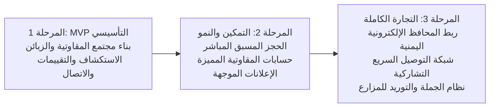

# وثيقة الرؤية والتحليل الاستراتيجي | منصة قطفة (Qatfa)

---

## 1. ملخص تنفيذي (Executive Summary)

**قطفة** هي منصة رقمية اجتماعية وتجارية رائدة، صُممت خصيصاً لإعادة هيكلة ورقمنة أكبر سوق استهلاكي وتجاري يومي في الجمهورية اليمنية: **سوق القات**.

لا تقتصر المنصة على كونها دليلاً جغرافياً للمتاجر أو تطبيقاً إلكترونياً تقليدياً، بل هي **شبكة تجارة اجتماعية حية (Live Social-Commerce Ecosystem)** تمكّن تجار القات (المقاوتية) والمزارعين من بناء علاماتهم التجارية، ونشر عروضهم اليومية "القطفة الطازجة"، وبناء سمعة موثوقة قائمة على التقييمات الشفافة، وتتيح للعملاء استكشاف أفضل أنواع القات القريبة منهم، ومتابعة مقاوتيتهم المفضلين، والتواصل المباشر معهم لحظة وصول الشحنات اليومية.

---

## 2. تحليل الفكرة ونقد النموذج التقليدي (Idea Critique & Problem Analysis)

### 2.1 واقع سوق القات الحالي في اليمن
1. **حجم السوق الضخم وحركته النقدية الهائلة:** يمثل سوق القات مليارات الريالات يومياً في التداول النقدي، ويشمل ملايين المتعاملين يومياً في مختلف المحافظات (صنعاء، عدن، تعز، إب، ذمار، عمران، صعدة، حضرموت، الحديدة، وغيرها).
2. **العشوائية وغياب الشفافية:** تتفاوت الأسعار والجودة بشكل حاد وغير مبرر أحياناً بين ساعة وأخرى في نفس اليوم.
3. **التوقيت الحرج وتلف السلعة (Extreme Perishability):** القات سلعة زراعية فائقة الحساسية؛ تُقطف في الصباح الباكر وتصل الأسواق بين الظهر والعصر وتفقد نضارتها وقيمتها التسويقية بعد ساعات قليلة.
4. **فوضى التشتت في عشرات مجموعات الواتساب والتليجرام:** يضطر المشتري للاشتراك في عشرات المجموعات العشوائية المزدحمة بالرسائل والجدال لمتابعة عروض القات، مما يسبب إرهاقاً وتشتتاً وصعوبة بالغة في المقارنة واكتشاف الأنسب.
5. **اعتماد المقاوتي على الموقع الفيزيائي والعلاقات المحدودة:** يعتمد التاجر فقط على رواد سوقه المحلي، مما يحد من توسعه وقدرته على استقطاب عملاء جدد راغبين في جودته.
6. **معاناة العميل اليومية وصعوبة الوصول للمفرش:** يضطر المستهلك لقضاء وقت طويل يومياً (بين الساعة 12:00 ظهراً وحتى 3:00 عصراً) في التجول في الأسواق المزدحمة للبحث عن نوع محدد، أو الاتصال المتكرر بالمقاوتي لمعرفة ما إذا كانت بضاعته قد وصلت أم نفدت، مع صعوبة الاهتداء إلى موقع مفرش التاجر بدقة داخل أروقة الأسواق الشعبية.

### 2.2 نقد الفكرة الساذجة وتحويلها إلى نموذج تجاري ناجح
- **الخطأ الشائع الأول (تطبيق توصيل وسلة شراء كاملة من اليوم الأول):**
  - *النقد:* محاولة فرض نموذج "أمازون" أو "طلبات" (سلة مشتريات + دفع إلكتروني + سائق توصيل) في المرحلة الأولى لسوق القات في اليمن محكومة بالفشل التشغيلي لعدة أسباب:
    - القات ليس سلعة نمطية؛ المشتري اليمني معتاد على "معاينة البضاعة" أو الاعتماد المطلق على سمعة المقاوتي.
    - الدفع في اليمن لا يزال بنسبة تزيد عن 85% نقداً (Cash on Delivery / Direct Cash).
    - تعقيد لوجستيات التوصيل السريع (في غضون 30-45 دقيقة في ذروة الزحام اليمني) سيرفع التكلفة التشغيلية ويحرق ميزانية المشروع مبكراً.
  - *الحل الاستراتيجي:* **فصل مرحلة الاستكشاف والسمعة عن مرحلة اللوجستيات.** يبدأ MVP كمنصة "اكتشاف وتواصل وبناء سمعة"، تليها لاحقاً خدمات التوصيل والحجز المسبق والدفع الإلكتروني كخدمات متقدمة تدريجية.

- **الخطأ الشائع الثاني (دليل محلات ستاتيكي جامد):**
  - *النقد:* نشر متجر به صورة دائمة وثابتة لا يفيد مستهلك القات، لأن قات اليوم ليس كقات الأمس.
  - *الحل الاستراتيجي:* مفهوم **"القطفة اليومية" (Daily Drop / Live Feeds)**. المتجر ديناميكي؛ كل يوم له بضاعته وتحديثاته، وفي حال عدم تحديث التاجر لبضاعته اليومية تظهر علامة "لم تصل قطفة اليوم بعد".

---

## 3. الرؤية والرسالة والقيم المؤسسية (Vision, Mission & Core Values)

### الرؤية (Vision)
أن تكون "قطفة" المنظومة الرقمية الموحدة والمرجعية الأولى لتجارة واستكشاف وتسويق القات في اليمن، والمنصة التي تعيد تعريف تجربة البيع والشراء عبر الشفافية والتقنية الحديثة.

### الرسالة (Mission)
تمكين كل مقاوتي ومزارع في اليمن من امتلاك متجر رقمي ذكي يربطه بآلاف العملاء في منطقته وخارجها، وتزويد المستهلك اليمني بتجربة يومية سهلة وسريعة وموثوقة للاستكشاف ومعرفة الأسعار وجودة المحصول وحجز القطفة الأنسب دون إهدار للوقت.

### القيم المؤسسية (Core Values)
1. **الموثوقية والنزاهة (Trust & Transparency):** الشفافية في التقييمات والأسعار ومواصفات السلعة.
2. **البساطة المتناهية (Extreme Simplicity):** واجهات تناسب كل فئات المستخدمين من المزارع البسيط إلى مستخدم الهواتف الذكية المتقدم.
3. **احترام السياق الثقافي والاجتماعي (Cultural Alignment):** تصميم تجربة تحاكي طقوس القات اليمنية وأعرافها التجارية بدلاً من فرض نماذج غربية غير متلائمة.
4. **السرعة والكفاءة (Low-Bandwidth Optimization):** عمل النظام بكفاءة استثنائية تحت ظروف الإنترنت البطيء والمتقطع في اليمن.

---

## 4. الميزة التنافسية وعوامل النجاح الحاسمة (Moats & Critical Success Factors)

| المحور | الوضع التقليدي بدون المنصة | الميزة التنافسية في منصة "قطفة" |
| :--- | :--- | :--- |
| **اكتشاف البضاعة** | التجول الفيزيائي المرهق في الأسواق أو التشتت في عشرات مجموعات الواتساب | تصفح بضائع عشرات المقاوتية في الحي والسوق والمدينة في شاشة واحدة دون التنقل بين مجموعات |
| **التوقيت وحداثة العرض** | جهل المشتري بموعد وصول البضاعة أو ما إذا كانت نفدت | توقيت تحديث فوري دقيق ("منذ 10 دقائق") مع حالة واضحة [متوفر / نفد] |
| **خريطة وموقع السوق** | تيه المشتري في أزقة السوق المزدحم بحثاً عن مفرش التاجر | خريطة تفاعلية واضحة لأسواق القات في اليمن مع تحديد موقع مفرش المقاوتي بدقة |
| **السمعة وثقة المشتري** | السمعة شفهية وتكرار حوادث القات المغشوش والأسعار الوهمية | توثيق أرقام البائعين، وتقييمات موثقة، وزر للإبلاغ الفوري عن العروض المضللة |
| **فائدة المقاوتي وعبء العمل** | انشغال المقاوتي بالرد المتكرر والمشتت في الواتساب أو انتظار المارة | فائدة فورية بجلب زبائن جدد ومبيعات سريعة في 30 ثانية دون أي عبء إداري على عمله |
| **التسويق والنشر الذكي** | إعادة إرسال الصور يدوياً في المجموعات مع فقدان الجودة | نشر عروض البائعين على منصات التواصل مع رابط مباشر (Deep Link) يفتح العرض في «قطفة» |
| **الأداء واستهلاك النت** | بطء تحميل المجموعات واستنزاف باقات الإنترنت | سرعة فتح فائقة للتطبيق واستهلاك خفيف جداً للبيانات ملائم لشبكات 3G اليمنية |

---

## 5. تبسيط النطاق: ماذا سنفعل وماذا سنستبعد في MVP؟

### ما سنركز عليه في MVP (Core Focus)
- **أساس التطبيق: بيع واستكشاف القات:** تجربة متكاملة لعرض أنواع القات اليمني، صوره الحقيقية، تقييماته، ومراسلة المقاوتي مباشرة.
- **خريطة السوق التفاعلية:** استعراض خريطة أسواق القات في اليمن وتحديد موقع مفرش المقاوتي داخل السوق بسهولة.
- **موجز موحد للعروض والأسعار:** يرى المشتري صور العروض والأسعار والمناطق وأسماء المقاوتية دون الحاجة للتنقل بين مجموعات الواتساب.
- **العروض المتجددة اللحظية:** صور حقيقية ملتقطة مباشرة، أسعار واضحة، وقت تحديث العرض بدقة، وزر تحويل فوري للحالة [متوفر / نفد].
- **ثقة المشتري وتوثيق البائعين:** توثيق أرقام هواتف البائعين عبر OTP والنزول الميداني، مع إتاحة الإبلاغ السريع عن العروض المضللة.
- **فائدة واضحة للمقاوتي بدون أعباء:** تمكين التاجر من كسب زبائن جدد خلال 30 ثانية يومياً دون أن يشكل التطبيق أي عبء على وتيرة عمله الميداني.
- **التسويق المستمر والمشاركة الذكية (Deep Linking):** إمكانية مشاركة العرض على منصات التواصل برابط مباشر ينقل المشتري مباشرة إلى تفاصيل العرض داخل تطبيق «قطفة».
- **السرعة الخاطفة وخفة الاستهلاك:** فتح التطبيق فوراً والتصفح باستهلاك بيانات فائق الانخفاض يتناسب مع باقات النت المحلية.

### ما سنستبعده من MVP لتجنب الفشل والتعقيد (Excluded from MVP)
- **بوابات الدفع الإلكتروني المباشرة:** معقدة تنظيمياً وتتطلب تراخيص بنكية، ونسبة استخدامها منخفضة في شراء القات الميداني (أكثر من 85% كاش).
- **إدارة أساطيل التوصيل وتتبع السائقين بالـ GPS الحي:** تكلفة تشغيلية باهظة وخطر تلف السلعة السريع في الزحام؛ يستلم المشتري بضاعته بنفسه أو عبر الترتيب المباشر مع التاجر.
- **الدردشة الكتابية المدمجة المعقدة (In-App Chat):** الاستعاضة عنها برابط WhatsApp المباشر وزر الاتصال الهاتفي السريع لتوفير تجربة مألوفة للمقاوتي دون تعقيد.
- **خرائط Google Maps API المدفوعة الباهظة:** الاستعاضة عنها بخرائط OpenStreetMap التفاعلية المجانية المخصصة للأسواق اليمنية مع الدليل الجغرافي بالمعالم.

---

## 6. استراتيجية النمو والتوسع عبر الزمن (Strategic Horizons)

1. **الأفق الأول (Horizon 1 - أول 6 أشهر):** احتلال صدارة التواجد الرقمي لسوق القات في العاصمة صنعاء كنموذج ريادي، وتحقيق شبكة من 500 مقاوتي نشط و 50,000 مستخدم يومي.
2. **الأفق الثاني (Horizon 2 - من 6 إلى 18 شهراً):** التوسع في بقية المحافظات الرئيسية (عدن، تعز، إب، ذمار، حضرموت)، وتفعيل الحسابات الموثقة (Verified Badges)، وبدء نظام الاشتراكات الشهرية للظهور المميز والإعلانات المدفوعة.
3. **الأفق الثالث (Horizon 3 - ما بعد 18 شهراً):** تحويل المنصة إلى Ecosystem متكامل يربط المزارع في رداع أو همدان أو صعدة مع تجار التجزئة في المدن (B2B Marketplace)، وتفعيل شراكات المحافظ الإلكترونية اليمنية (كريمي جوال، فلوسك، ون كاش، جيب، جوالي) ونظام توصيل الشحنات الحساسة.
