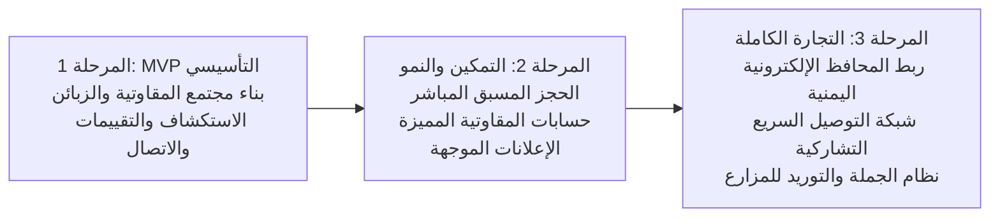

# وثيقة الرؤية والتحليل الاستراتيجي | منصة قطفة (Qatfa)

---

## 1. ملخص تنفيذي (Executive Summary)

**قطفة** هي منصة رقمية اجتماعية وتجارية رائدة، صُممت خصيصاً لإعادة هيكلة ورقمنة أكبر سوق استهلاكي وتجاري يومي في الجمهورية اليمنية: **سوق القات**.

لا تقتصر المنصة على كونها دليلاً جغرافياً للمتاجر أو تطبيقاً إلكترونياً تقليدياً، بل هي **شبكة تجارة اجتماعية حية (Live Social-Commerce Ecosystem)** تمكّن تجار القات (المقاوتية) والمزارعين من بناء علاماتهم التجارية، ونشر عروضهم اليومية "القطفة الطازجة"، وبناء سمعة موثوقة قائمة على التقييمات الشفافة، وتتيح للعملاء استكشاف أفضل أنواع القات القريبة منهم، ومتابعة مقاوتيتهم المفضلين، والتواصل المباشر معهم لحظة وصول الشحنات اليومية.

---

## 2. تحليل الفكرة ونقد النموذج التقليدي (Idea Critique & Problem Analysis)

### 2.1 واقع سوق القات الحالي في اليمن
1. **حجم السوق الضخم وحركته النقدية الهائلة:** يمثل سوق القات مليارات الريالات يومياً في التداول النقدي، ويشمل ملايين المتعاملين يومياً في مختلف المحافظات (صنعاء، عدن، تعز، إب، ذمار، عمران، صعدة، حضرموت، الحديدة، وغيرها).
2. **العشوائية وغياب الشفافية:** تتفاوت الأسعار والجودة بشكل حاد وغير مبرر أحياناً بين ساعة وأخرى في نفس اليوم.
3. **التوقيت الحرج وتلف السلعة (Extreme Perishability):** القات سلعة زراعية فائقة الحساسية؛ تُقطف في الصباح الباكر وتصل الأسواق بين الظهر والعصر وتفقد نضارتها وقيمتها التسويقية بعد ساعات قليلة.
4. **اعتماد المقاوتي على الموقع الفيزيائي والعلاقات المحدودة:** يعتمد التاجر فقط على رواد سوقه المحلي، مما يحد من توسعه وقدرته على استقطاب عملاء جدد راغبين في جودته.
5. **معاناة العميل اليومية:** يضطر المستهلك لقضاء وقت طويل يومياً (بين الساعة 12:00 ظهراً وحتى 3:00 عصراً) في التجول في الأسواق المزدحمة للبحث عن نوع محدد، أو الاتصال المتكرر بالمقاوتي لمعرفة ما إذا كانت بضاعته قد وصلت أم نفدت.

### 2.2 نقد الفكرة الساذجة وتحويلها إلى نموذج تجاري ناجح
- **الخطأ الشائع الأول (تطبيق توصيل وسلة شراء كاملة من اليوم الأول):**
  - *النقد:* محاولة فرض نموذج "أمازون" أو "طلبات" (سلة مشتريات + دفع إلكتروني + سائق توصيل) في المرحلة الأولى لسوق القات في اليمن محكومة بالفشل التشغيلي لعدة أسباب:
    - القات ليس سلعة نمطية؛ المشتري اليمني معتاد على "معاينة البضاعة" أو الاعتماد المطلق على سمعة المقاوتي.
    - الدفع في اليمن لا يزال بنسبة تزيد عن 85% نقداً (Cash on Delivery / Direct Cash).
    - تعقيد لوجستيات التوصيل السريع (في غضون 30-45 دقيقة في ذروة الزحام اليمني) سيرفع التكلفة التشغيلية ويحرق ميزانية المشروع مبكراً.
  - *الحل الاستراتيجي:* **فصل مرحلة الاستكشاف والسمعة عن مرحلة اللوجستيات.** يبدأ MVP كمنصة "اكتشاف وتواصل وبناء سمعة"، تليها لاحقاً خدمات التوصيل والحجز المسبق والدفع الإلكتروني كخدمات متقدمة تدريجية.

- **الخطأ الشائع الثاني (دليل محلات ستاتيكي جامد):**
  - *النقد:* نشر متجر به صورة دائمة وثابتة لا يفيد مستهلك القات، لأن قات اليوم ليس كقات الأمس.
  - *الحل الاستراتيجي:* مفهوم **"القطفة اليومية" (Daily Drop / Live Feeds)**. المتجر ديناميكي؛ كل يوم له بضاعته وتحديثاته، وفي حال عدم تحديث التاجر لبضاعته اليومية تظهر علامة "لم تصل قطفة اليوم بعد".

---

## 3. الرؤية والرسالة والقيم المؤسسية (Vision, Mission & Core Values)

### الرؤية (Vision)
أن تكون "قطفة" المنظومة الرقمية الموحدة والمرجعية الأولى لتجارة واستكشاف وتسويق القات في اليمن، والمنصة التي تعيد تعريف تجربة البيع والشراء عبر الشفافية والتقنية الحديثة.

### الرسالة (Mission)
تمكين كل مقاوتي ومزارع في اليمن من امتلاك متجر رقمي ذكي يربطه بآلاف العملاء في منطقته وخارجها، وتزويد المستهلك اليمني بتجربة يومية سهلة وسريعة وموثوقة للاستكشاف ومعرفة الأسعار وجودة المحصول وحجز القطفة الأنسب دون إهدار للوقت.

### القيم المؤسسية (Core Values)
1. **الموثوقية والنزاهة (Trust & Transparency):** الشفافية في التقييمات والأسعار ومواصفات السلعة.
2. **البساطة المتناهية (Extreme Simplicity):** واجهات تناسب كل فئات المستخدمين من المزارع البسيط إلى مستخدم الهواتف الذكية المتقدم.
3. **احترام السياق الثقافي والاجتماعي (Cultural Alignment):** تصميم تجربة تحاكي طقوس القات اليمنية وأعرافها التجارية بدلاً من فرض نماذج غربية غير متلائمة.
4. **السرعة والكفاءة (Low-Bandwidth Optimization):** عمل النظام بكفاءة استثنائية تحت ظروف الإنترنت البطيء والمتقطع في اليمن.

---

## 4. الميزة التنافسية وعوامل النجاح الحاسمة (Moats & Critical Success Factors)

| المحور | الوضع التقليدي بدون المنصة | الميزة التنافسية في منصة "قطفة" |
| :--- | :--- | :--- |
| **اكتشاف البضاعة** | التجول الفيزيائي المرهق في الأسواق تحت الشمس والزحام | تصفح بضائع عشرات المقاوتية في الحي والمدينة من شاشة الهاتف خلال دقيقتين |
| **التوقيت والمعرفة** | جهل المشتري بموعد وصول البضاعة إلى السوق | إشعار فوري للعميل: *"المقاوتي فلان نشر للتو قطفة الشامي الطازجة"* |
| **السمعة والتقييم** | السمعة شفهية ومحصورة في دائرة المعارف الضيقة | ملف تعريف معتمد مع شارة موثوقية وتقييمات حقيقية ومصورة من مئات العملاء |
| **تسويق المقاوتي** | مقيد بجدران دكانه أو مفرشه في السوق الشعبي | انتشار رقمي واسع، وميزة متابعة المتجر من قبل الآلاف |
| **معلومات السلعة** | سعر مجهول يتغير حسب الشخص والمفاصلة | شفافية في الوزن (حبة، حبلة، قبضة، كيلو)، مصدر القطفة، وحالة السلعة |

---

## 5. تبسيط النطاق: ماذا سنفعل وماذا سنستبعد في MVP؟

### ما سنركز عليه في MVP (Core Focus)
- ملف تعريفي احترافي ومبسط للمقاوتي (متجر رقمي سريع).
- ميزة "قطفة اليوم" بنظام التحديث اليومي السريع والمخزون الحي.
- محرك بحث وفلترة ذكي حسب المحافظة والمديرية والحي والنوع ومستوى السعر.
- قناة تواصل فورية مباشرة (اتصال هاتفي بنقرة واحدة + مراسلة عبر WhatsApp).
- نظام تقييم ومراجعات للمتاجر يضمن بناء الثقة.
- خفة استهلاك البيانات والصور المحسنة لتناسب سرعات الإنترنت المحلية.

### ما سنستبعده من MVP لتجنب الفشل والتعقيد (Excluded from MVP)
- **بوابات الدفع الإلكتروني المباشرة:** معقدة تنظيمياً وتتطلب تراخيص بنكية، ونسبة استخدامها منخفضة في شراء القات الميداني.
- **إدارة أساطيل التوصيل وتتبع السائقين بالـ GPS الحي:** تكلفة تشغيلية باهظة وخطر تلف السلعة السريع في الطرقات.
- **الدردشة الكتابية المدمجة المعقدة (In-App Chat):** الاستعاضة عنها برابط WhatsApp المباشر وزر الاتصال الهاتفي لأن المقاوتي اليمني يفضل الصوت والواتساب الجاهز على فتح شات داخل تطبيق جديد.
- **خرائط Google Maps التفاعلية المدفوعة:** استبدالها بدليل العناوين الهرمي المحلي (محافظة > مديرية > حي > معلم بارز) مع خريطة OpenStreetMap خفيفة جداً أو رابط Google Maps خارجي مجاني بدون استهلاك API حصة مدفوعة.

---

## 6. استراتيجية النمو والتوسع عبر الزمن (Strategic Horizons)

1. **الأفق الأول (Horizon 1 - أول 6 أشهر):** احتلال صدارة التواجد الرقمي لسوق القات في العاصمة صنعاء كنموذج ريادي، وتحقيق شبكة من 500 مقاوتي نشط و 50,000 مستخدم يومي.
2. **الأفق الثاني (Horizon 2 - من 6 إلى 18 شهراً):** التوسع في بقية المحافظات الرئيسية (عدن، تعز، إب، ذمار، حضرموت)، وتفعيل الحسابات الموثقة (Verified Badges)، وبدء نظام الاشتراكات الشهرية للظهور المميز والإعلانات المدفوعة.
3. **الأفق الثالث (Horizon 3 - ما بعد 18 شهراً):** تحويل المنصة إلى Ecosystem متكامل يربط المزارع في رداع أو همدان أو صعدة مع تجار التجزئة في المدن (B2B Marketplace)، وتفعيل شراكات المحافظ الإلكترونية اليمنية (كريمي جوال، فلوسك، ون كاش، جيب، جوالي) ونظام توصيل الشحنات الحساسة.
