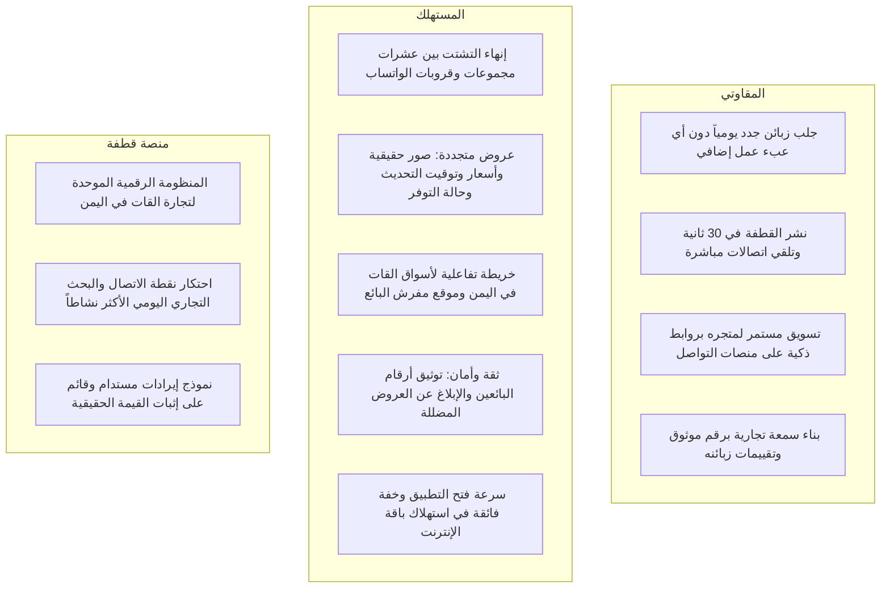

# المتطلبات التجارية ونموذج العمل (Business Requirements) | منصة قطفة

---

## 1. تحليل السوق اليمني وحجم الفرصة (Market Analysis & Sizing)

### 1.1 حجم السوق (Market Sizing: TAM, SAM, SOM)
- **إجمالي السوق المتاح (TAM - Total Addressable Market):**
  - يقدر حجم الإنفاق السنوي على القات في اليمن بمليارات الدولارات (تتراوح التقديرات بين 3 إلى 5 مليارات دولار سنوياً وفق دراسات اقتصادية متنوعة)، بمعدل استهلاك يومي يشمل أكثر من 12 إلى 15 مليون مواطن يمني.
- **سوق الخدمة القابل للوصول (SAM - Serviceable Addressable Market):**
  - مجتمع مستخدمي الهواتف الذكية في المدن والمراكز الحضرية الرئيسية (صنعاء، عدن، تعز، إب، ذمار، المكلا، مأرب، الحديدة) الذين تتراوح أعمارهم بين 18 و 60 عاماً، ويقدر بحوالي 5 إلى 7 ملايين مستخدم نشط للإنترنت.
- **الحصة المستهدفة الأولية (SOM - Serviceable Obtainable Market):**
  - استهداف 100,000 مستخدم نشط و 1,500 مقاوتي نشط في أمانة العاصمة صنعاء ومحافظة عدن خلال أول 12 شهراً من الإطلاق التجاري.

---

## 2. عرض القيمة الفريد (Value Proposition)

---

## 3. نموذج العمل ومصادر الإيرادات (Monetization Strategy)

لضمان نمو متسارع واكتساب شبكي قوي (Network Effects)، تم تقسيم استراتيجية تحقيق الدخل إلى 3 مراحل مدروسة:

### المرحلة الأولى: النمو المجاني المفتوح (MVP - 0% Fees)
- **الهدف:** كسر حاجز التردد وبناء أكبر قاعدة بيانات للمقاوتية والعملاء في تاريخ السوق اليمني.
- جميع الميزات مجانية 100% (فتح المتجر، رفع المنتجات، التواصل، التقييم).
- لا توجد أي عمولات أو رسوم اشتراك لجذب المقاوتية غير المتمرسين تقنياً.

### المرحلة الثانية: نماذج الاشتراك والظهور المميز (Freemium & Premium Listings)
بعد ترسيخ المكانة السوقية ووصول المنصة إلى أكثر من 500 مقاوتي و 50,000 مستخدم:
1. **اشتراك "المقاوتي المعتمد" (Verified Store Subscription):**
   - رسوم شهرية رمزية (مثال: 15,000 إلى 25,000 ريال يمني شهرياً).
   - المزايا: علامة التوثيق الزرقاء (مقاوتي موثق)، أولوية الظهور في نتائج البحث بالمديرية، شارة "قطفة اليوم المميزة"، دعم فني مباشر.
2. **عروض التثبيت في الصدارة (Featured Drops / Pinned Posts):**
   - دفع مبلغ يومي رمزي لتثبيت إعلان القطفة في أعلى شريط التطبيق للمستخدمين في نفس الحي خلال وقت الذروة (12:00 م - 3:00 م).
3. **الإشعارات الموجهة للحي (Area Push Campaigns):**
   - إمكانية قيام المتجر بإرسال إشعار فوري لمتابعيه أو لمستخدمي الحي: *"وصلت شحنة جديدة فاخرة عند العم صالح في سوق سواد حنش"*.

### المرحلة الثالثة: الإعلانات والخدمات التكميلية (B2B Ads & Ecosystem)
1. **إعلانات القطاعات المرتبطة (Sponsored Ads):**
   - مساحات إعلانية لشركات الطاقة الشمسية (التي تخدم مزارع القات)، شركات الري والمضخات، مستلزمات التعبئة والتغليف، وكالات السيارات وحافظات التبريد، والمشروبات ومياه الشرب.
2. **رسوم المعاملات (Transaction Fees) مستقبلاً:**
   - عند تفعيل خدمات الحجز المسبق الدفع عبر المحافظ الإلكترونية، اقتطاع نسبة مئوية متناهية الصغر (1.5% - 2%) مقابل الضمان المالي ومكافحة التهرب.

---

## 4. استراتيجية الاستحواذ والتسويق الميداني (Merchant Acquisition Playbook)

يعتبر المقاوتي محور نجاح المنصة (Supply-driven Marketplace)؛ إذا تواجدت البضاعة الممتازة والأسعار الصادقة، سيأتي الزبائن تلقائياً.

### خطة الاستحواذ الميداني (Field Onboarding Team):
1. **فريق النزول الميداني "سفراء قطفة":**
   - توظيف فريق شبابي ميداني مدرب في أشهر أسواق القات في اليمن (صنعاء: سوق علي محسن، سوق عنقاد، سوق نقم، سوق شميلة، سوق مذبح؛ عدن: سوق الشيخ عثمان، سوق المنصورة، سوق كراع؛ تعز، إب، ذمار، عمران، صعدة، حضرموت، الحديدة).
   - **فائدة واضحة للمقاوتي بدون عبء:** تدريب المقاوتي ومساعده الشاب في 5 دقائق على أن التطبيق أداة تسويق سريعة جداً لجلب زبائن جدد ومبيعات سريعة في 30 ثانية، دون أي تعقيد أو كتابة أو عبء إداري يثقل كاهله في السوق.
   - توثيق رقم هاتف البائع الميداني فورياً لضمان مصداقية المتجر أمام الزبائن.
2. **حملة "أول 100 مقاوتي مميز":**
   - منح أول 100 تاجر شارة "الرواد" مجاناً مدى الحياة، وتزويد مفرشه بلافتة واستيكر احترافي يحمل: **QR Code** يحمل عبارة *"تابع قطفة اليوم الحية وقيّمنا على تطبيق قطفة"*.
3. **التسويق المستمر والنشر عبر منصات التواصل (Social Deep Linking):**
   - تمكين المقاوتي بضغطة زر واحدة من نشر بطاقة عروضه اليومية على حالات WhatsApp وصفحات Facebook و Telegram و TikTok.
   - البطاقة تحتوي على صورة حقيقية للقات، السعر، ورابط مباشر ذكي (Deep Link)؛ عند ضغط الزبون في أي مجموعة واتساب، يفتح العرض مباشرة داخل تطبيق «قطفة»، مما ينهي فوضى التشتت في المجموعات ويوجه الزبائن مباشرة لمتجر البائع.
4. **حملات التسويق الرقمي الموجهة للعملاء (B2C Viral Growth):**
   - مخاطبة ألم العميل اليمني اليومي: *"ودّع التشتت بين عشرات قروبات الواتساب وزحام الأسواق.. كافة عروض وأسعار أسواق اليمن وخريطة المفارش تجدها في قطفة بضغطة زر"*.
   - استغلال ثقافة التخزين والمقيل والمحتوى التراثي والفكاهي اليمني لصنع انتشار فيروسي سريع.

---

## 5. الاعتبارات القانونية والتنظيمية في الجمهورية اليمنية
- **الوضع القانوني لتجارة القات محلياً:** القات سلعة زراعية وتجارية مشروعة ومسموح بتداولها وبيعها داخل الجمهورية اليمنية، وتخضع لضريبة مبيعات القات الرسمية الميدانية.
- **التوافق التنظيمي:** المنصة تعمل كمنصة وساطة إلكترونية ودليل تجاري رقمي (Information Directory & Marketplace)، ولا تشترك في نقل أو شحن السلعة في المرحلة الأولى، مما يمنحها إعفاءً من المخاطر اللوجستية والقانونية.
- **سياسة الفوترة والأسعار:** عرض السعر واضح بالريال اليمني، مع إخلاء مسؤولية المنصة عن أي تقلبات سعرية أو اتفاقات خاصة بين البائع والمشتري تتم خارج التطبيق.
