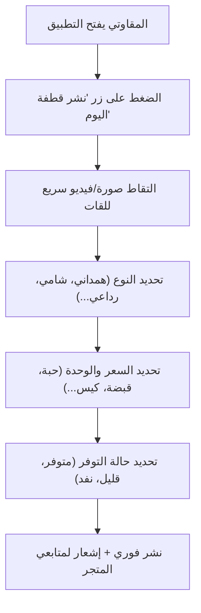

# المتطلبات الوظيفية المفصلة (Functional Requirements) | منصة قطفة

---

## 1. فهرس الوحدات الوظيفية (Functional Modules)

1. **وحدة المصادقة وإدارة الحسابات (Authentication & Account Management - FR-AUTH)**
2. **وحدة الملف الشخصي للمتجر والمقاوتي (Merchant Storefront - FR-STORE)**
3. **وحدة المنتجات والقطفة اليومية (Products & Daily Harvest - FR-PROD)**
4. **وحدة الاستكشاف والبحث والفلترة (Discovery, Search & Filter - FR-SRCH)**
5. **وحدة التفاعل والمجتمع (Social & Community - FR-COMM)**
6. **وحدة الاتصال وتوليد الطلبات (Lead Generation & Communication - FR-COMMUN)**
7. **وحدة الإشعارات (Push Notifications - FR-NOTIF)**
8. **وحدة لوحة التحكم والرقابة الإدارية (Admin & Moderation - FR-ADMIN)**

---

## 2. تفصيل المتطلبات الوظيفية

### 2.1 وحدة المصادقة وإدارة الحسابات (FR-AUTH)

| المعرف | اسم المتطلب | الوصف وقواعد العمل | الأولوية |
| :--- | :--- | :--- | :--- |
| **FR-AUTH-01** | التصفح كضيف | يتاح للزائر فتح التطبيق واستعراض المتاجر، وقوائم القات اليومية، والبحث والفلترة دون أي شاشة تسجيل دخول مسبقة. | حرجة (MVP) |
| **FR-AUTH-02** | تسجيل الدخول برقم الهاتف و OTP | تسجيل الدخول وإنشاء الحساب يتم عبر إدخال رقم الهاتف اليمني (يمن موبايل، يو YOU، سبأفون، واي) واستقبال رمز تحقق عبر SMS أو WhatsApp OTP. | حرجة (MVP) |
| **FR-AUTH-03** | إدارة الأدوار والصلاحيات (RBAC) | يدعم النظام الأدوار التالية: زائر (Guest)، مستخدم/عميل (Customer)، مقاوتي/تاجر (Maqwati)، مشرف محتوى (Moderator)، مدير نظام (Super Admin). | حرجة (MVP) |
| **FR-AUTH-04** | الترقية إلى حساب مقاوتي | يمكن للمستخدم المسجل تقديم طلب "افتح متجرك" عبر إدخال اسم المتجر، المحافظة، السوق، ورقم الاتصال. | حرجة (MVP) |
| **FR-AUTH-05** | إدارة الملف الشخصي للمستخدم | تعديل الاسم، الصورة الشخصية، المحافظة المفضلة، وسجل الإشعارات. | متوسطة |

---

### 2.2 وحدة الملف الشخصي للمتجر والمقاوتي (FR-STORE)

| المعرف | اسم المتطلب | الوصف وقواعد العمل | الأولوية |
| :--- | :--- | :--- | :--- |
| **FR-STORE-01** | بيانات المتجر الأساسية | يشمل المتجر: اسم المتجر/المقاوتي، نبذة تعريفية، صورة شخصية/شعار، صورة غلاف، ساعات العمل وموعد وصول القات اليومي. | حرجة (MVP) |
| **FR-STORE-02** | تحديد الموقع الجغرافي بالدليل الهرمي | اختيار المحافظة من قائمة معتمدة، ثم المديرية، ثم السوق الشعبي أو الشارع الرئيسي، وحقل نصي لوصف أقرب معلم بارز (مثال: *"بجوار صيدلية النور - مفرش رقم 14"*). | حرجة (MVP) |
| **FR-STORE-03** | إحداثيات GPS الاختيارية | إمكانية التقاط موقع المتجر عبر GPS أو إدخال رابط Google Maps لفتحه في تطبيق الخرائط الخارجي للعميل. | عالية (MVP) |
| **FR-STORE-04** | قنوات الاتصال | إدخال رقم الهاتف الرئيسي للاتصال المباشر، ورقم WhatsApp المخصص للمراسلة السريعة. | حرجة (MVP) |
| **FR-STORE-05** | شارات التوثيق (Badges) | إظهار شارة "متجر موثق" (Verified) تمنحها الإدارة بعد التحقق من هوية التاجر أو النزول الميداني. | عالية (MVP) |
| **FR-STORE-06** | حالة المتجر الآن | زر تحويل سريع يملكه المقاوتي لتحديد حالته: [مفتوح الآن ولديه بضاعة] أو [مغلق / نفدت بضاعة اليوم]. | حرجة (MVP) |

---

### 2.3 وحدة المنتجات والقطفة اليومية (FR-PROD)

| المعرف | اسم المتطلب | الوصف وقواعد العمل | الأولوية |
| :--- | :--- | :--- | :--- |
| **FR-PROD-01** | نشر القطفة السريعة | واجهة فائقة البساطة مخصصة للمقاوتي تمكنه من رفع صور/فيديو قصير وتحديد النوع والسعر في أقل من دقيقة. | حرجة (MVP) |
| **FR-PROD-02** | تصنيف أنواع القات | قائمة منسدلة بأنواع القات المشهورة: (شامي، همداني، عنسي، رداعي، قعطبي، أرحبي، غيلي، مطري، سوتي، يافعي، شبواني، إلخ) مع خيار كتابة نوع مخصص. | حرجة (MVP) |
| **FR-PROD-03** | مستويات الجودة والحالة | تحديد درجة الجودة: (سوبر / فاخر، درجة أولى، وسط، تجاري) وحالة القطفة (طازجة اليوم، قطفة صباحية، قطفة الأمس). | حرجة (MVP) |
| **FR-PROD-04** | وحدات القياس المعتمدة | دعم الوحدات المتداولة شعبياً: (حبة، حبلة، قبضة، قلايد، باقة، شطلة، كيس، كيلو، ربع كيلو، نصف كيلو). | حرجة (MVP) |
| **FR-PROD-05** | إدارة المخزون اللحظية | نقرة زر واحدة لتغيير حالة المنتج: [متوفر] / [متبقي كمية محدودة] / [نفدت الكمية المباعة]. | حرجة (MVP) |
| **FR-PROD-06** | الطابع الزمني للقطفة | عرض توقيت نشر القطفة بدقة (مثال: *"نُشرت قبل 20 دقيقة"*) لتأكيد طزاجة المعروض. | حرجة (MVP) |
| **FR-PROD-07** | معالجة الوسائط المتعددة والضغط | ضغط الصور تلقائياً على هاتف المقاوتي قبل الرفع إلى صيغة WebP بدقة لا تتجاوز 1080px وحجم أقل من 100KB لضمان الرفع السريع في الإنترنت الضعيف. | حرجة (MVP) |

---

### 2.4 وحدة الاستكشاف والبحث والفلترة (FR-SRCH)

| المعرف | اسم المتطلب | الوصف وقواعد العمل | الأولوية |
| :--- | :--- | :--- | :--- |
| **FR-SRCH-01** | تصفية الموقع الجغرافي | تصفية النتائج باختيار: المحافظة > المديرية > السوق الشعبي. وحفظ آخر منطقة تصفحها المستخدم كافتراضية. | حرجة (MVP) |
| **FR-SRCH-02** | البحث بالكلمات المفتاحية | بحث نصي سريع يبحث في أسماء المقاوتية، أسماء المتاجر، أنواع القات، والأسواق. | حرجة (MVP) |
| **FR-SRCH-03** | فلاتر متقدمة | فلترة حسب: نطاق السعر (الحد الأدنى - الحد الأعلى)، التقييم (4 نجوم فأعلى)، المنتجات المتوفرة حالياً فقط، قطفات اليوم فقط. | عالية (MVP) |
| **FR-SRCH-04** | خيارات الترتيب (Sorting) | الترتيب حسب: الأحدث نشراً، الأقل سعراً، الأعلى تقييماً، الأكثر متابعة. | عالية (MVP) |

---

### 2.5 وحدة التفاعل والمجتمع (FR-COMM)

| المعرف | اسم المتطلب | الوصف وقواعد العمل | الأولوية |
| :--- | :--- | :--- | :--- |
| **FR-COMM-01** | متابعة المتاجر (Follow) | إمكانية متابعة أي متجر؛ تظهر المتاجر المتابعة في تبويب خاص "متابعاتي" وتصل إشعارات عند نشرها لقطفة جديدة. | حرجة (MVP) |
| **FR-COMM-02** | التقييم والمراجعات | إمكانية إعطاء تقييم من 1 إلى 5 نجوم وكتابة تعليق، مع منع المستخدم من تقييم نفس المتجر أكثر من مرة واحدة شهرياً لمنع التلاعب. | حرجة (MVP) |
| **FR-COMM-03** | الرد على المراجعات | تمكين المقاوتي من الرد رسمياً على تقييمات عملائه لبناء ثقة ودية. | عالية |
| **FR-COMM-04** | الإعجاب والمفضلة | حفظ المنتجات أو المتاجر المفضلة في قائمة خاصة بالملف الشخصي للعميل. | متوسطة |
| **FR-COMM-05** | المشاركة الذكية (Deep Linking) | توليد روابط مشاركة لفتح بطاقة المنتج أو المتجر مباشرة داخل التطبيق أو عبر صفحة ويب خفيفة للمعاينة عند الإرسال عبر WhatsApp. | عالية (MVP) |
| **FR-COMM-06** | نظام الإبلاغ عن المحتوى | زر إبلاغ على كل متجر ومنتج ومراجعة، مع أسباب محددة: (معلومات مضللة، صورة مسروقة/غير حقيقية، سعر وهمي، احتيال، ألفاظ مسيئة). | حرجة (MVP) |

---

### 2.6 وحدة الاتصال وتوليد الطلبات (FR-COMMUN)

| المعرف | اسم المتطلب | الوصف وقواعد العمل | الأولوية |
| :--- | :--- | :--- | :--- |
| **FR-COMMUN-01** | اتصال هاتفي مباشر (Click-to-Call) | الضغط على زر "اتصال بالمقاوتي" يفتح فوراً لوحة اتصال الهاتف بالرقم المعتمد للمتجر. | حرجة (MVP) |
| **FR-COMMUN-02** | مراسلة واتساب الذكية (WhatsApp Direct) | الضغط على "مراسلة عبر واتساب" يفتح محادثة التاجر على WhatsApp برسالة مجهزة تلقائياً: *"مرحباً، استفسر بخصوص القطفة المعروضة على قطفة: [اسم القطفة] بسعر [السعر] - هل هي متوفرة حالياً؟"* | حرجة (MVP) |
| **FR-COMMUN-03** | تتبع النقرات والاهتمام (Leads Tracking) | تسجيل حدث نقرة الاتصال أو الواتساب في النظام كإحصائية مهمة للمقاوتي لإظهار عدد الزبائن الذين تواصلوا معه عبر التطبيق. | عالية (MVP) |

---

### 2.7 وحدة الإشعارات (FR-NOTIF)

| المعرف | اسم المتطلب | الوصف وقواعد العمل | الأولوية |
| :--- | :--- | :--- | :--- |
| **FR-NOTIF-01** | إشعارات القطفة الجديدة للمتابعين | إرسال إشعار Push Notification فوري للمستخدم عند قيام متجر يتابعه بنشر قطفة جديدة (بين 11:30 ص و 3:30 م). | حرجة (MVP) |
| **FR-NOTIF-02** | إشعارات حالة المتجر والحساب | إشعار المقاوتي عند اعتماد متجره، أو عند وصول تقييم جديد لمتجره. | عالية (MVP) |
| **FR-NOTIF-03** | الإشعارات الإدارية والتنبيهات | إرسال إشعارات جماعية من الإدارة بعروض خاصة أو تنبيهات موسمية (مثال: عطلات الأعياد والمواسم). | متوسطة |

---

### 2.8 وحدة لوحة التحكم والرقابة الإدارية (FR-ADMIN)

| المعرف | اسم المتطلب | الوصف وقواعد العمل | الأولوية |
| :--- | :--- | :--- | :--- |
| **FR-ADMIN-01** | إدارة وموافقة طلبات المتاجر | مراجعة طلبات فتح المتاجر الجديدة، التحقق من بيانات التاجر، اعتماد المتجر أو رفضه مع ذكر السبب. | حرجة (MVP) |
| **FR-ADMIN-02** | إدارة وحظر المستخدمين | البحث عن المستخدمين، تعديل الصلاحيات، حظر حساب مسيء مؤقتاً أو دائماً. | حرجة (MVP) |
| **FR-ADMIN-03** | قائمة فحص البلاغات (Reports Queue) | استعراض البلاغات الواردة من المستخدمين حول المتاجر والمنتجات والمراجعات، واتخاذ إجراء فوري (حذف المحتوى، إنذار، إيقاف). | حرجة (MVP) |
| **FR-ADMIN-04** | إدارة البيانات المرجعية الجغرافية | إضافة وتعديل وتفعيل المحافظات، المديريات، والأسواق الشعبية داخل الجمهورية اليمنية. | حرجة (MVP) |
| **FR-ADMIN-05** | لوحة المؤشرات والإحصائيات | شاشة لعرض: إجمالي المتاجر النشطة، المنتجات المنشورة اليوم، إجمالي الاتصالات المتولدة، ومناطق النشاط الأكثر كثافة. | عالية (MVP) |
