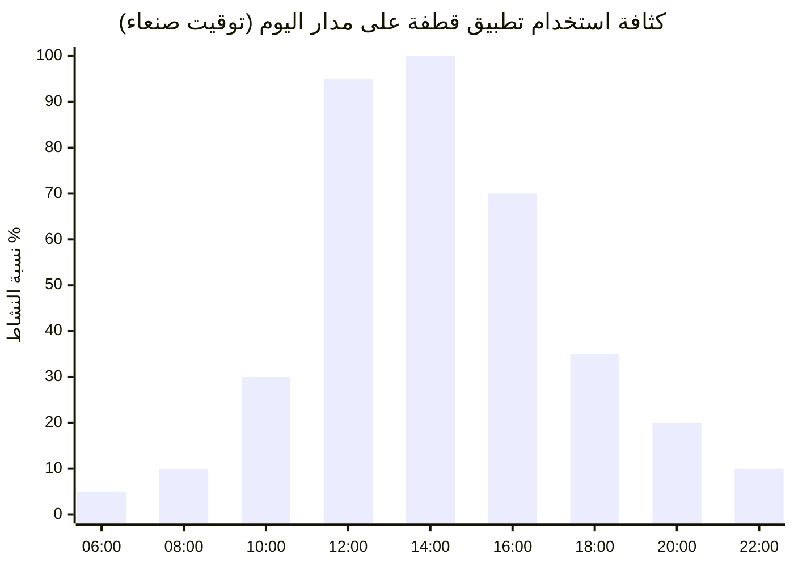

# المتطلبات غير الوظيفية (Non-Functional Requirements) | منصة قطفة

---

## 1. أداء وسرعة النظام في بيئة الاتصالات اليمنية (Performance & Latency)

### 1.1 واقع شبكات الاتصال في اليمن
- يعتمد غالبية المستخدمين على شبكات الجيل الرابع والثالث (4G / 3G) من مشغلي الاتصالات المحليين (يمن موبايل، يو YOU، سبأفون)، وتتسم الشبكات أحياناً بـ:
  - زمن تأخير مرتفع (High Latency: 120ms - 350ms).
  - معدل فقدان حزم ملحوظ (Packet Loss: 2% - 8%).
  - قيود على باقات البيانات وحرص المستخدمين على توفير استهلاك الميجابايت.

### 1.2 معايير الأداء المعتمدة (SLA Benchmarks)

| المعيار | الهدف الرقمي | آلية التحقيق |
| :--- | :--- | :--- |
| **زمن استجابة الـ API الداخلي (API Latency)** | أقل من 150ms للطلبات العادية، أقل من 250ms لطلبات البحث | استعلامات مفهرسة بقوة، وتخزين مؤقت في Redis |
| **زمن تحميل الشاشة الأولى (First Contentful Paint)** | أقل من 1.8 ثانية على شبكة 3G | دعم التخزين المحلي (Offline-first Cache) وعرض هياكل التحميل (Skeleton Loaders) |
| **حجم صور المنتجات** | لا يتجاوز 70KB - 110KB للصورة | ضغط إلزامي على جهاز العميل بصيغة WebP الحديثة مع جودة 75% |
| **حجم حزمة التطبيق (APK Size)** | أقل من 18MB | تقليل المكتبات الخارجية، واستخدام شاشات SVG، وضغط الموارد |
| **استهلاك الذاكرة العشوائية (RAM Usage)** | أقل من 120MB على هواتف الفئة الاقتصادية | إدارة ذكية لدورة حياة الصور وتفريغ القوائم اللانهائية (Lazy Loading / Virtualized Lists) |

---

## 2. التوافر والموثوقية وساعات الذروة (Availability & Peak Hours)

- **نافذة الذروة الحرجة (The Golden Peak Window):**
  - من الساعة **11:30 صباحاً وحتى 4:30 عصراً** بتوقيت اليمن. في هذه الساعات الـ 5 يتركز أكثر من **80%** من إجمالي حركة البيانات والاتصالات والبحث اليومي.
- **مستوى التوافر المستهدف (Uptime SLA):**
  - **99.9%** خلال ساعات الذروة، مع جدولة عمليات الصيانة والتحديث خارج هذه الساعات (بين 2:00 صباحاً و 5:00 صباحاً).
- **التعافي من الكوارث (Disaster Recovery - RPO & RTO):**
  - **RPO (Recovery Point Objective):** أقل من 15 دقيقة (نسخ احتياطي دوري لقواعد البيانات).
  - **RTO (Recovery Time Objective):** أقل من 30 دقيقة لاستعادة الخدمة كاملة في حال تعطل الخادم الرئيسي.

---

## 3. قابلية التوسع والنمو (Scalability)

1. **معمارية خالية من الحالة (Stateless Architecture):**
   - السيرفرات الخلفية لا تخزن جلسات المستخدمين في الذاكرة المحلية للسيرفر، بل تعتمد على رموز JWT المستقلة و Redis لإدارة الجلسات ومعدلات الطلب (Rate Limiting)، مما يسمح بمضاعفة عدد السيرفرات أفقياً (Horizontal Scaling) عند زيادة الأحمال دون أي تعديل برمجي.
2. **فصل الوسائط والتخزين (Decoupled Storage & CDN):**
   - عزل حركة تحميل ومشاهدة الصور والفيديوهات بالكامل عن سيرفر الـ API ونقلها إلى خدمات تخزين كائنية متوافقة مع S3 (مثل Cloudflare R2 / MinIO) مع شبكة توزيع محتوى CDN عالمية لتسريع التصفح وتوفير استهلاك الباندويث.
3. **تجمع اتصالات قاعدة البيانات (Connection Pooling):**
   - استخدام PgBouncer أو أدوات مدمجة لإدارة اتصالات PostgreSQL بمرونة تحت أعباء التصفح المرتفعة.

---

## 4. الأمان ومكافحة الاحتيال (Security & Fraud Prevention)

1. **حماية بوابات الرسائل القصيرة (SMS / OTP Rate Limiting):**
   - منع هجمات استنزاف رصيد الرسائل (SMS Pumping Attacks) بتطبيق حظر صارم: حد أقصى 3 رسائل OTP لكل رقم هاتف خلال 10 دقائق، وحظر طلبات OTP المكررة من نفس عنوان IP.
2. **تشفير البيانات أثناء النقل (In-Transit Encryption):**
   - تشفير إلزامي لجميع الاتصالات عبر بروتوكول TLS 1.3 مع شهادات SSL المحدثة تلقائياً واستخدام بروتوكول HTTP Strict Transport Security (HSTS).
3. **التحقق من صحة المدخلات والتعقيم (Sanitization & Validation):**
   - تعقيم كامل لكافة الحقول النصية لمنع هجمات حقن قواعد البيانات (SQL Injection) وهجمات البرمجة عبر المواقع (XSS).
4. **حماية هواتف المقاوتية وصلاحيات الرفع:**
   - تقييد أحجام الملفات المرفوعة إلى 5MB كحد أقصى وفحص امتدادات ونوع الميديا على السيرفر (MIME-Type validation) لمنع رفع أي ملفات تنفيذية ضارة.

---

## 5. التوافق وسهولة الاستخدام (Usability & Accessibility)

1. **دعم اللغة العربية الكامل والاتجاه من اليمين لليسار (RTL First):**
   - تصميم الواجهات بالكامل لتناسب القراءة العربية الطبيعية، مع خط عربي حديث عالي الوضوح وسهل القراءة على الشاشات الصغيرة (مثل: `Cairo` أو `Almarai`).
2. **التباين العالي تحت أشعة الشمس (Outdoor Sunlight Visibility):**
   - بما أن المقاوتي والمشتري يستخدمان التطبيق غالباً في الشارع وسوق القات المفتوح تحت ضوء الشمس، يجب أن تعتمد واجهات الاستكشاف على ألوان ذات تباين عالٍ (High Contrast)، وأزرار واضحة ذات مساحات لمس كبيرة (Touch Targets لا تقل عن 48x48 بكسل).
3. **دعم الهواتف الشائعة في اليمن (Target Device Fleet):**
   - التوافق التام مع نظام Android ابتداءً من الإصدار 7.0 (Nougat) فما فوق، مع دعم خاص للأجهزة الاقتصادية الأكثر انتشاراً في السوق اليمني (Transsion Group: Infinix, Tecno, Itel بالإضافة إلى إصدارات Samsung Galaxy A series و Xiaomi Redmi).
   - التوافق مع نظام iOS ابتداءً من الإصدار 14.0 فما فوق.
   - استهلاك بطارية منخفض جداً (تجنب التتبع الجغرافي المستمر في الخلفية Background GPS tracking لمنع نفاد بطارية هاتف التاجر أثناء تواجده في السوق).
