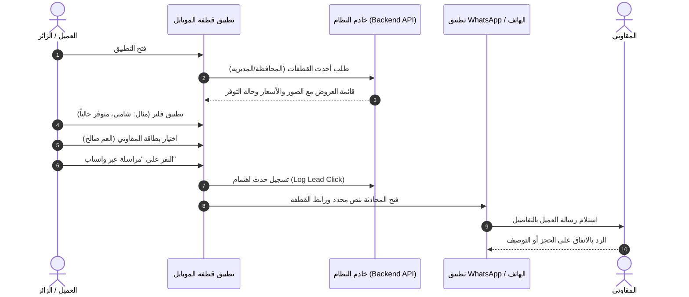
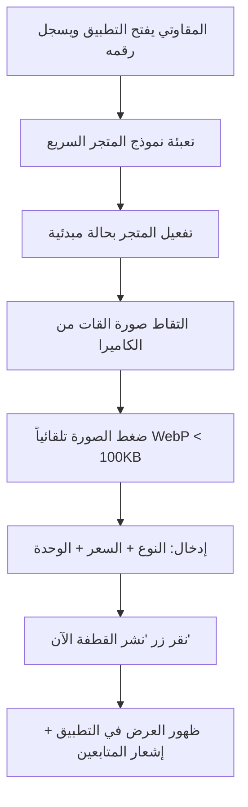

# حالات الاستخدام التفصيلية (Use Cases & Workflows) | منصة قطفة

---

## 1. فهرس حالات الاستخدام الرئيسية

1. **UC-01:** استكشاف القطفة والتواصل مع المقاوتي (Discovery to Contact)
2. **UC-02:** تسجيل المقاوتي ونشر القطفة اليومية (Merchant Onboarding & Daily Drop)
3. **UC-03:** تقييم المتجر والمراجعة المجتمعية (Store Rating & Review)
4. **UC-04:** معالجة البلاغات والرقابة المشرفة (Abuse Reporting & Moderation)

---

## 2. تفصيل حالات الاستخدام

### UC-01: استكشاف القطفة والتواصل مع المقاوتي (Discovery to Contact)

- **الجهات الفاعلة (Actors):** الزائر / العميل، المقاوتي، النظام، تطبيق WhatsApp.
- **الشروط المسبقة (Preconditions):** تطبيق قطفة مثبت على هاتف العميل، والمقاوتي لديه متجر نشط وقام بنشر قطفة اليوم.
- **المحفز (Trigger):** العميل يرغب في شراء قات لعشية اليوم ويفتح التطبيق.

#### مخطط التسلسل (Sequence Diagram):

#### المسار الأساسي للنجاح (Main Success Scenario):
1. يفتح العميل التطبيق فيتم تحديد موقعه التلقائي أو اختياره اليدوي للمحافظة والمديرية.
2. يستعرض العميل موجز "قطفات اليوم الطازجة" مرتبة بالأحدث نشراً.
3. يقوم العميل بفلترة القائمة حسب نوع القات وسقوف الأسعار.
4. ينقر العميل على بطاقة القطفة لعرض الصور المكبرة، وقت القطف، ومكان المفرش في السوق.
5. يضغط العميل على زر "مراسلة عبر واتساب".
6. يسجل النظام نقرة التحويل في قاعدة البيانات لخدمة إحصائيات المقاوتي.
7. يفتح الهاتف تطبيق WhatsApp محتوياً على رقم المقاوتي ورسالة استفسار دقيقة برابط الحزمة.
8. يتم التواصل المباشر بين الطرفين للاتفاق على الاستلام والحجز.

#### المسارات البديلة والاستثناءات (Alternative & Exception Scenarios):
- **3a. لا توجد قطفات في المديرية المختارة:**
  - يعرض التطبيق شاشة لطيفة تفيد بعدم وجود عروض حالياً في هذا السوق، مع اقتراح أسواق مجاورة في نفس المحافظة، وزر "تنبيهي عند وصول قطفة جديدة هنا".
- **5a. العميل يفضل الاتصال الصوتي المباشر:**
  - ينقر العميل على "اتصال هاتفي"، فيفتح التطبيق واجهة الاتصال بالرقم المعتمد مباشرة.

---

### UC-02: تسجيل المقاوتي ونشر القطفة اليومية (Merchant Onboarding & Daily Drop)

- **الجهات الفاعلة (Actors):** المقاوتي، تطبيق قطفة، خادم النظام (API & Storage)، فريق التحقق.
- **الشروط المسبقة (Preconditions):** هاتف المقاوتي متصل بالإنترنت ومزود بكاميرا.
- **المحفز (Trigger):** وصول بضاعة القات الجديدة إلى مفرش المقاوتي في السوق.

#### مخطط التدفق (Workflow):

#### المسار الأساسي للنجاح (Main Success Scenario):
1. يقوم المقاوتي بتسجيل الدخول برقم هاتفه ورمز التحقق (SMS/WhatsApp OTP).
2. يختار "إنشاء متجر جديد" ويدخل اسم الشهرة، المحافظة، المديرية، واسم السوق ورقم المفرش.
3. يضغط المقاوتي على زر "إضافة قطفة اليوم".
4. تلتقط الكاميرا صورة حزمة القات؛ ويقوم التطبيق بضغطها تلقائياً محلياً على الجهاز لتقليل الحجم.
5. يختار المقاوتي النوع (مثل: قعطبي) ويحدد السعر والوحدة بنقرات سريعة.
6. يضغط "نشر الآن"؛ يتم رفع الصورة وتخزين المنتج خلال ثوانٍ معدودة.
7. يظهر المنتج في رأس القائمة العامة للجمهور في نفس المحافظة.
8. يرسل النظام إشعارات للمستخدمين الذين يتابعون هذا المتجر بأن بضاعة اليوم قد وصلت.

#### المسارات الاستثنائية (Exception Scenarios):
- **4a. انقطاع الإنترنت أثناء رفع الصورة:**
  - يعيد التطبيق المحاولة تلقائياً بمجرد عودة الاتصال (Retry Mechanism) مع حفظ بيانات المنتج محلياً في ذاكرة التخزين المؤقت (Offline SQLite Draft).

---

### UC-03: تقييم المتجر والمراجعة المجتمعية (Store Rating & Review)

- **الجهات الفاعلة (Actors):** العميل المسجل، النظام، المقاوتي.
- **الشروط المسبقة (Preconditions):** العميل مسجل دخوله في التطبيق بحساب موثق بالهاتف.
- **المحفز (Trigger):** العميل اشترى من المقاوتي ويرغب في كتابة مراجعته.

#### قواعد التحقق وضبط التلاعب (Anti-Spam Rules):
1. لا يمكن للعميل تقييم المتجر إلا مرة واحدة كل 30 يوماً (لتفادي حرق أو تلميع التقييمات).
2. منع المقاوتي من تقييم متجره الخاص نهائياً.
3. تطبيق فلتر فوري للكلمات النابية أو المسيئة في نص التقييم.

#### خطوات السيناريو (Scenario Steps):
1. يدخل العميل على صفحة متجر المقاوتي ويضغط "أضف تقييمك".
2. يحدد عدد النجوم (من 1 إلى 5).
3. يكتب تعليقاً يوضح جودة القات وسرعة التجاوب وأمانة الوزن.
4. يضغط "إرسال التقييم".
5. يتحقق النظام من قيود مكافحة السبام ومطابقة النص لمعايير المحتوى.
6. يُنشر التقييم فوراً ويتم تحديث المتوسط الحسابي لنقاط المتجر.
7. يتلقى المقاوتي إشعاراً بتقييم جديد مع إمكانية الرد الرسمي تحت التقييم.

---

### UC-04: معالجة البلاغات والرقابة المشرفة (Abuse Reporting & Moderation)

- **الجهات الفاعلة (Actors):** العميل، النظام، مشرف المحتوى (Moderator).
- **الشروط المسبقة (Preconditions):** وجود محتوى مبلغ عنه (صورة مضللة، سعر وهمي، أو سب وشتم).

#### خطوات السيناريو (Scenario Steps):
1. يضغط العميل على خيار "إبلاغ" الموجود على بطاقة المنتج أو المتجر.
2. يختار سبب البلاغ من القائمة: (صورة غير حقيقية، سعر وهمي، احتيال، كلمات مسيئة) مع شرح اختياري.
3. يسجل النظام البلاغ؛ وإذا تجاوزت البلاغات على منتج معين 3 بلاغات مستقلة خلال ساعة، يتم إخفاء المنتج تلقائياً مؤقتاً لحين المراجعة (Auto-quarantine).
4. يدخل المشرف إلى لوحة التحكم ويستعرض قائمة البلاغات المعلقة.
5. يفحص المشرف الأدلة ويتخذ أحد الإجراءات:
   - **تأكيد المخالفة:** حذف المنتج بشكل نهائي وإرسال تنبيه للتاجر.
   - **مخالفة جسيمة/متكررة:** حظر متجر التاجر لمدة 7 أيام أو حظر نهائي.
   - **بلاغ كيدي/غير صحيح:** رفض البلاغ وإعادة إظهار المنتج إن كان معلقاً.
