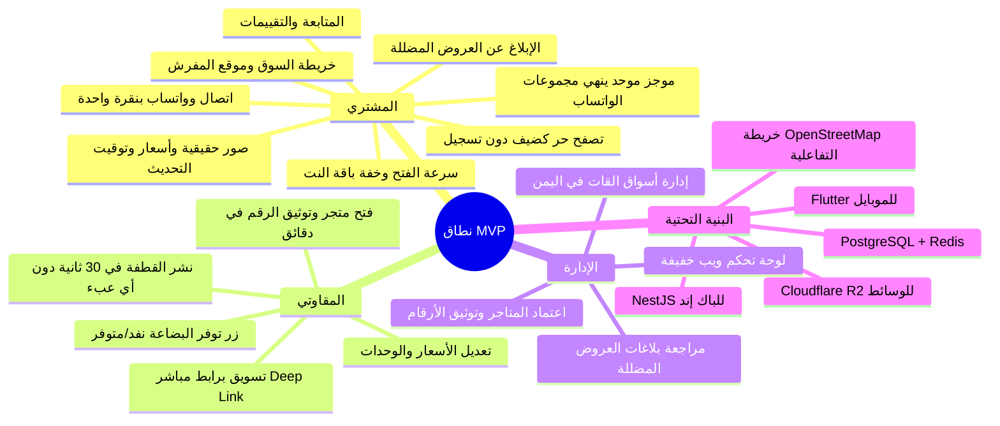

# وثيقة نطاق النسخة الأولى (MVP Scope & Exclusions) | منصة قطفة

---

## 1. فلسفة النسخة الأولى (The MVP Philosophy)

تتمثل الفلسفة الحاكمة للنسخة الأولى من منصة **قطفة** في المعادلة التالية:
> **"أسرع إطلاق ميداني ممكن + أقل تكلفة تشغيلية واستضافة + أعلى جودة وتجاوب على شبكات الإنترنت اليمنية"**

الهدف الاستراتيجي ليس بناء كل شيء من اليوم الأول، بل إطلاق المنصة في أقل من **8 إلى 10 أسابيع**، وحل المشكلة الجوهرية: **"كيف يعرف الزبون في صنعاء أو عدن أفضل قطفة قات متوفرة حوله الآن، وكيف يتواصل فوراً مع صاحبها؟"**.

---

## 2. النطاق المعتمد للنسخة الأولى (In-Scope - Core MVP)

### تفاصيل المكونات المعتمدة:
1. **تطبيق الهواتف الذكية (Android & iOS):**
   - **الأساس هو بيع واستكشاف القات:** عرض كافة أنواع القات اليمني (همداني، شامي، قعطبي، رداعي، عنسي...)، مع صور حقيقية ملتقطة مباشرة، تقييمات موثوقة، وأسعار شفافة.
   - **واجهة موحدة تنهي فوضى مجموعات الواتساب:** يستعرض المشتري كافة العروض والمناطق والأسعار وأسماء المقاوتية في شاشة واحدة دون التنقل بين مجموعات.
   - **البحث والفلترة الذكية بالميزانية المتوفرة:** إدخال المبلغ النقدي المتوفر لدى المشتري لعرض المنتجات والمقاوتية في نطاق السوق المختار بفارق بسيط (±10% حول المبلغ).
   - **العروض المتجددة اللحظية:** إظهار وقت تحديث العرض بدقة (مثال: *"تم التحديث قبل 10 دقائق"*)، مع سياسة عدم التخزين المحلي المسبق للعروض (Live Only) لضمان حداثة البيانات.
   - **خريطة أسواق القات وموقع المفرش:** استعراض خريطة تفاعلية لأسواق القات في اليمن تُظهر مواقع مفارش المقاوتية لتسهيل الوصول للمفرش داخل السوق.
   - **ثقة المشتري وتوثيق أرقام البائعين:** التحقق من أرقام المقاوتية بـ OTP، ومنع تكرار رقم الهاتف لأكثر من حساب، وزر إبلاغ يمنع تكرار البلاغ من نفس المستخدم.
   - **الرقابة الإدارية العادلة:** إيقاف الحسابات يتم حصراً وبشكل يدوي عبر لوحة تحكم فريق الدعم والمسؤولين دون أي حظر آلي.
   - **فائدة واضحة للمقاوتي ونظام القوائم المجهزة (Presets System):** بعد تحديد المفرش بالسوق، يظهر زر متوهج يرشده لإعداد الأنواع والأصناف والوحدات المعتادة لتظهر وحدها في نافذة النشر السريع (< 20 ثانية) مع زر علوي لإضافة أصناف مخصصة.
   - **التحكم المزدوج بالتوفر والإخفاء التلقائي:** مفتاح للمتجر ككل، ومفتاح لكل منتج منفرد؛ مع إخفاء المنتج تلقائياً عند نفاذ الكمية وإرسال إشعار فوري للتاجر بتعديل الكمية أو تأكيد الإخفاء.
   - **الإعلان السريع اليومي (Express Ad):** إتاحة نشر إعلان واحد يومياً للمقاوتي المستعجل بكتابة تفاصيله وسعره وصورته دون الحاجة للإعداد الكامل.
   - **إيقاف إشعارات التقييمات للمقاوتي:** خيار كتم تنبيهات التقييم حتى لا تزعج التاجر في ساعات البيع المزدحمة.
   - **التسويق المستمر والروابط المباشرة (Deep Linking):** بطاقة مشاركة مصورة للعرض مع رابط مباشر ينقل المشتري من أي منصة تواصل إلى تفاصيل العرض في تطبيق «قطفة».
   - **سرعة الفتح وخفة النت:** فتح التطبيق في أقل من 1.5 ثانية واستهلاك اقتصادي جداً لباقة الإنترنت يتناسب مع شبكات 3G اليمنية.
   - وضع الزائر الكامل (Guest Mode) لتصفح الأسواق والمنتجات دون أي حاجز تسجيل.
   - إشعارات Push Notifications عبر Firebase للمتابعين عند نزول بضاعة جديدة.

2. **بوابة الإدارة والمشرفين (Web Admin Portal):**
   - لوحة تحكم سريعة لإدارة المتاجر (موافقة، رفض، حظر يدوي، توثيق أرقام البائعين).
   - طابور مراجعة ومعالجة بلاغات العروض المضللة لحماية الثقة، مع تتبع المبلغين الفريدين ومنع البلاغات الكيدية.
   - إدارة البيانات الجغرافية وأسواق القات في محافظات اليمن.
   - إحصائيات سريعة للنشاط اليومي وحركة الاتصالات.

---

## 3. الميزات المؤجلة عمداً من MVP وأسباب استبعادها (Out-of-Scope & Justifications)

| الميزة المستبعدة | البديل المعتمد في MVP | الأسباب التقنية والتجارية للاستبعاد |
| :--- | :--- | :--- |
| **بوابة الدفع الإلكتروني المباشر** | الدفع المباشر نقداً بين التاجر والزبون عند الاستلام | 1. أكثر من 85% من التعاملات في اليمن لا تزال كاش. 2. التعقيد التنظيمي والحاجة لحسابات بنكية وضمانات. 3. تقليل أي احتكاك (Friction) أمام المقاوتي الجديد. |
| **إدارة أساطيل التوصيل والتتبع الحي** | الاستلام المباشر من مفرش المقاوتي بالسوق أو ترتيب خاص عبر واتساب | 1. القات سلعة زراعية فائقة التلف وحساسة للحرارة والوقت. 2. تكلفة تشغيل أسطول سيارات أو دراجات باهظة جداً. 3. شوارع وأسواق اليمن تعاني من زحام خانق قد يتسبب في تلف السلعة وشكاوى متكررة. |
| **الدردشة الكتابية المدمجة (In-App Chat)** | زر WhatsApp وزر الاتصال الهاتفي المباشر | 1. تطبيق WhatsApp هو المنصة الأولى للتواصل الشعبي في اليمن. 2. بناء شات مدمج يتطلب خوادم Socket.io واستضافة مكلفة وإدارة مستمرة. 3. المقاوتي أثناء انشغاله في السوق لن يفتح شات داخل تطبيق غير معتاد عليه. |
| **خرائط Google Maps API المدفوعة** | خريطة OpenStreetMap التفاعلية المجانية + الدليل الهرمي بالمعالم | 1. أسعار Google Maps API مرتفعة جداً بالدولار وتستنزف الميزانية. 2. استخدام خريطة OpenStreetMap المخصصة والمجانية يوفر خريطة واضحة للسوق وموقع المفرش بصفر تكلفة. 3. الدمج مع الوصف المحلي بالمعالم أكثر دقة 100 مرة للزبون اليمني. |
| **البث المباشر (Live Streaming)** | صور حقيقية وفيديوهات قصيرة مضغوطة جداً | سرعات الإنترنت في اليمن وتكلفتها لا تسمح حالياً بتشغيل خوادم بث حي WebRTC بتكلفة مجدية للمشروع. |
| **محرك التوصيات بالذكاء الاصطناعي (AI Recommendations)** | ترتيب بسيط يعتمد على: الأحدث، الأقرب، والأعلى تقييماً | استخدام الـ AI في مرحلة البداية دون وجود ملايين البيانات سلوك مكلف وغير مبرر تجارياً (Over-engineering). |

---

## 4. معايير بوابة الانتقال إلى المرحلة الثانية (MVP Exit Criteria)

لإعلان نجاح النسخة الأولى والبدء بتنفيذ المرحلة التالية من خارطة الطريق، يجب تحقيق المعايير التالية:
1. تسجيل وتوثيق ما لا يقل عن **300 مقاوتي نشط** في أسواق صنعاء وعدن.
2. قيام أكثر من **70%** من المقاوتية المسجلين بنشر وتحديث قطفاتهم اليومية بانتظام.
3. تجاوز حاجز **25,000 عملية تنزيل** للتطبيق خلال أول شهرين.
4. توليد ما لا يقل عن **50,000 نقرة اتصال ومحادثة واتساب** للطلب والاستفسار.
5. استقرار البنية التحتية بنسبة توافر تتجاوز 99.8% دون أي انهيار خلال ساعات الذروة اليومية.
