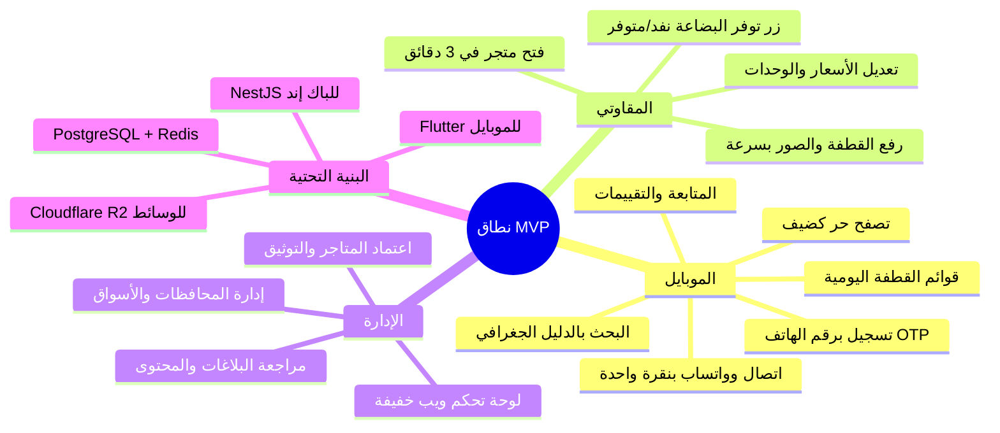

# وثيقة نطاق النسخة الأولى (MVP Scope & Exclusions) | منصة قطفة

---

## 1. فلسفة النسخة الأولى (The MVP Philosophy)

تتمثل الفلسفة الحاكمة للنسخة الأولى من منصة **قطفة** في المعادلة التالية:
> **"أسرع إطلاق ميداني ممكن + أقل تكلفة تشغيلية واستضافة + أعلى جودة وتجاوب على شبكات الإنترنت اليمنية"**

الهدف الاستراتيجي ليس بناء كل شيء من اليوم الأول، بل إطلاق المنصة في أقل من **8 إلى 10 أسابيع**، وحل المشكلة الجوهرية: **"كيف يعرف الزبون في صنعاء أو عدن أفضل قطفة قات متوفرة حوله الآن، وكيف يتواصل فوراً مع صاحبها؟"**.

---

## 2. النطاق المعتمد للنسخة الأولى (In-Scope - Core MVP)

### تفاصيل المكونات المعتمدة:
1. **تطبيق الهواتف الذكية (Android & iOS):**
   - واجهة مستخدم مبسطة جداً، سريعة التحميل، تعمل بكفاءة على شبكات 3G.
   - وضع الزائر الكامل (Guest Mode) لتصفح الأسواق والمنتجات دون أي حاجز تسجيل.
   - تسجيل الدخول والتوثيق برقم الهاتف ورمز التحقق (OTP).
   - دليل هرمي للمناطق: (المحافظة > المديرية > السوق > أقرب معلم).
   - عرض بطاقات القطفة اليومية مع صور مضغوطة، نوع القات، السعر بالريال، الوحدة، وحالة التوفر.
   - روابط التحويل الفوري: زر الاتصال الهاتفي وزر WhatsApp بمحادثة مجهزة مسبقاً.
   - التفاعل المجتمعي: متابعة المتاجر المفضلة، تقييم المتجر بالنجوم، مشاركة رابط القطفة عبر واتساب، وزر الإبلاغ عن المحتوى المخالف.
   - إشعارات Push Notifications عبر Firebase للمتابعين عند نزول بضاعة جديدة.

2. **بوابة الإدارة والمشرفين (Web Admin Portal):**
   - لوحة تحكم سريعة لإدارة المتاجر (موافقة، رفض، حظر، توثيق).
   - إدارة المحتوى وقائمة البلاغات لمعالجة المخالفات.
   - إدارة البيانات الجغرافية المرجعية (إضافة أسواق جديدة في المدن).
   - إحصائيات سريعة للنشاط اليومي.

---

## 3. الميزات المؤجلة عمداً من MVP وأسباب استبعادها (Out-of-Scope & Justifications)

| الميزة المستبعدة | البديل المعتمد في MVP | الأسباب التقنية والتجارية للاستبعاد |
| :--- | :--- | :--- |
| **بوابة الدفع الإلكتروني المباشر** | الدفع المباشر نقداً بين التاجر والزبون عند الاستلام | 1. أكثر من 85% من التعاملات في اليمن لا تزال كاش. 2. التعقيد التنظيمي والحاجة لحسابات بنكية وضمانات. 3. تقليل أي احتكاك (Friction) أمام المقاوتي الجديد. |
| **إدارة أساطيل التوصيل والتتبع الحي** | الاستلام المباشر من مفرش المقاوتي بالسوق أو ترتيب خاص عبر واتساب | 1. القات سلعة زراعية فائقة التلف وحساسة للحرارة والوقت. 2. تكلفة تشغيل أسطول سيارات أو دراجات باهظة جداً. 3. شوارع وأسواق اليمن تعاني من زحام خانق قد يتسبب في تلف السلعة وشكاوى متكررة. |
| **الدردشة الكتابية المدمجة (In-App Chat)** | زر WhatsApp وزر الاتصال الهاتفي المباشر | 1. تطبيق WhatsApp هو المنصة الأولى للتواصل الشعبي في اليمن. 2. بناء شات مدمج يتطلب خوادم Socket.io واستضافة مكلفة وإدارة مستمرة. 3. المقاوتي أثناء انشغاله في السوق لن يفتح شات داخل تطبيق غير معتاد عليه. |
| **خرائط Google Maps التفاعلية المدفوعة** | الدليل الجغرافي الهرمي الدقيق + رابط Google خارجي مجاني | 1. أسعار Google Maps API مرتفعة جداً بالدولار. 2. معظم أسواق ومفارش القات اليمنية الشعبية لا تحمل أسماء شوارع مرقمة على Google Maps بدقة كافية. 3. الوصف المحلي بالمعالم (مثال: *"سوق نقم، بجوار بنك الكريمي، مفرش رقم 5"*) أكثر دقة 100 مرة للزبون المحلي. |
| **البث المباشر (Live Streaming)** | صور وفيديوهات قصيرة مضغوطة جداً | سرعات الإنترنت في اليمن وتكلفتها لا تسمح حالياً بتشغيل خوادم بث حي WebRTC بتكلفة مجدية للمشروع. |
| **محرك التوصيات بالذكاء الاصطناعي (AI Recommendations)** | ترتيب بسيط يعتمد على: الأحدث، الأقرب، والأعلى تقييماً | استخدام الـ AI في مرحلة البداية دون وجود ملايين البيانات سلوك مكلف وغير مبرر تجارياً (Over-engineering). |

---

## 4. معايير بوابة الانتقال إلى المرحلة الثانية (MVP Exit Criteria)

لإعلان نجاح النسخة الأولى والبدء بتنفيذ المرحلة التالية من خارطة الطريق، يجب تحقيق المعايير التالية:
1. تسجيل وتوثيق ما لا يقل عن **300 مقاوتي نشط** في أسواق صنعاء وعدن.
2. قيام أكثر من **70%** من المقاوتية المسجلين بنشر وتحديث قطفاتهم اليومية بانتظام.
3. تجاوز حاجز **25,000 عملية تنزيل** للتطبيق خلال أول شهرين.
4. توليد ما لا يقل عن **50,000 نقرة اتصال ومحادثة واتساب** للطلب والاستفسار.
5. استقرار البنية التحتية بنسبة توافر تتجاوز 99.8% دون أي انهيار خلال ساعات الذروة اليومية.
