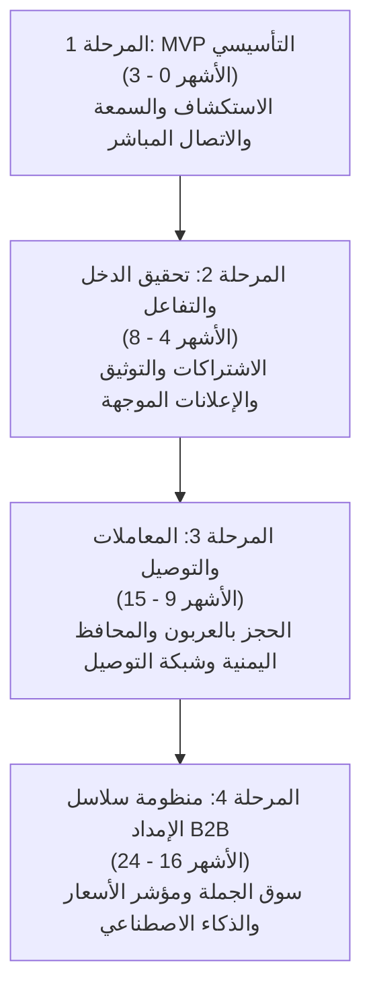

# خارطة الطريق متعددة المراحل (Product Roadmap) | منصة قطفة

---

## 1. الرؤية الزمنية العامة لخارطة الطريق

---

## 2. تفصيل مراحل التطوير والتوسع

### المرحلة الأولى: التأسيس وإطلاق MVP (الأشهر 0 - 3)
- **التركيز الأساسي:** إثبات حاجة السوق (Product-Market Fit)، والنزول الميداني لأسواق صنعاء وعدن، وبناء كتلة حرجة من التجار والمستخدمين.
- **المخرجات والميزات:**
  - تطبيق الموبايل لنظامي Android و iOS مع التصفح الحر كضيف.
  - محرك البحث الجغرافي والدليل الهرمي للأسواق والمديريات.
  - نشر القطفة اليومية السريعة وصور WebP المضغوطة.
  - التحويل الفوري للاتصال ومحادثات WhatsApp الذكية.
  - نظام المتابعة والإشعار عند نشر بضاعة جديدة.
  - التقييمات والمراجعات ونظام مكافحة السبام البسيط.
  - لوحة الإدارة لمراجعة المحتوى وتوثيق المتاجر.

---

### المرحلة الثانية: التفاعل وتفعيل الإيرادات (الأشهر 4 - 8)
- **التركيز الأساسي:** تحقيق التدفق النقدي الذاتي للمنصة (Cash-flow positive) عبر باقات التجار.
- **المخرجات والميزات:**
  - **باقات اشتراك المقاوتية:** حساب "المقاوتي المعتمد" بشارة زرقاء ودعم فني مخصص.
  - **ميزة الإعلانات وتثبيت القطفة (Sponsored Drops):** ظهور العرض في أعلى نتائج البحث بالحي.
  - **حملات الإشعارات المحلية (Local Geotargeted Push):** إشعار مستخدمي الحي عند وصول شحنة خاصة.
  - **خرائط OpenStreetMap التفاعلية الخفيفة:** إمكانية رؤية موقع المفرش على خريطة تفاعلية بدون تكلفة إضافية.
  - **قصص القطفة اليومية (Stories / Daily Clips):** مقاطع فيديو قصيرة جداً (15 ثانية) تعرض نضارة القات وتختفي بعد 12 ساعة.

---

### المرحلة الثالثة: المعاملات المالية والتوصيل التشاركي (الأشهر 9 - 15)
- **التركيز الأساسي:** إدخال المعاملات المالية الآمنة وحل مشكلة الشراء المسبق والتوصيل.
- **المخرجات والميزات:**
  - **نظام الحجز المسبق بالعربون (Pre-order Escrow):** دفع عربون حجز بسيط لضمان عدم بيع الحزمة لزبون آخر.
  - **ربط المحافظ الإلكترونية اليمنية المعتمدة:**
    - كريمي جوال (Kuraimi Jawal)
    - فلوسك (Floosak - بنك اليمن والكويت)
    - ون كاش (OneCash)
    - جيب (Jeeb)
    - جوالي (Jawali)
  - **شبكة التوصيل التشاركي بالدراجات النارية (Crowdsourced Bike Couriers):**
    - تسجيل سائقي الدراجات النارية في الأحياء لتوصيل الطلبات المحجوزة من السوق للزبون خلال 30 دقيقة مقابل أجرة توصيل ثابتة.
  - **نظام نقاط الولاء والمكافآت (Qatfa Rewards):** كسب نقاط عند كل عملية تقييم ومراجعة موثقة واستبدالها برصيد أو خصومات.

---

### المرحلة الرابعة: سلاسل الإمداد ومؤشرات السوق الذكية B2B (الأشهر 16 - 24)
- **التركيز الأساسي:** ربط المزارع بالمقاوتية (Supply Chain Digitization) وتوفير ذكاء أعمال للسوق.
- **المخرجات والميزات:**
  - **سوق الجملة (Qatfa B2B Wholesale):** ربط أصحاب المزارع في همدان، أرحب، رداع، عنس، وصعدة مباشرة مع تجار التجزئة في المدن الكبرى لتنظيم صفقات الشحن الصباحية.
  - **مؤشر أسعار القات اليومي (Daily Market Price Index):** لوحة بيانية شفافة توضح متوسط سعر القات اليومي حسب النوع والمحافظة لخدمة الجمهور والتجار.
  - **تحليلات متقدمة للمقاوتي:** تقارير شهرية توضح أكثر الساعات طلباً، وأنواع القات الأكثر بحثاً في منطقته.
  - **فرز جودة الصور بالذكاء الاصطناعي (AI Quality Screen):** استبعاد الصور المضللة أو غير الواضحة تلقائياً واقتراح تحسين إضاءة الصورة للتاجر قبل النشر.

---

## 3. مصفوفة الأولويات الفنية والتجارية

| الميزة | المرحلة | الأثر التجاري | التعقيد الفني | قرار التنفيذ |
| :--- | :--- | :--- | :--- | :--- |
| **دليل المتاجر والقطفة اليومية** | 1 | مرتفع جداً | منخفض | فوري (MVP) |
| **الاتصال الهاتفي والواتساب** | 1 | مرتفع جداً | منخفض | فوري (MVP) |
| **التقييمات والمتابعة** | 1 | مرتفع | متوسط | فوري (MVP) |
| **اشتراكات المتاجر والتوثيق** | 2 | مرتفع جداً | منخفض | أولوية المرحلة 2 |
| **قصص القطفة القصيرة** | 2 | متوسط | متوسط | أولوية المرحلة 2 |
| **المحافظ الإلكترونية اليمنية** | 3 | مرتفع جداً | مرتفع | أولوية المرحلة 3 |
| **شبكة سائقي التوصيل** | 3 | مرتفع | مرتفع جداً | أولوية المرحلة 3 |
| **سوق الجملة B2B للمزارع** | 4 | مرتفع جداً | مرتفع | أولوية المرحلة 4 |
| **فحص الجودة بالـ AI** | 4 | متوسط | مرتفع | أولوية المرحلة 4 |
