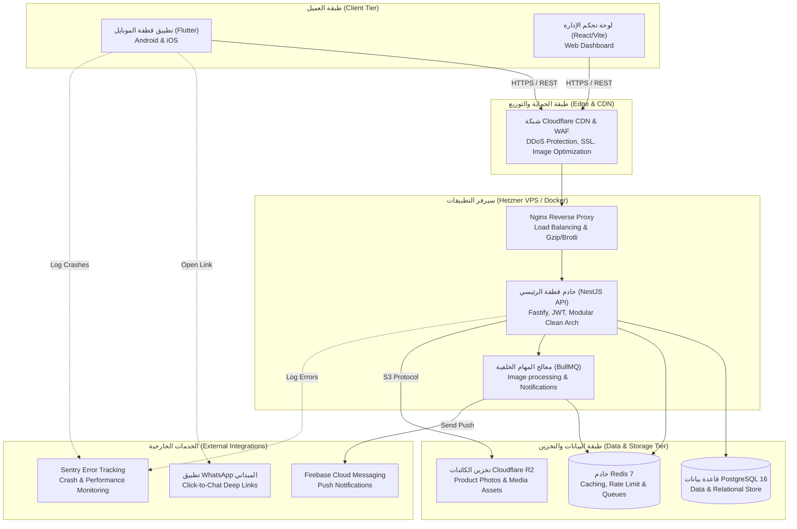

# المعمارية التقنية وقرارات الاختيار (System Architecture & ADRs) | منصة قطفة

---

## 1. مقارنة التقنيات وقرارات الاختيار المعمارية (Technology Trade-offs)

### 1.1 تقنيات تطبيقات الهاتف: Flutter مقابل React Native

| المعيار | Flutter (Dart) | React Native (TypeScript) | التحليل لسوق اليمن |
| :--- | :--- | :--- | :--- |
| **الأداء على الأجهزة الضعيفة** | ممتاز (الترجمة المباشرة إلى Native ARM عبر محرك Impeller/Skia) | جيد (لكنه يعتمد على الجسر أو Hermes مع استهلاك أعلى للذاكرة) | أجهزة اليمن الاقتصادية (Infinix, Tecno, Itel) تتفوق بشكل حاسم مع Flutter |
| **دعم RTL والخط العربي** | أصيل وتطابق تام 100% دون أي مشاكل تنسيق | يتطلب ضبطاً إضافياً وقد تحدث مشاكل في اتجاهات الأيقونات | ميزة حاسمة للمستخدم اليمني |
| **حجم التطبيق النهائي** | صغير ومنضبط مع تفعيل ProGuard و Tree-shaking | متوسط، مع تبعيات JavaScript Bundle | تقليل حجم التطبيق لأقل من 18MB مهم لتوفير باقات البيانات |
| **وفرة المطورين محلياً** | مجتمع مطوري Flutter هو الأكبر والأكثر نشاطاً في اليمن | متوفر لكنه أقل انتشاراً بين مطوري الموبايل المحليين | سهولة توظيف واستبدال الكفاءات محلياً |

> **القرار المعتمد (ADR-01):** اختيار **Flutter** كإطار عمل موحد لتطبيق الموبايل (Android و iOS).

---

### 1.2 تقنيات الخادم الخلفي (Backend Framework): مقارنة الرباعي

| الإطار | NestJS (Node.js/TS) | Laravel (PHP) | ASP.NET Core (C#) | Spring Boot (Java) |
| :--- | :--- | :--- | :--- | :--- |
| **سرعة التطوير (Time to Market)** | سريعة جداً | فائقة السرعة | متوسطة | بطيئة ومعقدة نسبياً |
| **استهلاك الذاكرة (RAM Footprint)** | منخفض (90MB - 180MB) | منخفض إلى متوسط | منخفض إلى متوسط | مرتفع (يحتاج خوادم بذاكرة 2GB+ للبدء) |
| **نموذج الإدخال/الإخراج** | غير متزامن فائق السرعة (Non-blocking I/O) | متزامن في الأصل (يحتاج Octane للأداء العالي) | غير متزامن عالي الأداء | متعدد الخيوط |
| **المعمارية النظيفة (Clean Architecture)** | معمارية معيارية مدمجة (Modules, DI, Guards, DTOs) | MVC قياسي (يتطلب جهداً للحفاظ على Clean Arch) | معمارية مؤسسية ممتازة | معمارية مؤسسية قوية |
| **التوافق المعرفي مع الفريق** | لغة TypeScript مشتركة بين الويب والباك إند | لغة PHP منفصلة | بيئة .NET خاصة | بيئة Java خاصة |

> **القرار المعتمد (ADR-02):** اختيار **NestJS (TypeScript)** مع محرك **Fastify** لسرعة استجابة فائقة، معمارية وحدات واضحة، وتكلفة استضافة متناهية الصغر تناسب انطلاقة المشروع.

---

### 1.3 مقارنة قواعد البيانات (Database Engine)

| الخيار | المزايا | العيوب | التقييم لمنصة قطفة |
| :--- | :--- | :--- | :--- |
| **PostgreSQL** | علاقات متينة، دعم هائل للبحث النصي العربي، دعم JSONB للبيانات المرنة، ودعم PostGIS للبيانات الجغرافية | يتطلب ضبط فهارس جيد | **الخيار المثالي (Winner):** يجمع بين متانة العلاقات ومرونة الـ NoSQL والقدرات الجغرافية |
| **MySQL / MariaDB** | شائعة وبسيطة | إمكانيات JSON والميزات الجغرافية المتقدمة أضعف من Postgres | مقبولة لكن Postgres تتفوق مستقبلاً |
| **MongoDB** | مرونة المستندات | صعوبة إدارة العلاقات المعقدة والتقارير المالية والتحويلات | غير مناسبة لمنصة تجارية مستقبلية تتطلب معايير ACID |
| **Firebase Firestore** | سريعة في البدء | تكلفة باهظة وغير متوقعة عند زيادة القراءات، وصعوبة الاستعلامات المركبة | مرفوضة لتجنب مفاجآت التكلفة بالدولار |

> **القرار المعتمد (ADR-03):** اعتماد **PostgreSQL 16** مع **Redis 7** للتخزين المؤقت وتحديد معدلات الطلب (Rate Limiting).

---

### 1.4 مقارنة التخزين والوسائط (Media & Object Storage)

| الخدمة | تكلفة التخزين (لكل GB) | تكلفة نقل البيانات (Egress Fees) | الأداء العالمي والوسائط |
| :--- | :--- | :--- | :--- |
| **Cloudflare R2** | \$0.015 / GB شهرياً | **\$0.00 (مجاني تماماً بدون أي رسوم خروج)** | توافق كامل مع S3 API وربط فوري مع شبكة CDN |
| **AWS S3** | \$0.023 / GB شهرياً | مرتفعة (\$0.09 / GB) وتزيد الفاتورة بشكل مفاجئ | معيار عالمي لكن تكاليف الـ Egress خطيرة |
| **MinIO (Self-hosted)** | مجاني برمجياً (تكلفة السيرفر فقط) | تعتمد على باندويث السيرفر | يتطلب إدارة صيانة وتأمين مستمر للقرص |

> **القرار المعتمد (ADR-04):** اعتماد **Cloudflare R2** لصفرية رسوم نقل البيانات (Zero Egress Fees) والتكامل السلس مع شبكة Cloudflare CDN لضغط وتوزيع الصور مجاناً.

---

### 1.5 مقارنة خدمات الخرائط (Mapping Strategy)

| الخيار | التكلفة المالية | الدقة في اليمن | القرار المعتمد |
| :--- | :--- | :--- | :--- |
| **Google Maps API** | باهظة (\$7 لكل 1000 استدعاء خريطة) | ضعيفة في أسماء أزقة الأسواق الشعبية | **مستبعدة من واجهات التطبيق المباشرة** |
| **OpenStreetMap + Leaflet** | مجانية ومفتوحة المصدر | جيدة جداً وتتحسن مجتمعياً | معتمدة كخيار عرض بصري خفيف في المرحلة الثانية |
| **الدليل الهرمي (Hierarchical Dropdowns)** | صفر تكلفة | **الأعلى دقة وفهماً للمواطن اليمني** | **الخيار الأساسي الحاكم لـ MVP** مع زر فتح Google Maps الخارجي مجاناً |

---

### 1.6 الاستضافة والبنية التحتية السحابية

- **الاختيار:** استئجار خادم سحابي افتراضي خاص (VPS) من **Hetzner Cloud** (مثل خادم CPX31: 4 vCPU, 8GB RAM, 160GB NVMe بتكلفة حوالي 14 يورو شهرياً) أو **DigitalOcean** (\$24 شهرياً).
- **التبرير:** تكلفة ثابتة ومنخفضة جداً تحمي ميزانية الشركة الناشئة، مع توفير أداء أسرع بكثير من خدمات السحابة باهظة الثمن (AWS/GCP) في المراحل التأسيسية.

---

## 2. مخطط معمارية النظام (C4 Architecture Diagram)

---

## 3. قرارات التصميم المعماري (Architectural Decisions Summary)

1. **الاعتماد على Modular Monolith في البداية:**
   - تجنب تعقيدات الـ Microservices في المرحلة الأولى. نظام Modular Monolith مبني داخل NestJS بنظافة، يسهل اختباره ونشره، ومستعد للانفصال لخدمات مستقلة عندما يتجاوز الضغط مئات الآلاف من الزوار.
2. **استراتيجية التحميل المسبق والتخزين المؤقت (Aggressive Cache Strategy):**
   - تخزين شجرة المحافظات والمديريات والأسواق في ذاكرة تطبيق الموبايل (Hive / SharedPreferences)، وتخزين قوائم عروض اليوم الأكثر قراءة في Redis لمدة 60 ثانية لتقليل الضغط على قاعدة البيانات بنسبة 85%.
3. **التصميم غير المعتمد على اتصال مستمر (Offline Resilience):**
   - التطبيق يحتفظ بآخر البيانات التي شاهدها العميل في ذاكرة التخزين المؤقت لعرضها حتى عند تقطع الإنترنت المفاجئ أثناء تواجده في السوق.
