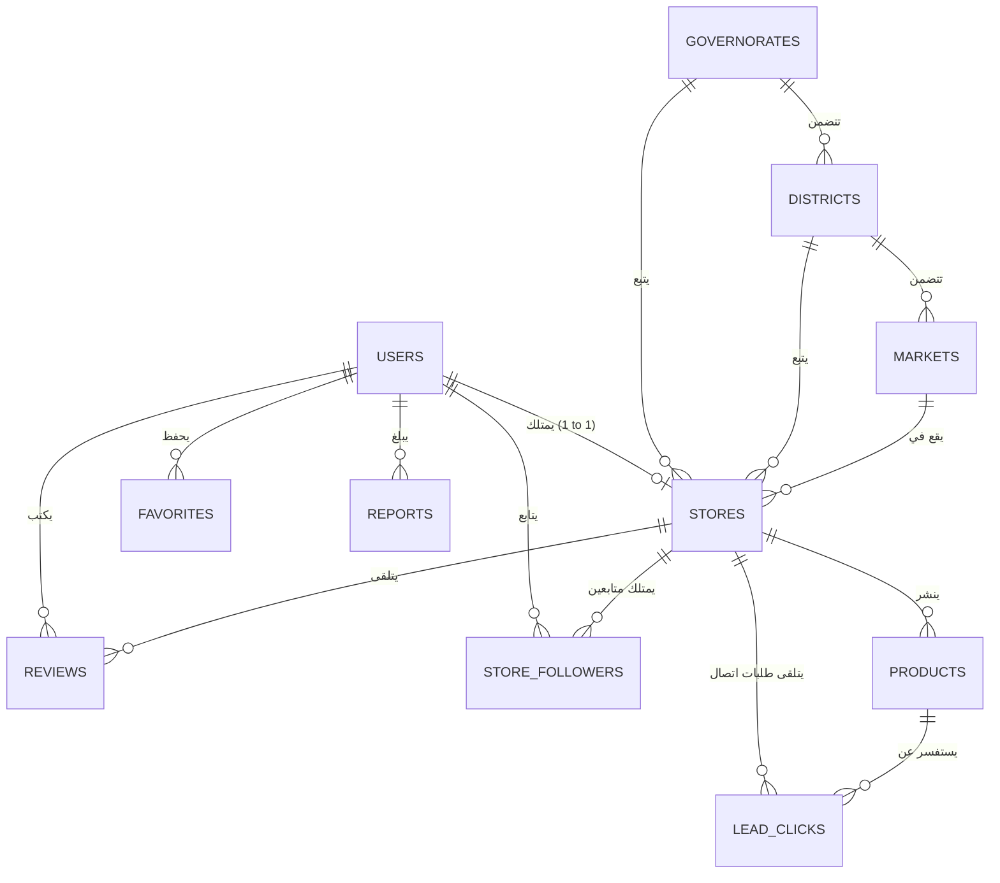

# تصميم وهيكلية قاعدة البيانات (Database Design & ERD) | منصة قطفة

---

## 1. محرك قاعدة البيانات والمعايير العامة

- **المحرك:** PostgreSQL 16 Enterprise.
- **الترميز:** `UTF8` لدعم كامل للغة العربية.
- **التوقيت:** التخزين الموحد بتوقيت `UTC` مع العرض للمستخدم بتوقيت اليمن `Asia/Aden` (UTC+3).
- **المعرفات الأساسية (Primary Keys):** استخدام `UUID v7` أو `BIGSERIAL` المتسلسل المفهرس لسرعة الفهرسة العالية.
- **الحذف المرن (Soft Deletes):** استخدام حقل `deleted_at` لكافة الجداول الحيوية لحفظ السجلات وتفادي الفقدان غير المقصود.

---

## 2. مخطط علاقات الكيانات (Entity Relationship Diagram - ERD)



---

## 3. جداول قاعدة البيانات التفصيلية (DDL Specifications)

### 3.1 جدول المستخدمين (`users`)
| الحقل | النوع | القيود | الوصف |
| :--- | :--- | :--- | :--- |
| `id` | `UUID` | PRIMARY KEY | المعرف الفريد للمستخدم |
| `phone_number` | `VARCHAR(20)` | UNIQUE, NOT NULL | رقم الهاتف بصيغة دولية (+967) |
| `full_name` | `VARCHAR(100)` | NOT NULL | الاسم الظاهر |
| `role` | `VARCHAR(20)` | NOT NULL, DEFAULT 'CUSTOMER' | الصلاحية: `GUEST`, `CUSTOMER`, `SELLER`, `MODERATOR`, `ADMIN` |
| `avatar_url` | `VARCHAR(500)` | NULLABLE | رابط الصورة الشخصية |
| `governorate_id` | `INT` | NULLABLE | المحافظة المفضلة للتصفح السريع |
| `is_active` | `BOOLEAN` | DEFAULT TRUE | هل الحساب نشط أم محظور |
| `fcm_token` | `VARCHAR(300)` | NULLABLE | رمز جهاز Firebase للإشعارات |
| `created_at` | `TIMESTAMPTZ` | DEFAULT NOW() | تاريخ الإنشاء |
| `updated_at` | `TIMESTAMPTZ` | DEFAULT NOW() | تاريخ التعديل |

---

### 3.2 جدول المتاجر والمقاوتية (`stores`)
| الحقل | النوع | القيود | الوصف |
| :--- | :--- | :--- | :--- |
| `id` | `UUID` | PRIMARY KEY | معرف المتجر |
| `user_id` | `UUID` | UNIQUE, REFERENCES users(id) | مالك المتجر (المقاوتي) |
| `store_name` | `VARCHAR(150)` | NOT NULL | اسم الشهرة أو المحل |
| `slug` | `VARCHAR(160)` | UNIQUE, NOT NULL | رابط فريد للمشاركة |
| `bio` | `TEXT` | NULLABLE | نبذة عن المقاوتي وخبرته |
| `logo_url` | `VARCHAR(500)` | NULLABLE | شعار المتجر |
| `cover_url` | `VARCHAR(500)` | NULLABLE | صورة واجهة المتجر / المفرش |
| `phone_call` | `VARCHAR(20)` | NOT NULL | رقم الاتصال المباشر |
| `phone_whatsapp`| `VARCHAR(20)` | NOT NULL | رقم الواتساب المعتمد |
| `governorate_id`| `INT` | REFERENCES governorates(id) | المحافظة |
| `district_id` | `INT` | REFERENCES districts(id) | المديرية |
| `market_id` | `INT` | REFERENCES markets(id) | السوق الشعبي |
| `address_detail`| `VARCHAR(255)`| NOT NULL | معلم بارز (مثال: جوار بوابة 2) |
| `latitude` | `DECIMAL(10,8)`| NULLABLE | خط العرض (اختياري) |
| `longitude` | `DECIMAL(11,8)`| NULLABLE | خط الطول (اختياري) |
| `is_verified` | `BOOLEAN` | DEFAULT FALSE | شارة التوثيق الرسمية |
| `is_open_today` | `BOOLEAN` | DEFAULT TRUE | هل المتجر مفتوح اليوم |
| `rating_avg` | `DECIMAL(3,2)` | DEFAULT 5.00 | متوسط التقييم التراكمي |
| `reviews_count` | `INT` | DEFAULT 0 | إجمالي عدد المراجعات |
| `followers_count`| `INT` | DEFAULT 0 | عدد المتابعين |
| `created_at` | `TIMESTAMPTZ` | DEFAULT NOW() | تاريخ التسجيل |
| `updated_at` | `TIMESTAMPTZ` | DEFAULT NOW() | تاريخ التحديث |

---

### 3.3 جدول المنتجات وعروض القطفة اليومية (`products`)
| الحقل | النوع | القيود | الوصف |
| :--- | :--- | :--- | :--- |
| `id` | `UUID` | PRIMARY KEY | معرف القطفة / المنتج |
| `store_id` | `UUID` | REFERENCES stores(id) | المتجر التابع له |
| `title` | `VARCHAR(150)` | NOT NULL | عنوان العرض (مثال: شامي فاخر رأس) |
| `qat_type` | `VARCHAR(50)` | NOT NULL | النوع (همداني، شامي، رداعي، إلخ) |
| `quality_grade`| `VARCHAR(30)` | NOT NULL | الجودة (سوبر، أول، وسط، تجاري) |
| `harvest_region`| `VARCHAR(100)`| NULLABLE | منطقة القطف والمزرعة |
| `harvest_time` | `VARCHAR(50)` | NOT NULL | وقت القطف (قطفة الصباح، قطفة الأمس) |
| `price` | `DECIMAL(12,2)`| NOT NULL | السعر |
| `currency` | `VARCHAR(10)` | DEFAULT 'YER_OLD' | العملة (`YER_OLD` قديم / `YER_NEW` جديد) |
| `price_unit` | `VARCHAR(30)` | NOT NULL | الوحدة (حبة، قبضة، قلايد، كيلو، باقة) |
| `stock_status` | `VARCHAR(20)` | DEFAULT 'AVAILABLE' | الحالة: `AVAILABLE`, `LOW_STOCK`, `SOLD_OUT` |
| `images` | `JSONB` | NOT NULL | مصفوفة روابط الصور المضغوطة |
| `video_url` | `VARCHAR(500)` | NULLABLE | رابط فيديو قصير إن وجد |
| `is_active` | `BOOLEAN` | DEFAULT TRUE | متاح للعرض أم مخفي |
| `drop_date` | `DATE` | DEFAULT CURRENT_DATE | تاريخ يوم القطفة لتنظيف وعزل الأيام السابقة |
| `created_at` | `TIMESTAMPTZ` | DEFAULT NOW() | توقيت النشر الفعلي |
| `updated_at` | `TIMESTAMPTZ` | DEFAULT NOW() | توقيت التعديل |

---

### 3.4 جدول التقييمات والمراجعات (`reviews`)
| الحقل | النوع | القيود | الوصف |
| :--- | :--- | :--- | :--- |
| `id` | `UUID` | PRIMARY KEY | معرف المراجعة |
| `user_id` | `UUID` | REFERENCES users(id) | العميل المقيم |
| `store_id` | `UUID` | REFERENCES stores(id) | المتجر المقيم |
| `rating` | `INT` | CHECK (rating >= 1 AND rating <= 5) | عدد النجوم |
| `comment` | `TEXT` | NOT NULL | نص الرأي والتقييم |
| `merchant_reply`| `TEXT` | NULLABLE | رد التاجر الرسمي |
| `is_approved` | `BOOLEAN` | DEFAULT TRUE | هل التقييم معتمد أم محجوب |
| `created_at` | `TIMESTAMPTZ` | DEFAULT NOW() | تاريخ التقييم |

---

### 3.5 جدول متابعات المتاجر (`store_followers`)
| الحقل | النوع | القيود | الوصف |
| :--- | :--- | :--- | :--- |
| `id` | `BIGSERIAL` | PRIMARY KEY | معرف السجل |
| `user_id` | `UUID` | REFERENCES users(id) | المستخدم المتابع |
| `store_id` | `UUID` | REFERENCES stores(id) | المتجر المتابع |
| `created_at` | `TIMESTAMPTZ` | DEFAULT NOW() | تاريخ المتابعة |
*(قيد فريد: `UNIQUE(user_id, store_id)` لمنع التكرار)*

---

### 3.6 جدول تتبع التحويلات والاتصالات (`lead_clicks`)
| الحقل | النوع | القيود | الوصف |
| :--- | :--- | :--- | :--- |
| `id` | `BIGSERIAL` | PRIMARY KEY | معرف السجل |
| `user_id` | `UUID` | NULLABLE | المستخدم إن كان مسجلاً (أو NULL للزائر) |
| `store_id` | `UUID` | REFERENCES stores(id) | المتجر المستهدف |
| `product_id` | `UUID` | NULLABLE, REFERENCES products(id) | المنتج المستفسر عنه |
| `click_type` | `VARCHAR(20)` | NOT NULL | نوع الإجراء: `PHONE_CALL` أو `WHATSAPP` |
| `ip_address` | `INET` | NULLABLE | عنوان الآي بي لتحليل السلوك ومنع الاحتيال |
| `created_at` | `TIMESTAMPTZ` | DEFAULT NOW() | وقت النقر |

---

### 3.7 جداول الدليل الجغرافي المرجعي (`governorates`, `districts`, `markets`)
- `governorates`: `(id, name_ar, name_en, currency_code, is_active)`
- `districts`: `(id, governorate_id, name_ar, is_active)`
- `markets`: `(id, district_id, name_ar, landmark, is_active)`

---

## 4. استراتيجيات الفهرسة وتحسين الأداء (Indexing Strategy)

```sql
-- 1. فهرس مركب سريع جداً لاستعلامات الصفحة الرئيسية والفلترة اليومية
CREATE INDEX idx_products_active_drop ON products (drop_date DESC, stock_status, created_at DESC)
WHERE is_active = TRUE;

-- 2. فهرس للبحث حسب المتجر ومنتجاته النشطة
CREATE INDEX idx_products_store_active ON products (store_id, is_active, created_at DESC);

-- 3. فهرس جغرافي مركب للمتاجر المفتوحة في مديرية وسوق معين
CREATE INDEX idx_stores_geo_active ON stores (governorate_id, district_id, market_id, is_open_today)
WHERE is_open_today = TRUE;

-- 4. فهرس فريد يمنع تكرار المراجعة لنفس المتجر خلال نفس الشهر
CREATE UNIQUE INDEX idx_unique_monthly_user_review ON reviews (user_id, store_id, date_trunc('month', created_at));

-- 5. فهرس نصي متقدم للبحث السريع في أسماء المتاجر والأنواع
CREATE INDEX idx_stores_name_trgm ON stores USING gin (store_name gin_trgm_ops);
CREATE INDEX idx_products_title_trgm ON products USING gin (title gin_trgm_ops);
```
