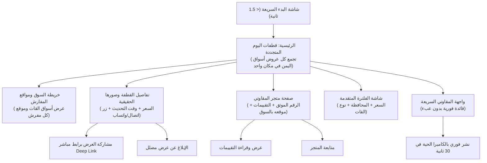

# دليل تجربة وتصميم واجهة المستخدم (UI/UX Guidelines) | منصة قطفة

---

## 1. فلسفة التصميم وسيكولوجية المستخدم (Design Philosophy & User Psychology)

### 1.1 المبادئ الثلاثية الحاكمة
1. **الوضوح الصارم تحت أشعة الشمس (Outdoor High Contrast):**
   - يُستخدم التطبيق بنسبة 70% أثناء الوقوف في أسواق القات المفتوحة أو أثناء التنقل بالسيارة في وضح النهار. التباين اللوني العالي والأيقونات الكبيرة هي متطلب حتمي وليست ترفاً جمالياً.
2. **السرعة الخاطفة وعدم إشغال اليدين (Frictionless / Single-Thumb Usability):**
   - المقاوتي في السوق تكون يداه مشغولتين بفرز الحزم واستلام النقود؛ يجب أن يتمكن من إنجاز أي عملية بنقرة إبهام واحدة وبأقل قدر من الكتابة النصية عبر خيارات الأزرار المجهزة (Chips & Toggles).
3. **الهوية اليمنية التراثية بروح عصرية (Modern Yemeni Heritage):**
   - تجسيد ألوان الطبيعة الجبلية اليمنية ومزارع القات العريقة مع لمسات أنيقة من ألوان العقيق اليمني، والابتعاد عن القوالب البلاستيكية المستوردة.

---

## 2. نظام الألوان الشامل (Color System)

```
[ الأخضر القاتمي - Qat Leaf ]   #1B5E20  ████  اللون الأساسي (Primary) - يمثل أصالة المحصول
[ الأخضر النضر - Fresh Shoot ]  #2E7D32  ████  اللون الثانوي والنشاط (Secondary)
[ لون العقيق اليماني - Agate ]   #E65100  ████  اللون التنبيهي والمميز (Accent) - للأزرار التفاعلية
[ رمادي فاتح مريح - Surface ]   #F4F6F8  ████  خلفية التطبيق لتقليل إجهاد العين
[ أبيض ناصع - Pure White ]     #FFFFFF  ████  بطاقات المنتجات والمحتوى
[ أحمر صريح - Sold Out Red ]    #D32F2F  ████  شارة "نفدت الكمية" والتنبيهات
```

| المتغير | الرمز اللوني | الاستخدام |
| :--- | :--- | :--- |
| `primary` | `#1B5E20` | أشرطة التطبيق العلوية (AppBars)، الأزرار الرئيسية، والشعار |
| `primary_light`| `#E8F5E9` | خلفيات البطاقات النشطة والشارات المعتمدة |
| `accent` | `#E65100` | أزرار الاتصال الهاتفي، شارات السعر البارزة، والتقييمات |
| `whatsapp_green`| `#25D366` | زر التواصل المباشر عبر WhatsApp |
| `surface` | `#F8F9FA` | خلفية الشاشات العامة |
| `text_primary` | `#1A202C` | النصوص والعناوين الرئيسية (عالية التباين) |
| `text_secondary`| `#718096` | النصوص الفرعية وتوقيت النشر |

---

## 3. الخطوط والتيبوجرافي (Typography)

- **عائلة الخط المعتمدة:** خط **Cairo** (أو **Almarai**) كخط عربي أساسي.
- **خصائص الخط:** يتميز بنسب هندسية ممتازة، ووضوح شديد للأرقام العربية والإنجليزية حتى في الأحجام الصغيرة (11sp)، ودقة قراءة ممتازة على شاشات الهواتف الاقتصادية منخفضة الدقة (HD Ready).

| المستوى | الحجم (SP) | الوزن (Weight) | الاستخدام |
| :--- | :--- | :--- | :--- |
| **Headline 1** | 22sp | Bold (700) | عنوان المتجر، أسماء الأسواق الرئيسية |
| **Headline 2** | 18sp | Semi-Bold (600) | عناوين عروض القطفة اليومية |
| **Price Tag** | 19sp | Bold (700) | عرض سعر القطفة بالريال اليمني |
| **Body Large** | 15sp | Regular (400) | تفاصيل ونبذة المتجر والوصف |
| **Body Small** | 12sp | Regular (400) | الطابع الزمني ("منذ 15 دقيقة")، اسم السوق |
| **Button Text**| 15sp | Bold (700) | نصوص أزرار الاتصال والمراسلة وحفظ العرض |

---

## 4. المكونات البصرية التفاعلية (Micro-Interactions & Components)

### 4.1 بطاقة القطفة اليومية (Daily Drop Card)
- **شكل البطاقة:** بطاقة بيضاء بظلال خفيفة ناعمة وحواف دائرية (Border Radius: 12dp).
- **الوسائط:** صورة عريضة بنسبة 16:9 بجودة WebP واضحة مع إمكانية التمرير الأفقي في حال وجود أكثر من صورة.
- **شارات الحالة العلوية (Overlays):**
  - شارة خضراء في الزاوية العلوية: *"طازج اليوم - قطفة الصباح"*.
  - شارة السعر السفلية: *"12,000 ريال / حبة"*.
- **الإجراءات الفورية السفلية:**
  - زر أخضر داكن بارز: `[ واتساب ]` بأيقونة WhatsApp.
  - زر ثانوي: `[ اتصال ]` بأيقونة الهاتف.
  - زر تبديل مفضلة (قلب صغير).

### 4.2 نموذج النشر السريع للمقاوتي (Zero Friction Quick Publisher)
- مبدأ الفائدة بدون عبء: لا توجد أي نماذج معقدة تستهلك وقت المقاوتي أثناء انشغاله في السوق.
- عند الضغط على الزر الدائري الكبير أسفل الشاشة `(+)`:
  1. نافذة سفلية منبثقة (Bottom Sheet) فورية.
  2. تشغيل كاميرا الهاتف مباشرة لالتقاط صورة حقيقية للقات الطازج.
  3. رقاقات سريعة لاختيار النوع (همداني | شامي | قعطبي | عنسي | رداعي) بضغطة إبهام.
  4. حقل رقمي كبير لإدخال السعر بالريال.
  5. زر كبير بملء الشاشة: **[ انشر القطفة في 30 ثانية ]** مع زر تبديل سريع: `[متوفر الآن] / [نفد]`.

### 4.3 شاشة خريطة السوق ومواقع المفارش (Interactive Market Map)
- خريطة تفاعلية خفيفة للسوق الشعبي المختار (عبر OpenStreetMap و FlutterMap مع تخزين مؤقت للبلاطات لتوفير النت).
- دبابيس واضحة (Stall Pins) تُظهر أسماء المقاوتية وأرقام مفارشهم.
- تمايز لوني فوري:
  - **دبوس أخضر نضر:** مقاوتي لديه قطفة متوفرة الآن وطازجة.
  - **دبوس رمادي:** مقاوتي نفدت بضاعته اليوم أو لم ينشر بعد.
- النقر على الدبوس يفتح بطاقة سريعة منبثقة بأسفل الشاشة تتضمن: صورة القات، السعر، شارة "رقم موثق"، وزر اتصال وزر واتساب مباشر.

### 4.4 بطاقة المشاركة الذكية والتسويق المستمر (Deep Link Share Card)
- زر مشاركة عريض في بطاقة القطفة: عند النقر عليه، يُنشئ التطبيق تلقائياً بطاقة صورية جذابة مخصصة لقصص وحالات WhatsApp و Facebook و Telegram.
- البطاقة تحتوي على: صورة القطفة الحقيقية، السعر بالريال، اسم المقاوتي وسوقه، ورابط مباشر ذكي `https://qatfa.ye/drop/:id`.
- نقر أي شخص على الرابط ينقله مباشرة إلى شاشة العرض داخل تطبيق «قطفة».

### 4.5 شارة توثيق رقم البائع وزر الإبلاغ عن العروض المضللة
- **شارة الثقة (Verified Phone):** أيقونة درع أخضر بجوار رقم واسم المقاوتي تفيد بتوثيق رقمه عبر OTP والتأكد من هويته الميدانية.
- **زر الإبلاغ عن العروض المضللة:** زر بشكل علم أحمر أو قائمة خيارات يتيح للمشتري التبليغ بنقرتين (صورة مسروقة/غير حقيقية، سعر وهمي مختلف عن السوق، بضاعة نفدت).

---

## 5. مخطط تدفق الشاشات (Screen Flow & Navigation Map)



---

## 6. إرشادات التصميم لحالات الإنترنت المتقطع (Offline & Loading States)

1. **هياكل التحميل الهيكلية (Skeleton Loaders):**
   - استبدال دوائر التحميل الدائرية المزعجة (Spinners) بهياكل رمادية تومض بنعومة (Shimmer Effect) تحاكي بطاقات القطفة ومظهر المتاجر لإشعار المستخدم بالسرعة.
2. **استبقاء البيانات السابقة (Stale-While-Revalidate):**
   - عند فتح التطبيق دون إنترنت، لا تظهر شاشة بيضاء أو رسالة خطأ مزعجة؛ بل تظهر آخر قائمة تم تصفحها مع شريط تنبيه صغير في الأعلى: *"أنت في وضع عدم الاتصال - البيانات المعروضة من آخر زيارة"*.
