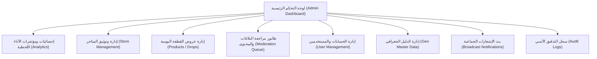

# مواصفات لوحة التحكم والإدارة (Admin Panel Specification) | منصة قطفة

---

## 1. نظرة عامة والتقنيات المعتمدة (Tech Stack & Architecture)

- **الهدف:** توفير واجهة ويب إدارية حديثة وفائقة السرعة لفريق إدارة المنصة، ومشرفي المحتوى، وفريق النزول الميداني.
- **التقنيات المعتمدة:**
  - **الواجهة:** React 18 + Vite (سرعة تجميع فائقة وحجم كود صغير).
  - **التصميم:** Tailwind CSS + مكونات shadcn/ui المهيأة لدعم الاتجاه من اليمين لليسار (RTL).
  - **إدارة الحالة والبيانات:** TanStack Query (React Query v5) لضمان تخزين مؤقت متطور واستجابة لحظية.
  - **الأمان:** حماية إضافية بجلسات مخصصة، وإلزام المصادقة الثنائية (2FA) للمشرفين والمديرين.

---

## 2. الهيكل العام للأقسام والصفحات (Information Architecture)

---

## 3. تفصيل وحدات لوحة التحكم (Module Specifications)

### 3.1 شاشة المؤشرات الحية (Dashboard & Live KPIs)
- **شريط العدادات اليومية:**
  - عدد القطفات المنشورة اليوم (Live Drops Today).
  - إجمالي نقرات الاتصال والواتساب المنفذة اليوم (Total Leads Today).
  - عدد المتاجر النشطة والمفتوحة في الأسواق الآن.
  - عدد البلاغات العاجلة المعلقة في طابور الانتظار.
- **الخريطة الحرارية للنشاط (Activity Heatmap):** توزيع الإقبال حسب المحافظات (صنعاء، عدن، تعز، إب، ذمار...).
- **رسم بياني لساعات الذروة:** تتبع حركة البحث والاتصالات لحظياً خلال نافذة (11:00 ص - 4:00 م).

---

### 3.2 وحدة إدارة وتوثيق المتاجر وأرقام البائعين (Store & Phone Verification)
- **قائمة طلبات التوثيق المعلقة (Pending Verifications):**
  - استعراض بيانات المتجر المسجل حديثاً (اسم المقاوتي، السوق، المفرش، أرقام الاتصال).
  - حالة التحقق من رقم الهاتف عبر OTP (Phone Verified Status).
  - مراجعة الصور المرفقة لمفرش التاجر وبطاقة هويته والتحقق الميداني لسفراء المنصة.
  - **إجراءات بضغطة زر واحدة:**
    - `[ منح شارة "رقم موثق" وشارة "متجر معتمد" ]`
    - `[ تحديد وتثبيت موقع مفرش التاجر على خريطة السوق ]`
    - `[ طلب استيفاء بيانات / اتصال بالمقاوتي ]`
    - `[ رفض الطلب مع توضيح السبب ]`
- **إدارة المتاجر الحالية:**
  - تعديل بيانات أي متجر، إعادة تعيين كلمة المرور أو رقم الهاتف، وتجميد المتجر في حال تكرار البلاغات.

---

### 3.3 طابور فحص البلاغات ومكافحة العروض المضللة (Misleading Offers & Abuse Queue)
- **طريقة العرض:** جدول مفصل يعرض البلاغات مرتبة حسب درجة الأهمية؛ وتجميد العرض تلقائياً بعد 3 بلاغات لحماية ثقة المشترين:
  - **عنصر البلاغ:** رابط المتجر، صورة القطفة، وقت التحديث، أو نص التقييم.
  - **السبب:** (سعر كاذب/وهمي، صورة مضللة أو مسروقة، بضاعة نفدت ولم يحدثها التاجر، احتيال).
  - **مقدم البلاغ:** معرف المستخدم وتاريخ وتوقيت البلاغ.
- **لوحة اتخاذ القرار السريع:**
  - زر أحمر: `[ حذف العرض المضلل فوراً مع إشعار التاجر ]`.
  - زر تحذيري: `[ إرسال إنذار بحظر المتجر وسحب شارة التوثيق ]`.
  - زر أزرق: `[ حظر حساب التاجر نهائياً لسوء السلوك ]`.
  - زر رمادي: `[ رفض البلاغ واعتباره كيدياً وإعادة تفعيل العرض ]`.

---

### 3.4 وحدة إدارة البيانات الجغرافية وخرائط الأسواق (Geo & Market Maps Manager)
- واجهة شجرية لإدارة الدليل الجغرافي وخرائط أسواق القات في عموم الجمهورية اليمنية:
  1. **المحافظات:** إضافة، تفعيل/تعطيل، تحديد العملة المتداولة (طبعة قديمة / جديدة).
  2. **المديريات:** ربط كل مديرية بمحافظتها.
  3. **أسواق القات في اليمن:** تحديد إحداثيات السوق، وتخطيط أماكن المفارش وتعيين كل مفرش لمقاوتي معتمد.
  3. **الأسواق الشعبية:** إضافة أسماء الأسواق الحقيقية المعروفة في المدن (مثل: سوق علي محسن، سوق عنقاد، سوق شميلة، سوق الشيخ عثمان...) مع حقل نصي لمعالم السوق وإحداثيات الموقع التقريبية.

---

### 3.5 وحدة بث الإشعارات الموجهة (Push Notifications Dispatcher)
- أداة سهلة تمكن المشرفين من إرسال إشعارات تسويقية أو توجيهية:
  - **الجمهور المستهدف:** (الكل، المشترين فقط، المقاوتية فقط، أو مستخدمي محافظة معينة).
  - **عنوان الإشعار ونصه:** باللغة العربية الواضحة.
  - **رابط التحويل المباشر (Deep Link):** توجيه المستخدم لفتح متجر معين أو تصفية نوع قات محدد عند النقر.

---

### 3.6 سجل التدقيق الأمني (Audit Logs)
- تسجيل تلقائي لكل إجراء يتخذه أي مدير أو مشرف في النظام:
  - المعرف، اسم المشرف، عنوان الـ IP، نوع الإجراء (حذف منتج، حظر متجر، تعديل محافظة)، والبيانات السابقة والجديدة (Diff Payload) لضمان النزاهة التامة ومنع إساءة استخدام الصلاحيات.
