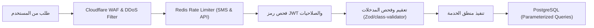

# خطة الأمان وحماية البيانات والخصوصية (Security Plan) | منصة قطفة

---

## 1. نموذج تهديدات النظام (Threat Modeling - STRIDE Analysis)

| التهديد (Threat) | الخطر في سياق قطفة | التدابير الأمنية المضادة (Mitigations) |
| :--- | :--- | :--- |
| **انتحال الهوية (Spoofing)** | فتح متجر مزيف باسم مقاوتي مشهور في سوق علي محسن لتضليل الزبائن | اعتماد شارات التوثيق (Verified Badges) بعد التحقق الميداني، والمصادقة الصارمة عبر رقم الهاتف ورمز OTP |
| **التلاعب بالبيانات (Tampering)** | تعديل أسعار أو بيانات قطفة تاجر آخر أو حشو تقييمات مزورة | تطبيق حراس المصادقة (Ownership Guards) في الباك إند: لا يمكن تعديل أو حذف أي منتج إلا من مالكه الشرعي المسجل |
| **الإنكار (Repudiation)** | قيام تاجر بنشر سعر كاذب أو مضلل ثم إنكار نشره | تسجيل كل عملية تعديل أو نشر في جدول سجلات التدقيق (Audit Logs) مع الـ IP والطابع الزمني الدقيق |
| **تسريب المعلومات (Info Disclosure)** | استخراج أرقام هواتف المشترين أو بياناتهم الخاصة | أرقام هواتف المشترين مشفرة ومحجوبة تماماً عن العامة؛ الرقم الوحيد الظاهر هو رقم هاتف متجر المقاوتي برغبته للتواصل |
| **حجب الخدمة (Denial of Service)** | استنزاف رصيد رسائل SMS عبر هجمات (SMS Pumping) أو إغراق السيرفر وقت الذروة | فرض قيود سرعة صارمة (Rate Limiting) عبر Redis، واستخدام Cloudflare Under Attack Mode وقت الذروة |
| **تصعيد الصلاحيات (Elevation of Privilege)** | محاولة مستخدم عادي الوصول إلى لوحة تحكم المشرفين | التحقق المشدد من صلاحيات الدور (RBAC Guards) في كل استدعاء API بالاعتماد على توقيع JWT الرقمي |

---

## 2. الإجراءات الأمنية التفصيلية (Security Controls)

### 2.1 حماية بوابات المصادقة ورموز التحقق (OTP Protection)
1. **فرادة رقم الهاتف الصارمة (Strict Phone Uniqueness Enforcement):**
   - قيد قاعدة بيانات فريد (`UNIQUE CONSTRAINT`) على مستوى جدول `users` والـ API يمنع نهائياً تكرار ربط نفس رقم الهاتف بأكثر من حساب، مما يقطع الطريق أمام إنشاء حسابات وهمية مزدوجة.
2. **مكافحة استنزاف رصيد الرسائل (Anti-SMS Pumping):**
   - حد أقصى 3 رسائل تحقق لكل رقم هاتف خلال فترة 15 دقيقة.
   - حد أقصى 10 طلبات OTP من نفس عنوان الـ IP خلال ساعة واحدة لمنع برامج البوت.
   - تشفير رمز الـ OTP في Redis كـ Hash مع وقت صلاحية (TTL) لا يتجاوز 120 ثانية، ويحذف فور الاستخدام الأول.

### 2.2 مكافحة الإساءة والبلاغات الكيدية (Anti-Abuse & Moderation Security)
1. **منع تكرار البلاغات (Report Deduplication Constraint):**
   - قيد فريد مركب `UNIQUE (reporter_id, target_type, target_id)` يمنع أي مستخدم من إغراق النظام أو البائع ببلاغات متكررة على نفس العرض أو التاجر.
2. **سياسة منع الحظر الآلي (No Automated Ban Policy):**
   - تحصين النظام ضد هجمات الإبلاغ الكيدي الجماعي (Sybil / Report-Bombing Attacks)؛ فلا يتم تعليق أو حظر أي حساب تلقائياً مهما بلغ عدد البلاغات، بل تُحول البلاغات إلى طابور مراجعة الدعم الفني للتحقق والاتصال المباشر قبل اتخاذ أي إجراء إداري يدوي.

### 2.3 إدارة الرموز الرقمية والجلسات (JWT Lifecycle)
- **رمز الوصول (Access Token):** مدة صلاحية قصيرة (15 دقيقة) موقعة بمفتاح `RS256` أو `HS256` عالي القوة.
- **رمز التجديد (Refresh Token):** مدة صلاحية 30 يوماً، مخزن ومفهرس في قاعدة البيانات مع دعم الإلغاء الفوري (Revocation) في حال رصد أي سلوك مريب أو تغيير الهاتف.

### 2.3 أمان الوسائط والصور المرفوعة (Media Upload Security)
1. **التحقق من التوقيع الحقيقي للملف (MIME Magic Bytes):**
   - فحص بايتات التوقيع الحقيقية للملف في السيرفر وعدم الاكتفاء بامتداد اسم الملف لمنع رفع ملفات تنفيذية ضارة.
2. **تطهير البيانات الوصفية (Metadata Stripping - EXIF Data):**
   - إزالة كافة البيانات الوصفية (EXIF metadata) من صور القات قبل حفظها؛ بما في ذلك إحداثيات GPS الدقيقة لكاميرا هاتف المقاوتي، ونوع الكاميرا، لحماية خصوصية التاجر ومكانه الشخصي.
3. **تقييد الحجم الإجمالي:**
   - رفض أي صورة يتجاوز حجمها الأصلي 5 ميجابايت على بوابة Nginx مباشرة.

### 2.4 تأمين قواعد البيانات والشبكة (Database & Infrastructure Hardening)
1. **منع حقن قواعد البيانات (Zero SQL Injection):**
   - منع كتابة استعلامات SQL مركبة نصياً؛ الاعتماد الحصري على محركات الاستعلامات الآمنة (Prisma ORM أو TypeORM) ذات المعلمات الآمنة المجهزة (Parameterized Queries).
2. **عزل خادم قاعدة البيانات:**
   - خادم PostgreSQL يعمل على شبكة داخلية مغلقة (Private Virtual Network) ولا يستقبل اتصالات من الإنترنت الخارجي مطلقاً؛ الاتصال مقتصر فقط على حاويات تطبيق NestJS المصرح لها.
3. **التشفير أثناء النقل (TLS 1.3):**
   - منع أي اتصال غير مشفر وتحويل كافة اتصالات HTTP إلى HTTPS تلقائياً مع تفعيل ترويسات الأمان الصارمة:
     - `Strict-Transport-Security: max-age=31536000; includeSubDomains`
     - `X-Content-Type-Options: nosniff`
     - `X-Frame-Options: DENY`
     - `Content-Security-Policy: default-src 'self'`

---

## 3. سياسة الخصوصية وحماية البيانات الشخصية

1. **الحد الأدنى لجمع البيانات (Data Minimization):**
   - لا تجمع المنصة أي بيانات غير ضرورية للعملية التجارية. للزائر: لا بيانات إطلاقاً. للمشتري: رقم الهاتف والاسم فقط. للمقاوتي: بيانات مفرشه التجاري وأرقام الاتصال التي يطلب بنفسه نشرها للزبائن.
2. **حق الحذف والنسيان (Right to be Forgotten):**
   - إتاحة خيار "حذف حسابي نهائياً" داخل تطبيق الموبايل تماشياً مع متطلبات متجري Google Play و Apple App Store؛ مع حذف الـ FCM Token والبيانات التعريفية للمستخدم فوراً.
