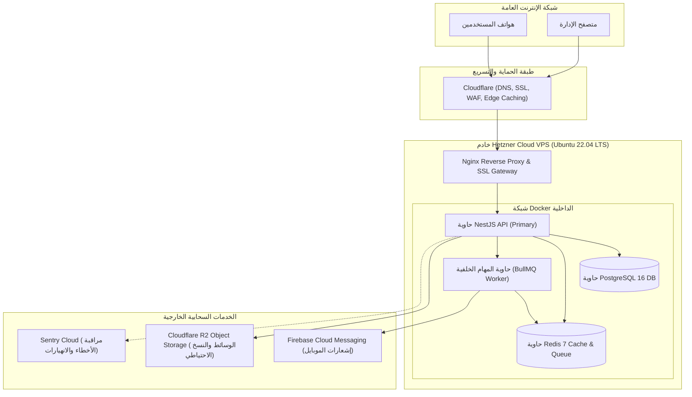
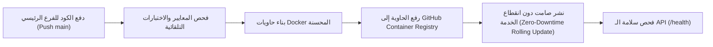

# خطة النشر والتشغيل والبنية التحتية (Deployment & DevOps Plan) | منصة قطفة

---

## 1. طوبولوجيا البنية التحتية (Infrastructure Topology)

تعتمد منصة قطفة على بنية تحتية سحابية اقتصادية ومرنة بنظام الحاويات (Docker Containers)، مما يتيح تشغيل المنصة بكفاءة عالية على خادم افتراضي عالي الأداء (Hetzner Cloud VPS) في البداية مع قابلية التوسع الأفقي لاحقاً.

---

## 2. مواصفات الخادم ونظام Docker Compose

### 2.1 مواصفات خادم الإنتاج التأسيسي (Production Host Specs)
- **المزود:** Hetzner Cloud (موقع نورمبرغ أو فالكنشتاين بألمانيا - زمن استجابة سريع لليمن).
- **الخطة المقترحة:** `CPX31` (4 Dedicated vCPUs, 8 GB RAM, 160 GB NVMe SSD).
- **نظام التشغيل:** Ubuntu 22.04 LTS (x86_64).
- **التكلفة التقديرية:** ~ 14.50 يورو شهرياً (قرابة \$16 دولار شهرياً).

### 2.2 تكوين الحاويات الأساسية (`docker-compose.prod.yml`)
1. **`nginx-proxy`:** استقبال الطلبات الخارجية على المنفذين 80/443، تفعيل ضغط Brotli و Gzip لتسريع التصفح في اليمن، وتوجيه حركة المرور إلى حاويات الـ API.
2. **`qatfa-api`:** تطبيق NestJS مشغل بنمط الإنتاج المتعدد عبر PM2 أو Node Cluster.
3. **`qatfa-worker`:** معالج خلفي مستقل لتصغير الصور وإرسال حزم الإشعارات عبر Firebase دون تأخير استجابة المستخدم.
4. **`postgres-db`:** قاعدة البيانات الرئيسية مع مجلد بيانات دائم (Persistent Volume) ومفهرس بالكامل.
5. **`redis-cache`:** التخزين المؤقت وقوائم الانتظار في الذاكرة السريعة مع حماية بكلمة مرور مشفرة.

---

## 3. خط أنابيب النشر المؤتمت (CI/CD Pipeline via GitHub Actions)

1. **مرحلة التدقيق والاختبار (Lint & Test):**
   - التحقق من معايير TypeScript و ESLint.
   - تشغيل اختبارات التكامل للـ APIs الحيوية (المصادقة، إضافة القطفة، البحث).
2. **مرحلة البناء والضغط (Docker Build):**
   - بناء الحاوية بأسلوب الطبقات المتعددة (Multi-stage build) لتقليص حجم الحاوية النهائية لأقل من 150MB.
3. **النشر بدون انقطاع الخدمة (Zero-Downtime Deploy):**
   - الاتصال الآمن بالسيرفر عبر مفاتيح SSH مشفرة.
   - سحب النسخة الجديدة وتشغيلها، والتحقق من نقطة الفحص `/api/v1/health` قبل تبديل توجيه Nginx، مما يضمن استمرارية الخدمة بنسبة 100%.

---

## 4. استراتيجية النسخ الاحتياطي التلقائي (Automated Backup Policy)

1. **النسخ اليومي لقاعدة البيانات (Daily DB Dumps):**
   - مهمة دورية مؤتمتة (Cron Job) تنفذ يومياً في تمام الساعة 03:30 فجراً بتوقيت اليمن (خارج ساعات النشاط).
   - استخراج نسخة كاملة عبر أداة `pg_dump` مع ضغط عالي بصيغة `gz`.
2. **التشفير والحفظ الخارجي (Offsite Encrypted Storage):**
   - تشفير ملف النسخة الاحتياطية بمفتاح متقدم `AES-256`.
   - رفع الملف المشفر تلقائياً إلى خزانة تخزين منفصلة في **Cloudflare R2** معزولة جغرافياً عن خادم الاستضافة.
3. **سياسة الاستبقاء (Retention Policy):**
   - الاحتفاظ بنسخ يومية لآخر 14 يوماً.
   - الاحتفاظ بنسخة أسبوعية لكل أسبوع لآخر شهرين.
   - الاحتفاظ بنسخة شهرية لمدة عام كامل.

---

## 5. الرصد والمراقبة وتنبيهات الطوارئ (Monitoring & Alerting)

- **رصد الأخطاء والانهيارات البرمجية (Sentry):**
  - ربط فوري لتطبيق الموبايل وسيرفر الـ API بـ Sentry مع التقاط مسارات الأخطاء (Stack Traces) وتنبيه الفريق بالبريد وتيليجرام فور تكرار أي خطأ.
- **مراقبة التوافر والـ SSL (Uptime Monitoring):**
  - استخدام أداة رصد مجانية وموثوقة (مثل Uptime Kuma أو Better Stack) لفحص عنوان الخدمة كل 60 ثانية من 3 قارات مختلفة.
- **تنبيهات الطوارئ اللحظية:**
  - بوت Telegram آلي يرسل تنبيهاً فورياً لفريق الدعم والتقنية في الحالات التالية:
    - توقف الـ API أو تجاوز زمن الاستجابة 800ms لأكثر من دقيقتين.
    - امتلاء مساحة القرص الصلب عن 85%.
    - ارتفاع استهلاك المعالج أو الذاكرة عن 90% أثناء ساعات الذروة.
