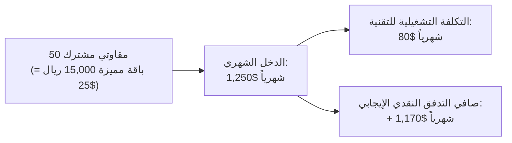

# دراسة وتقدير التكاليف الواقعية والميزانية (Cost Estimation & Budget) | منصة قطفة

---

## 1. فلسفة الميزانية والهندسة المالية للمشروع

تم تصميم النموذج المالي لمنصة **قطفة** بعقلية الشركات الناشئة المرنة (Lean Startup):
- **تجنب حرق الأموال في البرمجيات باهظة الثمن:** استخدام التقنيات مفتوحة المصدر والخدمات ذات التكلفة الصفرية لحركة البيانات (مثل Cloudflare R2 و Flutter و NestJS).
- **حماية ميزانية التشغيل:** إبقاء تكلفة تشغيل السيرفرات الشهرية للمرحلة الأولى في حدود **أقل من 80 دولار شهرياً**، بحيث يمكن للمشروع الاستمرار لسنوات دون ضغوط مالية حتى تحقيق التدفق النقدي الذاتي.

---

## 2. التكاليف التأسيسية لمرة واحدة (CapEx - One-Time Development & Setup)

| البند | التكلفة التقديرية (بالدولار الأمريكي) | ملاحظات وتفاصيل البند |
| :--- | :--- | :--- |
| **تصميم تجربة وواجهة المستخدم (UI/UX)** | \$800 - \$1,200 | تصميم الشاشات الكاملة على Figma (موبايل + ويب + تدفقات الاستخدام والرموز) |
| **تطوير تطبيق الموبايل (Flutter)** | \$2,200 - \$3,500 | برمجة نسختي Android و iOS بكفاءة عالية ودعم العمل دون إنترنت كامل |
| **تطوير الخادم الخلفي وقاعدة البيانات (NestJS)**| \$1,800 - \$2,800 | بناء الـ APIs، الحماية، الفهرسة، وتكامل التخزين والإشعارات |
| **تطوير لوحة التحكم الإدارية (React Dashboard)**| \$900 - \$1,400 | واجهة الإشراف، إدارة المتاجر، البلاغات، والدليل الجغرافي |
| **ضمان الجودة واختبار الأداء (QA & Testing)** | \$500 - \$800 | اختبار الأداء على شبكات الاتصال اليمنية وأجهزة أندرويد الاقتصادية |
| **حساب مطور Google Play Console** | \$25 | رسوم تدفع مرة واحدة مدى الحياة لشركة Google |
| **حساب مطور Apple Developer Program** | \$99 | اشتراك سنوي لمتجر Apple App Store |
| **شراء النطاق الرسمي (Domain Name .com / .ye)** | \$15 - \$60 | شراء نطاق `qatfa.ye` أو `qatfa-app.com` لمدة عام |
| **المجموع التقديري الإجمالي للتأسيس** | **\$6,339 - \$9,884** | تكلفة إنجاز مشروع مؤسسي متكامل جاهز للإطلاق التجاري |

---

## 3. التكاليف التشغيلية الشهرية لمرحلة الإطلاق الأولى (OpEx - MVP Monthly Costs)

تقدير التكلفة الشهرية خلال أول 6 أشهر (حتى 500 متجر و 25,000 مستخدم نشط):

| الخدمة السحابية / البند | المزود التقني | التكلفة الشهرية بالدولار | كيف حققنا هذه التكلفة المنخفضة؟ |
| :--- | :--- | :--- | :--- |
| **خادم التطبيقات وقاعدة البيانات (VPS)** | Hetzner Cloud (CPX31 - 8GB RAM) | **\$16.00** | خادم ألماني خارق الأداء بتكلفة ثابتة بدلاً من سحابة AWS باهظة التكلفة |
| **تخزين الوسائط والصور (Object Storage)** | Cloudflare R2 | **\$2.00 - \$5.00** | أول 10GB مجاناً، ورسوم نقل البيانات خارج السيرفر **0.00\$** مجاناً مدى الحياة |
| **شبكة توزيع المحتوى والحماية (CDN & WAF)**| Cloudflare Free / Pro Tier | **\$0.00** | الباقة المجانية توفر حماية DDoS كاملة وشهادات SSL مجانية غير محدودة |
| **خدمة الإشعارات (Push Notifications)** | Firebase Cloud Messaging (FCM) | **\$0.00** | خدمة مجانية 100% بدون أي حدود لحجم الإشعارات من Google |
| **خدمات الخرائط (Maps)** | الدليل الهرمي + OpenStreetMap | **\$0.00** | استبعاد استدعاءات Google Maps API المدفوعة واستبدالها بحلول مجانية |
| **بوابة التحقق ورسائل الـ OTP** | بوابة محلية يمنية / WhatsApp OTP | **\$35.00 - \$60.00** | تكلفة حزم رسائل SMS محلية للتحقق من هوية المستخدمين الجدد |
| **مراقبة الأخطاء والانهيارات (Monitoring)** | Sentry Developer Plan | **\$0.00** | باقة مجانية تغطي أول 5,000 خطأ برمجي شهرياً (كافية تماماً لمرحلة MVP) |
| **النسخ الاحتياطي السحابي الخارجي** | Cloudflare R2 Bucket (Encrypted) | **\$1.00** | تخزين النسخ اليومية المشفرة بتكلفة سنتات معدودة |
| **صيانة تقنية ودعم فني أساسي** | فريق الدعم الداخلي | **\$150.00 - \$250.00** | صيانة الخوادم ومتابعة الاستقرار والتحديثات الدورية |
| **إجمالي التكلفة التشغيلية الشهرية (التقنية)** | — | **\$54.00 - \$82.00 / شهرياً** | **(أقل من 100 دولار شهرياً لتشغيل البنية التحتية بالكامل!)** |

---

## 4. نموذج نقطة التعادل والعائد المالي (Breakeven & ROI Analysis)

متى تبدأ المنصة بتغطية تكاليفها وتحقيق أرباح؟

- **رسوم الاشتراك المميز المقترحة:** 15,000 إلى 25,000 ريال يمني شهرياً (ما يعادل قرابة \$25 إلى \$40 دولار للمتجر المعتمد).
- **نقطة التعادل التشغيلي (Operational Breakeven):**
  - باشتراك **4 مقاوتية فقط** في الباقة المميزة (4 × \$25 = \$100)، تغطي المنصة كامل فواتير السيرفرات والتخزين والرسائل والنسخ الاحتياطي!
- **الهدف التجاري لنهاية العام الأول:**
  - اشتراك 250 متجراً في باقات التوثيق والإعلانات = **\$6,250 دولار شهرياً** كإيراد متكرر، مع تكلفة تشغيل تقنية لا تتجاوز \$250 دولار شهرياً في تلك المرحلة.
