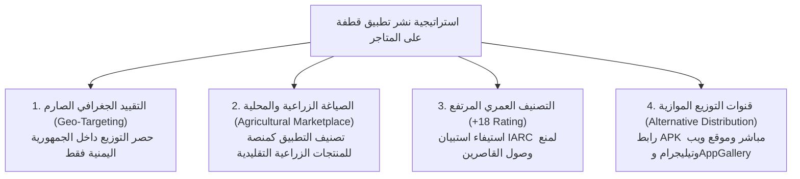

# تحليل المخاطر وسياسات Google Play (Risk Analysis & App Store Compliance) | منصة قطفة

---

## 1. تحليل مخاطر سياسات متجر Google Play (Google Play Policy Compliance)

> [!IMPORTANT]
> **إخلاء مسؤولية تنظيمي:** يعتمد قبول ونشر أي تطبيق على متجر Google Play على مراجعة فريق Google وسياساتها وإرشاداتها السارية وقت تقديم التطبيق. لذلك تم إعداد هذه الاستراتيجية لتقليل احتمالية الرفض إلى أدنى مستوى مع توفير قنوات توزيع بديلة تضمن استمرارية المشروع في كل الظروف.

### 1.1 طبيعة التحدي في متجر Google Play
- **السياسة المعنية:** سياسة جوجل المتعلقة بـ *"السلع الخاضعة للرقابة، التبغ، والكحوليات والمواد المنبهة" (Tobacco, Controlled Substances & Regulated Goods)*.
- **التشخيص الدقيق:** نبتة القات (*Catha edulis*) تعتبر سلعة زراعية محلية مرخصة وقانونية 100% داخل أراضي الجمهورية اليمنية وتخضع لرسوم ضريبية رسمية، إلا أن تصنيفها في بعض الدول الغربية قد يُساء فهمه من قِبل روبوتات الفحص الآلي (Automated Review Bots) في Google Play إذا تم وصف التطبيق بعبارات غير دقيقة أو تصنيفه في فئات غير ملائمة.

---

### 1.2 خطة التموضع وخفض مخاطر المراجعة (Mitigation & Framing Strategy)

#### الإجراءات العملية لتقديم التطبيق:
1. **التقييد الجغرافي الصارم (Target Yemen Only):**
   - حصر نطاق توفر التطبيق في إعدادات Google Play Console على **"الجمهورية اليمنية" (Republic of Yemen)** فقط، مما يقلل من خضوعه للقوانين الدولية للدول التي تجرم تداول النبتة ويؤكد امتثاله للقوانين المحلية السارية.
2. **الصياغة والكلمات الوصفية الرسمية (Metadata & Description):**
   - تصنيف التطبيق في فئة **"التسوق" (Shopping)** أو **"الأعمال" (Business)** كمنصة تربط المزارعين والأسواق الشعبية بالزبائن.
   - استخدام الوصف المهني: *"منصة إلكترونية لدليل المنتجات الزراعية والمحاصيل التراثية والأسواق الشعبية في الجمهورية اليمنية"*.
   - تجنب استخدام أي كلمات قد تثير خوارزميات الذكاء الاصطناعي لفحص المحتوى الدولي.
3. **التصنيف العمري (+18 Mature Rating):**
   - ملء استبيان المحتوى الدولي (IARC) باحترافية، وتحديد الفئة العمرية للتطبيق لمن هم فوق 18 عاماً لضمان عدم وجود أي شبهة متعلقة بحماية الأطفال أو المراهقين.
4. **عدم معالجة مدفوعات رقمية لمواد زراعية في MVP:**
   - عدم وجود بوابة دفع إلكتروني داخل التطبيق في مرحلة MVP يرفع فرص القبول بشكل جذري؛ لأن التطبيق يعمل كدليل معلومات وتواصل (Information Directory & Marketplace Discovery)، ولا يتدخل في العمليات المالية المباشرة.

---

### 1.3 استراتيجية التوزيع الموازي في اليمن (Yemeni Multi-Channel Distribution)

في السوق اليمني تحديداً، يعاني متجر Google Play غالباً من بطء التنزيل أو مشاكل حظر الاتصال، لذلك تعتمد كبرى التطبيقات اليمنية (مثل تطبيق بنك الكريمي، يو YOU، ويمن موبايل) على استراتيجية النشر الهجين:
1. **التحميل المباشر بصيغة APK (Direct APK Download):**
   - توفير زر تحميل سريع ومباشر لملف الـ APK من الموقع الرسمي للمنصة `qatfa.ye/download` عبر خوادم Cloudflare السريعة.
2. **التوزيع عبر قناة Telegram الرسمية:**
   - رفع ملف الـ APK وتحديثاته في قناة تيليجرام رسمية موثقة للمنصة (تيليجرام من أكثر التطبيقات تداولاً في اليمن لتنزيل التحديثات دون استهلاك رصيد كبير).
3. **متجر Huawei AppGallery:**
   - نشر التطبيق على متجر هواوي الرسمي؛ نظراً لانتشار أجهزة هواوي وهونر الكثيف في اليمن ومرونة إجراءات مراجعة التطبيقات المحلية فيه.

---

## 2. مصفوفة المخاطر الشاملة وخطط احتوائها (Risk Matrix)

| فئة الخطر | وصف الخطر | الاحتمالية | الأثر | خطة الاستجابة والمعالجة (Action Plan) |
| :--- | :--- | :--- | :--- | :--- |
| **خطر تنظيمي / متجر** | تعليق أو تأخير مراجعة التطبيق في Google Play | متوسطة | متوسط | تفعيل التوزيع المباشر لملف APK عبر الموقع وقناة تيليجرام فوراً، وتقديم طلب استئناف موثق بالوضع القانوني التجاري في اليمن |
| **خطر احتيال وتضليل** | قيام مقاوتي بعرض صور قديمة أو أسعار غير حقيقية لجذب الزبائن | مرتفعة | متوسط | تفعيل الإبلاغ المجتمعي التلقائي، تعليق الحساب عند تكرار 3 بلاغات، وإلزام تصوير القطفة عبر كاميرا التطبيق الحية في التحديث القادم |
| **خطر أمان تقني** | هجمات استنزاف رسائل الـ OTP (SMS Flooding) | متوسطة | مرتفع | حد أقصى 3 رسائل لكل رقم هاتف، وحظر الـ IPs المشبوهة عبر Cloudflare WAF و Redis Rate Limiting |
| **خطر انقطاع الإنترنت** | بطء أو انقطاع كابلات الإنترنت الدولية في اليمن | مرتفعة | مرتفع | دعم التخزين المؤقت المحلي (Offline Caching) لكي يتمكن العميل من رؤية أرقام المقاوتية والاتصال بهم هاتفياً دون اتصال |
| **خطر مقاومة التجار** | تردد بعض كبار المقاوتية في استخدام التطبيق لانشغالهم | مرتفعة | مرتفع | نزول ميداني لسفراء المنصة، وتدريب المقاوتي ومساعده الشاب في السوق على النشر في 30 ثانية مجاناً |
