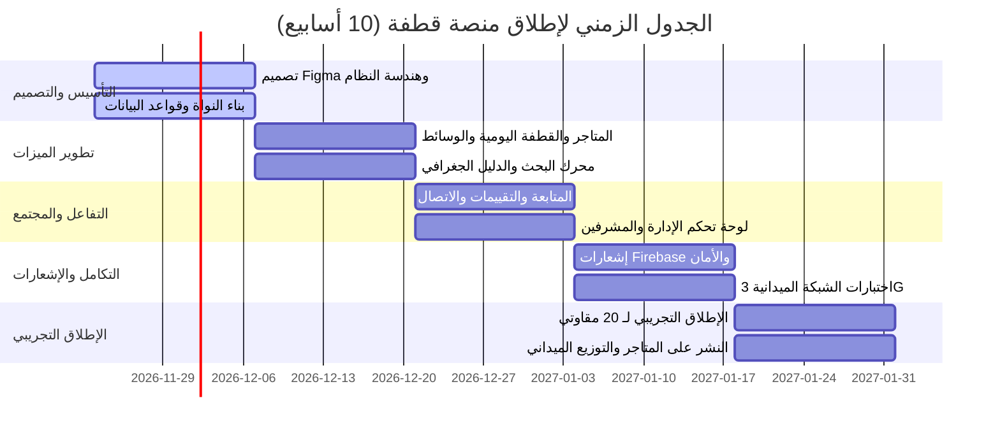

# الجدول الزمني ومراحل التنفيذ (Project Timeline & Sprints) | منصة قطفة

---

## 1. منهجية العمل وتوزيع الأدوار (Methodology & Team Allocation)

تعتمد خطة تنفيذ النسخة الأولى (MVP) على منهجية **Agile / Scrum** مكثفة مقسمة إلى **5 سبرنتات (Sprints)** مدة كل سبرنت أسبوعان (بإجمالي **10 أسابيع عمل** للوصول للإطلاق التجاري الميداني).

---

## 2. تفصيل خطة السبرنتات (Sprint-by-Sprint Execution)

### السبرنت 1: التأسيس والتصميم المعماري (الأسبوع 1 - 2)
- **فريق التصميم:** إنهاء نماذج Figma التفاعلية لكافة شاشات الموبايل ولوحة التحكم واعتماد نظام الألوان وخط Cairo.
- **فريق الباك إند:** إعداد خادم NestJS، ومخطط قاعدة بيانات PostgreSQL، ووحدة المصادقة عبر OTP، والربط مع Redis.
- **فريق الموبايل:** تهيئة مشروع Flutter بالمعمارية النظيفة (Clean Architecture)، وإعداد معالجة الشبكات (Dio) والثيم العام ودعم العمل بدون اتصال.
- **فريق DevOps:** تجهيز بيئة التطوير وخادم Hetzner وشهادات SSL وشبكة Cloudflare.

---

### السبرنت 2: محرك المتاجر والقطفة اليومية والوسائط (الأسبوع 3 - 4)
- **الباك إند:** بناء واجهات برمجة المتاجر، الدليل الجغرافي (محافظة > مديرية > سوق)، ورفع الصور المضغوطة إلى Cloudflare R2.
- **الموبايل:** برمجة واجهة التصفح كضيف، شاشة اختيار الموقع، نموذج نشر القطفة السريع للمقاوتي مع الكاميرا المدمجة، وعرض بطاقات القطفة اليومية.
- **لوحة التحكم:** البدء في واجهة الويب الإدارية، وإدارة الدليل الجغرافي للمدن والأسواق.

---

### السبرنت 3: التفاعل المجتمعي وتوليد الاتصالات (الأسبوع 5 - 6)
- **الموبايل والباك إند:**
  - برمجة أزرار الاتصال الهاتفي ومحادثة WhatsApp المجهزة بروابط القطفات.
  - تفعيل نظام متابعة المتاجر ونظام التقييم بالنجوم والمراجعات الموثقة مع موانع السبام.
  - برمجة شاشات البحث والفلترة حسب النوع والسعر والجودة وحالة التوفر.
- **لوحة التحكم:** شاشات استعراض واعتماد المتاجر الجديدة، وإدارة المستخدمين.

---

### السبرنت 4: الإشعارات والأمان واختبارات البيئة اليمنية (الأسبوع 7 - 8)
- **الموبايل والباك إند:**
  - ربط وتفعيل إشعارات Firebase Cloud Messaging (إشعار العميل فور نشر مقاوتيه المفضلين لبضاعة اليوم).
  - ضبط أمان المدخلات، وتطهير صور القات من البيانات الوصفية (EXIF Data)، ومحددات السرعة (Rate Limiting).
- **اختبارات الجودة (QA):**
  - محاكاة شبكات الإنترنت البطيئة في اليمن (3G High Latency & Packet Loss) واختبار تجاوب التطبيق واستهلاك باقات الميجابايت.
  - اختبار التطبيق على أجهزة هواتف اقتصادية حقيقية (Infinix, Tecno, Samsung A series).

---

### السبرنت 5: الإطلاق التجريبي المغلق والتدشين الرسمي (الأسبوع 9 - 10)
- **المرحلة التجريبية (Closed Pilot):**
  - النزول الميداني وتثبيت التطبيق تجريبياً لـ 20 مقاوتي معروف في أسواق صنعاء (سوق علي محسن وسوق شميلة)، وتدريبهم على النشر اليومي وملاحظة سلوكهم الحقيقي.
- **تجهيز النشر والتوزيع:**
  - إعداد متطلبات النشر على Google Play Console وفق الاستراتيجية المعتمدة (التقييد الجغرافي، التصنيف الزراعي).
  - بناء صفحة الويب للتحميل المباشر لملف الـ APK مع توفير رابط قناة Telegram الرسمية.
  - بدء الحملة التسويقية وتوزيع ملصقات الـ QR Code في أسواق القات.
