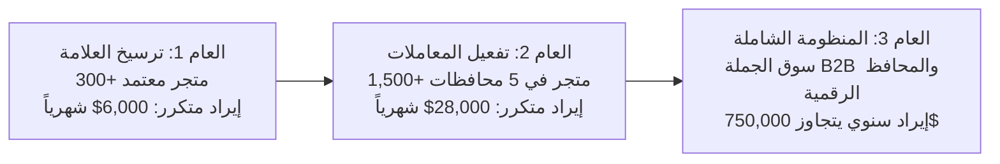

# المقترح الاستثماري والتنفيذي (Client & Investor Proposal) | منصة قطفة

---

## 1. الفرصة الاستثمارية والرسالة الموجهة للإدارة (The Investment Thesis)

يمثل سوق القات في الجمهورية اليمنية **أكبر سوق تجاري واستهلاكي يومي نقدياً** في البلاد بحجم تداول يقدر بمليارات الدولارات سنوياً، مع قاعدة مستهلكين نشطة تتجاوز 12 مليون مواطن يتخذون قرار الشراء يومياً بين الساعة 11:30 صباحاً و 3:30 عصراً.

وعلى الرغم من هذه الكثافة الهائلة، ظل هذا السوق لعدة عقود دون أي تنظيم رقمي أو منصة مركزية تجمع التجار بالمستهلكين. 

منصة **"قطفة"** ليست مجرد تطبيق تقني، بل هي **مبادرة استراتيجية لاحتكار نقطة الاتصال والبحث التجاري الأولى في اليمن**؛ عبر تحويل تجارة القات التقليدية العشوائية إلى منظومة تجارة اجتماعية شفافة وموثوقة.

---

## 2. استراتيجية نزع المخاطر (De-risking Framework)

لضمان أعلى درجات النجاح وتفادي تعثر الشركات الناشئة، قمنا بتفكيك المشروع وفق القواعد الذهبية التالية:
1. **نزع المخاطر اللوجستية (No Delivery in MVP):**
   - عدم التورط في تكاليف سيارات أو دراجات التوصيل في المرحلة الأولى؛ والتركيز الحصري على "الاستكشاف والاتصال وحجز القطفة".
2. **نزع المخاطر المالية والتنظيمية (Cash & Direct Contact):**
   - تحويل المشتري للمقاوتي مباشرة عبر الهاتف والواتساب، مما يعفي المنصة من أي تعقيدات بنكية أو شبهات تنظيمية.
3. **نزع مخاطر التكلفة التكنولوجية (Lean Tech Stack):**
   - بنية تحتية سحابية متطورة للغاية ولكنها اقتصادية (أقل من \$80 شهرياً) تعمل دون أي استنزاف مالي حتى بعد استقبال عشرات الآلاف من المستخدمين.
4. **تجاوز مخاطر متجر التطبيقات (Multi-Channel Distribution):**
   - صياغة زراعية حذرة لسياسات Google Play مع توفير خطوط تنزيل مباشرة بصيغة APK وقناة تيليجرام رسمية تضمن وصول التطبيق لكل مواطن يمني دون عوائق.

---

## 3. العائد الاستثماري المتوقع (Financial Projections Summary)

- **التكلفة التأسيسية التقديرية لبناء المنصة بالكامل:** من \$6,500 إلى \$9,800 دولار أمريكي.
- **التكلفة التشغيلية للتقنية شهرياً:** أقل من \$80 دولار شهرياً.
- **نقطة التعادل المالي (Break-even):** تتحقق بمجرد اشتراك 4 مقاوتية فقط في الباقة المميزة.

---

## 4. الخطوات التنفيذية الفورية لبدء المشروع (Immediate Next Steps)

1. **اعتماد وثائق المتطلبات:** مراجعة واعتماد الملفات المرفقة في مجلد `docs/`.
2. **بدء مرحلة التصميم:** إطلاق تصميم واجهات Figma والنماذج التفاعلية (مدة أسبوعين).
3. **تأسيس بيئة السيرفرات:** استئجار خادم Hetzner وتهيئة مستودعات GitHub والـ CI/CD.
4. **تشكيل فريق النزول الميداني:** اختيار سفيرين ميدانيين لبدء حصر وتصوير أوائل المقاوتية في أسواق صنعاء تمهيداً للإطلاق التجريبي.
