# وثيقة تدفقات المستخدمين التفصيلية (Detailed User Flows) | منصة قطفة

---

## 1. الفلسفة الحاكمة لتجربة المستخدم (UX Philosophy & Design Pillars)

تم تصميم تدفقات المستخدمين في منصة **قطفة (Qatfa)** بناءً على فهم ميداني عميق لسيكولوجية وسلوك المتعاملين في سوق القات اليمني (المشتري والتاجر):

```
       ┌────────────────────────────────────────────────────────┐
       │             الفلسفة الحاكمة لتدفقات قطفة              │
       └──────────────────────────┬─────────────────────────────┘
                                  │
         ┌────────────────────────┼────────────────────────┐
         ▼                        ▼                        ▼
┌──────────────────┐    ┌──────────────────┐    ┌──────────────────┐
│   منطقة الإبهام   │    │   صفر عبء إداري  │    │   إنهاء فوضى     │
│   (One-Thumb)    │    │   على المقاوتي   │    │   قروبات الواتساب│
│  تحت شمس السوق   │    │  نشر في 30 ثانية │    │   موجز منظم موحد │
└──────────────────┘    └──────────────────┘    └──────────────────┘
```

1. **تصميم ملائم للشارع والشمس (Outdoor Glare & One-Thumb Ergonomics):** 
   - 80% من تفاعلات المشتري والمقاوتي تتم في الشارع أو داخل أسواق القات المزدحمة تحت أشعة الشمس المباشرة.
   - كافة الأزرار الحيوية تقع في الثلث السفلي من الشاشة لتسهيل النقر بإبهام اليد الواحدة.
2. **صفر عبء تشغيلي على المقاوتي (Zero Operational Burden):**
   - المقاوتي في السوق لا يملك الوقت أو المزاج لكتابة نصوص أو ملء استمارات طويلة.
   - يتم نشر العرض اليومي عبر 3 نقرات فقط وكاميرا حية خلال **أقل من 30 ثانية**.
3. **إنهاء فوضى مجموعات الواتساب والتليجرام:**
   - بدلاً من تشتت المشتري بين عشرات المجموعات المزعجة، يقدم التطبيق موجزاً حياً وموحداً لكافة أسواق اليمن، مع خريطة تفاعلية للمفارش وزري اتصال وواتساب فوريين.
4. **السرعة الخاطفة وخفة استهلاك باقة الإنترنت (Sub-Second Latency & Low Bandwidth):**
   - التطبيق يبدأ في أقل من 1.5 ثانية ويعمل بكفاءة على شبكات 3G وباقات يمن موبايل و يو، مع دعم كامل لوضع التصفح دون اتصال (Offline-first).

---

## 2. تدفقات المشتري بالتفصيل (Buyer / Customer Journeys)

---

### التدفق 2.1: الدخول الفوري والتصفح كضيف (Guest First Onboarding)

> **الهدف:** تمكين أي مواطن يمني من فتح التطبيق ورؤية عروض القات والأسعار والمتاجر فوراً دون أي حاجز تسجيل دخول أو طلب أذونات غير ضرورية.

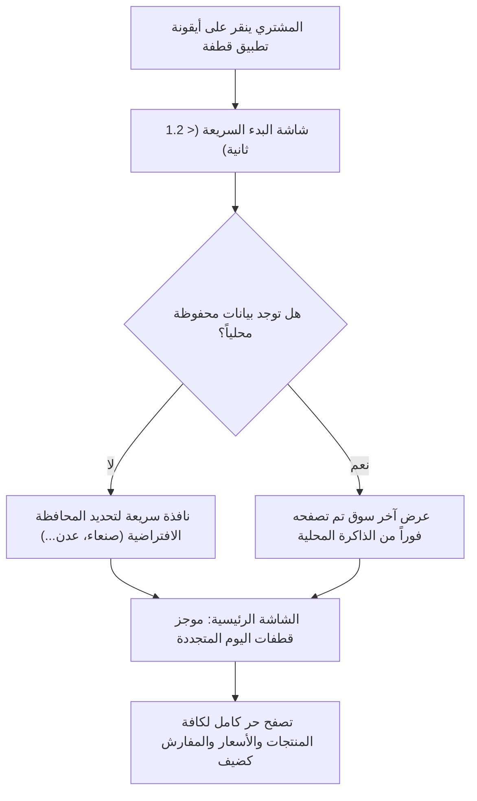

#### خطوات التدفق وقواعد العمل:
1. **الفتح الأولي (First Launch):** يفتح التطبيق مباشرة دون أي شاشات تعريفية طويلة (No Long Carousels).
2. **تحديد المحافظة الافتراضية:** تظهر نافذة منبثقة بسيطة تطلب اختيار المدينة (صنعاء، عدن، تعز، إب، ذمار...)، ويتم حفظ الاختيار تلقائياً في ذاكرة الهاتف (Local Storage).
3. **تصفح ضيف كامل (100% Guest Mode):** يستطيع الزائر تصفح كافة القطفات، الصور، الأسعار، خرائط الأسواق، وحتى الضغط على أزرار الاتصال بالبائع دون الحاجة لتسجيل أي حساب.
4. **متى يُطلب تسجيل الدخول فقط؟** يطلب النظام تسجيل الدخول برقم الهاتف ورمز التحقق (OTP) فقط عند:
   - كتابة تقييم أو مراجعة لمتجر.
   - متابعة متجر لتلقي الإشعارات.
   - حفظ قطفة في المفضلة.
   - الإبلاغ عن عرض مضلل.

---

### التدفق 2.2: استكشاف العروض اليومية وفلترة أنواع القات (Daily Drops Discovery & Smart Filter)

> **الهدف:** العثور على القات المطلوب (همداني، شامي، قعطبي...) بالسعر المناسب والجودة المطلوبة في دقيقة واحدة.

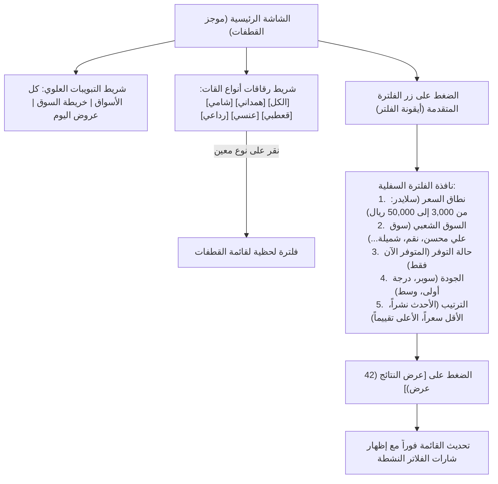

#### قواعد العمل وتجربة الاستخدام:
- **تحديث العروض اللحظي:** كل بطاقة عرض تحتوي على مؤشر زمني واضح: *"تم التحديث قبل 8 دقائق"* مع شارة توفر بارزة: `[متوفر الآن]` باللون الأخضر أو `[نفدت الكمية]` باللون الرمادي.
- **التخزين المؤقت الذكي:** عند التمرير، يتم تنزيل الصور خفيفة الحجم بصيغة WebP بتدفق تدريجي لا يستهلك باقة النت.

---

### التدفق 2.3: استعراض خريطة أسواق القات في اليمن ومواقع المفارش (Market Map & Stall Navigation)

> **الهدف:** تمكين المشتري من رؤية خريطة السوق الشعبي ومعرفة مكان مفرش المقاوتي بدقة للتسوق المباشر دون أن يتوه في أزقة السوق المزدحم.

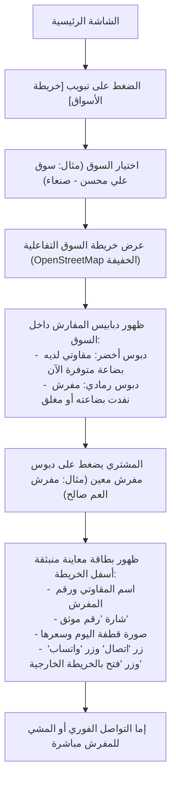

---

### التدفق 2.4: فحص تفاصيل القطفة والاتصال المباشر بالمقاوتي (Drop Details & 1-Click Ordering)

> **الهدف:** معاينة القات بالصور المكبرة ومعرفة كامل التفاصيل، ثم الانتقال الفوري للاتصال الهاتفي أو محادثة WhatsApp دون وسطاء.

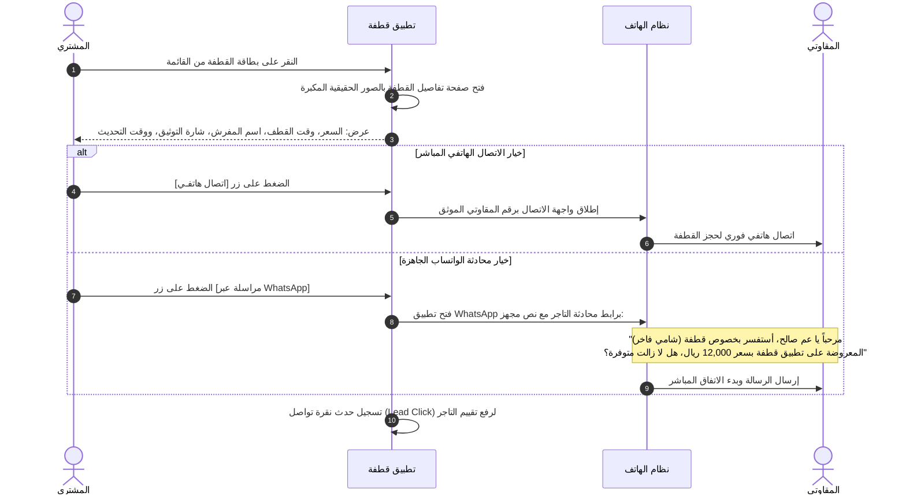

---

### التدفق 2.5: متابعة المقاوتي المفضل واستلام إشعارات القطفة الحية (Follow & Push Alerts)

> **الهدف:** أن يكون الزبون أول من يعلم بوصول شحنة القات المفضلة لديه لحظة تفريغها في السوق.

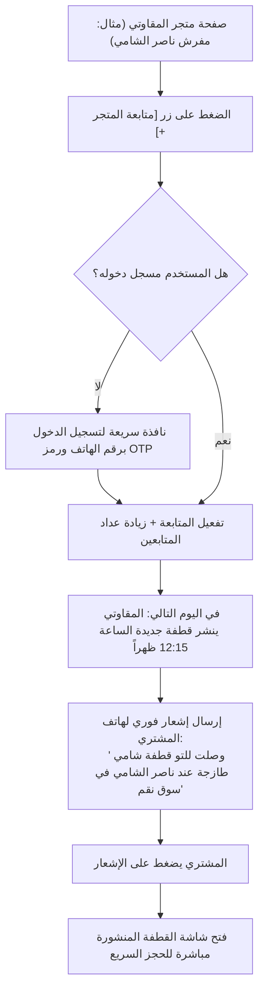

---

### التدفق 2.6: تجربة ما بعد الشراء: التقييم وإرفاق صورة القات (Ratings & Reviews)

> **الهدف:** بناء سمعة شفافة وموثوقة تكافئ المقاوتي الصادق وتمنع الغش وتغيير الأسعار.

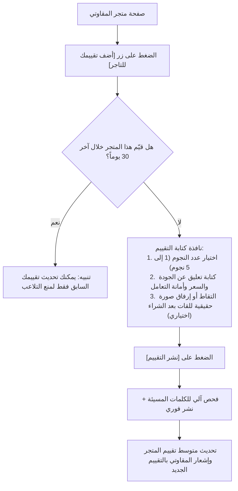

---

### التدفق 2.7: الإبلاغ عن العروض المضللة وحماية مجتمع المنصة (Report Misleading Drop)

> **الهدف:** حماية ثقة المشترين واستبعاد أي عرض كاذب أو صورة مسروقة أو تلاعب بالأسعار تلقائياً.

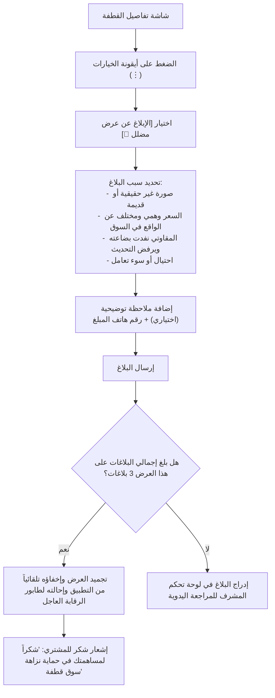

---

### التدفق 2.8: مشاركة العرض بالروابط الذكية العميقة (Deep Link Sharing)

> **الهدف:** تمكين المشترين والتجار من تداول العروض في مجموعات الواتساب وحالات فيسبوك برابط ينقل القارئ مباشرة إلى داخل تطبيق قطفة.

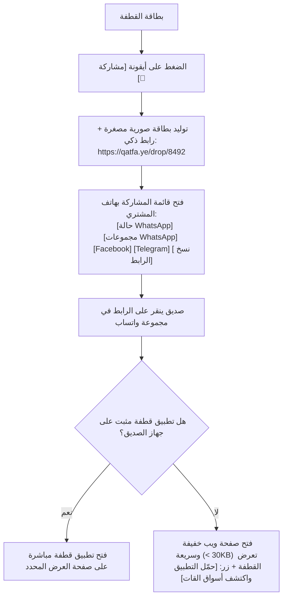

---

## 3. تدفقات المقاوتي / البائع بالتفصيل (Seller / Maqwati Journeys)

---

### التدفق 3.1: التسجيل وتوثيق رقم الهاتف عبر OTP (Fast Seller Onboarding)

> **الهدف:** تحويل أي مقاوتي في السوق إلى بائع موثق لديه متجر رقمي في أقل من دقيقتين.

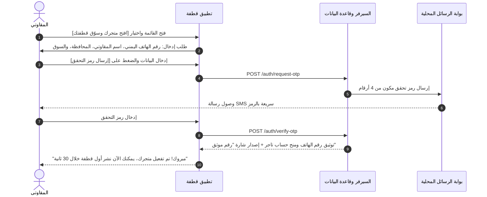

---

### التدفق 3.2: تثبيت المفرش على خريطة السوق الشعبي (Stall Pinning on Market Map)

> **الهدف:** وضع مفرش التاجر على الخريطة ليتمكن زبائن حيه ومدينته من المشي إليه فوراً.

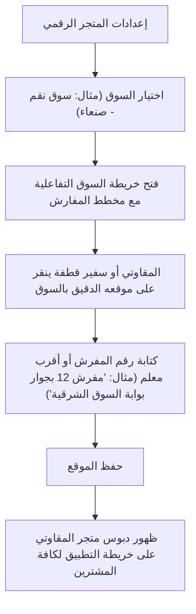

---

### التدفق 3.3: النشر الخاطف للقطفة في 30 ثانية (Lightning Drop Publishing - The 30s Flow)

> **الهدف:** تمكين المقاوتي وهو يقف تحت ضغط الزبائن في السوق من رفع بضاعته في نصف دقيقة دون كتابة أي نصوص معقدة.

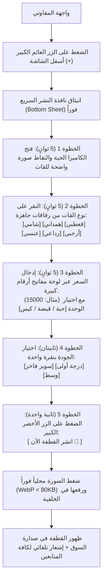

#### عداد الوقت النموذجي للنشر الخاطف:
* **00:00 - 00:05:** الضغط على زر (+) وتشغيل الكاميرا والتقاط صورة القات.
* **00:06 - 00:12:** اختيار النوع (شامي) والوحدة (حبة).
* **00:13 - 00:20:** كتابة السعر (15000).
* **00:21 - 00:25:** الضغط على زر "انشر".
* **المجموع:** **25 ثانية فقط** كافية لنشر العرض دون تشتيت التاجر عن زبائن السوق.

---

### التدفق 3.4: التبديل اللحظي لحالة البضاعة [متوفر / نفد] (Instant Availability Toggle)

> **الهدف:** إيقاف الاتصالات والرسائل فور بيع البضاعة لمنع إزعاج المقاوتي وخداع المشترين.

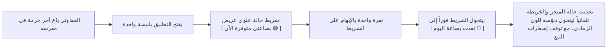

---

### التدفق 3.5: التسويق المستمر بمشاركة بطاقة القطفة على الواتساب (Continuous Marketing Flow)

> **الهدف:** تمكين المقاوتي من تسويق بضاعته بضغطة زر إلى زبائنه على حالات الواتساب والمجموعات لجلب مشترين جدد باستمرار.

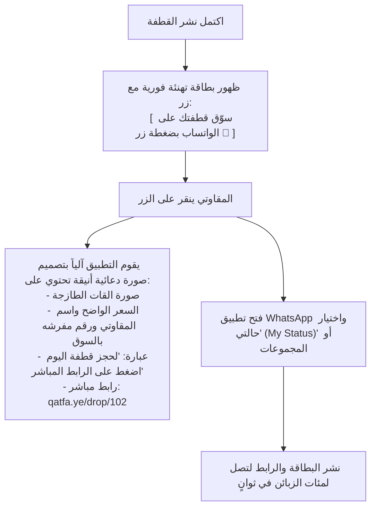

---

## 4. مصفوفة التعامل مع الحالات الاستثنائية وانقطاع الإنترنت (Edge Cases & Offline UX)

| الحالة الاستثنائية | السلوك المتوقع من التطبيق | الإجراء والتغذية الراجعة للمستخدم |
| :--- | :--- | :--- |
| **انقطاع الإنترنت أثناء رفع المقاوتي للقطفة** | حفظ الصورة والبيانات في طابور محلي (Local SQLite/Hive Queue). | ظهور شريط برتقالي: *"تم حفظ القطفة، سيتم نشرها تلقائياً فور عودة الاتصال"*، مع استمرار عمل التطبيق. |
| **تصفح المشتري للتطبيق دون إنترنت** | فتح التطبيق في وضع عدم الاتصال (Offline Cache Mode). | عرض آخر عروض تم تحميلها مسبقاً، مع إبقاء أزرار **الاتصال الهاتفي المباشر** نشطة لأنها تعمل عبر شبكة الاتصال الخلوية دون إنترنت. |
| **عدم استلام رمز OTP عبر SMS** | إتاحة زر بديل بعد 45 ثانية لإرسال الرمز عبر WhatsApp. | ظهور خيار: `[ استلام الرمز عبر محادثة WhatsApp الرسمية ]`. |
| **محاولة مشتري تقييم نفس المتجر عدة مرات** | منع النظام لتكرار التقييم لنفس المتجر خلال 30 يوماً. | رسالة ودية: *"لقد قمت بتقييم هذا المتجر مؤخراً، يمكنك تعديل تقييمك الحالي"*. |
| **تقديم بلاغات كيدية ضد مقاوتي موثوق** | لا يتم حظر المتجر فورياً إلا بعد تحقق المشرف البشري. | إذا كان البائع موثقاً وتاريخه ممتاز، يُحال البلاغ لمكالمة تحقق هاتفية من فريق الدعم قبل اتخاذ أي إجراء حظر. |
| **نفاذ الكمية وتأخر المقاوتي في التحديث** | إمكانية إبلاغ المشترين بنقرة واحدة: *"نفدت البضاعة"*. | عند نقر 3 زبائن على *"أفاد المقاوتي بنفاذ البضاعة"* في المحادثة، يتحول العرض تلقائياً إلى حالة *"قد تكون الكمية نفدت - يرجى التأكد هاتفياً"*. |