# وثيقة تدفقات المستخدمين التفصيلية (Detailed User Flows) | منصة قطفة

---

## 1. الفلسفة الحاكمة لتجربة المستخدم (UX Philosophy & Design Pillars)

تم تصميم تدفقات المستخدمين في منصة **قطفة (Qatfa)** بناءً على فهم ميداني عميق لسيكولوجية وسلوك المتعاملين في سوق القات اليمني (المشتري والتاجر):

```
       ┌────────────────────────────────────────────────────────┐
       │             الفلسفة الحاكمة لتدفقات قطفة              │
       └──────────────────────────┬─────────────────────────────┘
                                  │
         ┌────────────────────────┼────────────────────────┐
         ▼                        ▼                        ▼
┌──────────────────┐    ┌──────────────────┐    ┌──────────────────┐
│   منطقة الإبهام   │    │   صفر عبء إداري  │    │   إنهاء فوضى     │
│   (One-Thumb)    │    │   على المقاوتي   │    │   قروبات الواتساب│
│  تحت شمس السوق   │    │  نشر في 30 ثانية │    │   موجز منظم موحد │
└──────────────────┘    └──────────────────┘    └──────────────────┘
```

1. **تصميم ملائم للشارع والشمس (Outdoor Glare & One-Thumb Ergonomics):** 
   - 80% من تفاعلات المشتري والمقاوتي تتم في الشارع أو داخل أسواق القات المزدحمة تحت أشعة الشمس المباشرة.
   - كافة الأزرار الحيوية تقع في الثلث السفلي من الشاشة لتسهيل النقر بإبهام اليد الواحدة.
2. **صفر عبء تشغيلي على المقاوتي (Zero Operational Burden):**
   - المقاوتي في السوق لا يملك الوقت أو المزاج لكتابة نصوص أو ملء استمارات طويلة.
   - يتم نشر العرض اليومي عبر 3 نقرات فقط وكاميرا حية خلال **أقل من 30 ثانية**.
3. **إنهاء فوضى مجموعات الواتساب والتليجرام:**
   - بدلاً من تشتت المشتري بين عشرات المجموعات المزعجة، يقدم التطبيق موجزاً حياً وموحداً لكافة أسواق اليمن، مع خريطة تفاعلية للمفارش وزري اتصال وواتساب فوريين.
4. **السرعة الخاطفة وخفة استهلاك باقة الإنترنت (Sub-Second Latency & Low Bandwidth):**
   - التطبيق يبدأ في أقل من 1.5 ثانية ويعمل بكفاءة على شبكات 3G وباقات يمن موبايل و يو.
   - **سياسة عدم التخزين المحلي المسبق للعروض (No Offline Drops Caching):** حرصاً على مصداقية السوق ودقة معلومات التوفر، لا يتم تحميل وتخزين آخر عروض القات محلياً في وضع عدم الاتصال (عروض القات حية ولحظية Live Only)؛ بينما يقتصر التخزين المحلي على الدليل المرجعي للأسواق والمحافظات وقوائم الاتصال المحفوظة.

---

## 2. تدفقات المشتري بالتفصيل (Buyer / Customer Journeys)

---

### التدفق 2.1: الدخول الفوري والتصفح كضيف (Guest First Onboarding)

> **الهدف:** تمكين أي مواطن يمني من فتح التطبيق ورؤية عروض القات والأسعار والمتاجر فوراً دون أي حاجز تسجيل دخول أو طلب أذونات غير ضرورية.

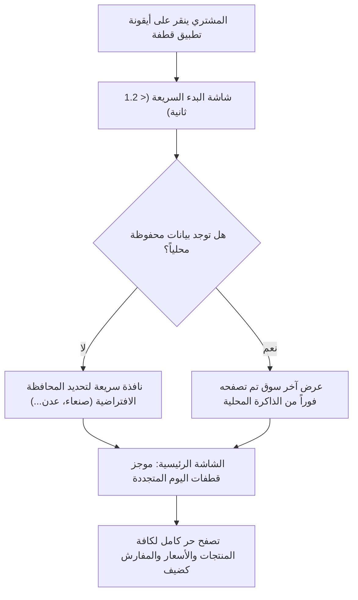

#### خطوات التدفق وقواعد العمل:
1. **الفتح الأولي (First Launch):** يفتح التطبيق مباشرة دون أي شاشات تعريفية طويلة (No Long Carousels).
2. **تحديد المحافظة الافتراضية:** تظهر نافذة منبثقة بسيطة تطلب اختيار المدينة (صنعاء، عدن، تعز، إب، ذمار...)، ويتم حفظ الاختيار تلقائياً في ذاكرة الهاتف (Local Storage).
3. **تصفح ضيف كامل (100% Guest Mode):** يستطيع الزائر تصفح كافة القطفات، الصور، الأسعار، خرائط الأسواق، وحتى الضغط على أزرار الاتصال بالبائع دون الحاجة لتسجيل أي حساب.
4. **متى يُطلب تسجيل الدخول فقط؟** يطلب النظام تسجيل الدخول برقم الهاتف ورمز التحقق (OTP) فقط عند:
   - كتابة تقييم أو مراجعة لمتجر.
   - متابعة متجر لتلقي الإشعارات.
   - حفظ قطفة في المفضلة.
   - الإبلاغ عن عرض مضلل (مع ربط البلاغ برقم المستخدم لمنع التكرار).

---

### التدفق 2.2: استكشاف العروض اليومية والفلترة الذكية بالميزانية المتوفرة (Daily Drops Discovery & Smart Budget Filter)

> **الهدف:** العثور على القات المطلوب (همداني، شامي، قعطبي، عنسي...) بالسعر المناسب وبحسب الميزانية النقدية المتوفرة في جيب المشتري مع مراعاة نطاق السوق المختار.

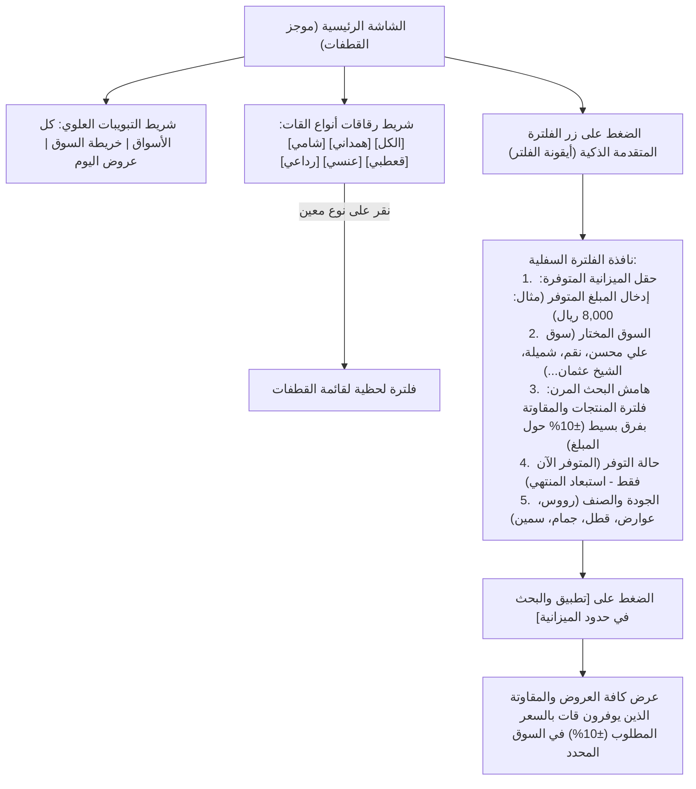

#### قواعد العمل وتجربة الاستخدام لميزة البحث بالميزانية:
- **البحث الذكي بالمبلغ المتوفر (Budget-Based Search):** يستطيع المشتري كتابة المبلغ المتوفر في جيبه نقداً (مثلاً: 7,000 أو 10,000 أو 15,000 ريال)؛ فيقوم التطبيق بالبحث في نطاق السوق المختار وعرض المنتجات وقائمة المقاوتية الذين يوفرون بضاعة بهذا السعر أو بفرق بسيط أقل أو أكثر (نطاق مرن ±10%، مثلاً لمبلغ 10,000 ريال يعرض عروض 9,000 إلى 11,000 ريال).
- **تحديث العروض اللحظي:** كل بطاقة عرض تحتوي على مؤشر زمني واضح: *"تم التحديث قبل 8 دقائق"* مع شارة توفر بارزة: `[متوفر الآن]` باللون الأخضر أو `[نفدت الكمية]` باللون الرمادي.
- **سياسة عدم التخزين المحلي للعروض:** العروض لا تُحمل مسبقاً في الذاكرة دون اتصال؛ فكل عرض يُجلب حياً لضمان عدم شراء بضاعة مباعة.
- **التخزين المؤقت الذكي:** عند التمرير أونلاين، يتم تنزيل الصور خفيفة الحجم بصيغة WebP بتدفق تدريجي لا يستهلك باقة النت.

---

### التدفق 2.3: استعراض خريطة أسواق القات في اليمن ومواقع المفارش (Market Map & Stall Navigation)

> **الهدف:** تمكين المشتري من رؤية خريطة السوق الشعبي ومعرفة مكان مفرش المقاوتي بدقة للتسوق المباشر دون أن يتوه في أزقة السوق المزدحم.

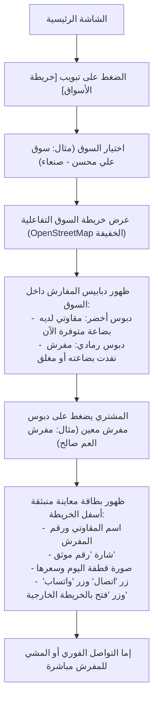

---

### التدفق 2.4: فحص تفاصيل القطفة والاتصال المباشر بالمقاوتي (Drop Details & 1-Click Ordering)

> **الهدف:** معاينة القات بالصور المكبرة ومعرفة كامل التفاصيل، ثم الانتقال الفوري للاتصال الهاتفي أو محادثة WhatsApp دون وسطاء.

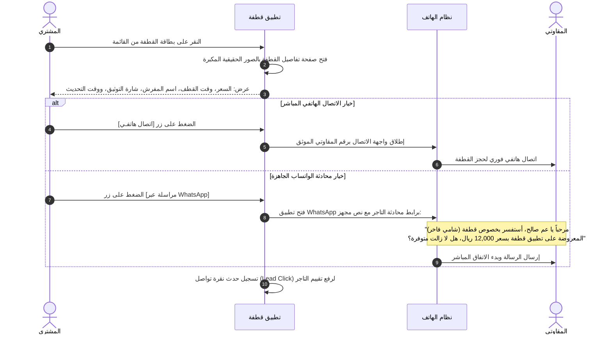

---

### التدفق 2.5: متابعة المقاوتي المفضل واستلام إشعارات القطفة الحية (Follow & Push Alerts)

> **الهدف:** أن يكون الزبون أول من يعلم بوصول شحنة القات المفضلة لديه لحظة تفريغها في السوق.

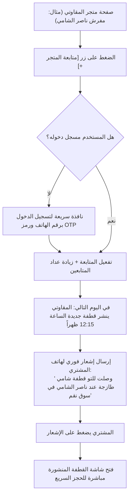

---

### التدفق 2.6: تجربة ما بعد الشراء: التقييم وإرفاق صورة القات (Ratings & Reviews)

> **الهدف:** بناء سمعة شفافة وموثوقة تكافئ المقاوتي الصادق وتمنع الغش وتغيير الأسعار.

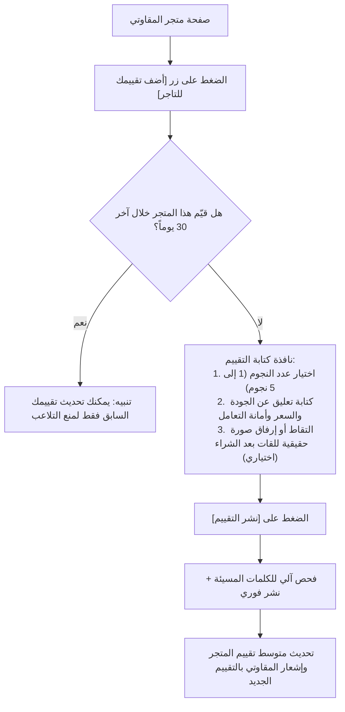

---

### التدفق 2.7: الإبلاغ عن العروض المضللة وحماية مجتمع المنصة (Report Misleading Drop & Anti-Abuse)

> **الهدف:** حماية ثقة المشترين واستبعاد أي عرض كاذب أو صورة مسروقة أو تلاعب بالأسعار مع حماية البائعين من البلاغات الكيدية ومنع تكرار البلاغ من نفس المستخدم.

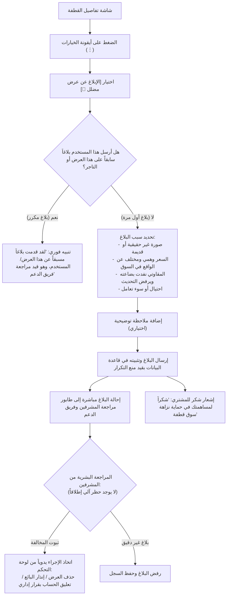

#### قواعد العمل للحد من البلاغات وحماية الحسابات:
1. **منع التكرار الصارم (Report Deduplication):** لا يستطيع أي مستخدم إرسال أكثر من بلاغ واحد على نفس المنتج أو نفس المقاوتي؛ وأي محاولة إضافية تُرفض فوراً على مستوى التطبيق والـ API وقاعدة البيانات.
2. **حظر الحسابات يدوي وحصري عبر لوحة الدعم (Manual-Only Suspension):** منعاً للتخريب والمكائد بين المقاوتية في السوق، **لا يتم إيقاف أو تجميد أي حساب تلقائياً أبداً** مهما كان عدد البلاغات؛ فجميع القرارات تتطلب فحصاً بشرياً وتواصلاً مباشراً من فريق الدعم والمسؤولين عبر لوحة التحكم الإدارية.

---

### التدفق 2.8: مشاركة العرض بالروابط الذكية العميقة (Deep Link Sharing)

> **الهدف:** تمكين المشترين والتجار من تداول العروض في مجموعات الواتساب وحالات فيسبوك برابط ينقل القارئ مباشرة إلى داخل تطبيق قطفة.

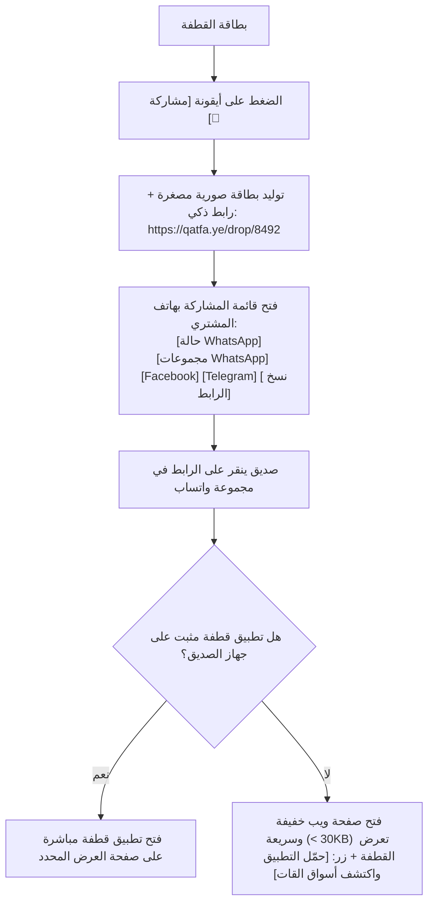

---

## 3. تدفقات المقاوتي / البائع بالتفصيل (Seller / Maqwati Journeys)

---

### التدفق 3.1: التسجيل وتوثيق رقم الهاتف وضمان عدم التكرار (Unique Phone Verification)

> **الهدف:** تحويل أي مقاوتي في السوق إلى بائع موثق لديه متجر رقمي في أقل من دقيقتين مع التحقق الصارم من عدم تكرار رقم الهاتف لأكثر من حساب.

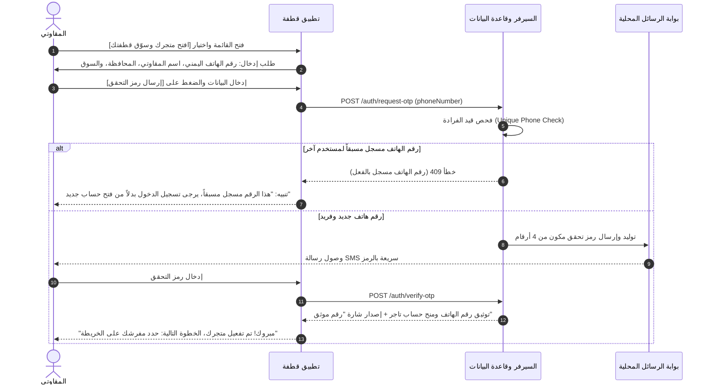

---

### التدفق 3.2: تثبيت المفرش على الخريطة والزر المتوهج لإعداد القوائم السريعة (Stall Pinning & Glowing Next Step)

> **الهدف:** وضع مفرش التاجر على الخريطة بدقة، يتبعه توجيه بصري متوهج وجذاب ينقله مباشرة لإعداد خياراته المفضلة لتجهيز نافذة النشر السريع.

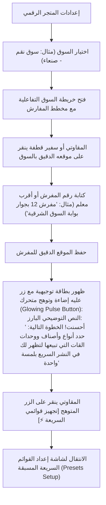

---

### التدفق 3.3: إعداد القوائم السريعة المسبقة للأنواع والأصناف والوحدات (Presets Configuration Flow)

> **الهدف:** تخصيص تجربة النشر للمقاوتي بحيث لا تظهر له في نافذة النشر السريع إلا الأنواع والأصناف والوحدات التي يحددها بنفسه، مع إمكانية إضافة أنواع أو أصناف مخصصة جديدة بزر علوي.

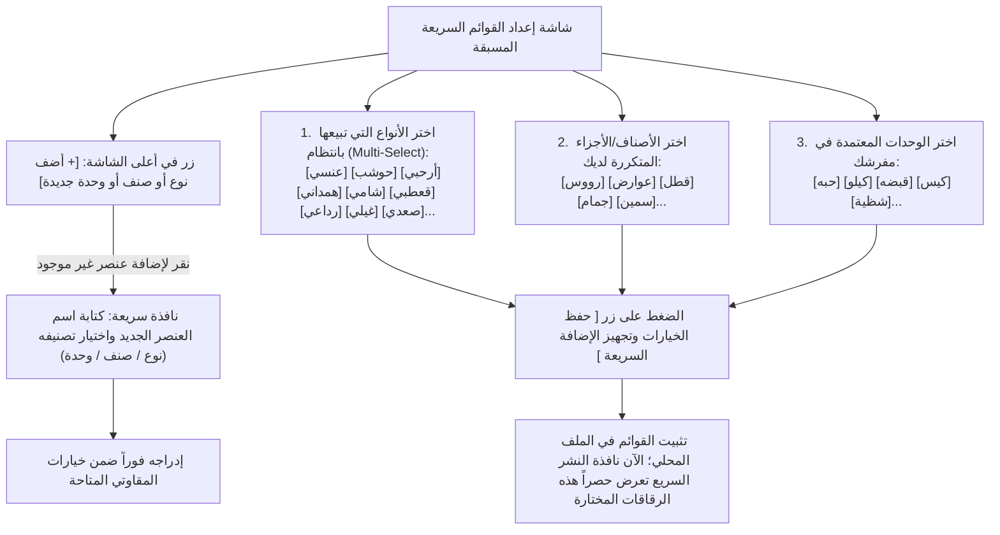

---

### التدفق 3.4: النشر الخاطف للقطفة بالاعتماد على القوائم المجهزة (Lightning Drop Publishing - The Quick-Add Flow)

> **الهدف:** إتمام نشر العرض اليومي في **أقل من 20 ثانية**؛ بالاعتماد على الرقاقات التي أعدها المقاوتي مسبقاً، مع توفير زر علوي للإضافة السريعة عند ظهور صنف جديد.

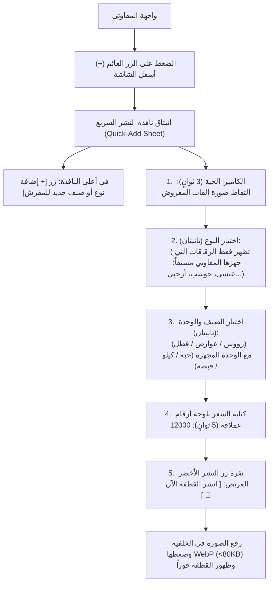

---

### التدفق 3.5: التبديل المزدوج لحالة التوفر [المتجر كاملاً / المنتج المنفرد] (Dual Availability Controls)

> **الهدف:** تمكين المقاوتي من التحكم الكامل بظهور بضاعته عبر مفتاح رئيسي للمتجر ككل ومفتاح مستقل لكل قطفة.

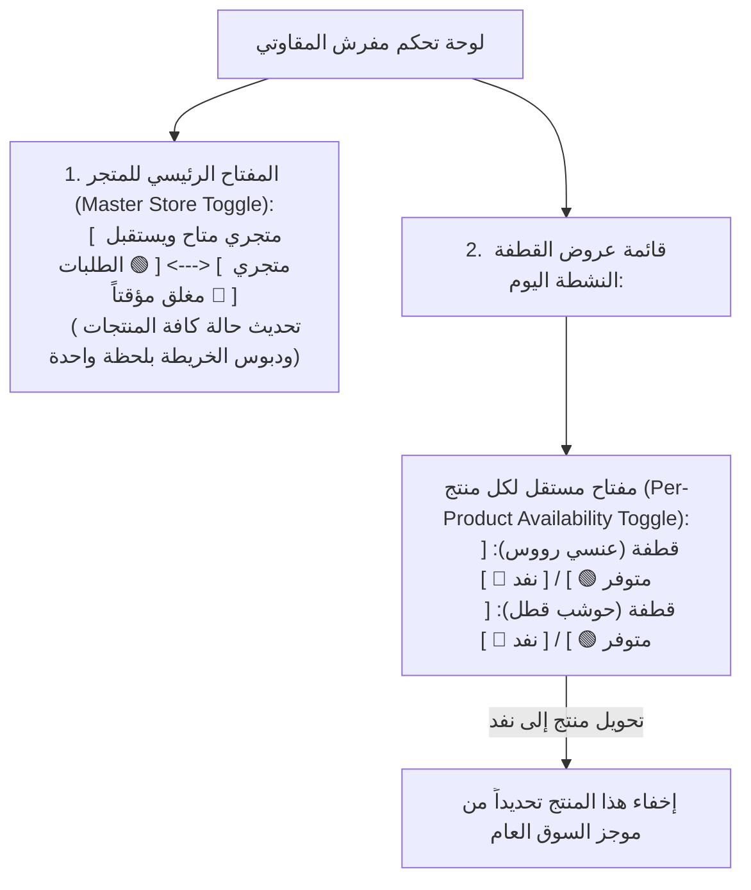

---

### التدفق 3.6: الإخفاء التلقائي عند نفاذ الكمية وتفاعل الإشعار (Stock-Out Auto-Hide & Notification Action)

> **الهدف:** حماية مصداقية التطبيق وإيقاف اتصالات المشترين عند نفاذ صنف معين، مع إشعار المقاوتي فورا لتمكينه من زيادة الكمية أو تأكيد الإخفاء.

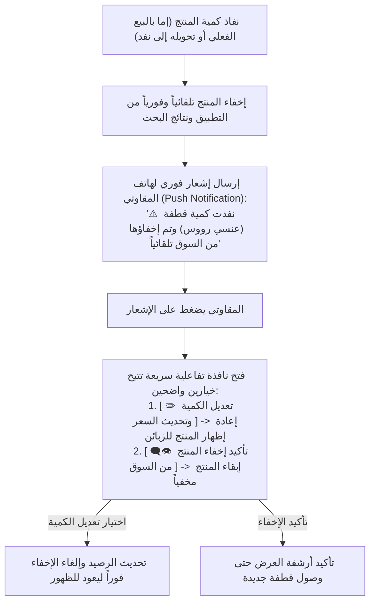

---

### التدفق 3.7: تدفق الإعلان السريع اليومي بدون إعداد كامل (Daily Express Ad Flow)

> **الهدف:** استيعاب المقاوتية المستعجلين الذين لا يرغبون بملء الموقع وتثبيت المفرش وإعداد القوائم المسبقة، عبر إتاحة إعلان يومي سريع واحد فقط.

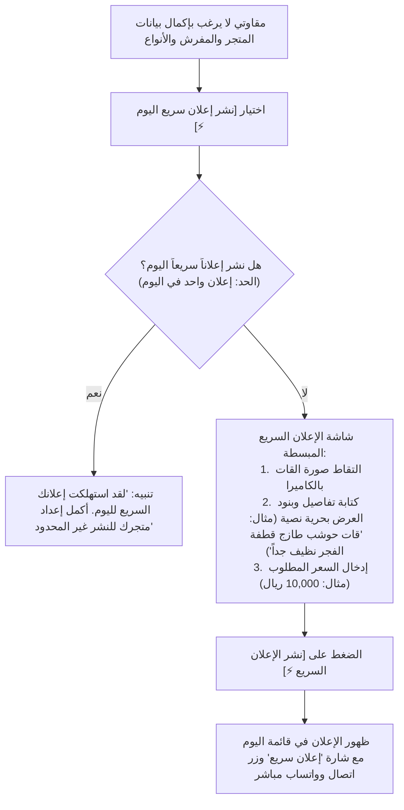

---

### التدفق 3.8: إيقاف إشعارات التقييمات للمقاوتي (Mute Rating Notifications Flow)

> **الهدف:** منع إزعاج المقاوتي بإشعارات التقييم والمراجعات أثناء ساعات الذروة والبيع المزدحم في السوق.

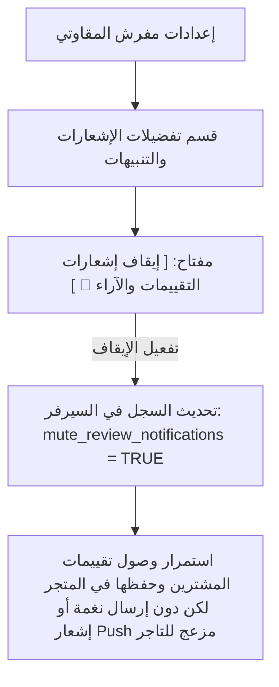

---

### التدفق 3.9: التسويق المستمر بمشاركة بطاقة القطفة على الواتساب (Continuous Marketing Flow)

> **الهدف:** تمكين المقاوتي من تسويق بضاعته بضغطة زر إلى زبائنه على حالات الواتساب والمجموعات لجلب مشترين جدد باستمرار.

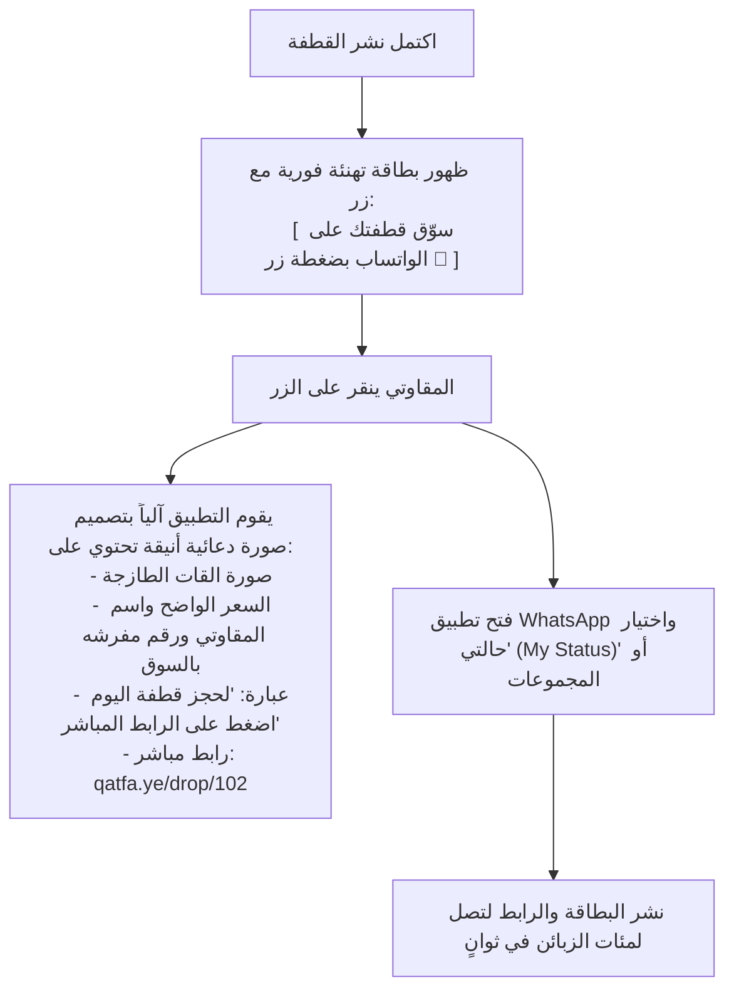

---

## 4. مصفوفة التعامل مع الحالات الاستثنائية وانقطاع الإنترنت (Edge Cases & Offline UX)

| الحالة الاستثنائية | السلوك المتوقع من التطبيق | الإجراء والتغذية الراجعة للمستخدم |
| :--- | :--- | :--- |
| **انقطاع الإنترنت أثناء رفع المقاوتي للقطفة** | حفظ الصورة والبيانات في طابور محلي (Local SQLite/Hive Queue). | ظهور شريط برتقالي: *"تم حفظ القطفة، سيتم نشرها تلقائياً فور عودة الاتصال"*، مع استمرار عمل التطبيق. |
| **تصفح المشتري للتطبيق دون إنترنت** | فتح التطبيق في وضع عدم الاتصال للبيانات المرجعية الثابتة فقط. | **عدم تحميل عروض القات السابقة مسبقاً محلياً** لمنع تضليل الزبائن ببضاعة نفدت؛ والتخزين دون اتصال يقتصر على دليل الأسواق والمحافظات وأرقام الاتصال المحفوظة مسبقاً، مع بقاء أزرار **الاتصال الهاتفي المباشر** نشطة عبر شبكة الـ GSM. |
| **محاولة تسجيل رقم هاتف مكرر** | فحص فرادة الرقم بقاعدة البيانات لمنع الحسابات المزدوجة. | تنبيه فوري: *"رقم الهاتف هذا مرتبط بحساب مسجل مسبقاً، يرجى تسجيل الدخول بدلاً من فتح حساب جديد"*. |
| **نفاذ كمية القطفة المعروضة** | إخفاء فوري وتلقائي للعرض من التطبيق وإشعار المقاوتي. | إرسال Push Notification للبائع: *"نفدت كمية قطفتك وتم إخفاؤها"* مع زرين: *"تعديل الكمية"* أو *"تأكيد الإخفاء"*. |
| **محاولة مشتري تقديم بلاغات مكررة** | حظر تقديم أكثر من بلاغ واحد من نفس المستخدم على نفس المنتج أو البائع. | إظهار تنبيه منع التكرار: *"لقد قمت بالإبلاغ عن هذا العرض/المستخدم مسبقاً، والبلاغ قيد الفحص من المشرفين"*. |
| **ورود بلاغات متعددة ضد مقاوتي** | **عدم الحظر الآلي مطلقاً**؛ إحالة البلاغات إلى طابور مراجعة المشرفين. | الحساب لا يُوقف تلقائياً أبداً مهما زادت البلاغات؛ حيث يقوم فريق الدعم والمسؤولون بالتحقق البشري والمكالمة الهاتفية واتخاذ القرار يدوياً من لوحة التحكم. |
| **عدم رغبة المقاوتي في إكمال إعداد المتجر** | إتاحة إعلان يومي سريع واحد فقط (Express Ad). | السماح بنشر إعلان واحد خلال 24 ساعة يحتوي على نص حر وسعر وصورة دون الحاجة لتحديد السوق والمفرش والقوائم المسبقة. |
| **عدم استلام رمز OTP عبر SMS** | إتاحة زر بديل بعد 45 ثانية لإرسال الرمز عبر WhatsApp. | ظهور خيار: `[ استلام الرمز عبر محادثة WhatsApp الرسمية ]`. |
| **محاولة مشتري تقييم نفس المتجر عدة مرات** | منع النظام لتكرار التقييم لنفس المتجر خلال 30 يوماً. | رسالة ودية: *"لقد قمت بتقييم هذا المتجر مؤخراً، يمكنك تعديل تقييمك الحالي"*. |