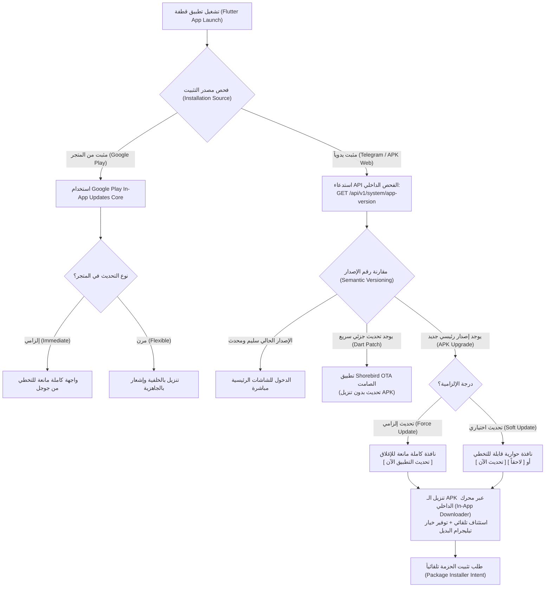

# استراتيجية التحديثات المستمرة والتوزيع البديل (In-App Updates & Alternative Distribution Strategy) | منصة قطفة

---

## 1. الملخص التنفيذي وتوصيف المشكلة (Problem Statement & Executive Summary)

### 1.1 التحدي التقني والتشغيلي

في المراحل الأولى لإطلاق منصة **قطفة (Qatfa)**، تم اعتماد استراتيجية التوزيع المباشر خارج المتاجر الرسمية عبر **قناة Telegram الرسمية وموقع الويب (تنزيل ملف الـ APK المباشر)**، مع التخطيط للنشر اللاحق على متاجر التطبيقات (Google Play و Huawei AppGallery).

ينشأ عن هذا النمط من التوزيع تحدٍ جوهري يتمثل في:

1. **غياب التحديث التلقائي للمتجر:** التطبيقات المثبتة خارج Google Play (Sideloaded APKs) لا تتلقى أي إشعارات أو تحديثات آلية في الخلفية من نظام التشغيل كما هو معتاد في متجر Google Play.
2. **طبيعة المنتج الحية والمتسارعة:** منصة قطفة تتطلب معايير عالية لتوافق إصدارات التطبيق مع الـ APIs الخلفية (Backend Breaking Changes)، وحل أي ثغرات أو مشاكل واجهة فوراً لضمان تجربة المقاوتي والمشتري.
3. **خصوصية السوق اليمني وبيئة الاتصال:** بطء الاتصال، انقطاع كابلات الإنترنت، وتكلفة باقات البيانات المحدودة (3G/4G) تتطلب حلول تحديث ذكية، خفيفة، وسريعة لا ترهق المستخدم ولا تجبره على إعادة تنزيل حزم ضخمة عند كل تعديل بسيط.

### 1.2 الهدف الهندسي المعتمد

بناء **منظومة تحديث هجينة ثلاثية المستويات (Hybrid 3-Tier Update Architecture)** داخل تطبيق Flutter والواجهات الخلفية لـ NestJS ولوحة التحكم، تتيح:

- **اكتشاف التحديثات فورياً** بمجرد فتح التطبيق أو عبر إشعارات البث.
- **تحديثات بدون تنزيل APK كامل (Code Push / OTA)** للأخطاء البرمجية وتعديلات الواجهة السريعة.
- **تنزيل وتثبيت الـ APK مباشرة من داخل التطبيق (In-App APK Installer)** دون الحاجة للخروج إلى المتصفح أو فتح تيليجرام يدوياً.
- **تكامل سلس وتلقائي مع Google Play In-App Updates** عند توفر التطبيق في المتجر لاحقاً مع المحافظة على نفس الشيفرة المصدرية (Single Codebase).

---

## 2. مقارنة الحلول العالمية والبدائل التقنية (Benchmarking & Solution Evaluation)

لحل معضلة التحديثات خارج المتاجر لتطبيقات **Flutter**، تم تحليل واختبار 4 مناهج تقنية رئيسية:

| المعيار                                           | الخيار 1: التحقق عبر الـ API + التنزيل الداخلي (Custom In-App APK Engine) | الخيار 2: Code Push عبر الهواء (Shorebird OTA)                                           | الخيار 3: Google Play In-App Update API          | الخيار 4: التوجيه الخارجي اليدوي (External Link Redirect)   |
| :------------------------------------------------ | :------------------------------------------------------------------------ | :--------------------------------------------------------------------------------------- | :----------------------------------------------- | :---------------------------------------------------------- |
| **دعم التثبيت خارج المتاجر (Telegram / Web APK)** | **مدعوم بنسبة 100% (أصيل)**                                               | مدعوم بنسبة 100% (تحديث كود Dart)                                                        | ❌ غير مدعوم إطلاقاً (يعمل حصراً مع Google Play) | مدعوم (يحيل المستخدم للمتصفح/تيليجرام)                      |
| **تجربة المستخدم (UX)**                           | ممتازة (شريط تقدم، تنزيل وتثبيت فوري بضغطة زر)                            | الأفضل عالمياً (تحديث صامت وفوري عند إعادة التشغيل)                                      | ممتازة (Flexible / Immediate)                    | ضعيفة ومربكة (خروج من التطبيق، بحث عن الملف وتثبيته يدوياً) |
| **حجم التنزيل المستهلك**                          | حجم الـ APK كاملاً (~12 - 16MB)                                           | متناهي الصغر (Patches بحجم 200KB - 2MB فقط)                                              | حزم الفوارق عبر Google Play (~2 - 6MB)           | حجم الـ APK كاملاً (~12 - 16MB)                             |
| **نوع التعديلات المسموحة**                        | كافة التعديلات (Dart + Native + Assets + Plugins)                         | **أكواد Dart والواجهات فقط** (لا يدعم تعديل ملفات Android Native أو إضافة Plugins جديدة) | كافة التعديلات                                   | كافة التعديلات                                              |
| **التكلفة المالية**                               | **صفرية (\$0.00)** - خوادم Cloudflare R2 الحالية                          | مجاني حتى 5,000 تحديث/شهر، ثم \$20/شهر                                                   | صفرية مجانية من Google                           | صفرية                                                       |
| **التوافق المستقبلي مع المتاجر**                  | متوافق كخيار بديل عند التحميل اليدوي                                      | متوافق بنسبة 100% مع سياسات Play Store و App Store                                       | أساسي لنسخة المتجر الرسمية                       | متوافق                                                      |

---

## 3. المعمارية الهجينة المقترحة لمنصة قطفة (The 3-Tier Hybrid Architecture)

نظراً لاحتياجات منصة قطفة وخصائص السوق اليمني، نعتمد استراتيجية **الطبقات الثلاث المتكاملة (3-Tier Update Engine)**:



---

## 4. تفاصيل المكونات الفنية (Technical Implementation Details)

### 4.1 خادم التحقق من الإصدارات (NestJS Version Control API)

يتم تزويد الخادم الخلفي بنقطة وصول مخصصة تفحص إصدار التطبيق، ونظام التشغيل، ومصدر التثبيت، لتعيد التوجيه الملائم.

- **المسار:** `GET /api/v1/system/app-version`
- **الوصول:** عام (Public) ومخزن مؤقتاً عبر Cloudflare Edge Cache.
- **المعاملات (Query Params):**
  - `platform`: `android` أو `ios`.
  - `currentVersion`: `1.0.0`
  - `buildNumber`: `10`
  - `installerStore`: `telegram` أو `website` أو `google_play`.

#### نموذج الاستجابة المعياري (JSON Response Payload):

```json
{
  "success": true,
  "statusCode": 200,
  "message": "تم جلب بيانات فحص الإصدار بنجاح",
  "data": {
    "latestVersion": "1.1.0",
    "latestBuildNumber": 15,
    "minSupportedVersion": "1.0.0",
    "minSupportedBuildNumber": 10,
    "updateType": "OPTIONAL",
    "title": "تحديث جديد متوفر لمنصة قطفة 🌿",
    "releaseNotes": "• تحسين سرعة تحميل خريطة أسواق القات في صنعاء وعدن.\n• ميزة التبديل المستقل لتوفر القطفة بنقرة زر واحدة.\n• إصلاح مشكلة ثبات الاتصال في شبكات 3G الضعيفة.",
    "downloadUrl": "https://cdn.qatfa.ye/releases/qatfa-v1.1.0.apk",
    "apkSizeInBytes": 14680064,
    "sha256": "8f4e2c1d3b5a7e9f0a2c4e6b8d0f1a3c5e7b9d1f3a5c7e9b0d2f4a6c8e0b1d3f",
    "telegramChannelUrl": "https://t.me/qatfa_app",
    "telegramPostUrl": "https://t.me/qatfa_app/42",
    "playStoreUrl": "https://play.google.com/store/apps/details?id=ye.qatfa.app",
    "showTelegramOption": true
  }
}
```

---

### 4.2 محرك التحديث والتثبيت داخل تطبيق Flutter

لتوفير تجربة خالية من التعقيد للمستخدم العادي والمقاوتي في السوق، يتم تنفيذ تدفق التثبيت داخل التطبيق بالخطوات التالية:

#### المكتبات المعتمدة في `pubspec.yaml`:

```yaml
dependencies:
  package_info_plus: ^8.0.0 # قراءة إصدار التطبيق والمصدر الحالي
  dio: ^5.7.0 # تنزيل ملف الـ APK مع تتبع نسبة الإنجاز والسرعة
  path_provider: ^2.1.4 # تحديد مجلد التخزين المؤقت المحلي للتحميل
  open_filex: ^4.5.0 # أو install_plugin لإطلاق معالج تثبيت الأندرويد
  permission_handler: ^11.3.1 # طلب إذن تثبيت الحزم غير المعروفة
  in_app_update: ^4.2.0 # لمزامنة متجر Google Play لاحقاً
  shorebird_code_push: ^1.2.0 # التحديثات السريعة عبر الهواء (اختياري/مرحلي)
```

#### آلية العمل البرمجية (Workflow Logic):

1. **فحص الإصدار عند الإقلاع (Silent Startup Check):**
   - عند فتح التطبيق، يتم إرسال طلب غير معطل للواجهة (Non-blocking Asynchronous Request) إلى مسار `/system/app-version`.
   - في حال عدم وجود إنترنت، يستمر التطبيق في العمل مستخدماً البيانات المخزنة مؤقتاً دون إزعاج المستخدم.

2. **معالجة التحديث الإلزامي (Hard / Force Update):**
   - إذا كان `currentBuildNumber < minSupportedBuildNumber`، يتم إظهار شاشة كاملة (Non-dismissible Modal) لا يمكن إغلاقها أو الرجوع منها بزر العودة، تشرح سبب التحديث وأهميته لضمان استمرار عمل التطبيق.

3. **معالجة التحديث الاختياري (Soft / Flexible Update):**
   - إذا كان `currentBuildNumber < latestBuildNumber` لكنه أعلى من الحد الأدنى، تظهر بطاقة سفلية أنيقة (Bottom Sheet) مع خياري: `[ تحديث الآن ]` و `[ لاحقاً ]`.

4. **تنزيل الـ APK مع معالجة انقطاع الإنترنت (Resumable Download):**
   - يقوم محرك `Dio` بتنزيل الملف وحفظه في مسار التخزين المؤقت `getExternalStorageDirectory()` مع إظهار شريط نسبة مئوية دقيق وحجم المنقول (مثال: `6.4MB / 14.2MB`).
   - يدعم التحميل الاستئناف في حال تذبذب شبكة الهاتف.

5. **التحقق من سلامة الحزمة (SHA-256 Checksum):**
   - للوقاية من تلف الحزم بسبب ضعف الإنترنت أو هجمات التعديل، يقوم التطبيق بمطابقة التجزئة المشفرة (Hash) للملف المحمل مع قيمة `sha256` المستلمة من الـ API قبل التثبيت.

6. **إطلاق معالج تثبيت أندرويد (Trigger Android Package Installer Intent):**
   - فور اكتمال التنزيل والتحقق، يستدعي التطبيق معالج النظام:
     ```dart
     await OpenFilex.open(downloadedApkPath, type: "application/vnd.android.package-archive");
     ```
   - إذا كان نظام Android 8.0 فأعلى يتطلب إذناً لتثبيت التطبيقات من مصادر غير معروفة (`REQUEST_INSTALL_PACKAGES`)، يقوم التطبيق بتوجيه المستخدم عبر رسالة توضيحية بلهجة محلية مبسطة: _"يرجى تفعيل خيار (السماح بتثبيت التطبيقات من هذا المصدر) لمرة واحدة فقط لإتمام التحديث"_.

---

### 4.3 تكامل قناة Telegram في تجربة التحديث (Telegram-Integrated Fallback)

نظراً لأن منصة **Telegram** تحظى بشعبية جارفة في اليمن وتتميز بضغط البيانات وخوادم CDN قريبة، يتم تضمين خيار تيليجرام كبديل استراتيجي فوري:

1. **زر بديل في نافذة التحديث:**
   - بجانب زر `[ تنزيل وتثبيت مباشر ]`، يوجد زر واضح يحمل هوية تيليجرام: `[ تنزيل التحديث عبر قناة Telegram ✈️ ]`.
2. **الربط بالمنشور الدقيق (Deep Linking to Telegram Post):**
   - لا يُفتح رابط القناة بشكل عام، بل يتم توجيه المستخدم مباشرة إلى **معرف المنشور المحدد** (مثال: `tg://resolve?domain=qatfa_app&post=42`) لكي يجد ملف الـ APK أمامه مباشرة بضغطة زر دون الحاجة للبحث في سجل القناة.

---

### 4.4 مسار التحديثات السريعة عبر الهواء (Over-The-Air / Shorebird Code Push)

لتفادي إجبار المستخدمين على إعادة تنزيل حزمة الـ APK عند معالجة أخطاء الكود البسيطة أو تحسين النصوص وتصميم الشاشات:

1. **طريقة العمل:** تتيح تقنية **Shorebird** تجميع الفوارق في كود Dart (AOT Patches) ورفعها عبر سحابة مخصصة.
2. **الحجم والسرعة:** حجم الرقعة البرمجية يتراوح عادة بين **150KB إلى 1.5MB** مقارنة بـ 15MB للـ APK الكامل.
3. **التطبيق الصامت (Silent Update):** يقوم التطبيق بتنزيل الرقعة في الخلفية دون أن يشعر المستخدم، ويتم تطبيق التعديلات تلقائياً في المرة القادمة التي يفتح فيها التطبيق.
4. **حدود الاستخدام:** الرقع البرمجية تعالج كود Dart فقط؛ أما عند إضافة صلاحيات أندرويد جديدة، أو تحديث مكتبات تتضمن كود Native، يتم اللجوء تلقائياً لآلية ترقية الـ APK الكامل.

---

### 4.5 الانتقال السلس إلى Google Play و Huawei AppGallery (Future-Proof Store Migration)

عند اعتماد التطبيق ونشره رسمياً على المتاجر:

1. **كشف مصدر التثبيت آلياً (Installer Source Detection):**
   - باستخدام كود `PackageInfo.fromPlatform()`، يستعلم التطبيق عن `installerStore`:
     - إذا كانت القيمة `com.android.vending` -> التطبيق يعلم أنه مثبت من Google Play.
     - إذا كانت القيمة `com.huawei.appmarket` -> مثبت من Huawei AppGallery.
     - إذا كانت القيمة فارغة أو `null` -> مثبت يدوياً من Telegram أو الموقع.
2. **تكييف سلوك التحديث ديناميكياً:**
   - لمستخدمي **Google Play**: يتم استدعاء مكتبة `in_app_update` الرسمية لتفعيل واجهة جوجل الأصلية (Google Play Flexible / Immediate Update Core) دون تنزيل ملفات خارجية.
   - لمستخدمي **Telegram / Website**: يستمر محرك التنزيل الداخلي المستقل في العمل بسلاسة تامة.
   - هذا يضمن **امتثالاً كاملاً 100% لسياسات Google Play**، حيث تمنع سياسات جوجل قيام التطبيق المثبت عبر المتجر بتنزيل حزم APK خارجية من خوادم مستقلة.

---

## 5. واجهات تجربة المستخدم وسيناريوهات التحديث (UI/UX Flows & Specs)

### 5.1 نموذج شاشة التحديث الإلزامي (Force Update Dialog)

```text
┌────────────────────────────────────────────────────────┐
│                                                        │
│                    🌿 منصة قطفة                        │
│                                                        │
│             [ أيقونة صاروخ / تحديث جذري 🚀 ]            │
│                                                        │
│            تحديث ضروري لاستمرار عمل التطبيق            │
│                 الإصدار الجديد: v1.1.0                 │
│                                                        │
│  حرصاً على دقة عروض القطفة وتأمين حسابك، قمنا          │
│  بإطلاق تحديث هام يتضمن الميزات التالية:               │
│                                                        │
│  ✓ تحسين سرعة فتح خريطة الأسواق الشعبية.                │
│  ✓ إيقاف العروض تلقائياً عند نفاذ الكمية فوراً.       │
│  ✓ استقرار إشعارات الأسعار الجديدة في شبكات 3G.        │
│                                                        │
│  ┌──────────────────────────────────────────────────┐  │
│  │   [ ⬇️ بدء تنزيل وتثبيت التحديث الآن (14MB) ]     │  │
│  └──────────────────────────────────────────────────┘  │
│                                                        │
│  ┌──────────────────────────────────────────────────┐  │
│  │   [ ✈️ تنزيل التحديث السريع عبر Telegram ]        │  │
│  └──────────────────────────────────────────────────┘  │
│                                                        │
│  ملاحظة: حجم التحديث اقتصادي ولا يستنزف رصيد باقتك.    │
│                                                        │
└────────────────────────────────────────────────────────┘
```

### 5.2 أثناء عملية التنزيل المباشر (In-Progress State):

- يظهر شريط تقدم تفاعلي (Linear Progress Indicator):
  - النسبة: `68%`
  - الحجم: `9.8MB من 14.4MB`
  - السرعة التقريبية وزر إلغاء في حال رغب المستخدم في استئناف العملية لاحقاً.
- فور اكتمال التنزيل، يتحول الزر تلقائياً إلى:
  `[ ⚙️ اضغط هنا لتثبيت التحديث الآن ]`

---

## 6. جدول مقارنة مسارات التوزيع وسيناريوهات التشغيل

| مسار التوزيع                          | مصدر التثبيت                | قناة التحديث الأولية                      | القناة الاحتياطية (Fallback)             | متطلبات صلاحيات أندرويد                      |
| :------------------------------------ | :-------------------------- | :---------------------------------------- | :--------------------------------------- | :------------------------------------------- |
| **المرحلة الحالية (Initial Rollout)** | الموقع الرسمي `qatfa.ye`    | محرك التنزيل الداخلي (In-App Downloader)  | رابط منشور التحديث في Telegram           | إذن تثبيت الحزم (`REQUEST_INSTALL_PACKAGES`) |
| **قناة تيليجرام الرسمية**             | Telegram Channel            | محرك التنزيل الداخلي مع فحص الـ API       | تنزيل الـ APK المرفوع في تيليجرام مباشرة | إذن تثبيت الحزم                              |
| **التحديثات البرمجية الصغيرة**        | كافة المصادر (Web/Telegram) | تحديث كود Dart الهوائي الصامت (Shorebird) | التحويل لتحميل الـ APK الكامل عند التعذر | لا يتطلب أي صلاحيات إضافية                   |
| **مرحلة المتاجر (Google Play)**       | متجر Google Play            | واجهة Google Play In-App Update الرسمية   | توجيه لصفحة المتجر في المتصفح            | صلاحيات Google Play القياسية                 |
| **مرحلة أجهزة هواوي (AppGallery)**    | Huawei AppGallery           | واجهة التحديث الرسمية عبر Huawei Core SDK | محرك التحميل الداخلي للـ APK             | صلاحيات AppGallery                           |

---

## 7. متطلبات لوحة التحكم لإدارة التحديثات (Admin Panel Controls)

تتم إضافة وحدة جديدة في لوحة إدارة النظام تسمى **"إدارة إصدارات التطبيق" (App Version Control Center)** بالميزات التالية:

1. **شاشة رفع وإدارة الإصدارات (Releases Dashboard):**
   - رقم الإصدار البرمجي (`Version Name` مثل `1.1.0`) ورقم البناء (`Build Number` مثل `15`).
   - خيار تحديد طبيعة التحديث:
     - `إلزامي (Blocking / Force Update)`: يمنع استخدام الإصدارات الأقدم تماماً.
     - `موصى به (Soft / Optional Update)`: يظهر إشعاراً مرناً يمكن تجاوزه.
   - حقل ملاحظات الإصدار (Release Notes) باللغة العربية الواضحة.
2. **رابط الملف وخوادم التوزيع:**
   - رفع ملف الـ APK مباشرة إلى مخزن **Cloudflare R2** بنقرة زر واحدة.
   - استخراج وتخزين تجزئة الحزمة المشفرة `SHA-256` تلقائياً عبر النظام للتحقق من سلامة الملفات.
   - إدخال رابط منشور التيليجرام المقابل (`Telegram Post URL`).
3. **مفتاح الطوارئ والرجوع للإصدار السابق (Emergency Rollback Switch):**
   - إمكانية خفض الحد الأدنى المطلوب للإصدار بنقرة زر واحدة في حال اكتشاف خطأ غير متوقع في الإصدار الجديد، مما يسمح للمستخدمين بالاستمرار في استخدام الإصدار السابق دون انقطاع.

---

## 8. خطة التنفيذ الموصى بها (Implementation Action Plan)

| الخطوة | المهمة التفصيلية                                                                                                             |         المسؤول          | الإطار الزمني |
| :----: | :--------------------------------------------------------------------------------------------------------------------------- | :----------------------: | :-----------: |
| **1**  | إضافة مسار `GET /api/v1/system/app-version` في خادم NestJS مع إمكانية ضبط القيم من متغيرات البيئة أو جدول الإعدادات          |      مطور الباك إند      |     يومان     |
| **2**  | إضافة وحدة إدارة الإصدارات البسيطة داخل لوحة تحكم React/Vite                                                                 |     مطور الفرونت إند     |     يومان     |
| **3**  | بناء شاشة وخدمة `AppUpdateService` في Flutter المسؤولة عن فحص الإصدار والتنزيل الداخلي بواسطة `Dio` والتثبيت عبر `OpenFilex` |      مطور الموبايل       |    3 أيام     |
| **4**  | تصميم وإعداد نوافذ الحوار (نافذة الإلزام ونافذة التحديث المرن) مع دعم الاتجاه العربي RTL ونصوص اللهجة اليمنية المريحة        | مصمم UI/UX ومطور Flutter |   يوم واحد    |
| **5**  | إنشاء قناة Telegram الرسمية وضبط آلية تسمية ملفات الـ APK المرفوعة بروابط مباشرة                                             |  فريق العمليات والتسويق  |   يوم واحد    |
| **6**  | اختبار سيناريوهات الانقطاع وإعادة التنزيل على هواتف الفئة الاقتصادية (Infinix, Tecno, Itel) في بيئات اتصال 3G حقيقية         |    مهندس الجودة (QA)     |     يومان     |

---

## 9. الخلاصة والتوصية النهائية

إن الجمع بين:

1. **نظام التحقق الذكي عبر الـ API الداخلي للباك إند**،
2. **محرك التنزيل والتثبيت المباشر داخل تطبيق Flutter دون إخراج المستخدم**،
3. **قناة Telegram المنسقة بروابط المنشورات المباشرة كخط دعم بديل**،
4. **والهيكلية المجهزة للانتقال التلقائي لمكتبة Google Play In-App Updates لاحقاً**،

يمنح منصة **قطفة** حلاً هندسياً متكاملاً فائق الاستقرار، يضمن بقاء جميع مستخدمي المنصة (مشترين ومقاوتية) على أحدث إصدار بأقل مجهود وبأعلى كفاءة في استهلاك باقات الإنترنت المحلية.
