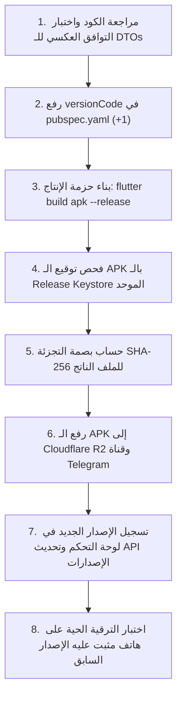

# ميثاق استقرار التحديثات ومعالجة أعطال Flutter والـ Backend (Update Resilience & Failure Safeguards) | منصة قطفة

---

## 1. مقدمة وأهداف الوثيقة (Purpose & Scope)

في منصة **قطفة (Qatfa)**، تُعد التحديثات المستمرة شريان حياة التطبيق، خاصة مع اعتمادنا في المرحلة الأولى على **التوزيع المباشر لملفات الـ APK عبر الموقع وقناة Telegram** قبل الانتقال لمتجر Google Play.

إطلاق تحديث به خلل تقني أو عدم توافق بين تطبيق الموبايل (Flutter) والخادم الخلفي (NestJS Backend) قد يؤدي إلى:

1. **انهيار التطبيق عند الفتح (Crash on Startup):** لا يستطيع المستخدم الدخول للتطبيق، وبالتالي يفقد التطبيق قدرته على استلام أي تحديث قادم عبر الإنترنت!
2. **فقدان جلسات المستخدمين (Session Drop):** تسجيل خروج مفاجئ للمقاوتية والمشترين وفقدان التفضيلات المحلية.
3. **توقف الـ API أو أخطاء التوافق (API Desynchronization):** فشل استجابة الواجهات البرمجية بسبب إرسال معاملات غير مدعومة أو تغيير هياكل الـ JSON.
4. **حظر الحزمة أو فشل التثبيت (Installation Blockers):** بسبب أخطاء الأذونات أو شهادات التوقيع الرقمي.

تهدف هذه الوثيقة إلى **حصر كافة المشاكل المتوقعة من جانب Flutter والـ Backend** ووضع **قواعد هندسية صارمة وإلزامية (Hard Rules)** يجب الالتزام بها منذ اليوم الأول للتطوير لمنع وقوع أي من هذه المشاكل نهائياً.

---

## 2. مصفوفة المخاطر البرمجية للتحديثات (Failure Modes Matrix)

|   #   | مصدر الخلل                               | المشكلة التقنية                                                   | الأثر على المستخدم والمنصة                                                                                               |    مستوى الخطورة     | الحل الهندسي المعتمد لمنعه                                                                        |
| :---: | :--------------------------------------- | :---------------------------------------------------------------- | :----------------------------------------------------------------------------------------------------------------------- | :------------------: | :------------------------------------------------------------------------------------------------ |
| **1** | **توقيع التطبيق (Signing)**              | فقدان ملف `release.keystore` أو تغيير مفتاح التوقيع بين إصدارين   | رفض أندرويد تثبيت التحديث (`INSTALL_FAILED_UPDATE_INCOMPATIBLE`). إجبار المستخدم على حذف التطبيق القديم وفقدان البيانات. | **كارثي (Critical)** | تثبيت مفتاح التوقيع والـ Keystore منذ اليوم الأول وأخذ نسخ احتياطية مشفرة متعددة في مدير الأسرار. |
| **2** | **معرف التطبيق (Package Name)**          | تغيير `applicationId` في ملفات Gradle                             | اعتباره تطبيقاً جديداً منفصلاً تماماً بدلاً من تحديث للتطبيق الحالي.                                                     | **كارثي (Critical)** | تثبيت معرف الحزمة الموحد `ye.qatfa.app` وعدم تغييره إطلاقاً.                                      |
| **3** | **رقم البناء (Version Code)**            | بناء APK برقم `versionCode` مساوٍ أو أقل من الإصدار المثبت        | يرفض نظام الأندرويد التحديث صامتاً ولا يتم تثبيت الملف.                                                                  |   **مرتفع (High)**   | فرض فحص آلي في CI/CD يمنع تصدير أي APK دون زيادة `buildNumber` بمقدار 1 على الأقل.                |
| **4** | **أذونات أندرويد (Permissions)**         | نسيان إذن `REQUEST_INSTALL_PACKAGES` أو إعداد `FileProvider`      | فشل إطلاق معالج تثبيت الـ APK من داخل التطبيق وظهور خطأ أمني.                                                            |  **حرج (Critical)**  | تهيئة `FileProvider` وأذونات التثبيت في ملف `AndroidManifest.xml` من الإصدار 1.0.0.               |
| **5** | **تخزين الكاش المحلي (Local Storage)**   | تغيير بنية نماذج Hive / Isar / SharedPreferences دون Migration    | انهيار التطبيق فور تشغيله (`TypeCastException` أو `CorruptedBoxException`).                                              | **كارثي (Critical)** | فرض تدوين إصدارات الكاش (Schema Versioning) ودعم المعالجة الدفاعية (Safe Defaults & Auto-Purge).  |
| **6** | **تغيرات الـ API (Breaking Changes)**    | تعديل الباك إند لمسار أو هيكل JSON يعتمد عليه إصدار قديم في السوق | توقف واجهات التطبيق القديم وظهور شاشات بيضاء للمستخدمين الذين لم يحدثوا بعد.                                             |  **حرج (Critical)**  | تفعيل ترويسات الإصدار الصارمة ودعم الإصدارات المتعددة للـ API (`/v1/`, `/v2/`) مع التوافق العكسي. |
| **7** | **تلف ملف الـ APK (Corrupted Download)** | انقطاع أو ضعف شبكة 3G يؤدي لتنزيل ملف APK ناقص الحجم              | رسالة نظام أندرويد: _"There was a problem parsing the package"_.                                                         |  **متوسط (Medium)**  | التحقق الإلزامي من بصمة التجزئة `SHA-256` للملف قبل استدعاء معالج التثبيت.                        |
| **8** | **سياسات متجر Google Play**              | استدعاء كود تنزيل APK خارجي داخل النسخة المعتمدة بمتجر جوجل       | حظر حساب المطور على متجر Google Play لإخلاله بسياسة أمان التوزيع.                                                        |  **حرج (Critical)**  | فصل محرك التحديث برمجياً بناءً على كاشف المصدر (`installerStore`).                                |

---

## 3. القواعد الملزمة لمطوري فلاتر (Flutter Engineering Rules)

### القاعدة FL-01: الضبط النهائي لمعرف الحزمة وملف التوقيع (Signing & Package ID)

- يُعتمد معرف الحزمة الرسمي: **`ye.qatfa.app`** لجميع المنصات.
- يُنشأ ملف مفاتيح الإنتاج `release.jks` / `release.keystore` مرة واحدة فقط، ويُحفظ بأعلى درجات الأمان:
  - تشفير الملف وحفظ نسخة منه في مستودع آمن مع كلمة مرور قوية.
  - إضافة مسارات المفاتيح إلى `.gitignore` لمنع رفعها بالخطأ:
    ```gitignore
    android/key.properties
    android/app/*.jks
    android/app/*.keystore
    ```
- في ملف `android/app/build.gradle`:
  ```groovy
  defaultConfig {
      applicationId "ye.qatfa.app"
      minSdkVersion 21
      targetSdkVersion 34
      versionCode flutterVersionCode.toInteger()
      versionName flutterVersionName
  }
  ```

### القاعدة FL-02: التجهيز الأمني لتثبيت الحزم (FileProvider & Install Intent)

من الإصدار الأول (Day 1)، يجب أن يحتوي ملف `android/app/src/main/AndroidManifest.xml` على:

```xml
<!-- صلاحية تثبيت الحزم للتحديث الداخلي -->
<uses-permission android:name="android.permission.REQUEST_INSTALL_PACKAGES" />
<uses-permission android:name="android.permission.INTERNET" />
<uses-permission android:name="android.permission.READ_EXTERNAL_STORAGE" android:maxSdkVersion="32" />

<application ...>
    <!-- تهيئة FileProvider لتمرير مسار الـ APK المحمل بأمان لمعالج النظام -->
    <provider
        android:name="androidx.core.content.FileProvider"
        android:authorities="${applicationId}.fileprovider"
        android:exported="false"
        android:grantUriPermissions="true">
        <meta-data
            android:name="android.support.FILE_PROVIDER_PATHS"
            android:resource="@xml/file_paths" />
    </provider>
</application>
```

ويتم إنشاء الملف `android/app/src/main/res/xml/file_paths.xml`:

```xml
<?xml version="1.0" encoding="utf-8"?>
<paths xmlns:android="http://schemas.android.com/apk/res/android">
    <external-cache-path name="external_cache" path="." />
    <external-files-path name="external_files" path="." />
    <cache-path name="cache" path="." />
</paths>
```

### القاعدة FL-03: الترقيم الدلالي وإلزامية تصاعد Build Number

- يتم الالتزام بالترقيم في `pubspec.yaml`:
  ```yaml
  version: 1.0.0+1
  ```
- **القاعدة الصارمة:** لا يتم نشر أي APK تجريبي أو نهائي للعملاء بنفس رقم البناء (`+1`). أي بناء جديد يجب أن يرفع الـ `buildNumber` بمقدار (+1) إجبارياً حتى يقبله نظام أندرويد كتحديث فوق النسخة المثبتة.

### القاعدة FL-04: البرمجة الدفاعية لقواعد البيانات والتخزين المحلي (Defensive Local Storage)

- عند قراءة البيانات من الكاش المحلي (`SharedPreferences`, `SecureStorage`, أو `Hive`):
  1. **التعامل مع حقول JSON المفقودة بـ Default Values:** لا تفترض أبداً أن الحقل موجود في النسخة السابقة.
     ```dart
     // كود صحيح دفاعي:
     final int unreadCount = json['unread_count'] as int? ?? 0;
     final bool isMuted = json['is_muted'] as bool? ?? false;
     ```
  2. **آلية احتواء انهيار الصناديق (Corrupted Box Catch):** في حال حدوث خطأ أثناء قراءة الكاش المحلي بسبب تحديث النموذج البرمجي، يجب التقاط الاستثناء ومسح الصندوق المتضرر وإعادة تحميله من السيرفر بدلاً من توقف التطبيق بالكامل:
     ```dart
     try {
       await Hive.openBox<UserModel>('userBox');
     } catch (e) {
       await Hive.deleteBoxFromDisk('userBox');
       await Hive.openBox<UserModel>('userBox');
     }
     ```

### القاعدة FL-05: الترويسات الإلزامية في عميل الشبكة (Mandatory Network Headers)

يجب تضمين ترويسات الإصدار في الـ Interceptor الأساسي لـ `Dio` في كافة الطلبات:

```dart
dio.interceptors.add(InterceptorsWrapper(
  onRequest: (options, handler) async {
    final packageInfo = await PackageInfo.fromPlatform();
    options.headers['X-App-Version'] = packageInfo.version;
    options.headers['X-App-Build'] = packageInfo.buildNumber;
    options.headers['X-App-Platform'] = Platform.operatingSystem;
    options.headers['X-App-Installer'] = packageInfo.installerStore ?? 'direct_apk';
    return handler.next(options);
  },
  onError: (DioException error, handler) {
    // معالجة كود الإلزام بالتحديث القادم من الخادم
    if (error.response?.statusCode == 426) {
      // 426 Upgrade Required: إطلاق شاشة التحديث الإلزامي فوراً
      UpdateEventBus.emitForceUpdateRequired(error.response?.data);
    }
    return handler.next(error);
  },
));
```

### القاعدة FL-06: الشرط الفاصل بين تحديث Google Play والتحديث المباشر

لحماية حساب المطور من الإغلاق في متجر Google Play:

```dart
final packageInfo = await PackageInfo.fromPlatform();
final installer = packageInfo.installerStore;

if (installer == 'com.android.vending') {
  // التطبيق نُزّل من Google Play -> تفعيل واجهة جوجل الرسمية فقط
  await GooglePlayUpdateEngine.checkAndPerform();
} else {
  // التطبيق نُزّل من Telegram أو الموقع -> تفعيل محرك التحميل الداخلي للـ APK
  await InAppApkUpdateEngine.checkAndPerform();
}
```

---

## 4. القواعد الملزمة لمطوري الباك إند (NestJS Backend Rules)

### القاعدة BE-01: حظر التعديلات الكاسرة للتوافق الرجعي (Zero Breaking Changes Policy)

- **يُمنع منعاً باتاً:**
  1. حذف حقل موجود مسبقاً في استجابة JSON كان يستخدمه إصدار قديم.
  2. تغيير نوع بيانات حقل موجود (مثال: تحويل `price` من `number` إلى `string` أو العكس).
  3. تغيير اسم الحقل القائم؛ في حال الرغبة في اعتماد تسمية جديدة، يُرسل الحقل القديم بجانب الحقل الجديد لفترة انتقالية لا تقل عن 6 أشهر:
     ```json
     {
       "store_name": "مفرش الخير",
       "storeName": "مفرش الخير"
     }
     ```
  4. جعل حقل اختياري في الطلب (`Optional Param`) إجبارياً فجأة في الـ DTO، حتى لا تفشل طلبات الإصدارات القديمة بـ `400 Bad Request`.

### القاعدة BE-02: ترقيم واجهات البرمجة (API Versioning)

- يلتزم الباك إند بمسارات موثقة تبدأ بالإصدار: `/api/v1/`.
- عند وجود تغيير جذري يعيد هيكلة المنظومة، يتم إنشاء مسار جديد `/api/v2/` مع الحفاظ على عمل مسار `/api/v1/` للنسخ المتداولة بين المستخدمين في الميدان.

### القاعدة BE-03: حارس فحص الإصدار ونظام الطوارئ (App Version Guard)

- يقوم حارس الـ API (`VersionCheckGuard`) بقراءة الترويسة `X-App-Build`.
- إذا كان رقم البناء أقل من `minSupportedBuildNumber` المعتمد في جدول إعدادات النظام:
  - يُرجع الخادم فوراً استجابة: `HTTP 426 Upgrade Required`.
  - جسم الاستجابة يتضمن كود الخطأ ورابط التحديث المباشر والملاحظات، لتقوم واجهة Flutter بإيقاف المستخدم وتوجيهه للتحديث فوراً.

### القاعدة BE-04: سلامة التحميل والتحقق بالـ Checksum

- عند رفع أي حزمة APK جديدة إلى خادم التخزين السحابي (Cloudflare R2)، يقوم الخادم الخلفي بحساب تجزئة `SHA-256` للـ APK وتخزينها في قاعدة البيانات.
- يُرسل هذا المعامل في استجابة فحص الإصدار لكي يتحقق منه هاتف المستخدم قبل بدء معالج التثبيت لمنع أي تلف ناتج عن انقطاع الإنترنت في شبكات الاتصال اليمنية.

---

## 5. إجراءات دورة الإصدار والنشر (Release & Rollout Checklist)

قبل نشر أي تحديث جديد وتوزيعه على قناة Telegram أو الموقع الرسمي:



---

## 6. إجراءات الطوارئ وسيناريو التراجع الفوري (Emergency Rollback)

في حال تم إطلاق تحديث واكتشف فريق الدعم أو الميدان وجود خطأ حرج (Critical Bug) يؤثر على عمليات المقاوتية أو المشترين:

1. **الخطوة الفورية في لوحة التحكم (Admin Panel):**
   - خفض قيمة `minSupportedBuildNumber` إلى رقم الإصدار السابق المستقر لمنع ظهور شاشة الإلزام للمستخدمين الذين لم يحدثوا بعد.
2. **على مستوى التحديث الصامت (Shorebird OTA):**
   - إذا كان الخطأ ضمن كود Dart، يتم إطلاق رقعة تصحيحية (Hotfix Patch) خلال أقل من 15 دقيقة تُطبق فورياً للمستخدمين دون الحاجة لتحميل APK جديد.
3. **على مستوى ملف الـ APK المباشر:**
   - تعديل `downloadUrl` في الـ API ليشير فوراً للنسخة المستقرة، وتثبيت تنويه عاجل في قناة Telegram الرسمية.

---

## 7. الخلاصة

هذا الميثاق يمثل **خط الدفاع الأول لسلامة وتطور منصة قطفة**. الالتزام الصارم بهذه الضوابط الهندسية منذ السطر البرمجي الأول في فلاتر والباك إند يضمن انتقالاً سلساً من مرحلة التوزيع عبر تيليجرام والموقع إلى متاجر التطبيقات دون أي مفاجآت تقنية أو تعطل في خدمة أي عميل أو تاجر.
