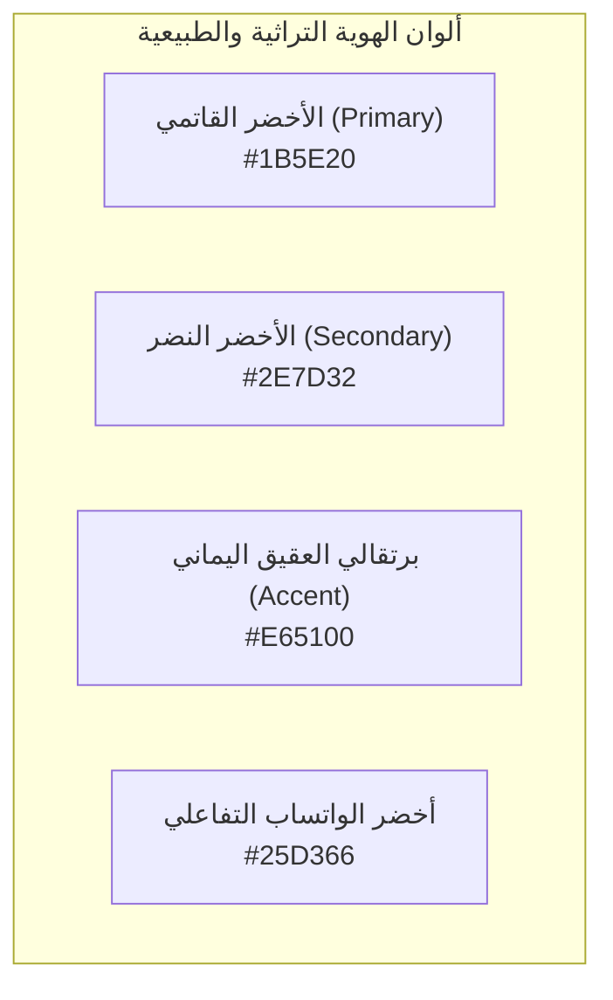
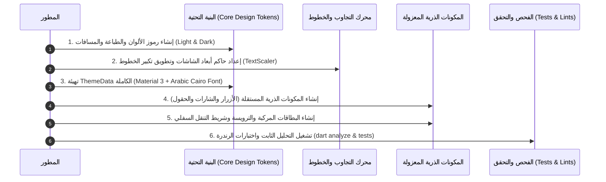

# خطة تنفيذ البنية التحتية لتصميم الواجهات ونظام التصميم (UI/UX Design System & Infrastructure Plan)
## تطبيق «قطفة» - منصة تجارة واستكشاف القات في الجمهورية اليمنية

---

## 1. ملخص تنفيذي والهدف المعماري
تهدف هذه الخطة إلى وضع حجر الأساس الهندسي والتصميمي لتطبيق الهاتف المحمول (Flutter) لمنصة **قطفة (Qatfa)**، عبر تفكيك وتحليل الصور الخمس المرجعية المولدة للواجهات في مجلد `apps/mobile/images_ui`، ومطابقتها بصرامة مع وثائق المتطلبات التشغيلية، وميثاق الأداء الميداني تحت أشعة الشمس والأجهزة الاقتصادية (المسارات 21 و 22 و 13 ووثيقة استراتيجية الأداء 01).

تلتزم الخطة ببناء **بنية تحتية متكاملة وقابلة للتوسع (Design System & Core Infrastructure)** قبل الشروع في بناء الشاشات، مع عزل كل مكون في ملف مستقل نظيف، وضمان التجاوب المطلق مع أحجام الشاشات المختلفة وأحجام الخطوط الكبيرة، ودعم الوضع الداكن المتجانس مع الهوية اليمنية الأصيلة.

---

## 2. التحليل البصري العميق للصور المرجعية (Reverse-Engineering AI UI Screens)

تم فحص الصور الخمس عالية الدقة بدقة متناهية لتحديد العناصر والأنماط البصرية:

```
┌──────────────────────────────────────────────────────────────────────────────────┐
│                             تحليل الشاشات الخمس                                  │
├─────────────────┬──────────────────┬─────────────────┬─────────────────┬─────────┤
│ 1. الرئيسية     │ 2. تفاصيل القطفة │ 3. الأسواق      │ 4. الحجوزات     │ 5. حسابي│
│ (Daily Drops)   │ (Drop Detail)    │ (Markets & Map) │ (Bookings)      │(Profile)│
└─────────────────┴──────────────────┴─────────────────┴─────────────────┴─────────┘
```

### 2.1 الشاشة 1: الرئيسية - موجز عروض اليوم (`5778591430203871631_120.jpg`)
* **الرأس العلوي (Top Header):**
  - شريط حالة داكن متدرج بالأخضر القاتمي مع نقوش صنعانية تراثية خفيفة في الخلفية.
  - شعار «قطفة - QATFA» في المنتصف بأيقونة أوراق خضراء عصرية.
  - زر تحديد السوق الجغرافي: كبسولة خضراء شبه شفافة في اليمين `[ 📍 سوق الملح ▼ ]`.
  - أيقونة الإشعارات: جرس تنبيه مع نقطة إشعار حمراء بارزة في اليسار.
* **شريط البحث والفلترة:**
  - حقل بحث مستطيل بحواف بيضاوية كاملة (Border Radius: 28dp) مع أيقونة عدسة ونص توجيهي: *"ابحث عن نوع القات (همداني، أرحبي، شامي...) أو المقاوتي..."*.
  - زر الفلترة المتقدمة المدمج بأيقونة سلاسل التعديل `[ ⚙️ ]`.
* **شريط رقاقات الأصناف (Category Chips):**
  - شريط أفقي قابل للتمرير يحتوي على رقاقات: `[ الكل ]` (أخضر داكن نشط)، `[ همداني ممتاز ]`، `[ أرحبي قطفة أولى ]`، `[ شامي غيلاني ]`، `[ خولاني طري ]`.
* **بانر العرض البطل (Hero Featured Drop Card):**
  - بطاقة عريضة بخلفية صورة عالية الجودة ومظللة.
  - شارة زمنية ذهبية: `[ ⏱️ وصل قبل 25 دقيقة - الكمية محدودة ]`.
  - عنوان تسويقي عريض بخط عربي أنيق: *"قطفة مميزة من أجود الأنواع"*.
  - زر نداء الإجراء (CTA) بلون العقيق اليماني البرتقالي الناري: `[ > احجز حزمتك الآن ]`.
* **شريط ركائز الثقة (Trust Indicators Bar):**
  - شريط بثلاث شارات أيقونية سريعة:
    1. `🛡️ مقاوتة موثقون ميدانياً`
    2. `⏱️ قطفات اليوم فقط`
    3. `📷 صور حقيقية 100%`
* **شبكة عروض القطفات (2-Column Grid Drops):**
  - بطاقات شبكية رأسية أنيقة ومتباعدة.
  - صورة العرض بنسبة 4:3 يعلوها وسم طزاجة أخضر نضر: `[ 🌿 طازج الآن ]`.
  - اسم الصنف (همداني فاخر / أرحبي قاعي سوبر) بخط عريض.
  - اسم المقاوتي مع أيقونة المستخدم: `👤 أبو محمد السالمي`.
  - السعر البارز بالريال اليمني بلون برتقالي عقيقي عريض: `14,000 ر.ي` مع خط شطب على السعر السابق في عروض التخفيض `18,000 ر.ي`.
  - زرا الإجراء السريع: زر دائري للاتصال `[ 📞 ]` وزر عريض لمحادثة وحجز الواتساب `[ 💬 حجز واتساب ]`.
* **شريط التنقل السفلي والزر العائم:**
  - 4 تبويبات رئيسية (الرئيسية، الأسواق، حجوزاتي، حسابي).
  - زر وسطي عائم دائري برتقالي متوهج ومرفوع (Elevated Floating Action Button): `[ + اعرض قطفتك ]` مخصص لنشر المقاوتي السريع.

---

### 2.2 الشاشة 2: تفاصيل القطفة الكاملة (`5778591430203871632_120.jpg`)
* **شريط التطبيق والوسائط العلوية:**
  - زر رجوع دائري بتأثير زجاجي نصف شفاف `[ < ]`.
  - زر مشاركة العرض `[ 📤 ]` وزر المفضلة `[ 🤍 ]`.
  - معرض صور تفاعلي متعدد (Image Carousel) يحتوي على مؤشر صفحات سفلي `...` وعداد صور `[ 🖼️ 1 / 5 ]` وزر تكبير ملء الشاشة `[ ⤢ ]`.
  - شارة توثيق التصوير المباشر أعلى الصورة: `[ 📷 صورة حقيقية من السوق اليوم ]`.
* **بطاقة المقاوتي ومعلومات الثقة:**
  - صورة دائرية للمقاوتي مع درع توثيق أزرق / أخضر.
  - اسم المقاوتي: *"الحاج يحيى الصياح - مقاوتي معتمد في سوق الملح"*.
  - تقييم المتجر: `⭐ 4.9 (2.5k تقييم)` وعدد العمليات الناجحة: `🛍️ +120 مبيعة مكتملة`.
* **العنوان وموقع المفرش:**
  - عنوان الصنف: *"أرحبي قاعي سوبر"*.
  - شارة الموقع مع معاينة مصغرة للخريطة: `📍 سوق الملح - صنعاء`.
* **مصفوفة صفات القطفة (Specification Attribute Grid):**
  - حاوية مميزة بلون رمادي/أخضر فاتح تضم 4 مربعات مواصفات ميدانية:
    1. **درجة النعومة:** `طري جداً (خضيري)` - أيقونة ورقة شجر.
    2. **نسبة العيدان:** `90% أوراق غضة` - أيقونة غصن.
    3. **وقت وتاريخ القطف:** `اليوم الساعة 4:30 فجراً` - أيقونة تقويم.
    4. **طريقة الحفظ:** `خيش مبلل ومكيف بالكامل` - أيقونة درع وحماية.
* **شريط السعر والإجراءات السفلية الثابتة (Sticky Bottom Bar):**
  - شارة خصم برتقالية: `خصم 17%` بجوار السعر السابق المشطوب `18,000 ر.ي`.
  - السعر الصافي بخط ضخم شديد الوضوح: `15,000 ر.ي`.
  - زران عريضان تحت إبهام اليد:
    - زر اتصال هاتفي: `[ 📞 اتصال هاتفي الآن ]` بخلفية خضراء نعناعية فاتحة.
    - زر مراسلة واتساب رئيسي: `[ 💬 محادثة وحجز مباشر عبر واتساب ]` باللون الأخضر المميز لواتساب مع أيقونة رسمية.

---

### 2.3 الشاشة 3: دليل الأسواق والخريطة التفاعلية (`5778591430203871629_120.jpg`)
* **الترويسة وبحث الأسواق:**
  - أيقونة مظلة السوق التراثية مع عنوان *"الأسواق - اكتشف الأسواق والمقاوتة في منطقتك"*.
  - حقل بحث عن الأسواق والمناطق مع زر الفلترة.
  - رقاقات فلترة المحافظات: `[ الكل ]`، `[ صنعاء ]`، `[ الحديدة ]`، `[ تعز ]`، `[ إب ]`، `[ عدن ]`.
* **بطاقة الخريطة التفاعلية (Embedded Market Map):**
  - بطاقة خريطة مدمجة بنسب مدروسة تُظهر دبابيس المفارش والأسواق مع هالة رادارية للموقع النشط.
  - نافذة معلومات منبثقة (Callout) للمفرش المحدد تحتوي على صورة واسم السوق "سوق الملح".
  - زر عائم على الخريطة لتحديد موقع المستخدم: `[ 🧭 موقعي الحالي ]`.
* **قائمة بطاقات الأسواق (Market Cards List):**
  - كل بطاقة تحتوي على:
    - صورة حقيقية للسوق من زاوية عريضة مع شارة `[ 🟢 نشط الآن ]`.
    - اسم السوق (مثال: "سوق الملح المركزي - شارع الستين").
    - التقييم والنجوم: `⭐ 4.8 (2.5k تقييم)`.
    - عدد المقاوتية النشطين: `👥 120 مقاوتي`.
    - أوقات العمل والذروة: `🕒 من 6 صباحاً - 10 مساءً`.
    - زر انتقال أخضر فاتح: `[ عرض السوق > ]`.

---

### 2.4 الشاشة 4: الحجوزات والمتابعات (`5778591430203871630_120.jpg`)
* **فلتر حالات الحجوزات (Segmented Tabs):**
  - رقاقات علوية بعدادات رقمية واضحة:
    - `[ 📋 الكل (3) ]`
    - `[ ⏱️ قيد التأكيد (1) ]`
    - `[ 🟢 مؤكد (1) ]`
    - `[ 🟢 مكتمل (1) ]`
* **بطاقات الحجوزات التفصيلية:**
  - كل بطاقة تحتوي على صورة الصنف المصغرة، اسم النوع (أرحبي قاعي، همداني فاخر، شامي غيلاني).
  - اسم المقاوتي والسعر والكمية (`الكمية: 1 حزمة (كيلو)`).
  - شارة الحالة الملونة وتاريخ ووقت الاستلام المتوقع.
  - أزرار تفاعلية سفلية بحسب الحالة:
    - حالة قيد التأكيد: زر إلغاء الحجز بلون أحمر ناعم وزر عرض التفاصيل.
    - حالة مؤكد: زر اتصال فوري بالمقاوتي وزر عرض التفاصيل.
    - حالة مكتمل: زر تقييم التجربة بنجوم خضراء.
* **بطاقة الملخص المالي السفلي:**
  - حاوية تلخيصية خضراء هادئة: *"إجمالي حجوزاتك: 3 حجوزات | بقيمة إجمالية: 42,000 ر.ي"* مع شعار *"مع قطفة .. دائماً الأفضل"*.

---

### 2.5 الشاشة 5: الحساب والملف الشخصي (`5778591430203871628_120.jpg`)
* **رأس الملف الشخصي (Profile Header Card):**
  - صورة المستخدم داخل إطار دائري مزدوج مع شارة كاميرا للتعديل.
  - الاسم ورقم الهاتف مع زر التعديل وقائمة تبديل الصفة `[ مشتري ▼ / مقاوتي ]`.
  - شارة التوثيق: `🛡️ مستخدم موثق` مع تقييم 5 نجوم.
* **شريط الإحصائيات السريع (Stats Metric Bar):**
  - 3 أعمدة إحصائية متساوية ومفصولة بخطوط عمودية ناعمة:
    - المكتملة / المحفوظة
    - الحجوزات النشطة
    - القطفات المفضلة
* **قائمة خيارات الحساب (Account Action Tiles):**
  - صفوف تفاعلية بحواف دائرية وأيقونات ملونة بألوان متباينة داخل حاويات مربعة ناعمة:
    1. **البيانات الشخصية** (أيقونة مستخدم خضراء)
    2. **العناوين والمواقع / المفارش المفضلة** (أيقونة موقع خضراء)
    3. **المفضلة** (أيقونة قلب برتقالية)
    4. **سجل الطلبات والحجوزات** (أيقونة لوحة مهام خضراء)
    5. **الإشعارات** (أيقونة جرس زرقاء مع نقطة تنبيه حمراء)
    6. **الإعدادات** (أيقونة ترس بنفسجية)
    7. **الدعم الفني** (أيقونة سماعة خضراء)
    8. **تسجيل الخروج** (حاوية حمراء فاتحة بنص وأيقونة حمراء واضحة)
* **تذييل الشاشة:** رسم توضيحي لمدرجات جبال اليمن ومزارع القات الخضراء مع العبارة الملهمة *"مع قطفة .. نزرع الخير ونحصده معاً"*.

---

## 3. مطابقة التصميم بالمتطلبات ومعالجة عناصر الذكاء الاصطناعي الوهمية
> [!IMPORTANT]
> **تنبيه جوهري للمتطلبات والـ MVP:**
> الصور المرجعية مولدة بالذكاء الاصطناعي واحتوت على بعض العناصر المخالفة لاستراتيجية إطلاق التطبيق (وثيقة 21 - De-risking ووثيقة 08 - MVP Scope). سنقوم بالمحافظة على جمال الهوية البصرية بنسبة 100% مع ضبط منطق البيانات كالتالي:

| العنصر في صورة الذكاء الاصطناعي | التعارض مع المتطلبات وخطة المنصة | المعالجة المعتمدة في بنية التصميم |
| :--- | :--- | :--- |
| **أيقونة سلة تسوق وإحصائية "8 طلب مكتمل"** | لا توجد سلة تسوق إلكترونية أو دفع عبر التطبيق في الـ MVP تجنباً للتعقيدات البنكية ومخاطر غوغل بلاي. | استبدالها بـ **«استفسارات هاتفية»** أو **«تواصل مباشر ناجح»** مع الحفاظ على نفس التنسيق الرقمي الأنيق. |
| **"العناوين والمواقع: إدارة عناوين الاستلام والتوصيل"** | لا يوجد أسطول توصيل للمنازل في الـ MVP تجنباً للتكاليف اللوجستية؛ الشراء يتم بالاستلام المباشر من مفرش المقاوتي بالسوق. | تحويل الخيار إلى **«أسواقي ومفارشي المفضلة: إدارة الأسواق القريبة والمفارش المعتمدة»**. |
| **نظام حجز وتأكيد مركزي أوتوماتيكي** | المعاملات تتم كاش في السوق والمحادثة تتم عبر واتساب والاتصال. | عرض تبويب الحجوزات كـ **سجل متابعة القطفات المتفق عليها عبر الواتساب** وتذكير المشتري بموعد استلام حزمته من المفرش دون تعقيد برمجي خلفي. |

---

## 4. نظام الألوان الشامل والهوية البصرية (Color Token System)

تم بناء باليت ألوان دقيقة للوضعين الفاتح والداكن، تحقق أعلى درجات التباين تحت أشعة الشمس (Outdoor Contrast Ratio > 7:1 للنصوص الرئيسية):



### 4.1 جدول رموز الألوان للوضع الفاتح والوضع الداكن (Light & Dark Palettes)

| المتغير البرمجي (Token) | الوضع الفاتح (Light Theme) | الوضع الداكن (Dark Night Theme) | الاستخدام وتجربة المستخدم |
| :--- | :--- | :--- | :--- |
| `primary` | `#1B5E20` | `#22C55E` | اللون الرئيسي، أشرطة التطبيق، الأزرار، والوسوم النشطة |
| `primaryDark` | `#0E3813` | `#14532D` | الخلفيات المتدرجة للترويسة ورؤوس الشاشات |
| `primaryContainer` | `#E8F5E9` | `#14291B` | خلفيات البطاقات النشطة والشارات المعتمدة وحاويات الأيقونات |
| `onPrimary` | `#FFFFFF` | `#05200D` | النصوص والأيقونات فوق اللون الرئيسي |
| `secondary` | `#2E7D32` | `#4ADE80` | شارات "طازج الآن"، مؤشرات التوفر الخضراء |
| `accent` (العقيق) | `#E65100` | `#FB923C` | أزرار الإجراء البارزة، شارات التخفيض، أسعار القات البارزة |
| `accentContainer` | `#FFF3E0` | `#331805` | خلفية شارة السعر وعروض التخفيض |
| `whatsapp` | `#25D366` | `#22C55E` | زر حجز ومحادثة الواتساب الفوري |
| `scaffoldBackground` | `#F8F9FA` | `#0A110D` | خلفية التطبيق العامة (مستوحاة من ليل جبال اليمن في الوضع الداكن) |
| `surface` | `#FFFFFF` | `#132219` | خلفية البطاقات والقوائم والنوافذ المنبثقة |
| `surfaceElevated` | `#F1F5F2` | `#1C3024` | البطاقات المتداخلة وحقول الإدخال والرقاقات غير النشطة |
| `textPrimary` | `#1A202C` | `#F1F5F9` | العناوين الرئيسية، أسعار المنتجات، وأسماء المتاجر |
| `textSecondary` | `#64748B` | `#94A3B8` | النصوص الفرعية، الطوابع الزمنية، والملاحظات المساعدة |
| `borderSubtle` | `#E2E8F0` | `#243B2D` | الحدود الفاصلة بين المكونات والبطاقات |
| `danger` | `#DC2626` | `#F87171` | شارات "نفدت الكمية"، أزرار إلغاء الحجز وتسجيل الخروج |
| `dangerContainer` | `#FEE2E2` | `#391313` | خلفية زر تسجيل الخروج وإلغاء الحجز |
| `warning` | `#F59E0B` | `#FBBF24` | شارة الحجز "قيد التأكيد"، وتنبيهات التحديث |

---

## 5. منظومة المرونة والطباعة المستجيبة (Responsive Typography & Layouts)

### 5.1 حماية النصوص وتكبير خط النظام (Font Scale Clamping)
لتفادي انهيار الواجهات وظهور أخطاء `RenderFlex overflowed` عندما يقوم المستخدم بتكبير الخط من إعدادات الهاتف (Accessibility Font Scale حتى 2.0x):
- اعتماد محدد أقصى وأدنى لـ `TextScaler`:
  ```dart
  // تحديد معامل تكبير الخط بين 0.85 و 1.30 كحد أقصى لمنع انكسار البطاقات الحساسة
  final clampedScaler = MediaQuery.textScalerOf(context).clamp(
    minScaleFactor: 0.85,
    maxScaleFactor: 1.30,
  );
  ```
- استخدام أداة `FittedBox` أو `Flexible` مع `TextOverflow.ellipsis` في أرقام الأسعار وأسماء الأصناف.

### 5.2 سلم الخطوط المعتمد (Typography Scale - Cairo Font)
يتم استخدام عائلة خط **Cairo** العربية الرسمية مع دعم الأرقام اللاتينية المنسقة:

| اسم النمط (Style Token) | الحجم الأساسي | الوزن (FontWeight) | ارتفاع السطر | الاستخدام |
| :--- | :--- | :--- | :--- | :--- |
| `displayLarge` | 24sp | Bold (700) | 1.3 | العناوين الترحيبية الكبرى وترويسة الشاشات |
| `titleLarge` | 18sp | Bold (700) | 1.35 | أسماء القطفات في شاشة التفاصيل والأسواق الكبرى |
| `titleMedium` | 16sp | SemiBold (600) | 1.4 | أسماء الأصناف في البطاقات، وعناوين القوائم |
| `priceTagLarge` | 20sp | ExtraBold (800) | 1.2 | أرقام الأسعار البارزة بالريال اليمني |
| `priceTagMedium`| 16sp | Bold (700) | 1.2 | أسعار البطاقات الشبكية في الصفحة الرئيسية |
| `bodyLarge` | 14sp | Regular (400) | 1.5 | نصوص الوصف، ومواصفات القطفة |
| `bodyMedium` | 13sp | Medium (500) | 1.4 | بيانات المقاوتي، أسماء الأسواق، وملاحظات الحجز |
| `labelSmall` | 11sp | SemiBold (600) | 1.3 | الشارات (طازج الآن، قيد التأكيد)، والطوابع الزمنية |

### 5.3 نظام القياسات والمسافات المتسق (Spacing & Metric Tokens)
- نظام شبكي قاعدي من مضاعفات الـ 4dp:
  - `space4` = 4dp
  - `space8` = 8dp (المسافة الداخلية للشارات والأزرار المصغرة)
  - `space12` = 12dp (المسافة بين العناصر المترابطة)
  - `space16` = 16dp (الهامش القياسي الأفقي لصفحات التطبيق)
  - `space20` = 20dp (المسافة بين أقسام الشاشة)
  - `space24` = 24dp (الهوامش الرأسية الكبرى)
- أنصاف أقطار الزوايا (Corner Radii):
  - `radiusSmall` = 8dp (الشارات والرقاقات الصغيرة)
  - `radiusMedium` = 14dp (حقول الإدخال، البطاقات، والصور)
  - `radiusLarge` = 20dp (بطاقات العروض الكبرى، والنوافذ السفلية)
  - `radiusFull` = 999dp (الأزرار البيضاوية وحبوب البحث والتنقل)

---

## 6. معمارية وهيكلية المجلدات في المشروع (Project Architecture)

وفقاً لأفضل الممارسات المستخلصة من مهارات `.agents` (مهارة `flutter-apply-architecture-best-practices` و `flutter-build-responsive-layout`)، سيتم تنظيم البنية التحتية لتصميم الواجهات تحت مجلد `lib/core/` بوضوح واستقلالية تامة:

```text
apps/mobile/lib/
├── core/
│   ├── theme/
│   │   ├── app_colors.dart            # تعريف باليت الألوان الثابتة والفاتحة والداكنة
│   │   ├── app_typography.dart        # تعريف أنماط خط Cairo والأحجام والأوزان
│   │   ├── app_spacing.dart           # ثوابت المسافات والهوامش وأنصاف الأقطار
│   │   ├── app_shadows.dart           # تعريف الظلال الناعمة المتكيفة مع السطوع
│   │   └── app_theme.dart             # تجميع ThemeData الكامل (ThemeData.light و ThemeData.dark)
│   ├── responsive/
│   │   ├── responsive_layout.dart     # أداة LayoutBuilder للتكيف مع الشاشات
│   │   ├── screen_breakpoints.dart    # نقاط التحول (Mobile: < 600, Tablet: >= 600)
│   │   └── text_scaler_boundary.dart  # ويدجت تغليف لضبط أقصى تكبير لخط النظام
│   └── widgets/
│       ├── buttons/
│       │   ├── qatfa_primary_button.dart   # الزر الأساسي الأخضر / البرتقالي
│       │   ├── qatfa_whatsapp_button.dart  # زر محادثة الواتساب مع الأيقونة المجهزة
│       │   ├── qatfa_phone_button.dart     # زر الاتصال الهاتفي السريع
│       │   └── qatfa_icon_button.dart      # الأزرار الدائرية الشفافة والزجاجية
│       ├── cards/
│       │   ├── drop_grid_card.dart         # بطاقة القطفة في الشبكة الرئيسية (صورة + صنف + سعر + إجراء)
│       │   ├── market_summary_card.dart    # بطاقة السوق في قائمة الأسواق
│       │   ├── booking_card.dart           # بطاقة الحجز مع محدد الحالة الملون
│       │   └── stat_counter_card.dart      # بطاقة الإحصائيات ثلاثية الأعمدة
│       ├── chips/
│       │   ├── qatfa_choice_chip.dart      # رقاقة اختيار أصناف القات والمحافظات
│       │   └── qatfa_status_badge.dart     # شارة الحالة (طازج الآن، مؤكد، نفدت الكمية)
│       ├── inputs/
│       │   └── qatfa_search_field.dart     # حقل البحث البيضاوي مع زر الفلترة
│       ├── navigation/
│       │   ├── qatfa_bottom_nav_bar.dart   # شريط التنقل السفلي خماسي العناصر مع FAB المرتفع
│       │   └── qatfa_app_bar_header.dart   # الترويسة العلوية التراثية المتدرجة
│       └── feedback/
│           ├── qatfa_shimmer_box.dart      # هياكل التحميل الشبحية (Skeleton Loaders)
│           └── qatfa_trust_badge_bar.dart  # شريط ركائز الثقة الثلاثي
```

---

## 7. تفصيل المكونات الذرية المستقلة (Atomic Components Breakdown)

لكي يكون الكود نظيفاً وقابلاً لإعادة الاستخدام واختبار كل عنصر بمفرده دون تشابك:

1. **`QatfaStatusBadge` (شارة الحالة الذكية):**
   - تعرض الحالة بنصوص ملونة وخلفية هادئة ونقطة وميض اختيارية:
     - `fresh` (طازج الآن - أخضر)
     - `pending` (قيد التأكيد - برتقالي تحذيري)
     - `confirmed` (مؤكد - أخضر زمردي)
     - `completed` (مكتمل - رمادي هادئ / أخضر نضر)
     - `soldOut` (نفدت الكمية - أحمر داكن)
2. **`QatfaWhatsAppButton` (زر الواتساب التفاعلي المباشر):**
   - يدعم التمرير المباشر لرقم المقاوتي ونص رسالة مجهز مسبقاً (مع اسم الصنف وسعره) عبر `url_launcher`.
3. **`QatfaPhoneButton` (زر الاتصال الهاتفي):**
   - زر سريع لإجراء مكالمة هاتفية فورية بنقرة إبهام واحدة مع حماية ضد النقرات المتكررة.
4. **`QatfaBottomNavBar` (شريط التنقل السفلي المتطور):**
   - شريط مقوس بنعومة يضم 4 تبويبات مع زر إبراز عائم مركزي دائري برتقالي `[ + اعرض قطفتك ]` موجه للمقاوتية لنشر القطفة بسرعة البرق.
5. **`QatfaAppBarHeader` (ترويسة الهوية التراثية):**
   - مكون يعرض الخلفية الخضراء القاتمة العميقة مع زخارف النمط الصنعاني المفرغة، وشعار التطبيق، وكبسولة اختيار السوق السريعة، وأيقونة الإشعارات بجرس التنبيه.
6. **`QatfaShimmerBox` (مكون التحميل الهيكلي):**
   - بديل لمؤشرات التحميل التقليدية الدائرية لتوفير تجربة مستخدم سريعة وسلسة حتى في سرعات الإنترنت الضعيفة.

---

## 8. خطة مراحل التنفيذ البرمجي خطوة بخطوة (Step-by-Step Implementation Roadmap)



### المرحلة 1: حزم الاعتماد الأساسية في `pubspec.yaml`
- إضافة وتحديث الحزم المطلوبة:
  - `google_fonts` (أو خطوط Cairo محلية في assets لتفادي الحاجة للإنترنت).
  - `flutter_svg` لدعم الأيقونات المتجهية الواضحة على جميع الشاشات.
  - `url_launcher` لربط أزرار الواتساب والاتصال الهاتفي.
  - `intl` لتنسيق الأرقام والأسعار والتواريخ باللغة العربية.

### المرحلة 2: تشييد رموز التصميم الأساسية (Design Tokens)
- برمجة `lib/core/theme/app_colors.dart` بجميع الرموز المذكورة للوضعين الفاتح والداكن.
- برمجة `lib/core/theme/app_typography.dart` مع سلم المقاسات المعتمد.
- برمجة `lib/core/theme/app_spacing.dart` للمسافات وأنصاف الأقطار.
- بناء `lib/core/theme/app_theme.dart` لتوليد ستايل متكامل يدعم Material 3 تلقائياً.

### المرحلة 3: بناء محرك التجاوب وحماية النصوص
- بناء `lib/core/responsive/text_scaler_boundary.dart` لضمان عدم حدوث Overflow.
- بناء `lib/core/responsive/responsive_layout.dart` لدعم الهواتف والأجهزة اللوحية.

### المرحلة 4: تشييد المكونات الذرية (UI Core Components)
- بناء الأزرار التفاعلية (`qatfa_primary_button.dart`, `qatfa_whatsapp_button.dart`, `qatfa_phone_button.dart`).
- بناء الشارات والرقاقات (`qatfa_status_badge.dart`, `qatfa_choice_chip.dart`).
- بناء حقل البحث المخصص (`qatfa_search_field.dart`).
- بناء البطاقات الأساسية (`drop_grid_card.dart`, `market_summary_card.dart`, `booking_card.dart`).
- بناء شريط التنقل السفلي والترويسة العلوية (`qatfa_bottom_nav_bar.dart`, `qatfa_app_bar_header.dart`).

### المرحلة 5: الفحص والتحقق الشامل (Static Analysis & Testing)
- إجراء فحص التوافق اللوني والتباين تحت الشمس.
- تشغيل `dart analyze` للتأكد من خلو البنية التحتية من أي أخطاء أو تحذيرات.
- كتابة اختبارات ويدجت (Widget Tests) للمكونات الرئيسية للتحقق من صمودها أمام تكبير الخط وتغير الثيم.
