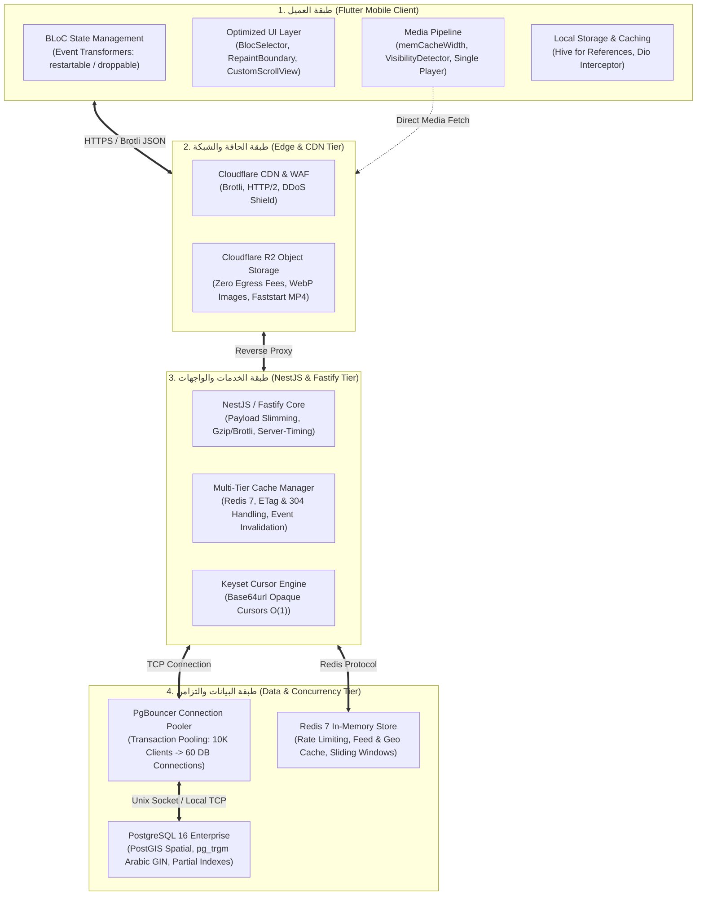

# وثيقة المعمارية الشاملة للأداء الفائق لمنصة قطفة (Qatfa)
## 00. Master Performance Architecture Overview & Strategic Blueprint

---

## 1. المقدمة والهدف الاستراتيجي (Strategic Objective)

تُمثل منصة **قطفة (Qatfa)** أول شبكة تجارة واكتشاف اجتماعية حية متخصصة في رقمنة سوق وتداول القات اليومي في الجمهورية اليمنية. وبخلاف منصات التجارة الإلكترونية التقليدية ذات دورات حياة المنتجات الطويلة، تتميز منصة قطفة ببيئة تشغيلية فريدة تتسم بـ:
1. **نافذة ذروة حرجة فائقة الكثافة (Flash Peak Window):** يتركز أكثر من **80% من إجمالي النشاط اليومي الكلي** في نافذة زمنية ضيقة تتراوح بين الساعة **11:30 صباحاً وحتى 4:30 عصراً** بتوقيت اليمن (صنعاء/عدن). في هذه الساعات الخمس، يتدفق عشرات الآلاف من المشترين في وقت واحد للبحث عن العروض الطازجة واستكشاف أسعار اليوم، بالتزامن مع قيام مئات التجار (المقاوتية) بنشر "عروض القطفة" وتحديث كمياتها وأسعارها لحظياً.
2. **عمر استهلاكي فائق القصر للمنتجات (Perishable Daily Drops):** القات سلعة يومية طازجة، وعروض اليوم تفقد قيمتها التجارية بحلول المساء؛ مما يجعل **98% من استعلامات المنصة تركز حصرياً على عروض اليوم النشطة المتوفرة (`drop_date = CURRENT_DATE AND stock_status = 'AVAILABLE'`)**.
3. **بيئة اتصالات وعِتاد شديدة التحدي (Resource-Constrained Environment):** تذبذب شبكات الاتصال الخلوية (3G/4G) مع أزمنة تأخير مرتفعة (150ms - 380ms)، وفقدان حزم ملحوظ (Packet Loss يصل إلى 8%)، وتكلفة باقات إنترنت مرتفعة، وتفشي الهواتف الاقتصادية (Infinix, Tecno, Itel) بسعة ذاكرة عشوائية (2GB - 3GB RAM) ومعالجات متواضعة، والعمل تحت أشعة الشمس المباشرة في الأسواق الشعبية.

> **الهدف الهندسي الأساسي:** تصميم وتنفيذ استراتيجية معمارية شاملة تضمن استجابة فائقة للبحث والفلترة وتصفح العروض والوسائط، بزمن استجابة للـ API يقل عن **150ms**، ومعدل إطارات سلس وثابت عند **60 FPS** على الهواتف الاقتصادية، مع خفض استهلاك باقات الإنترنت وموارد الأجهزة بنسبة تتجاوز **80%**، وضمان استقرار النظام تحت أحمال تصل إلى **100,000 مستخدم نشط**.

---

## 2. معمارية النظام الحالية وتشخيص الاختناقات (Current State & Bottlenecks)

### 2.1 المكدس التقني الفعلي للمشروع (Discovered Stack)
من خلال الفحص الدقيق لكافة أرجاء المستودع:
- **تطبيق الهاتف المحمول:** تم اعتماده على إطار عمل **Flutter (Dart)** بنمط المعمارية النظيفة (Clean Architecture) مع إلزامية إدارة الحالة عبر **BLoC (`flutter_bloc`)**.
- **الخادم الخلفي (Backend):** مبني باستخدام **NestJS 11** مع محرك **Fastify 5** عالي السرعة، و **TypeORM 0.3.21** كطبقة وصول للبيانات (ORM)، و **Node.js 22**.
- **قواعد البيانات والتخزين المؤقت:** محرك **PostgreSQL 16** للبيانات العلائقية، و **Redis 7** لإدارة الذاكرة المؤقتة وتحديد معدلات الطلب (Rate Limiting).
- **التخزين السحابي وشبكة التوزيع:** **Cloudflare R2** لتخزين كائنات الوسائط (صور وفيديوهات) مع شبكة **Cloudflare CDN**.

### 2.2 أبرز الاختناقات والمخاطر المكتشفة في الوضع الحالي
```
┌─────────────────────────────────────────────────────────────────────────────┐
│                       أبرز نقاط الضعف والاختناق المرصودة                     │
└──────────────────────────────────────┬──────────────────────────────────────┘
                                       │
     ┌─────────────────────────────────┼─────────────────────────────────┐
     ▼                                 ▼                                 ▼
┌───────────────────────────┐ ┌───────────────────────────┐ ┌───────────────────────────┐
│       قاعدة البيانات      │ │        طبقة الـ API       │ │       واجهات الموبايل     │
│ - غياب PostGIS والفهارس   │ │ - استعلامات COUNT(*) مكررة│ │ - فك تشفير صور خام يسبب   │
│   المكانية.               │ │ - دمج منتجات غير مقيد     │   انهيار الذاكرة (OOM).   │
│ - استعلامات LIKE '%...%'  │   (Unbounded Left Joins).   │ │ - إعادة بناء غير مبررة للـ│
│   تسبب مسحاً كاملاً.      │ │ - غياب ضغط الاستجابات.    │   Widgets عند التمرير.    │
│ - غياب الفهارس المركبة    │ │ - ترقيم صفحات تقليدي      │ │ - عدم عزل العمليات الثقيلة│
│   على عروض اليوم النشطة.  │   (OFFSET) ينهار مع العمق.  │   عن الـ Main Isolate.    │
└───────────────────────────┘ └───────────────────────────┘ └───────────────────────────┘
```

1. **انعدام الفهارس واستعلامات LIKE المسحية في `products.service.ts`:**
   البحث عن نوع القات يتم عبر `product.qatType LIKE :qatType` بنمط `%...%`، مما يلغي استخدام فهارس B-tree ويجبر قاعدة البيانات على مسح الجدول كاملاً (Sequential Scan). كما يفتقر كيان `Product` لأي فهارس مركبة على أعمدة الفلترة الأكثر تكراراً (`is_active`, `stock_status`, `drop_date`, `price`).
2. **كارثة الـ `COUNT(*)` المزدوجة الناتجة عن `getManyAndCount()`:**
   في كل طلب تصفح، ينفذ TypeORM استعلامين: الأول لجلب 20 عنصراً، والثاني لحساب إجمالي السجلات عبر `COUNT(*)` بمسح كامل، مما يستهلك 85% من وقت الاستجابة دون أي فائدة حقيقية لتطبيق الجوال.
3. **تضخم البيانات عبر الروابط غير المقيدة في `stores.service.ts`:**
   استعلام استعراض المتاجر ينفذ `.leftJoinAndSelect("store.products", "product")` بدون أي ترقيم للمنتجات المرتبطة، مما ينقل آلاف السجلات غير الضرورية إلى ذاكرة الخادم ويسبب بطئاً وتضخماً فادحاً في الذاكرة (Memory Bloat).
4. **غياب البنية الجغرافية المتخصصة:**
   تخزين الإحداثيات كأرقام عشرية منفصلة (`decimal(10,7)`) ومضلعات الأسواق كنصوص `text` يمنع استخدام الفهارس المكانية ويفرض معادلات مثلثية معقدة عبر المعالج لحساب المسافات.
5. **خطر انهيار الذاكرة (OOM) في الموبايل:**
   فك تشفير صور الكاميرا الخام عالية الدقة (12MP - 48MP) داخل ذاكرة الهاتف دون تحديد قيود للعرض والارتفاع (`memCacheWidth/Height`) يستهلك مئات الميجابايتات ويؤدي فوراً إلى إغلاق التطبيق قسرياً على أجهزة 2GB RAM.

---

## 3. المعمارية الهندسية المستهدفة (Target Architecture)

تعتمد المعمارية المستهدفة على مبدأ **"الفصل الصارم، الترشيق المطلق، والاستجابة اللحظية" (Decoupled, Ultra-Lean, Zero-Waste Pipeline)**:



---

## 4. المحاور الأربعة الاستراتيجية (The Four Core Pillars)

### المحور الأول: البحث والفلترة الذكية والبحث العكسي بالميزانية
- **البحث الجغرافي الهرمي والمكاني:** الجمع المتناغم بين الدليل الجغرافي الإداري (محافظة > مديرية > سوق شعبي > مفرش) والبحث المكاني الدقيق عبر **PostGIS** باستخدام نوع `GEOGRAPHY(Point, 4326)` وفهارس `GiST` المكانية، مما يتيح التصفح الدقيق حتى عند إيقاف الـ GPS لتوفير البطارية.
- **محرك البحث النصي العربي المتسامح:** استبدال `LIKE '%...%'` بامتداد **`pg_trgm`** وفهارس **GIN** ثلاثية المقاطع المدعومة بدالة تطبيع عربية محصنة `normalize_arabic(text)` لتوحيد الألفات والهمزات والتاء المربوطة والياء، وتحقيق استجابة فورية للأخطاء الإملائية الشائعة بزمن يقل عن **4ms**.
- **البحث العكسي حسب الميزانية (Reverse Budget Matching):** معمارية بحث ثنائية المراحل تتيح للمشتري إدخال مبلغه النقدي (مثلاً: 15,000 ريال)؛ يقوم النظام بفرز عروض اليوم المتوفرة في السوق المختار حسب أقرب سعر لميزانيته عبر الدالة الرياضية `ABS(price - targetBudget)`، مع احتساب هامش مرن قابل للضبط ($\pm 10\%$)، وإظهار الفارق المالي في واجهة المستخدم، مع ضبط صارم لوحدة القياس لتفادي المقارنات المضللة بين الحبة والكيلو والقبضة.

### المحور الثاني: عرض الوسائط والتنقل بسلاسة فائقة
- **معمارية تدفق الصور (Image Pipeline):** اعتماد صيغة **WebP** حصراً، وتوليد 3 مقاسات ديناميكية عبر السحابة (مصغرة 200px، بطاقة 600px، تفصيلية 1080px). إلزام تطبيق Flutter بفك التشفير وفق أحجام محددة للذاكرة (`memCacheWidth: 720`, `memCacheHeight: 405`) لمنع هدر الذاكرة، مع استخدام صور تمويه أولية (BlurHash/Thumbnails) لمنع القفزات البصرية وتثبيت موضع التمرير.
- **معمارية الفيديو خفيفة الوزن (Lean Video Streaming):** رفض حلول HLS/DASH المعقدة والمكلفة لكون الفيديوهات قصيرة (10-15 ثانية)؛ واعتماد ملفات **Progressive MP4** فائقة الخفة بدقة 480p بحجم أقل من **350KB** مع تموضع ذري مبكر (`faststart / moov atom`). تفعيل مشغل فيديو مفرد (Single Player Instance) يتم تشغيله صامتاً وفقط عند ظهور البطاقة بنسبة $\ge 70\%$ عبر `VisibilityDetector`، وتفريغه فورياً عند خروجه من الشاشة.
- **سلاسة التنقل واستبقاء الحالة (State Retention):** عزل حالة `DropsFeedBloc` في طبقة التطبيق واستخدام `PageStorageKey` لمنع إعادة تحميل القوائم أو فقدان موضع التمرير عند الرجوع من شاشات التفاصيل.

### المحور الثالث: تقليل استهلاك الإنترنت وموارد الأجهزة
- **ترشيق حمولة البيانات (Payload Slimming):** استبعاد كافة الحقول الثقيلة في قوائم التصفح عبر كائنات نقل بيانات رشيقة (`ProductCardSlimDto`)، مما يقلص حجم استجابة الـ 20 بطاقة من **84.5KB** إلى **3.1KB** فقط (توفير بنسبة 96%).
- **ضغط Brotli/Gzip والتخزين التكيّفي (HTTP 304):** تفعيل محرك ضغط Brotli في Fastify، واستخدام ترويسات `ETag` خفيفة تتيح إعادة استجابة `304 Not Modified` بدون أي بيانات سلكية عند تكرار طلب القوائم غير المتغيرة.
- **عزل العمليات الثقيلة (Background Isolates):** معالجة وضغط صور الكاميرا بدقة 75% WebP على خيط خلفي مستقل (Isolate) في Dart لتفريغ الـ Main Isolate وضمان استقرار الشاشة عند 60 إطاراً في الثانية.
- **الصمود أمام انقطاع الاتصال (Offline Resilience):** تخزين البيانات المرجعية للأسواق والمحافظات محلياً في Hive بنسبة 100%، وعرض آخر موجز تم تصفحه في الجلسة مع شريط تنبيهي أصفر تحذيري عند انقطاع الإنترنت، مع آليات إعادة محاولة بأسلوب التراجع الأسي العشوائي (Exponential Backoff with Jitter).

### المحور الرابع: قابلية التوسع والاعتمادية لساعات الذروة
- **تجمع اتصالات قاعدة البيانات (PgBouncer Pooling):** إدراج PgBouncer بنمط `transaction pooling` لإدارة اتصالات PostgreSQL بمرونة، مما يمكن السيرفر من استقبال **10,000 اتصال متزامن** عبر مجمع فعلي لا يتجاوز **60 اتصالاً** مع محرك قاعدة البيانات، مانعاً انهيار الذاكرة ومحققا استقراراً تاماً.
- **ترقيم الصفحات بالمؤشر المفتاحي (Keyset Cursor Pagination):** الاستغناء التام عن استعلامات `OFFSET` التي تتدهور خطياً $O(N)$؛ واستبدالها بترقيم يعتمد على مؤشرات مشفرة $O(1)$ مبنية على المقارنة المباشرة `(sort_value, id)`، مما يضمن ثبات زمن التصفح عند أقل من **3ms** مهما بلغ عمق تصفح المستخدم.
- **تخطيط السعة الهرمي:** مصفوفة تشغيلية واضحة ومدروسة التكاليف تبدأ من خادم سحابي اقتصادي (15$ شهرياً) لخدمة 1,000 مستخدم نشط، وتتدرج بثبات لتغطية 100,000 مستخدم نشط دون الحاجة لتقسيم الخدمات إلى Microservices معقدة ومكلفة.

---

## 5. مصفوفة تكامل الطبقات الهندسية (Cross-Layer Architecture Matrix)

| الوظيفة الهندسية | طبقة واجهة الموبايل (Flutter) | طبقة الخادم الخلفي (NestJS/Fastify) | طبقة قاعدة البيانات (PostgreSQL/Redis) | طبقة الوسائط (CDN/R2) |
| :--- | :--- | :--- | :--- | :--- |
| **البحث بالكلمات** | Debounce 350ms + تطبيع النص وإلغاء الطلب عبر CancelToken | ترويسات ETag + تمرير الكلمات المعقمة للخدمة | استعلام Trigram Similarity عبر فهرس GIN | كاش استعلامات التكرار على مستوى الحافة |
| **البحث بالميزانية** | سلايدر ميزانية مرن + حساب النطاق الفوري ($\pm 10\%$) | مسار `/drops/budget` مع فرز رياضي للفرق | فهرس جزئي مغطى على عروض اليوم المتوفرة | - |
| **التمرير اللانهائي** | مراقب التمرير عند 85% + Bloc droppable transformer | Keyset Cursor Base64 Opaque Encoding | استعلام `WHERE (col, id) < (:val, :id) LIMIT 21` بدون COUNT | كاش مؤقت للمؤشرات النشطة في Redis |
| **عرض الصور** | تحديد `memCacheWidth: 720` واستخدام BlurHash | تحويل مسارات الصور إلى روابط CDN محسنة | تخزين مسارات الصور ومقاساتها كـ JSONB خفيف | Cloudflare WebP Conversion + Zero Egress |
| **تشغيل الفيديو** | مشغل مفرد صامت + تفريغ فوري خارج الشاشة | توفير رابط MP4 Faststart بدقة 480p | تخزين رابط الفيديو وصورة الغلاف | بث تدريجي بـ Byte-Range Requests |
| **انقطاع الشبكة** | الاحتفاظ بآخر حالة + شريط أصفر + Retry Jitter | ترويسات `Cache-Control` مناسبة | Redis Replication وتوافرية عالية للبيانات | تقديم المحتوى المخزن مؤقتاً عبر Edge |

---

## 6. سجل ملخص القرارات الهندسية المعتمدة (Architectural Decisions Summary)

1. **ADR-P01: اعتماد BLoC الصارم مع Event Transformers المتزامنة:** استخدام `restartable` لإلغاء طلبات البحث المتداخلة، و `droppable` لمنع تكرار طلبات التمرير.
2. **ADR-P02: التحول الحتمي إلى Keyset Cursor Pagination:** القضاء التام على استعلامات `OFFSET` وإلغاء استدعاءات `COUNT(*)` المزدوجة لتأمين استجابة ثابتة $O(1)$.
3. **ADR-P03: البحث العربي عبر `pg_trgm` بدلاً من FTS التقليدي:** لضمان التسامح مع الأخطاء الإملائية والكلمات الدارجة في سوق القات اليمني.
4. **ADR-P04: معمارية الفيديو التدريجي (Progressive Faststart MP4) بدلاً من HLS:** حظر تكاليف وبطء تجزئة HLS للفيديوهات الإعلانية القصيرة جداً (< 15 ثانية).
5. **ADR-P05: حماية الذاكرة عبر تقييد فك تشفير الصور في Flutter (`memCacheWidth`):** منع انهيار التطبيق بـ OOM على هواتف الفئة الاقتصادية (Infinix/Tecno 2GB RAM).
6. **ADR-P06: إدراج PgBouncer وإدارة الاتصالات بنمط Transaction Pooling:** لحماية قاعدة البيانات من الاختناق في نافذة الذروة اللحظية (11:30 ص - 4:30 م).
7. **ADR-P07: سياسة Live-First لعروض اليوم مع كاش تحذيري عند الانقطاع:** حظر بيع القات المنتهي، وعرض النسخة المحفوظة مع شريط تحذيري فقط عند انقطاع الاتصال المفاجئ.
8. **ADR-P08: ترشيق استجابات الـ API وضغط Brotli الصارم:** تقليص حجم بيانات البطاقات بنسبة 96% لضمان التحميل السريع على شبكات 3G اليمنية.

---

## 7. هيكلية ملفات حزمة التوثيق المعماري (Documentation Roadmap)

تم توزيع مخرجات هذه الدراسة الهندسية الاستراتيجية في 10 وثائق تخصصية متكاملة داخل المجلد `docs/architecture/performance/`:

```
docs/architecture/performance/
├── 00_PERFORMANCE_ARCHITECTURE_OVERVIEW.md     <- الوثيقة الحالية (المخطط الاستراتيجي العام)
├── 01_FLUTTER_PERFORMANCE_STRATEGY.md           <- دراسة Flutter الشاملة وهندسة BLoC والذاكرة
├── 02_BACKEND_API_PERFORMANCE_STRATEGY.md       <- دراسة NestJS/Fastify، Caching، و Cursor Pagination
├── 03_DATABASE_QUERY_OPTIMIZATION_STRATEGY.md   <- دراسة PostgreSQL 16، PostGIS، وفهارس pg_trgm
├── 04_SMART_SEARCH_AND_BUDGET_MATCHING.md       <- المواصفات الكاملة للبحث والبحث العكسي بالميزانية
├── 05_MEDIA_DELIVERY_AND_CACHING_STRATEGY.md    <- استراتيجية الوسائط المضغوطة، CDN، وبث الفيديو
├── 06_NETWORK_AND_RESOURCE_OPTIMIZATION.md      <- تحسين استهلاك الإنترنت، البطارية، ودعم 3G
├── 07_PERFORMANCE_TESTING_AND_BENCHMARKS.md     <- خطط فحص الحمل، Stress Testing، ومقاييس SLA
├── 08_PERFORMANCE_IMPLEMENTATION_ROADMAP.md     <- خطة التنفيذ المرحلية وجداول المهام والاعتماديات
└── 09_ARCHITECTURAL_DECISIONS_RECORD.md         <- سجل القرارات المعمارية المفصل ومبرراتها
```

---
> **الخلاصة التنفيذية:** تمثل هذه الوثيقة حجر الزاوية الذي يوجه كافة الفرق البرمجية لضمان تحويل منصة قطفة إلى بيئة فائقة الأداء والسرعة، تلبي تطلعات المستخدم اليمني وتصمد بكفاءة تامة أمام تحديات العتاد والاتصالات المحلية.
