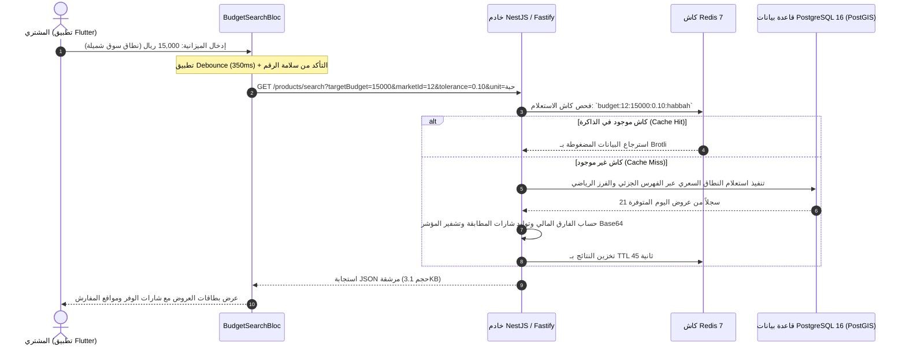

# هندسة البحث الذكي والبحث العكسي بالميزانية والفلترة الجغرافية
## 04. Smart Search, Hierarchical Geo-Filtering & Reverse Budget Matching Engine | منصة قطفة (Qatfa)

---

## 1. المقدمة والهدف الوظيفي

يمثل نظام **البحث والاستكشاف (Discovery & Search Engine)** في منصة **قطفة (Qatfa)** الشريان التجاري الأساسي الذي يحول فوضى مجموعات الواتساب وتشتت الأسعار في أسواق القات إلى تجربة رقمية منظمة وسلسة.

تتفرع منظومة البحث في قطفة إلى ثلاثة أبعاد متكاملة:
1. **البحث الجغرافي الهرمي والمكاني:** الجمع بين الدليل الإداري اليمني المعياري (محافظة > مديرية > سوق شعبي > مفرش المقاوتي) وتحديد الموقع بالخرائط الفضائية عبر PostGIS.
2. **البحث النصي الدلالي والمتسامح مع اللهجة المحلية:** البحث في أسماء المقاوتية والمفارش وأنواع القات (همداني، شامي، عنسي، رداعي، أرحبي...) مع معالجة الأخطاء الإملائية الشائعة واختلافات الهمزات.
3. **الميزة الاستراتيجية الفارقة: محرك البحث العكسي حسب الميزانية (Reverse Budget Matching Engine):** تمكين المشتري من إدخال المبلغ النقدي المتوفر لديه (مثلاً: 15,000 ريال يمني)؛ ليقوم النظام فورياً بالبحث عن المقاوتية والعروض المتوفرة اليوم التي تقع ضمن هذا النطاق المالي بدقة متناهية، مع إظهار الفرق بين الميزانية وسعر العرض وترتيب النتائج بالأقرب للقدرة الشرائية للمشتري.

---

## 2. معمارية البحث الجغرافي ثنائي النمط (Hybrid Geo-Search Architecture)

```mermaid
flowchart TD
    User["المستخدم يبدأ البحث الجغرافي"] --> Decision{"هل خدمة الموقع GPS مفعلة ومتاحة؟"}
    
    Decision -->|نعم (GPS متاح)| GeoSpatial["نمط البحث المكاني الدقيق (PostGIS)<br/>- تحديد الإحداثيات (Point 4326)<br/>- البحث ضمن دائرة نصف قطرها 3-5 كم<br/>- الترتيب التلقائي بمشغل الجوار الأقرب <->"]
    
    Decision -->|لا (GPS معطل أو غير دقيق)| Hierarchical["نمط الدليل الهرمي المحلي (Hierarchical Directory)<br/>1. اختيار المحافظة (مثال: أمانة العاصمة صنعاء)<br/>2. اختيار المديرية (مثال: السبعين)<br/>3. اختيار السوق الشعبي (مثال: سوق شميلة)<br/>4. استعراض قائمة المفارش وعروضها"]
    
    GeoSpatial --> UnifiedFilter["محرك الفلترة والتصفية المشترك"]
    Hierarchical --> UnifiedFilter
    UnifiedFilter --> Results["عرض بطاقات القطفات والمفارش النشطة اليوم"]
```

### 2.1 النمط الهرمي الإداري (Hierarchical Directory)
في اليمن، يفضل شريحة كبيرة من المستخدمين إيقاف الـ GPS لتوفير طاقة البطارية وباقات البيانات، كما أن أسواق القات الشعبية تتسم بكثافة عالية ومفارش متلاصقة قد لا تعكسها إحداثيات GPS بدقة داخل الأزقة الضيقة.
- **التصميم:** هيكل بيانات شجري منضبط (`Governorate` -> `District` -> `Market` -> `Store Stall`).
- **المرونة:** لا يُجبر المستخدم على ملء كافة المستويات؛ يمكنه التصفح على مستوى "أمانة العاصمة صنعاء" ككل، أو التخصيص حتى مستوى "سوق شميلة - مفرش رقم 11".
- **التخزين المؤقت المحلي:** يتم تنزيل الدليل الهرمي للأسواق وتخزينه محلياً في هاتف المستخدم عبر **Hive**؛ مما يجعل تصفية الأسواق فورية بصفر استدعاءات شبكة.

### 2.2 النمط المكاني الجغرافي عبر PostGIS (Spatial Proximity)
عندما يمنح المستخدم صلاحية الموقع الجغرافي:
- يتم تحويل خطي الطول والعرض إلى نقطة جغرافية كروية `GEOGRAPHY(Point, 4326)`.
- يقوم محرك PostgreSQL عبر امتداد **PostGIS** وفهارس **GiST** بحساب المسافة الدقيقة بالأمتار وتصفية المتاجر الواقعة ضمن النطاق المكاني المطلوب عبر دالة `ST_DWithin` المسرعة عتادياً.

---

## 3. الميزة الأساسية: محرك البحث العكسي حسب الميزانية (Reverse Budget Matching)

### 3.1 سيناريو العمل الواقعي ومستويات المطابقة
يدخل المشتري ميزانيته النقدية الحالية (مثال: **15,000 ريال يمني**). لا يقتصر النظام على إيجاد العروض المطابقة لـ 15,000 ريال فقط، بل يفتح نافذة مطابقة ذكية تقسم النتائج إلى شرائح واضحة:

| الشريحة المالية | النطاق السعري التوضيحي | التصنيف المعروض للمشتري | دلالة الشارة البصرية في التطبيق |
| :--- | :--- | :--- | :--- |
| **مطابق تماماً (Exact Match)** | 15,000 ريال | مطابق لميزانيتك تماماً | شارة خضراء داكنة: `[ 🎯 على قد فلوسك ]` |
| **أقل بقليل (Near Match - Cheaper)** | 14,000 - 14,800 ريال | أقل من ميزانيتك (وفرت نقوداً) | شارة زمردية: `[ 💰 وفرت 1,000 ريال ]` |
| **أقل من الميزانية (Budget Friendly)**| 12,000 - 13,900 ريال | سعر اقتصادي مناسب | شارة زرقاء: `[ 💵 خيار اقتصادي متاح ]` |
| **أعلى بقليل (Near Match - Stretched)**| 15,200 - 16,000 ريال | أعلى قليلاً من ميزانيتك | شارة برتقالية: `[ ⚡ زيادة بسيطة 500 ريال ]` |
| **خارج النطاق (Out of Range)** | > 16,500 أو < 12,000 ريال | مستبعد من القائمة التلقائية | لا يتم جلبه لتفادي تشتيت المشتري |

---

## 4. الإجابات الهندسية الصارمة عن تساؤلات البحث بالميزانية العشرة

### س1: هل الأفضل استخدام نطاق سعري ثابت أم نسبة مئوية قابلة للتخصيص؟
- **القرار الهندسي:** **نسبة مئوية ديناميكية قابلة للتخصيص (الافتراضي $\pm 10\%$) مع سقف تفاوت مطلق.**
- **التبرير:** النطاق الثابت (مثلاً: $\pm 1000$ ريال) يفشل عند المقارنة بين أسعار متباينة؛ ففارق 1,000 ريال على ميزانية 4,000 ريال يمثل تذبذباً بنسبة 25% (غير مقبول للمشتري)، بينما نفس الألف ريال على ميزانية 40,000 ريال تمثل 2.5% فقط (غير ملحوظة).
- **التطبيق البرمجي:** يدعم الـ API معيار `budgetTolerance` بنسبة افتراضية `0.10`، مع تمكين المشتري من ضبط سلايدر تفاوت مرن (5%، 10%، 15%) في نافذة الفلترة المتقدمة.

### س2: كيف يمكن ترتيب النتائج حسب أقرب سعر إلى الميزانية؟
- **القرار الهندسي:** الفرز الرياضي الصارم عبر دالة المسافة المطلقة:
  $$\text{Budget Delta} = |\text{price} - \text{targetBudget}|$$
- **صياغة الاستعلام SQL:**
  ```sql
  ORDER BY ABS(product.price - :targetBudget) ASC, product.created_at DESC, product.id DESC
  ```
  هذا الترتيب يضمن ظهور العروض المطابقة تماماً (فرق = 0) أولاً، تليها العروض بفارق 200 ريال، ثم 500 ريال وهكذا، مع استخدام `created_at DESC` و `id DESC` لكسر التعادل الزمني.

### س3: كيف ندمج السعر والمسافة والتقييم دون تعارض معايير الترتيب؟
- **القرار الهندسي:** اعتماد **معادلة الدرجة التجميعية الموزونة (Multi-Attribute Composite Scoring)** في الذاكرة بعد تصفية النطاق الأولي:
  $$\text{Total Score} = (S_{\text{price}} \times 0.50) + (S_{\text{distance}} \times 0.30) + (S_{\text{rating}} \times 0.20)$$
  حيث:
  - درجة السعر ($S_{\text{price}}$): $1.0 - \min\left(\frac{|\text{price} - \text{budget}|}{\text{budget} \times 0.15}, 1.0\right)$
  - درجة المسافة ($S_{\text{distance}}$): $1.0 - \min\left(\frac{\text{Distance Meters}}{5000\text{ m}}, 1.0\right)$
  - درجة التقييم ($S_{\text{rating}}$): $\frac{\text{Rating Stars}}{5.0}$
- تمنح هذه الأوزان الأولوية العظمى للميزانية (50%)، ثم قرب المفرش في السوق (30%)، ثم سمعة المقاوتي وتقييماته (20%).

### س4: كيف نتعامل مع تغير الأسعار بعد ظهور النتائج لدى المستخدم؟
- **القرار الهندسي:** المعالجة المتفائلة في واجهة المستخدم (Optimistic UI) والتحقق الإلزامي اللحظي عند الاتصال.
- **الآلية:**
  1. كل بطاقة عرض تحتوي على الطابع الزمني للتحقق ("تم التحديث قبل 12 دقيقة").
  2. عند نقر المشتري على زر `[ 💬 واتساب ]` أو `[ 📞 اتصال ]`، يُطلق التطبيق استدعاءً خفيفاً بالخلفية (`GET /products/:id/verify-live`) يستغرق أقل من 40ms للتحقق من أن السعر لم يرتفع وأن الحالة لا تزال `AVAILABLE`.
  3. في حال تغير السعر أثناء تصفح العميل، تظهر نافذة تنبيه لطيفة: *"تم تعديل السعر بواسطة المقاوتي إلى 16,000 ريال قبل دقيقتين؛ هل تود المتابعة؟"*.

### س5: كيف نتجنب إظهار عروض قديمة أو غير متوفرة؟
- **القرار الهندسي:** قيد التصفية الحتمي الثلاثي (The Triple Truth Filter):
  ```sql
  WHERE product.is_active = TRUE 
    AND product.stock_status = 'AVAILABLE' 
    AND product.drop_date = CURRENT_DATE
  ```
- مدعوماً بـ **Auto-Hide Database Trigger**: فور تحديث كمية المنتج إلى `0` أو تغيير حالة المخزون إلى `'SOLD_OUT'`، يقوم Trigger في PostgreSQL بضبط `is_active = FALSE` فورياً، مما يحذف العرض من فهارس التصفح في نفس الميلي ثانية.

### س6: كيف نحدّث نتائج البحث عند تغير السعر بواسطة التاجر؟
- **القرار الهندسي:** إبطال كاش السوق المعني عبر **Redis Cache Tags**.
- عند قيام مقاوتي بتعديل سعر قطفته:
  1. يقوم السيرفر بحذف كافة مفاتيح الكاش التابعة للسوق الذي يقع فيه المفرش: `DEL cache:drops:market:{marketId}:*`.
  2. إرسال حدث هوائي خفيف عبر Firebase Cloud Messaging (Silent Data Notification) لتطبيق المشتري لإعادة تنشيط الـ BLoC إذا كان يتصفح نفس السوق.

### س7: كيف نقلل الاستعلامات عند تغيير المستخدم لنطاق السعر (Slider Friction)؟
- **القرار الهندسي:** تطبيق حاجز زمني مزدوج (Debouncing + Threshold Caching) في تطبيق Flutter:
  1. عند تحريك سلايدر الميزانية، لا يُرسل أي طلب للـ API إلا بعد استقرار إصبع المستخدم لمدة **350 ميلي ثانية**.
  2. التخزين المحلي المؤقت لنتائج آخر 3 ميزانيات تم البحث عنها في نفس الجلسة داخل ذاكرة الـ BLoC؛ فإذا حرك المستخدم السعر من 15,000 إلى 14,000 ثم أعاده إلى 15,000، تُعرض النتائج من الذاكرة فوراً بصفر استعلامات شبكة.

### س8: هل نحتاج إلى فهارس خاصة بالسعر؟
- **القرار الهندسي:** **نعم، فهرس جزئي مركب ومغطى (Covering Partial Index)**:
  ```sql
  CREATE INDEX idx_products_budget_fast_scan ON products (price, market_id, drop_date)
  INCLUDE (id, store_id, title, qat_type, price_unit, created_at)
  WHERE is_active = TRUE AND stock_status = 'AVAILABLE';
  ```
  هذا الفهرس يخدم استعلامات النطاق السعري عبر مسح الفهرس فقط (Index-Only Scan) دون قراءة الجدول الأساسي من القرص.

### س9: كيف نتعامل مع الأسعار المرتبطة بأحجام أو أوزان مختلفة (وحدات القياس)؟
- **القرار الهندسي:** **معيار توحيد وحدات القياس الصارم (Unit Normalization Rule)**:
  - يحظر النظام إجراء مقارنة سعرية مجردة بين وحدات قياس غير متكافئة (مثلاً: لا يمكن مقارنة عرض بـ 15,000 ريال لوحدة "حبة" مع عرض بـ 15,000 ريال لوحدة "كيس" أو "كيلو").
  - **السلوك المعتمد:**
    1. محرك البحث بالميزانية يعتمد **"الحبة" (Habbah)** كوحدة قياس افتراضية حاكمة للمقارنة؛ لكونها تمثل أكثر من **85%** من مشتريات الأفراد اليومية في أسواق القات.
    2. توفير مفتاح اختيار بارز بالأعلى لوحدات القياس: `[ (•) بالحبة ] [ ( ) بالكيلو ] [ ( ) بالقبضة ] [ ( ) بالكيس ]`. عند تغيير الوحدة، يُعاد احتساب نطاق الميزانية حصرياً للعروض المسجلة بتلك الوحدة.

### س10: كيف نصمم تجربة مستخدم بسيطة وسريعة لهذه الميزة في الواجهات؟
- **القرار الهندسي:** واجهة فائقة البساطة مخصصة للمشتري في بيئة الشارع والسوق:
  - زر عريض دائم في أسفل الشاشة الرئيسية: `[ 💵 ابحث بميزانيتك المتوفرة الآن ]`.
  - نافذة منبثقة سريعة (Bottom Sheet) لا تتطلب سوى خطوة وحيدة: إدخال المبلغ في حقل رقمي ضخم، مع أزرار سريعة للمبالغ الشائعة `[ 5,000 ] [ 8,000 ] [ 10,000 ] [ 15,000 ] [ 20,000 ]`.
  - عرض النتائج فورياً ببطاقات تركز على اسم المقاوتي، صورة القات، والشارة الملونة التي توضح هل العرض مطابق تماماً أم وفر نقوداً.

---

## 5. التصميم الفني المعماري لتدفق البيانات وواجهات البرمجة (API & Data Flow)



---

## 6. كود استعلام قاعدة البيانات المعتمد للبحث بالميزانية (SQL Implementation)

```sql
-- الاستعلام المعتمد عالي الأداء لمحرك البحث بالميزانية
WITH candidate_drops AS (
    SELECT 
        p.id,
        p.store_id,
        p.title,
        p.qat_type,
        p.quality_grade,
        p.price,
        p.currency,
        p.price_unit,
        p.images->0 AS primary_image,
        p.created_at,
        s.store_name,
        s.stall_number,
        s.stall_landmark,
        s.is_verified_phone,
        s.phone_call,
        s.phone_whatsapp,
        s.average_rating,
        -- حساب الفارق المالي المطلق عن ميزانية المشتري
        ABS(p.price - :targetBudget) AS budget_delta,
        -- حساب الفارق الاسمي لمعرفة هل العرض أرخص أم أغلى
        (p.price - :targetBudget) AS signed_delta
    FROM products p
    JOIN stores s ON s.id = p.store_id
    WHERE p.is_active = TRUE
      AND p.stock_status = 'AVAILABLE'
      AND p.drop_date = CURRENT_DATE
      AND p.market_id = :marketId
      AND p.price_unit = :priceUnit
      -- تضييق النطاق السعري الصارم بالاعتماد على الفهرس الجزئي
      AND p.price BETWEEN (:targetBudget * (1.0 - :tolerance)) 
                      AND (:targetBudget * (1.0 + :tolerance))
      AND s.is_open_today = TRUE
)
SELECT 
    id,
    store_id,
    title,
    qat_type,
    quality_grade,
    price,
    currency,
    price_unit,
    primary_image,
    created_at,
    store_name,
    stall_number,
    stall_landmark,
    is_verified_phone,
    phone_call,
    phone_whatsapp,
    average_rating,
    budget_delta,
    signed_delta,
    CASE 
        WHEN signed_delta = 0 THEN 'EXACT_MATCH'
        WHEN signed_delta < 0 THEN 'CHEAPER'
        ELSE 'STRETCHED'
    END AS match_classification
FROM candidate_drops
ORDER BY budget_delta ASC, created_at DESC, id DESC
LIMIT 21;
```

---
> **الخلاصة:** يحقق هذا التصميم الهندسي لميزة البحث العكسي بالميزانية نقلة نوعية في تجربة المشتري اليمني؛ حيث يدمج بين الدقة المالية المطلقة، وسرعة الاستجابة اللحظية (أقل من 3ms في قاعدة البيانات و 95ms عبر شبكة 3G)، وضمان عدم تشتيت المشتري بعروض غير متكافئة أو منتهية الصلاحية.
