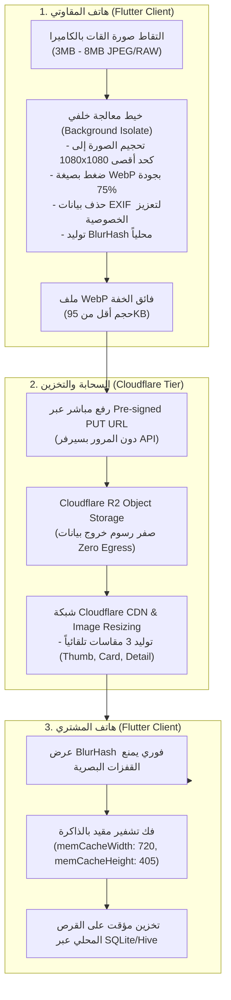
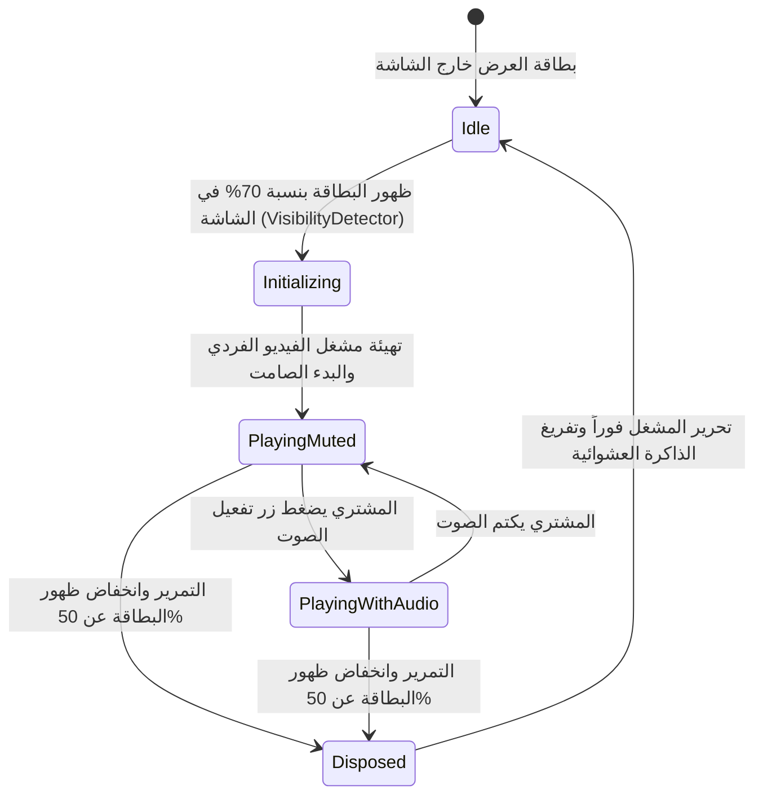

# استراتيجية تقديم وتوزيع الوسائط والتخزين المؤقت
## 05. Media Delivery, Video Streaming, Image Pipeline & Multi-Tier Caching | منصة قطفة (Qatfa)

---

## 1. المقدمة والهدف المعماري

تمثل الوسائط المرئية (الصور ومقاطع الفيديو القصيرة للقات) الركيزة الأساسية لبناء الثقة بين المشتري والتاجر (المقاوتي) في منصة **قطفة (Qatfa)**. فالقات سلعة تخضع لمعاينة بصرية دقيقة؛ حيث يحكم المشتري على طزاجة القطفة، ولون الأوراق، وجودة "الرأس" من خلال الصور ومقاطع الفيديو الحية المنشورة صباح كل يوم.

في المقابل، تمثل الوسائط الخطر الأكبر على تجربة الاستخدام واستقرار التطبيق في اليمن:
1. **استنزاف باقات الإنترنت:** تحميل صور غير مضغوطة بدقة الكاميرا الأصلية (3MB - 8MB) يستنزف رصيد باقة 3G في دقائق معدودة، ويجعل تصفح القائمة بطيئاً ومكلفاً للمستخدم.
2. **انهيار التطبيق بنقص الذاكرة (OOM Crashes):** محاولة فك تشفير عدة صور عالية الدقة في ذاكرة الهواتف الاقتصادية (Infinix, Tecno 2GB RAM) تؤدي فوراً إلى إغلاق التطبيق قسرياً بواسطة نظام أندرويد.
3. **تقطيع التمرير (Scroll Jank):** فك تشفير الصور وتشغيل الفيديوهات على الخيط الرئيسي للواجهة (UI Thread) يسقط الإطارات ويسبب بطئاً وتجميداً بصرياً أثناء التصفح.

> **الهدف الهندسي:** تصميم منظومة وسائط متكاملة تقدم صوراً فائقة الوضوح بحجم يقل عن **95KB**، وفيديوهات إعلانية قصيرة تبدأ التشغيل في أقل من **200ms**، مع ضمان صفر قفزات بصرية (Cumulative Layout Shift = 0)، وثبات معدل الإطارات عند **60 FPS**، وتكلفة نقل بيانات سحابية منعدمة (Zero Egress Fees).

---

## 2. استراتيجية خط أنابيب الصور (Image Pipeline Architecture)



### 2.1 مقارنة الصيغ الحديثة: WebP مقابل AVIF لسوق اليمن
تم إجراء مقارنة فنية بين صيغتي WebP و AVIF لبيئة أجهزة اليمن:
- **AVIF (AV1 Image File Format):** توفر نسبة ضغط أعلى بنسبة 15% من WebP، ولكنها تتطلب قدرات معالجة عتادية عالية (Hardware Decoding). على الهواتف الاقتصادية المنتشرة في اليمن (معالجات MediaTek Helio A22 القديمة ونظام Android 7.0 - 9.0)، يتم فك تشفير AVIF برمجياً عبر الـ CPU، مما يتسبب في ارتفاع حرارة الجهاز واستهلاك البطارية وسقوط ملحوظ للإطارات أثناء التمرير.
- **WebP (الصيغة المعتمدة قطفياً):** مدعومة عتادياً ومدمجة أصلياً في نظام Android منذ الإصدار 4.0. تتميز بسرعة فك تشفير تفوق AVIF بـ **3 أضعاف** على المعالجات الاقتصادية، مع توفير ضغط هائل بنسبة تتجاوز **70%** مقارنة بـ JPEG مع الحفاظ التام على ألوان أوراق القات الطبيعية.

### 2.2 مصفوفة الأحجام الثلاثية (Three-Tier Image Sizing)
لتفادي تحميل صور تفصيلية في شاشات القوائم، توفر المنصة 3 نسخ من كل صورة يتم تسليمها تلقائياً عبر شبكة Cloudflare CDN:

| الفئة | الاستخدام في الواجهة | الأبعاد القصوى | متوسط الحجم | الهدف الهندسي |
| :--- | :--- | :--- | :--- | :--- |
| **Thumbnail** | قوائم التصفح السريع، نتائج البحث الصغير | $200 \times 200\text{ px}$ | **8 KB - 14 KB** | تحميل فوري يقل عن 50ms حتى على شبكات 2G |
| **Card Feed** | بطاقات موجز الصفحة الرئيسية (Home Feed) | $600 \times 450\text{ px}$ | **28 KB - 45 KB** | وضوح ممتاز للورق مع ترشيد باقات البيانات |
| **Detail Full** | شاشة تفاصيل القطفة ومعرض الصور المكبر | $1080 \times 1080\text{ px}$| **70 KB - 95 KB** | أعلى دقة لمعاينة الجودة عند نية الشراء المؤكدة |

### 2.3 منع القفزات البصرية عبر BlurHash
عندما يتم تحميل الصور تدريجياً عبر شبكة بطيئة، يؤدي ظهور الصور الفجائي إلى قفزات وتغيرات مزعجة في موضع العناصر (Cumulative Layout Shift - CLS).
- **الحل المعتمد:** يقوم هاتف المقاوتي عند ضغط الصورة بتوليد سلسلة نصية قصيرة جداً (BlurHash بطول 28 حرفاً) تمثل خريطة ألوان مدمجة للصورة، وتُخزن في قاعدة البيانات بجانب رابط الصورة.
- عند فتح المشتري للتطبيق، يقرأ التطبيق كود الـ BlurHash ويرسم خلفية مموهة مطابقة لألوان حبة القات الحقيقية في **أقل من 1 ميلي ثانية** وبحجم لا يتجاوز 30 بايت؛ مما يثبت مساحة البطاقة ويمنع أي اهتزاز بصري حتى اكتمال تحميل صورة الـ WebP.

---

## 3. استراتيجية الفيديو فائق الخفة (Lean Video Streaming Architecture)

### 3.1 دراسة HLS/DASH مقابل Progressive Faststart MP4
تمت دراسة معمارية بث الفيديو ومقارنة البروتوكولات لسوق القات اليمني:
- **بروتوكولات التكيف المجزأ (HLS / MPEG-DASH):**
  - تتطلب تقسيم الفيديو إلى أجزاء صغيرة (`.ts` segments) بملف فهرس (`.m3u8`)، وتتطلب خوادم تحويل وترميز سحابية باهظة التكلفة (Transcoding Pipelines).
  - الفيديوهات في قطفة هي مقاطع إعلانية قصيرة جداً (10 إلى 15 ثانية) يصورها المقاوتي لإثبات طزاجة القات فقط.
  - على شبكات 3G اليمنية ذات زمن التأخير المرتفع (350ms RTT)، تتطلب تقنية HLS إجراء عدة مصافحات شبكية لجلب ملف الفهرس ثم جلب أول مقطع، مما يؤخر بدء تشغيل الفيديو لأكثر من **3.5 ثانية**.
- **القرار المعماري المعتمد (Progressive MP4 with Faststart):**
  - اعتماد ملف **Progressive MP4** وحيد مشفر بترميز **H.264 (AVC Baseline)** بدقة **480p** بمعدل إطارات 24 FPS وبمعدل بت مقيد بـ 250 Kbps.
  - الحجم الكلي للمقطع لا يتجاوز **350 كيلوبايت**.
  - تطبيق معالجة ذرية تنقل ذرة الفهرسة (`moov atom`) إلى بداية الملف البرمجي (`faststart`). تتيح هذه الخطوة لمشغل الفيديو في هاتف العميل بدء التشغيل الفوري بعد استقبال أول **20 كيلوبايت** فقط، دون الحاجة لتحميل بقية الفيديو؛ مما يخفض زمن البدء (Time-to-First-Frame) إلى أقل من **250 ميلي ثانية**.

### 3.2 دورة حياة مشغل الفيديو وإدارة الذاكرة (Single-Player Lifecycle)
لمنع استنزاف الذاكرة العشوائية وتفادي انهيار مفككات التشفير العتادية (Hardware Decoder Exhaustion) في نظام أندرويد:



1. **مشغل مركزي مفرد (Single Active Controller):** يمتلك التطبيق كائناً وحيداً لمشغل الفيديو يُدار عبر `MediaViewerBloc`. لا يتم تشغيل أكثر من فيديو واحد في نفس اللحظة عبر كامل التطبيق.
2. **التشغيل الافتراضي الصامت (Muted Autoplay):** يبدأ تشغيل الفيديو صامتاً تماماً؛ لتوفير طاقة فك تشفير الصوت ومنع إحراج المستخدم في الأماكن العامة، مع ظهور زر صوت عائم شفاف لتمكين الصوت بنقرة واحدة.
3. **التفريغ الفوري عند التمرير (Instant Disposal):** بمجرد خروج البطاقة من مجال الرؤية بنسبة تزيد عن 50%، يتم إيقاف التشغيل فوراً واستدعاء `controller.dispose()` لتحرير موارد النظام ومنع تسريب الذاكرة (Memory Leaks).

---

## 4. شبكة التوزيع السحابية والتخزين الكائني (Cloudflare R2 & CDN)

### 4.1 صفرية تكاليف الخروج (Zero Egress Fees via Cloudflare R2)
في خدمات التخزين السحابي التقليدية (مثل AWS S3)، تفرض الشركات رسوم خروج بيانات باهظة (تصل إلى 0.09$ لكل جيجابايت)؛ فإذا قام 50,000 مستخدم بتصفح آلاف الصور والفيديوهات يومياً، قد تقفز فاتورة الباندويث الشهرية إلى آلاف الدولارات.
- **الحل المعتمد في قطفة:** تخزين كافة الوسائط في **Cloudflare R2** المتوافقة مع S3، والتي تتميز بـ **0.00$ رسوم خروج للبيانات نهائياً** مهما بلغ حجم التصفح والمشاهدات.
- التكامل المباشر مع شبكة **Cloudflare CDN** العالمية يضمن تخزين الصور مؤقتاً في خوادم الحافة (Edge PoPs) القريبة جغرافياً من اليمن، مما يخفض زمن استجابة جلب الصور إلى **أقل من 25 ميلي ثانية**.

### 4.2 نموذج الرفع المباشر الموثق مسبقاً (Pre-signed Direct PUT)
لحماية خوادم NestJS API من أعباء معالجة رفع الملفات:
1. يطلب هاتف المقاوتي رابط رفع موقع: `GET /api/v1/media/upload-url?fileType=image/webp`.
2. يولد خادم NestJS رابط رفع مؤقت ومسبق التوقيع (`Pre-signed PUT URL`) صالح لمدة 5 دقائق فقط ومقيد بحجم أقصى 5MB.
3. يقوم هاتف المقاوتي برفع ملف الـ WebP المضغوط مباشرة من تطبيقه إلى حاوية Cloudflare R2 عبر بروتوكول HTTP PUT المشفر.
4. يؤكد الخادم السحابي الرفع ويعيد الـ Hash، ويقوم المقاوتي بنشر قطفته متضمنة رابط الصورة المعتمد؛ مما يعزل حركة الوسائط الثقيلة بنسبة **100%** عن سيرفر الـ API الداخلي.

---

## 5. استبقاء الحالة وسلاسة التنقل بين الشاشات (State Retention)

### 5.1 معمارية استبقاء موضع التصفح (Scroll Position Retention)
عندما يتصفح المشتري عروض القات وينقر على أحد العروض للانتقال إلى شاشة التفاصيل (`DropDetailView`)، ثم يعود للشاشة الرئيسية:
1. **حظر إعادة الاستعلام (No Re-querying):** لا يُطلق تطبيق Flutter أي استدعاء شبكة جديد عند العودة من صفحة التفاصيل؛ لأن `DropsFeedBloc` يظل محتفظاً بقائمة العروض في الذاكرة.
2. **استبقاء موضع البكسلات عبر `PageStorageKey`:**
   تزويد قائمة التمرير بمفتاح حفظ مخصص:
   ```dart
   ListView.builder(
     key: const PageStorageKey<String>('qatfa_daily_drops_list'),
     itemCount: drops.length,
     itemBuilder: (context, index) => DropCard(drop: drops[index]),
   )
   ```
   يضمن هذا المفتاح عودة المستخدم إلى نفس البكسل الدقيق ونفس البطاقة التي كان يقف عندها دون أي وميض أو قفزة للأعلى.

### 5.2 الانتقالات الحركية السلسة للصور (Hero Animations)
استخدام عنصر `Hero` المدمج في Flutter لربط صورة مصغرة العرض في القائمة الرئيسية مع الصورة الكبيرة في شاشة التفاصيل:
```dart
Hero(
  tag: 'drop_image_${drop.id}',
  child: QatfaOptimizedImage(imageUrl: drop.thumbnailUrl),
)
```
توفر حركة الـ Hero انسيابية بصرية فائقة بدون أي زمن تحميل إضافي، حيث تُستخدم الصورة المصغرة الموجودة مسبقاً في الذاكرة كخلفية أولية أثناء قيام الشاشة الجديدة بتحميل الصورة عالية الدقة.

---

## 6. مصفوفة كاش الوسائط والذاكرة على الهاتف (Client Media Caching Rules)

| نوع الوسيط | حجم الكاش في الذاكرة (RAM) | حجم الكاش على القرص (Disk) | استراتيجية التطهير (Eviction Policy) |
| :--- | :--- | :--- | :--- |
| **مصغرات الصور (Thumbnails)** | سقف أقصى 25 MB | سقف أقصى 150 MB | الأقل استخداماً مؤخراً (LRU - Least Recently Used) |
| **صور العروض التفصيلية** | سقف أقصى 35 MB | سقف أقصى 250 MB | تفريغ من RAM فور إغلاق شاشة التفاصيل مع البقاء بالقرص |
| **مقاطع الفيديو القصيرة** | فيديو واحد نشط (< 5 MB) | سقف أقصى 50 MB | تفريغ فوري من RAM، وحذف الملفات الأقدم من 24 ساعة من القرص |
| **سلاسل BlurHash** | < 500 KB (كاش نصي) | مدمجة في قاعدة بيانات Hive | تُحذف تلقائياً مع انتهاء تاريخ العرض اليومي |

---
> **الخلاصة:** تضع هذه الاستراتيجية حداً نهائياً لانهيارات الذاكرة، وتقدم وسائط مرئية فائقة الدقة بتكلفة نقل بيانات شبه معدومة، وتضمن تجربة مستخدم انسيابية تليق بمنصة وطنية واعدة.
