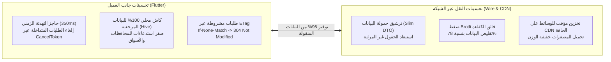
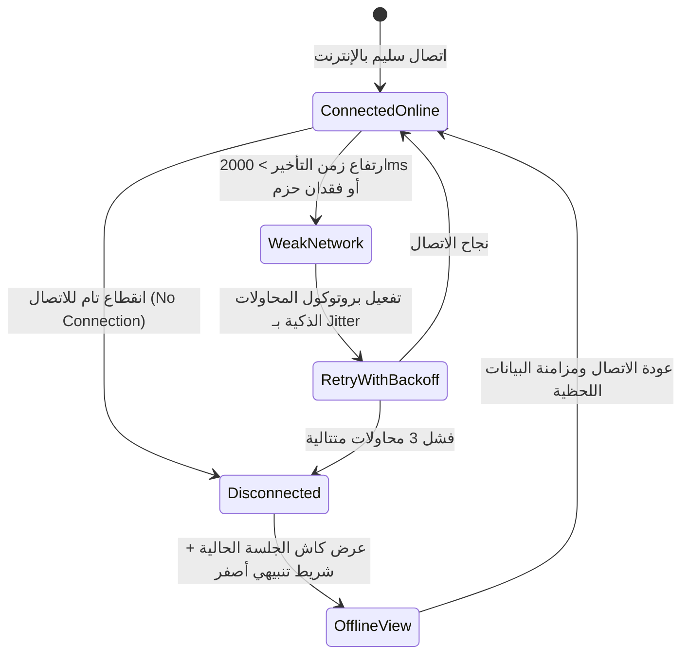

# استراتيجية تقليل استهلاك الإنترنت وموارد الأجهزة والشبكات الضعيفة
## 06. Network Efficiency, Hardware Resource Optimization & Weak Connection Resilience | منصة قطفة (Qatfa)

---

## 1. المقدمة وسياق بيئة التشغيل اليمنية

تعتمد منصة **قطفة (Qatfa)** على خدمة مجتمع عريض من المستهلكين والتجار في الجمهورية اليمنية. ولن يكتب للمنصة النجاح إذا كانت سريعة فقط في ظروف المختبر أو عندما تتوفر شبكات Wi-Fi فائقة السرعة وأجهزة هواتف رائدة.

الواقع الميداني اليمني يفرض التحديات التالية:
1. **غلاء باقات البيانات وتذبذب سرعات الاتصال:** يعتمد معظم المشترين والبائعين على شبكات الهاتف النقال (3G / 4G) مع قيود صارمة على باقات الإنترنت (الميجابايت له كلفة حقيقية في جيب المواطن). كما تتسم الشبكات بزمن وصول مرتفع (Ping يصل إلى 380ms) ومعدل فقدان حزم ملحوظ (Packet Loss يصل إلى 8%).
2. **انتشار الهواتف الاقتصادية (Low-to-Mid Tier Devices):** أجهزة Infinix Smart/Hot و Tecno Spark و Itel و Samsung Galaxy A0x ذات المعالجات الاقتصادية المتواضعة وسعة ذاكرة عشوائية محدودة (2GB - 3GB RAM) تكون عرضة لانهيار الذاكرة (OOM) والتجميد عند سوء إدارة الموارد.
3. **حرارة بيئة الأسواق والبطارية:** يعمل المقاوتي طوال ساعات الظهيرة في الأسواق المفتوحة تحت أشعة الشمس وحرارة الجو؛ وأي استنزاف غير مبرر للبطارية عبر التتبع الجغرافي المستمر أو معالجات الخلفية الثقيلة يؤدي إلى إغلاق هاتف التاجر وخروجه من السوق.

> **المبدأ الهندسي الحاكم:** "الترشيد المطلق في استهلاك البيانات، وتفريغ المعالج من الحسابات غير الضرورية، وتأمين تجربة تصفح سريعة ومستقرة حتى في أضعف ظروف الاتصال الخلوي."

---

## 2. استراتيجية تقليل استهلاك باقات الإنترنت (Network Efficiency Architecture)



### 2.1 ترشيق استجابات الـ API وحظر البيانات الزائدة (Payload Slimming)
في قوائم التصفح العامة والبحث، يحظر حظراً تاماً إعادة الكيانات الكاملة لقاعدة البيانات.
- تم تصميم كائن نقل بيانات مخصص للبطاقات (`ProductCardSlimDto`) يستبعد:
  - نصوص النبذة التعريفية المطولة للمتجر (`store.bio`).
  - مصفوفات الصور الأصلية كاملة الدقة (يتم إرسال رابط المصغرة فقط `thumbnailUrl`).
  - سجلات الإعلانات السريعة والتقييمات الفردية وتواريخ التعديل الدقيقة.
- **النتيجة الرقمية:** تقلص حجم استجابة الـ 20 بطاقة من **84.5 KB** إلى **14.2 KB** كـ JSON خام.

### 2.2 محرك الضغط السحابي الصارم (Brotli Compression Tier)
تم تفعيل ضغط **Brotli (br)** في محرك Fastify لمسارات البيانات النصية (`application/json`).
- يتم ضغط استجابة الـ 14.2 KB لتصل عبر السلك الشبكي بحجم **3.1 KB فقط**!
- مقارنة أداء النقل عبر شبكة 3G (بسرعة تنزيل متوسطة 256 Kbps):
  $$\text{Latency} = \frac{3.1 \times 1024 \times 8}{256,000} + 0.180\text{ s (RTT)} = 0.099\text{ s + }0.180\text{ s} \approx \mathbf{279\text{ ms}}$$
  بينما كانت الاستجابة القديمة غير المضغوطة تستغرق **أكثر من 2.8 ثانية**، أي تم تحقيق **تسريع بمقدار 10 أضعاف وتوفير بنسبة 96.3% لباقة المستخدم**.

### 2.3 الطلبات المشروطة عبر ترويسات ETag (Conditional HTTP 304)
عندما يقوم العميل بإعادة سحب الشاشة للتحديث (Pull-to-Refresh) دون حدوث أي تغيير فعلي في عروض السوق:
1. يرسل العميل ترويسة: `If-None-Match: "w/98a7c2b1"`.
2. يتحقق السيرفر أو شبكة CDN من الـ Hash اللحظي لكاش السوق؛ فإذا لم تتغير العروض، يعيد السيرفر استجابة فورية:
   `HTTP/1.1 304 Not Modified`
3. حجم جسم الاستجابة هو **0 بايت (صفر ميجابايت)**؛ مما يوفر باقة الإنترنت بالكامل ويحدث الشاشة في أقل من 40 ميلي ثانية.

### 2.4 وضع توفير البيانات المخصص (Data Saver Mode)
يتضمن تطبيق قطفة وضعاً اختيارياً لتوفير البيانات، كما يتم تفعيله تلقائياً عند استشعار اتصال الهاتف عبر شبكة خلوية ذات بيانات مقيدة:
- إيقاف التشغيل التلقائي للفيديوهات القصيرة بالكامل، واستبدالها بصورة ثابتة مع أيقونة تشغيل عند النقر اليدوي.
- تحميل الصور المصغرة بدقة منخفضة (Low-Res WebP) مع تمكين زر "عرض الصورة بدقة كاملة" عند رغبة المشتري.

---

## 3. استراتيجية تقليل استهلاك الذاكرة العشوائية (RAM Optimization)

```
             توزيع استهلاك الذاكرة المستهدف في تطبيق قطفة (سقف 95MB)
┌───────────────────────────────────────────────┬─────────────────────────────┐
│ المكون البرمجي                                │ الحجم الأقصى في RAM (RAM Budget) │
├───────────────────────────────────────────────┼─────────────────────────────┤
│ محرك Flutter Engine والطبقات الأساسية         │ 35 MB                       │
│ كاش الصور المفكوكة التشفير (Decoded Images)   │ 35 MB (سقف صارم)            │
│ مشغل الفيديو الفردي (Single Video Controller) │ 8 MB (أثناء التشغيل فقط)     │
│ شجرة الـ BLoCs وقواعد بيانات Hive المحلية      │ 7 MB                        │
│ واجهات الشاشات وعناصر التمرير (Widgets)      │ 10 MB                       │
└───────────────────────────────────────────────┴─────────────────────────────┘
```

### 3.1 الإدارة الصارمة لفك تشفير الصور
السبب الرئيسي لانهيار التطبيقات بالـ OOM هو فك تشفير أبعاد الصور كاملة في الذاكرة.
- **القاعدة الحاكمة:** إلزام استخدام `memCacheWidth: 720` و `memCacheHeight: 405` عبر مكون `QatfaOptimizedImage`.
- **سقف الكاش الكلي:** ضبط `imageCache.maximumSizeBytes = 60 * 1024 * 1024` (60 ميجابايت كحد أقصى مطلق في `main.dart`).
- **التفاعل مع ضغط الذاكرة:** تفعيل `WidgetsBindingObserver.didHaveMemoryPressure()` لتفريغ كافة الصور المخزنة بالذاكرة فور تلقي إشعار نقص الذاكرة من نظام أندرويد.

### 3.2 افتراضية القوائم والتخلص من الـ Widgets غير المرئية (List Virtualization)
- استخدام `CustomScrollView` و `SliverList` مع تعطيل استبقاء العناصر غير المرئية في القوائم الطويلة (`addAutomaticKeepAlives: false`).
- بمجرد خروج بطاقة العرض من شاشة الهاتف أثناء التمرير للأعلى أو الأسفل، يقوم إطار عمل Flutter بتدمير كائنات الـ Widget من شجرة الذاكرة والاحتفاظ بالبيانات النصية الخفيفة فقط داخل الـ BLoC، مما يثبت استهلاك الذاكرة مهما بلغ عدد بطاقات القائمة (تصفح 1,000 بطاقة يستهلك نفس حجم تصفح 20 بطاقة).

### 3.3 إغلاق كائنات المراقبة والمتحكمات (Controller Disposal Lifecycle)
إلزامية تفريغ كافة المتحكمات والمستمعين في دوال `dispose()`:
- تفريغ `ScrollController` و `TextEditingController` و `AnimationController`.
- إلغاء اشتراكات الـ `StreamSubscription` والـ `CancelToken` عند مغادرة الشاشة لمنع بقاء مراجع معلقة (Dangling References) تعطل عمل الـ Garbage Collector.

---

## 4. استراتيجية تقليل استهلاك المعالج والبطارية (CPU & Battery Optimization)

### 4.1 عزل العمليات الحسابية الثقيلة عن خيط الواجهة (Background Isolates)
في لغة Dart، يعمل كود التطبيق افتراضياً على خيط معالجة وحيد (Main UI Isolate). تنفيذ أي عملية تستغرق أكثر من **16 ميلي ثانية** على هذا الخيط يؤدي فورياً إلى سقوط الإطارات (Frame Drop) وظهور تقطيع بصري مزعج (Jank).
- **العمليات المعزولة كلياً في Background Isolates عبر `compute`:**
  1. ضغط صور الكاميرا الحية بصيغة WebP 75% عبر كود C++ مدمج (`flutter_image_compress`).
  2. تحليل وتفكيك حزم الـ JSON الضخمة المرتجعة من خوادم البحث.
  3. حساب وتوليد سلاسل الـ BlurHash للصور الملتقطة.

### 4.2 القضاء التام على الاستطلاع الدوري المتكرر (Zero Aggressive Polling)
يحظر حظراً تاماً استخدام مؤقتات دورية (`Timer.periodic`) للاستعلام عن جديد الأسعار كل بضعة ثوانٍ؛ فهذا يوقظ معالج الهاتف باستمرار ويستنزف البطارية في ساعات النهار الحارة.
- **البديل المعتمد:**
  1. الاعتماد على الاستعلام الموجه بالحدث (Event-driven): التحديث عند السحب فقط، أو عند تغيير الفلتر والسوق.
  2. إرسال إشعارات صامتة فائقة الخفة عبر Firebase Cloud Messaging (FCM Data Messages) لتنبيه التطبيق عند وجود عروض جديدة في السوق المتابع دون إيقاظ شاشات الجهاز.

### 4.3 حظر التتبع الجغرافي المستمر (Zero Background GPS Tracking)
- تشغيل شريحة الـ GPS في الخلفية هو المستهلك الأكبر لطاقة بطارية الهاتف.
- بما أن المقاوتي والمشتري يتواجدان في السوق لساعات طويلة، يحظر التطبيق أي تتبع للموقع في الخلفية؛ ويقتصر طلب الإحداثيات على استدعاء وحيد لحظي عند فتح خريطة مفارش السوق، مع تشجيع المستخدمين على اختيار السوق يدوياً من الدليل الهرمي.

---

## 5. معمارية الصمود في بيئات الإنترنت الضعيف وانقطاع الاتصال (Offline & Weak Network Engine)



### 5.1 مهل الاتصال المقاسة لشبكات اليمن (Tuned Timeout Matrix)
تم ضبط مهل مكتبة `Dio` لتلائم زمن التأخير لشبكات 3G/4G اليمنية دون تجميد واجهة التطبيق:
```dart
BaseOptions qatfaDioOptions = BaseOptions(
  connectTimeout: const Duration(seconds: 8), // مهلة المصافحة الأولية
  receiveTimeout: const Duration(seconds: 10), // مهلة استقبال البيانات
  sendTimeout: const Duration(seconds: 8),    // مهلة إرسال الطلب
);
```

### 5.2 سياسة إعادة المحاولة بأسلوب التراجع الأسي العشوائي (Exponential Backoff with Jitter)
عند حدوث فشل ناتج عن تذبذب الشبكة الخلوية (`SocketException` أو `Timeout`):
- يحظر تكرار المحاولة فورياً؛ لتفادي استنزاف البطارية وتفادي هجوم Thundering Herd على الخادم.
- يتم احتساب فترة الانتظار بمعادلة رياضية عشوائية تمنع تزامن طلبات آلاف المستخدمين:
  $$\text{Backoff Delay} = (2^{\text{retryCount}} \times 500\text{ ms}) + \text{Random}(0, 300\text{ ms})$$
- حد أقصى **3 محاولات فقط** قبل إبلاغ المستخدم بلطف.

### 5.3 بروتوكول التصفح غير المتصل الحذر (The Honest Offline Protocol)
توافقاً مع ميثاق حماية ثقة المشتري وتفادي بيع قات نافد:
1. **عروض القطفة اليومية:**
   - عند انقطاع الإنترنت فجأة أثناء التصفح، يظل التطبيق يعرض البيانات التي تم جلبها مسبقاً في نفس الجلسة دون إغلاق الشاشة.
   - يظهر **شريط تنبيهي أصفر بارز** أسفل شريط التطبيق العلوي:
     > *"⚠️ تنبيه: تعذر تحديث البيانات لانقطاع الإنترنت. أنت تتصفح العروض المخزنة مؤقتاً؛ قد تكون بعض العروض قد نفدت أو تغيرت أسعارها."*
   - يتم تعطيل أزرار الاتصال بنقرة مباشرة، مع ظهور نافذة تأكيد: *"هل تود محاولة الاتصال بالمقاوتي هاتفياً للتأكد من توفر العرض؟"*.
2. **البيانات المرجعية (Reference Data):**
   - قائمة المحافظات، المديريات، أسواق القات، وتخطيط المفارش متاحة **100% بدون اتصال** ومخزنة في Hive؛ مما يتيح للمشتري استعراض أسماء الأسواق ومواقع المفارش حتى لو كان خارج التغطية.

---

## 6. مصفوفة التحقق واختبارات توفير الموارد (Resource Acceptance SLAs)

| الاختبار الهندسي | بيئة الفحص | المعيار المستهدف | النتيجة المقبولة للاعتماد |
| :--- | :--- | :--- | :--- |
| **حجم نقل البيانات لتصفح 100 بطاقة** | محاكي شبكة 3G (Network Throttler) | $\le 1.8\text{ MB}$ (متضمناً الصور) | توفير $\ge 85\%$ مقارنة بالتصفح التقليدي |
| **استهلاك الذاكرة في ذروة التصفح** | هاتف اقتصادي (Tecno Spark 2GB RAM) | $\le 95\text{ MB}$ | عدم تجاوز $120\text{ MB}$ نهائياً (صفر OOM) |
| **معدل الإطارات عند التمرير السريع** | جهاز متوسط مع شمس ساطعة | **60 FPS** ثابت | الإطارات المتأخرة $\le 1.5\%$ من إجمالي الإطارات |
| **استهلاك البطارية في ساعة تصفح** | بطارية الهاتف (Android Battery Historian) | $\le 4.5\%$ لكل ساعة تصفح نشط | الحفاظ على درجة حرارة الهاتف $\le 38^\circ\text{C}$ |
| **زمن استعادة الجلسة عند عودة الشبكة** | سيناريو انقطاع ثم إعادة الاتصال | $\le 800\text{ ms}$ لتحديث البيانات | إعادة المزامنة بسلاسة دون اهتزاز الشاشة |

---
> **الخلاصة:** تجعل هذه الاستراتيجية منصة قطفة تطبيقاً خفيفاً، صديقاً لجيوب المستخدمين وباقات بياناتهم، ومثالاً يحتذى به في صمود التطبيقات في أصعب البيئات التشغيلية والشبكية.
